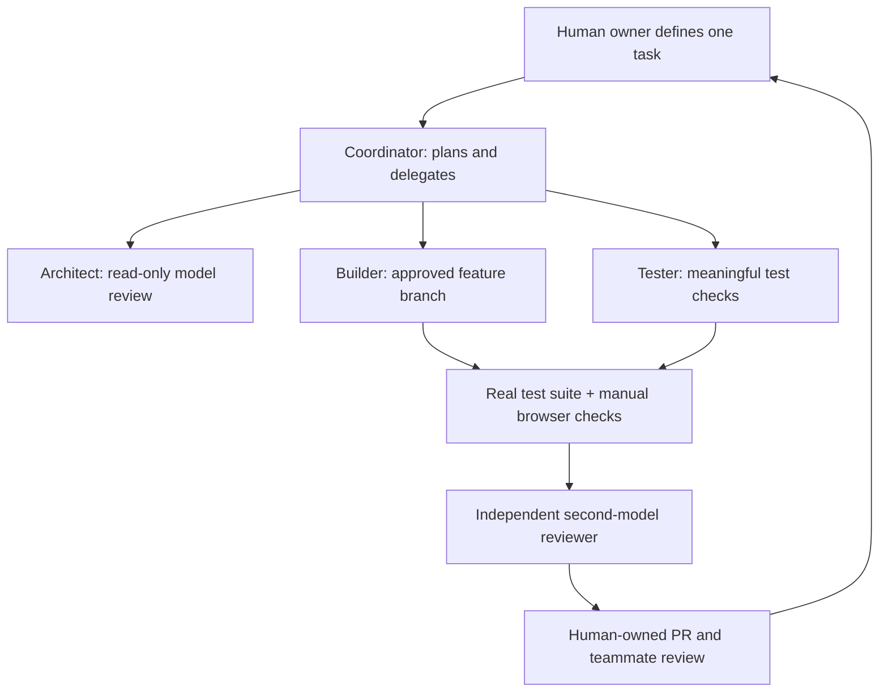

# SideQuest — Team Setup and Troubleshooting

This is a practical guide for working on the [SideQuest React project](README.md), which now lives on the default **`master`** branch. The old C++/Qt starter files are not required to run the app.

**Course P5 diagram:** [current selected Mermaid ER and notes](docs/MVP_TEAM_PLAYBOOK.md#p5-coursework-er-diagram--current-drawio-and-mermaid) · [editable draw.io file](https://drive.google.com/file/d/1gzbESV0y6hdACNoPJeH3hnO1zxFQ54Lv/view). It includes USER and AVAILABILITY_WINDOW for the coursework drawing; **do not add those tables to M2** unless the implementation contract and team agreement change.

## Install the tools

Install [VS Code](https://code.visualstudio.com/), [Git](https://git-scm.com/downloads), and [Node.js](https://nodejs.org/en/download) 24 (Node 22.12+ supported). Node includes `npm`.

In VS Code, open **Terminal → New Terminal** and check:

```bash
git --version
node --version
npm --version
```

If any command is missing, install that tool and restart VS Code.

## Clone and run

```bash
git clone https://github.com/haiiroWednesday/SideQuest-CSCI187.git
cd SideQuest-CSCI187/app
npm ci
npm run dev
```

Open the **Local** URL printed by Vite (often `http://localhost:5173/`).

If cloning a private repository fails, confirm that your GitHub account has accepted the collaborator invitation. If `npm ci` reports dependency errors, check that Node matches the version in `app/.nvmrc` and that `package-lock.json` is current. Avoid bypassing dependency checks with `--legacy-peer-deps` without team review.

## Update an existing clone

**Do not clone again** if you already have a local copy. From the repository folder:

```bash
git status
git branch --show-current
```

If you have uncommitted changes, preserve them before switching branches or pulling. Once your work is safe:

```bash
git fetch origin
git switch master
git pull --ff-only origin master
```

If `master` does not exist locally, use `git switch --track origin/master` after fetching. Then run `npm run dev` from `app/` and refresh the browser. GitHub updates do not automatically reach your laptop.

## Quick app check

1. Create **Art Workshop** at **Arts Building** on a chosen date, from **14:30** to **15:30**.
2. Search the same date with free time **14:00–16:00**. The event should match.
3. Search **15:45–17:00** instead. It should no longer match.
4. Refresh in the same browser to verify the event persists, and then remove it.

Events are saved in this browser's `localStorage`; teammates do not see each other's local events.

## Automated verification

From `app/`:

```bash
npm test
npm run build
npm run test:e2e
```

Our [React GitHub Actions workflow](.github/workflows/react-ci.yml) runs equivalent checks online. Student test examples and CI experiments are documented in [test appendix in the MVP playbook](docs/MVP_TEAM_PLAYBOOK.md#appendix--detailed-unit-testing-examples).

## Troubleshooting

- **Missing `dev` script:** run commands from `app/`, not the repository root.
- **Uncommitted changes block a switch or pull:** don't force it; save or coordinate your work first.
- **Site looks outdated:** check the current branch, pull `master`, restart Vite, and refresh.
- **Legacy C++ files appear:** they remain in the repository but are unrelated to the React build.
- **Avoid committing:** `node_modules/`, `dist/`, passwords, or API keys.

## Optional AI coding agents — choose by the work, not by what we installed first

**The team does not need Cline—or any paid agent—to complete M2.** Git, React/TypeScript, VS Code (or another editor), meaningful tests, continuous integration, and peer-reviewed PRs are the core development workflow. Agents help with implementation and reviews; humans must understand, test and approve their contributions. The [MVP Playbook](docs/MVP_TEAM_PLAYBOOK.md) is authoritative for the Event type, database strategy, roles and scope.

### The vocabulary

| Thing | What it is | What it is **not** |
| --- | --- | --- |
| **AI model (Claude, GPT, Gemini)** | An intelligence powering a session | A separate repository worker by itself |
| **Chat / API Playground** | Interface for asking and testing prompts | Automatically authorized to edit your local files |
| **Coding agent** | Model + repository/tool access + permissions + task context | Guaranteed correct code |
| **Subagent** | Independently instantiated specialist session, often with fresh context and different permissions/model | Just changing the system prompt or switching models |
| **Orchestrator** | Agent or workflow that delegates work and consolidates results | A GitHub branch or a model provider |
| **Git worktree** | Isolated checkout so independent agents avoid overwriting each other | Automatic review or merge resolution |
| **GitHub PR** | The reviewed change delivered to other teammates | A shared live conversation among agents |

**One agent with Claude then GPT remains one agent/session unless you explicitly start a second session or delegate.** A model selector alone doesn't create an adversarial reviewer. Separate agents do not magically see each other's conversations; they see approved files, branch changes, PRs, and delegated reports.

### Which tool should each person actually use?

| Option | Official product / documentation | Best use for SideQuest | Watch-outs |
| --- | --- | --- | --- |
| **OpenCode** | [Agents](https://docs.opencode.ai/docs/agents/) · [Providers](https://docs.opencode.ai/docs/providers/) | **Recommended for Cynthia's desired multi-provider team:** coordinator + per-agent model choice + specialized subagents | More configuration. Different providers may charge separately. |
| **Cursor** | [Parallel agents & worktrees](https://prod.cursor.com/docs/configuration/worktrees) · [Agents Window](https://cursor.com/changelog/3-0) | **Recommended for visual UI work:** design review, browser feedback, multiple isolated agent tasks in a graphical IDE | Separate subscription/usage limits; multiple agents cost more. |
| **Claude Code** | [Subagents](https://claude.com/resources/articles/subagents-in-claude-code) · [Getting started](https://docs.anthropic.com/en/docs/claude-code/getting-started) | Strong primary coding agent using Anthropic models and project-specific reviewer agents | Primarily Claude-focused; other providers need a separate integration. |
| **OpenAI Codex** | [Subagents](https://learn.chatgpt.com/docs/agent-configuration/subagents) · [Git worktrees](https://learn.chatgpt.com/docs/environments/git-worktrees) | Genuine independent GPT coding/review sessions; may be usable through eligible ChatGPT sign-in | Usage entitlements and quotas depend on account; sign-in isn't an OpenAI API key. |
| **Cline** | [Install paths](https://github.com/cline/cline/blob/main/docs/getting-started/installing-cline.mdx) · [Agent Teams](https://github.com/cline/cline/blob/main/docs/cli/agent-teams.mdx) | A useful VS Code coding agent if you already like it. CLI/Kanban can coordinate teams | **Agent Teams are not the ordinary VS Code extension workflow.** Do not make everyone install it. |

**Recommended initial choice:** Cynthia tests **OpenCode** as the mixed-model coordinator, with a dedicated second-model reviewer. Cursor is an alternative if UI convenience is the priority. Teammates can use Claude Code, Codex, Cursor, Cline, or no agent; the *same code contracts, Git/CI workflow and human review* apply to everyone.

### First use: one safe task before parallelism

1. Open the **SideQuest repository folder** (not a random file), follow the install/run steps above, and verify `npm test` and `npm run build` succeed within `app/`.
2. Protect uncommitted work before branching. From the repo root:

```bash
git status
git switch master
git pull --ff-only origin master
git switch -c feature/your-feature-yourname
```

3. Give the assistant this **read-only first task**:

> Read AGENTS.md, docs/MVP_TEAM_PLAYBOOK.md, and the current code for my assigned feature. Do not edit anything. Explain the exact data contract, files you would touch, dependencies on teammates, tests to add, and potential compatibility risks.

4. Once the plan matches your ownership and the agreed `CampusEvent` type, allow a **small feature patch**. Require approval for file edits and commands; forbid automatic merge, destructive Git operations, database reset, cloud deployment, and credential access.
5. Run real verification from `app/` (`npm test`, `npm run build`), inspect `git diff`, and manually check the screen. Have a **different session** review the code read-only. A human teammate reviews the GitHub PR before merge.

**A genuinely useful multi-agent flow:**



**Use separate worktrees/branches for simultaneous writers.** Three read-only reviewers can work in parallel, but three agents writing `App.tsx` in the same checkout will collide. Coordinator reports and independent reviews are useful only if they report specific defects or confirm measured behavior.

### Setup A — OpenCode, if you want Claude and GPT under one roof

1. Follow [OpenCode installation](https://opencode.ai/docs/) for the supported package manager/platform.
2. Open a terminal in the SideQuest repo and launch `opencode`. Use `/connect` to add providers. Anthropic API-key authentication uses your authorized Claude Console key; OpenAI may offer **Sign in with ChatGPT** for eligible plans. These are **separate authentication/billing mechanisms**, not shared credits. See [OpenCode providers](https://docs.opencode.ai/docs/providers/).
3. Use `/models` to select a currently available model rather than guessing a version. Start in the **Plan** agent before permitting code changes.
4. Add a separate `reviewer` or `test-reviewer` subagent in the project's OpenCode config/agent directory. Give it **read-only permissions** and, if available, a **different provider/model** from the builder. Use the official [custom agent guide](https://docs.opencode.ai/docs/agents/) for current syntax.
5. Ask the main agent to delegate a design audit, followed by a code review. Confirm the two subagents actually ran as separate sessions and inspect their outputs. Do not assume every @ mention launches parallel background work.

### Setup B — Cursor, if visual UI work is the priority

1. Install [Cursor](https://cursor.com/), open the existing SideQuest repository and verify app tests locally.
2. Open the **Agents Window**, which supports parallel agents. Use [worktrees](https://prod.cursor.com/docs/configuration/worktrees) so exploratory fixes don't overwrite your current feature branch.
3. For UI tasks, use Design Mode and point the agent at the actual rendered screen. Keep the interface contract in the prompt and require screenshots / browser checks.
4. Compare the outputs of separate agents, then bring back **one reviewed change**. Check current [pricing/usage](https://prod.cursor.com/help/account-and-billing/pricing) before launching multiple expensive sessions.

### Setup C — Claude Code, Codex, or Cline

- **Claude Code:** install using [Anthropic's guide](https://docs.anthropic.com/en/docs/claude-code/getting-started); authenticate with your eligible Claude account or authorized Console billing; create project specialists in `.claude/agents/` following the [current subagent instructions](https://claude.com/resources/articles/subagents-in-claude-code). The helper-agent creation UI has changed over time, so don't depend on an old wizard.
- **Codex:** use an eligible ChatGPT sign-in, its IDE/desktop tool, or [CLI](https://help.openai.com/en/articles/11369540-using-codex-with-your-chatgpt-plan); run review sessions in independent worktrees and confirm they read the current branch's changes. ChatGPT sign-in does not imply your OpenAI **API** account is billed.
- **Cline:** keep using it if installed and comfortable; the **gear inside the Cline panel** controls provider credentials. It supports Plan/Act but switching mode/model is not a real team. For true coordinated teams see [Cline CLI/Kanban](https://github.com/cline/cline/blob/main/docs/cli/agent-teams.mdx).

### Suggested SideQuest agent roles and ownership

| Human teammate | Real feature responsibility | Useful agent review |
| --- | --- | --- |
| **Cynthia** | Shared React components, information hierarchy, accessibility and discovery UX | Responsive design, keyboard/focus, interface contract, CSS duplication |
| **Devonny** | Catalog browsing and detail screens | Loading/empty/error states, event ID and source integrity |
| **Daven** | Posting, shared catalog, Supabase migrations and read/write adapter | Database constraints, anonymous permissions, cross-browser consistency |
| **Sembiyan** | Full-fit matching and device-local Schedule | Time boundary tests, duplicates, malformed storage, stable IDs |
| **Everyone** | Integration, PRs, build/tests, deliverables | Independent code reviewer and meaningful E2E tests |

A useful first multi-agent team is **four specialists total**: planner (read-only), builder (writer), test specialist (read-only or approved test edits), independent reviewer (preferably second model). Adding eight or twenty agents before the contracts and tests are stable can increase cost and confusion without improving correctness.

### Budget and security

- The team previously discussed Claude Console API credits; **check the remaining live balance and workspace permissions**, never assume the initial amount remains. Anthropic API billing and ChatGPT/Cursor subscriptions are different systems.
- Do not share API keys with teammates through chat or commit keys or `.env.local` files. Use individually authorized credentials and spending caps.
- Read permission prompts; an agent should not push, deploy, alter Supabase security, delete work, or merge PRs unless a human explicitly authorizes that action.
- The course's extra-credit [key rule](https://docs.google.com/document/d/12slKo80yu17NZw5nbrB0U1C_nj7mLq6h6uQoSbkCVQk/edit?usp=sharing) concerns the **deployed SideQuest application**; using an AI agent to write code does not itself count as AI API integration.
- Watch token costs: independent subagents each consume context. Use fewer agents with distinct roles, rather than paying several agents to repeat identical reviews.

### Troubleshooting

| Symptom | First check |
| --- | --- |
| Agent can't see repo | Open the correct local project folder and inspect its active branch |
| Can chat but can't edit code | Chat/Playground is not a coding agent, or the agent lacks tool permissions |
| Cline/Claude doesn't use expected credits | Verify actual provider, Console organization, and authentication method |
| OpenCode reviewer only uses the builder's model | Configure an explicit reviewer model and confirm provider is connected |
| Agents overwrite each other's files | Use separate worktrees/branches; don't run concurrent writers in one checkout |
| Agent says “tests passed” without evidence | Run `npm test`, `npm run build`, check CI and manually test UI |
| PR differs from the approved plan | Examine `git diff`, revert unintended edits; coordinate shared files |

**Documentation:** [OpenCode agents](https://docs.opencode.ai/docs/agents/) · [Cursor worktrees](https://prod.cursor.com/docs/configuration/worktrees) · [Claude Code subagents](https://claude.com/resources/articles/subagents-in-claude-code) · [Codex subagents](https://learn.chatgpt.com/docs/agent-configuration/subagents) · [Cline CLI Agent Teams](https://github.com/cline/cline/blob/main/docs/cli/agent-teams.mdx).
