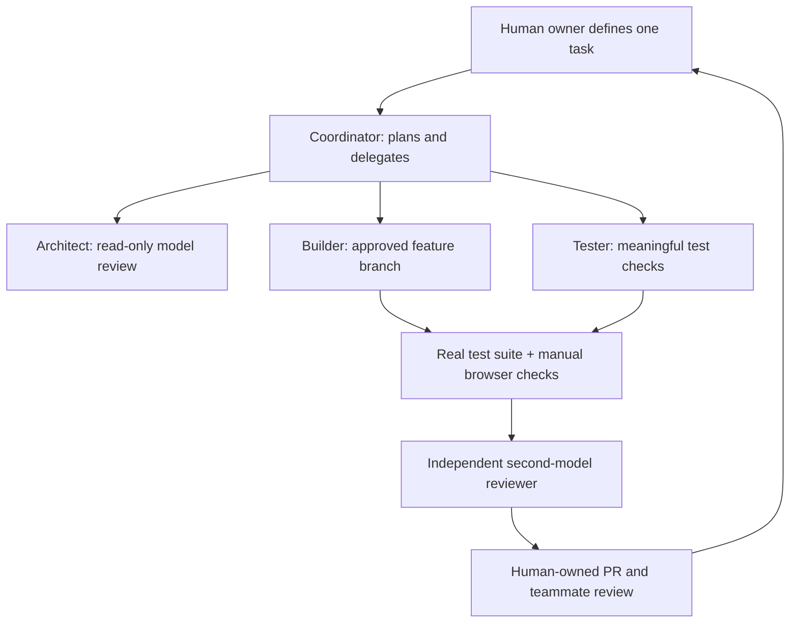

# SideQuest — Team Setup and Troubleshooting

This is a practical guide for working on the [SideQuest React project](README.md), which now lives on the default **`master`** branch. The old C++/Qt starter files are not required to run the app.

**Course P5 diagram:** [current selected Mermaid ER and notes](docs/MVP_TEAM_PLAYBOOK.md#p5-coursework-er-diagram--current-drawio-and-mermaid) · [editable draw.io file](https://drive.google.com/file/d/1gzbESV0y6hdACNoPJeH3hnO1zxFQ54Lv/view). It includes USER and AVAILABILITY_WINDOW for the coursework drawing; **do not add those tables to M2** unless the implementation contract and team agreement change.

## Install the tools

Install [VS Code](https://code.visualstudio.com/), [Git](https://git-scm.com/downloads), and [Node.js](https://nodejs.org/en/download) 24 (Node 22.12+ supported). Node includes `npm`.

In VS Code, open **Terminal → New Terminal** and check:

```bash
git --version
node --version
npm --version
```

If any command is missing, install that tool and restart VS Code.

## Clone and run

```bash
git clone https://github.com/haiiroWednesday/SideQuest-CSCI187.git
cd SideQuest-CSCI187/app
npm ci
npm run dev
```

Open the **Local** URL printed by Vite (often `http://localhost:5173/`).

If cloning the private repository fails, confirm that your GitHub account has accepted the collaborator invitation. If `npm ci` fails, inspect the actual dependency error instead of overriding peer-dependency checks.

## M2 shared Supabase setup in VS Code (server-only)

After cloning or pulling, the checked-in template `app/.env.example` is visible in VS Code. Make **your own** ignored `app/.env.local` in a terminal opened at `app/` with `cp .env.example .env.local`, then fill it locally with approved team values named `SUPABASE_URL` and `SUPABASE_PUBLISHABLE_KEY`. **Do not use the older `VITE_SUPABASE_*` variables**, commit keys, or send screenshots of local configuration. Restart `npm run dev` after setting them. See [M2 local Supabase setup](docs/SUPABASE_LOCAL_SETUP.md) for full instructions and the real two-browser acceptance test. Authorized collaborators can inspect GitHub without configuring the database; a live shared-data demonstration requires a configured server.

## Update an existing clone

**Do not clone again** if you already have a local copy. From the repository folder:

```bash
git status
git branch --show-current
```

If you have uncommitted changes, preserve them before switching branches or pulling. Once your work is safe:

```bash
git fetch origin
git switch master
git pull --ff-only origin master
```

If `master` does not exist locally, use `git switch --track origin/master` after fetching. Then run `npm run dev` from `app/` and refresh the browser. GitHub updates do not automatically reach your laptop.

## Quick M2 app check

1. Post **Art Workshop** with host name **SCU Art Club**, description **Bring materials**, location **Arts Building**, a valid future date, and **14:30–15:30**.
2. Search the same date with availability **14:00–16:00**. The posted catalog event should match; **15:45–17:00** should not match.
3. Choose **Plan to attend**, open **My Schedule**, refresh, and then **Remove from plans**. Verify the original post remains under **Posted events**.
4. Check the **Shared catalog not connected** warning. If it appears, this is a **browser-only fallback**, not a shared public project. To demonstrate cross-browser sharing, the owner must configure Supabase per [app/README.md](app/README.md) and verify Browser A's post is visible in independent Browser B.
5. Confirm an event with a long valid description, denied browser storage, an invalid date, and a failed catalog read behave sensibly. Do not assume tests establish live database permissions.

Personal plans always remain on the current device. The posting list is public across browsers **only when the shared Supabase connection is successfully configured**.

## Automated verification

From `app/`:

```bash
npm test
npm run build
npx playwright install chromium
npm run test:e2e
```

Our [React GitHub Actions workflow](.github/workflows/react-ci.yml) runs equivalent checks online. Student test examples and CI experiments are documented in [test appendix in the MVP playbook](docs/MVP_TEAM_PLAYBOOK.md#appendix--detailed-unit-testing-examples).

## Shared coding conventions

Use the same conventions in every contribution, regardless of which teammate owns the feature:

- **Structure:** Keep domain validation, event matching, time rules and storage adapters in `app/src/model/`. Controllers coordinate actions and convert failures into usable feedback; React Views render state and forward user actions.
- **Contracts:** Use the M2 `CampusEvent` and `EventDraft` contract from `model/eventCatalog.ts` for public records. Use `LegacyCampusEvent` from `model/events.ts` only for historical M1 compatibility and `ScheduleEvent` for saved-plan resolution. Translate SQL snake_case columns at the storage boundary.
- **Names and formatting:** Use descriptive camelCase variables, PascalCase components and types, two-space indentation, single-quoted imports and extensionless relative TypeScript paths. Prefer small, clearly named functions and option objects over several positional flags.
- **Behavior:** Treat campus dates/times as `America/Los_Angeles` in the M2 catalog. Keep planned event IDs device-local. Never present browser-only catalog data as shared. Preserve the distinction between missing records and failed requests.
- **Async work:** Prevent stale catalog and detail responses from replacing newer results, and clean up event listeners and timers when components unmount.
- **Comments and credit:** Explain constraints, invariants and non-obvious decisions. Avoid tutorials about ordinary syntax, decorative emoji and comments addressed to an instructor. Keep individual contributions visible through commits, PR descriptions and genuine review records.
- **Reviews:** Run `npm test`, `npm run build` and `npm run test:e2e` from `app/`. Verify every significant UI change on a narrow screen and with keyboard controls. Never claim that fixture-based tests prove live Supabase acceptance.

Run the shared style tools from `app/` before requesting review:

```sh
npm ci
npm run format           # Apply Prettier to authored app, tests, and development scripts.
npm run check:quality    # Check formatting, ESLint/React Hooks and course safeguards.
npm run build            # Verify strict TypeScript and production bundles.
```

CI also runs `format:check` and `lint`. Prettier enforces two spaces, single quotes,
no JavaScript statement-ending semicolons, and consistent CSS declaration layout.
The root EditorConfig covers the repository; historical C++ keeps four-space indentation.
Do not reformat the vendored `doctest.h`, generated lockfile, SQL migrations or asset files
with the web formatter. Keep intentional third-party and legacy boundaries labeled.

Use one focused refactor per behavior change, with tests proving preserved output.
A formatter cannot decide whether a name is meaningful or a function has too many responsibilities;
a teammate must review those judgments against the professor's Clean Code and Code Review slides.

Apply these standards to files you change. Historical fixtures and existing saved-event formats remain intact unless a migration is deliberately reviewed and tested.

## Troubleshooting

- **Missing `dev` script:** run commands from `app/`, not the repository root.
- **Uncommitted changes block a switch or pull:** don't force it; save or coordinate your work first.
- **Site looks outdated:** check the current branch, pull `master`, restart Vite, and refresh.
- **Legacy C++ files appear:** they remain in the repository but are unrelated to the React build.
- **Avoid committing:** `node_modules/`, `dist/`, passwords, or API keys.

## Optional AI coding agents — choose by the work, not by what we installed first

**The team does not need Cline—or any paid agent—to complete M2.** Git, React/TypeScript, VS Code (or another editor), meaningful tests, continuous integration, and peer-reviewed PRs are the core development workflow. Agents help with implementation and reviews; humans must understand, test and approve their contributions. The [MVP Playbook](docs/MVP_TEAM_PLAYBOOK.md) is authoritative for the Event type, database strategy, roles and scope.

### Use the team's Claude Console / Playground API credits in Cline or OpenCode (step by step)

**Who this is for:** SideQuest teammates who have explicit permission to spend the project owner's Claude Console **API** credits. This is a two-stage setup: the owner grants access in **Claude Console** and sets a cost limit; every teammate independently configures their coding agent. **The Playground is a web interface; the credits live on the Console organization's API billing balance.** Merely using a personal Claude account, Cline billing, Cursor subscription or ChatGPT account does not draw from that balance.

**Important credit distinction:** If these are **monthly promotional API credits bundled with Claude Max/Ultra/Team**, they cover Claude API requests (including Anthropic BYOK requests through Cline/OpenCode) and Console Playground, but **do not cover interactive Claude Code** in its terminal, IDE, desktop or web interfaces. Purchased prepaid API credits follow different rules. Confirm exactly which credit balance is available under [Console Billing](https://platform.claude.com/settings/billing) **before** enabling teammates. Included monthly credits expire at the billing-cycle boundary, do not roll over, and are shared across the linked organization.

#### A. Owner / Console administrator: grant the project access

1. **Confirm the correct organization and balance.** Sign in at [Claude Console](https://platform.claude.com/). Open [Billing](https://platform.claude.com/settings/billing) and record the available promotional/prepaid balance and expiry. If the intended monthly API credits have not been claimed yet, the eligible plan subscriber or Team owner can use their **claude.ai billing settings → API credits → Link organization** to select the intended Console organization. Avoid linking the wrong organization: changing it may require Anthropic support. If the Console account is an **individual account**, organization collaboration may need to be set up first.
2. **Check that further spending is controlled.** On Billing, inspect any prepaid balance, payment method and auto-reload/auto-purchase settings. Included credits are spent first, then purchased credits can be used; auto-reload can purchase more. If this is meant to be credit-only access, disable unwanted automatic purchases where your account permits, check whether an invoice arrangement applies, and set a conservative workspace spend limit. Do not assume the initial credit amount is still available.
3. **Create a separate SideQuest workspace.** Open [Workspaces](https://platform.claude.com/settings/workspaces) → **Create workspace**, name it `SideQuest-CSCI187`, and save. A dedicated workspace makes the project's API keys and usage easier to distinguish from personal experiments.
4. **Set an actual spending cap, plus alerts.** On Workspaces, select the new workspace → **Spend limits**. Set a monthly limit the owner is comfortable covering and configure the available spending alerts. The workspace limit is subject to the organization's broader limit; it cannot be larger. If necessary, use **Rate limits** to limit requests/tokens per minute. A shared workspace cap applies across all teammates using its API keys; it is **not a separate personal allowance for every student**.
5. **Invite teammates into the Console organization first.** Open [Members](https://platform.claude.com/settings/members) → **+ Invite**. Enter their individual email addresses, choose the least-privileged organization role that permits API-key creation (normally **Limited Developer**, if available), and send invitations. Teammates must accept their emailed invitations. Do **not** make them organization Admins or Billing admins just to use the API. If the Invite option is absent, the account may lack organization Admin permission or organization support.
6. **Add accepted members to the SideQuest workspace.** On Members, choose **Add to workspace** → select `SideQuest-CSCI187` → select the teammate → assign **Workspace Limited Developer** (or the lowest available role with API-key permissions) → confirm. A Workspace User can use the Playground but **cannot create API keys**. An organization invite alone may not grant access to a separate workspace.
7. **Confirm scope before sending teammates to the next section.** Verify the correct names appear in the workspace member list and that the workspace spend limit is configured. Send teammates the **link to this guide**, not a screenshot or copy of anyone's secret key. Only the owner/admin should adjust membership, billing or limits.

Official procedures: [Console invitations](https://support.claude.com/en/articles/13443764-invite-members-to-the-claude-console), [Workspaces, roles and limits](https://platform.claude.com/docs/en/manage-claude/workspaces), [Workspace key management](https://support.claude.com/en/articles/9796807-create-and-manage-workspaces-in-the-claude-console), [Monthly API-credit coverage](https://platform.claude.com/docs/en/about-claude/api-credits-for-subscribers).

#### B. Every teammate: create a *personal* workspace API key

1. Accept the Console invitation email and sign in to [Claude Console](https://platform.claude.com/). Select the organization's Console account if the account switcher lists multiple organizations. Confirm the `SideQuest-CSCI187` workspace appears.
2. Open [API Keys](https://platform.claude.com/settings/keys). Use the **Workspace** dropdown to select `SideQuest-CSCI187` **before** creating the key; keys cannot be moved between workspaces afterward.
3. Click **Create key**. Give it an identifiable, non-secret name, e.g. `sidequest-cline-<first-name>` or `sidequest-opencode-<first-name>`; select the available expiry/linked-account options appropriately. Confirm creation and copy the full API key **once**. Store it in a password manager or the coding agent's credential field, not in your repository.
4. **Never share the key**, even with the owner, over Discord, email, group chat, PR comments, screenshots or a committed `.env`. Do not put this key in React client code, Supabase configuration, GitHub Actions or a public GitHub repository. Everyone should have a distinct key so a leaked key can be disabled without disrupting the others.
5. If **Create key** is disabled, stop. Ask the owner to verify both your **organization role and workspace membership**. A Playground-only Workspace User role is insufficient for Cline/OpenCode API access.

Official reference: [Create an API key](https://platform.claude.com/docs/en/get-api-key).

#### C. Cline in VS Code: connect to the shared API-credit balance

1. Install and open [VS Code](https://code.visualstudio.com/) and open the existing `SideQuest-CSCI187` repository folder. If you have no clone, follow **Clone and run** earlier in this guide. Keep uncommitted work safe.
2. In VS Code press **Cmd+Shift+X** on Mac or **Ctrl+Shift+X** on Windows/Linux to open Extensions. Search for **Cline** and install the official Cline extension; open its sidebar panel.
3. In the Cline panel click **Settings** (gear). Under **API Provider**, select **Anthropic** for **Bring Your Own Key (BYOK)**. Do **not** leave the provider as **Cline**, **ClinePass**, **OpenRouter**, or another account if you want the SideQuest Anthropic organization to pay for API requests.
4. Paste **your own SideQuest workspace Anthropic API key** into the provider's **API Key** field. Pick a Claude model currently available to the organization's API account. You may use a lower-cost model for routine edits and reserve expensive models for demanding work. Save the settings.
5. Start with a low-cost **read-only** request in Cline: `Read AGENTS.md and docs/MVP_TEAM_PLAYBOOK.md. Summarize only my assigned files and the relevant API contracts. Do not change files, execute commands, or create commits.` Confirm that Cline responds and that it is actually using the **Anthropic** API provider.
6. Ask the owner to check usage for the **SideQuest workspace** under Claude Console Usage. Allow for reporting delay; one successful request does not prove the correct billing organization until the workspace usage is visible.
7. Before granting edit/terminal actions, follow the feature-branch, test, review and explicit-permission workflow below. Keep manual approval for edits/commands; never enable broad unattended tool execution to save clicks.

Current Cline documentation: [Install Cline](https://github.com/cline/cline/blob/main/docs/getting-started/installing-cline.mdx), [Authorize / choose BYOK provider](https://github.com/cline/cline/blob/main/docs/getting-started/authorizing-with-cline.mdx).

#### D. OpenCode alternative: same workspace credits, different agent

1. Install [OpenCode](https://opencode.ai/docs/) using the official instructions for your operating system. Open the SideQuest repository in a terminal and run `opencode`.
2. In OpenCode run `/connect`; select **Anthropic** (API-key connection) and paste **your own SideQuest workspace Anthropic API key**, created in section B. Avoid authenticating with a different provider or billing service if the goal is to use the team's Claude Console credits.
3. Run `/models` and select a Claude model offered by the **Anthropic** provider. Start in a read-only / planning workflow with the same initial prompt in section C.
4. Ask the owner to verify that the SideQuest **workspace** shows API usage, then continue with your individual Git branch. OpenCode stores provider credentials in a user-local credential store; keep that file private and out of Git.

Official reference: [OpenCode provider setup](https://opencode.ai/docs/providers/).

#### E. Verify costs, permissions and branch safety **before** real implementation

- **Owner confirms:** the credit balance is in the intended Console organization; the SideQuest workspace has a spend limit/alerts; every teammate is a member with a separate scoped key; automatic purchases have been checked; the Usage view attributes the test request to the right workspace.
- **Teammate confirms:** the Cline/OpenCode provider is **Anthropic BYOK** using their own `SideQuest-CSCI187` workspace key; the model and read-only prompt worked; they are on their **own feature branch**; `git status` shows no accidentally committed secrets.
- **Team agrees:** Claude Console API credits are organization-wide, not magically unlimited or individually allotted. Models, repeated full-repo scans and independent agents can spend credits quickly. Keep initial requests small.
- **Never ask an agent to manage billing, memberships or keys.** Those changes belong to the owner/admin. The agent may inspect project source code only with appropriate local permissions, and writes/commits/PRs/merges require the explicit human permissions in `AGENTS.md`.
- **When done:** the owner may remove a teammate from the workspace and disable their named API key under API Keys. Remember that workspace keys are independent of the human who created them: **disable/revoke the key explicitly** when access must end.

#### F. Troubleshooting checklist

| Symptom | Likely cause | Check / repair |
| --- | --- | --- |
| Teammate can open Playground but not create an API key | Workspace User, not Limited Developer; or missing workspace membership | Owner checks organization role and Members → Add to workspace; choose key-capable workspace role. |
| Cline prompts for payment or uses the wrong credits | Cline/ClinePass or third-party provider selected instead of Anthropic BYOK | Cline Settings → API Provider **Anthropic**, then the correct SideQuest API key. |
| Key returns 401 or authentication error | Wrong organization/key, revoked/expired key, accidental whitespace | Select correct Console organization/workspace, make a new scoped key if necessary, and update Cline locally. Never paste the key in a bug report. |
| Key returns 403 / cannot access model | Workspace permission or model entitlement restriction | Check organization/workspace roles and select a model shown as available; ask owner/admin. |
| Request fails due to quota/rate limit | Workspace cap, organizational limit, model rate limit or depleted API credits | Check workspace Spend limits, Rate limits and Console Billing; do **not** bypass the limit using a personal paid account without consent. |
| Successful response but no usage visible immediately | Reporting delay, wrong account/workspace or provider | Recheck Cline's provider, key workspace and Usage filters; wait for reporting before concluding the spend is elsewhere. |
| Claude Code subscription seems unaffected | Interactive Claude Code is a separate credit system for promotional API credits | Use **Cline with Anthropic BYOK** or **OpenCode with Anthropic API key** for the shared Console-credit workflow. |
| Someone accidentally included a key in a commit or chat | Secret disclosure | Stop using that key; disable/revoke it in Console immediately, create a replacement, and coordinate repository/history cleanup with a human maintainer. |

**Documentation scope:** this procedure describes account and billing access; it does not grant teammate access automatically, reveal credits or authorize spending. The owner must complete section A, every teammate completes B and C or D, and the owner verifies section E before substantial use.

### The vocabulary

| Thing | What it is | What it is **not** |
| --- | --- | --- |
| **AI model (Claude, GPT, Gemini)** | An intelligence powering a session | A separate repository worker by itself |
| **Chat / API Playground** | Interface for asking and testing prompts | Automatically authorized to edit your local files |
| **Coding agent** | Model + repository/tool access + permissions + task context | Guaranteed correct code |
| **Subagent** | Independently instantiated specialist session, often with fresh context and different permissions/model | Just changing the system prompt or switching models |
| **Orchestrator** | Agent or workflow that delegates work and consolidates results | A GitHub branch or a model provider |
| **Git worktree** | Isolated checkout so independent agents avoid overwriting each other | Automatic review or merge resolution |
| **GitHub PR** | The reviewed change delivered to other teammates | A shared live conversation among agents |

**One agent with Claude then GPT remains one agent/session unless you explicitly start a second session or delegate.** A model selector alone doesn't create an adversarial reviewer. Separate agents do not magically see each other's conversations; they see approved files, branch changes, PRs, and delegated reports.

### Which tool should each person actually use?

| Option | Official product / documentation | Best use for SideQuest | Watch-outs |
| --- | --- | --- | --- |
| **OpenCode** | [Agents](https://docs.opencode.ai/docs/agents/) · [Providers](https://docs.opencode.ai/docs/providers/) | **Recommended for Cynthia's desired multi-provider team:** coordinator + per-agent model choice + specialized subagents | More configuration. Different providers may charge separately. |
| **Cursor** | [Parallel agents & worktrees](https://prod.cursor.com/docs/configuration/worktrees) · [Agents Window](https://cursor.com/changelog/3-0) | **Recommended for visual UI work:** design review, browser feedback, multiple isolated agent tasks in a graphical IDE | Separate subscription/usage limits; multiple agents cost more. |
| **Claude Code** | [Subagents](https://claude.com/resources/articles/subagents-in-claude-code) · [Getting started](https://docs.anthropic.com/en/docs/claude-code/getting-started) | Strong primary coding agent using Anthropic models and project-specific reviewer agents | Primarily Claude-focused; other providers need a separate integration. |
| **OpenAI Codex** | [Subagents](https://learn.chatgpt.com/docs/agent-configuration/subagents) · [Git worktrees](https://learn.chatgpt.com/docs/environments/git-worktrees) | Genuine independent GPT coding/review sessions; may be usable through eligible ChatGPT sign-in | Usage entitlements and quotas depend on account; sign-in isn't an OpenAI API key. |
| **Cline** | [Install paths](https://github.com/cline/cline/blob/main/docs/getting-started/installing-cline.mdx) · [Agent Teams](https://github.com/cline/cline/blob/main/docs/cli/agent-teams.mdx) | A useful VS Code coding agent if you already like it. CLI/Kanban can coordinate teams | **Agent Teams are not the ordinary VS Code extension workflow.** Do not make everyone install it. |

**Recommended initial choice:** Cynthia tests **OpenCode** as the mixed-model coordinator, with a dedicated second-model reviewer. Cursor is an alternative if UI convenience is the priority. Teammates can use Claude Code, Codex, Cursor, Cline, or no agent; the *same code contracts, Git/CI workflow and human review* apply to everyone.

### First use: one safe task before parallelism

1. Open the **SideQuest repository folder** (not a random file), follow the install/run steps above, and verify `npm test` and `npm run build` succeed within `app/`.
2. Protect uncommitted work before branching. From the repo root:

```bash
git status
git switch master
git pull --ff-only origin master
git switch -c feature/your-feature-yourname
```

3. Give the assistant this **read-only first task**:

> Read AGENTS.md, docs/MVP_TEAM_PLAYBOOK.md, and the current code for my assigned feature. Do not edit anything. Explain the exact data contract, files you would touch, dependencies on teammates, tests to add, and potential compatibility risks.

4. Once the plan matches your ownership and the agreed `CampusEvent` type, allow a **small feature patch**. Require approval for file edits and commands; forbid automatic merge, destructive Git operations, database reset, cloud deployment, and credential access.
5. Run real verification from `app/` (`npm test`, `npm run build`), inspect `git diff`, and manually check the screen. Have a **different session** review the code read-only. A human teammate reviews the GitHub PR before merge.

**A genuinely useful multi-agent flow:**



**Use separate worktrees/branches for simultaneous writers.** Three read-only reviewers can work in parallel, but three agents writing `App.tsx` in the same checkout will collide. Coordinator reports and independent reviews are useful only if they report specific defects or confirm measured behavior.

### Setup A — OpenCode, if you want Claude and GPT under one roof

1. Follow [OpenCode installation](https://opencode.ai/docs/) for the supported package manager/platform.
2. Open a terminal in the SideQuest repo and launch `opencode`. Use `/connect` to add providers. Anthropic API-key authentication uses your authorized Claude Console key; OpenAI may offer **Sign in with ChatGPT** for eligible plans. These are **separate authentication/billing mechanisms**, not shared credits. See [OpenCode providers](https://docs.opencode.ai/docs/providers/).
3. Use `/models` to select a currently available model rather than guessing a version. Start in the **Plan** agent before permitting code changes.
4. Add a separate `reviewer` or `test-reviewer` subagent in the project's OpenCode config/agent directory. Give it **read-only permissions** and, if available, a **different provider/model** from the builder. Use the official [custom agent guide](https://docs.opencode.ai/docs/agents/) for current syntax.
5. Ask the main agent to delegate a design audit, followed by a code review. Confirm the two subagents actually ran as separate sessions and inspect their outputs. Do not assume every @ mention launches parallel background work.

### Setup B — Cursor, if visual UI work is the priority

1. Install [Cursor](https://cursor.com/), open the existing SideQuest repository and verify app tests locally.
2. Open the **Agents Window**, which supports parallel agents. Use [worktrees](https://prod.cursor.com/docs/configuration/worktrees) so exploratory fixes don't overwrite your current feature branch.
3. For UI tasks, use Design Mode and point the agent at the actual rendered screen. Keep the interface contract in the prompt and require screenshots / browser checks.
4. Compare the outputs of separate agents, then bring back **one reviewed change**. Check current [pricing/usage](https://prod.cursor.com/help/account-and-billing/pricing) before launching multiple expensive sessions.

### Setup C — Claude Code, Codex, or Cline

- **Claude Code:** install using [Anthropic's guide](https://docs.anthropic.com/en/docs/claude-code/getting-started); authenticate with your eligible Claude account or authorized Console billing; create project specialists in `.claude/agents/` following the [current subagent instructions](https://claude.com/resources/articles/subagents-in-claude-code). **Important:** interactive Claude Code sessions are excluded from monthly promotional Claude Platform API credits; for those credits, use Cline/OpenCode with a workspace-scoped Anthropic API key as documented above. Purchased credits have different conditions.
- **Codex:** use an eligible ChatGPT sign-in, its IDE/desktop tool, or [CLI](https://help.openai.com/en/articles/11369540-using-codex-with-your-chatgpt-plan); run review sessions in independent worktrees and confirm they read the current branch's changes. ChatGPT sign-in does not imply your OpenAI **API** account is billed.
- **Cline:** keep using it if installed and comfortable. For the **team's Claude API credits**, follow sections A–C above; the **gear inside the Cline panel → API Provider → Anthropic** selects Anthropic BYOK, which is separate from Cline/ClinePass billing. Changing modes/models alone does not create a coordinated team. For true coordinated teams see [Cline CLI/Kanban](https://github.com/cline/cline/blob/main/docs/cli/agent-teams.mdx).

### Suggested SideQuest agent roles and ownership

| Human teammate | Real feature responsibility | Useful agent review |
| --- | --- | --- |
| **Cynthia** | Shared React components, information hierarchy, accessibility and discovery UX | Responsive design, keyboard/focus, interface contract, CSS duplication |
| **Devonny** | Catalog browsing and detail screens | Loading/empty/error states, event ID and source integrity |
| **Daven** | Posting, shared catalog, Supabase migrations and read/write adapter | Database constraints, anonymous permissions, cross-browser consistency |
| **Sembiyan** | Full-fit matching and device-local Schedule | Time boundary tests, duplicates, malformed storage, stable IDs |
| **Everyone** | Integration, PRs, build/tests, deliverables | Independent code reviewer and meaningful E2E tests |

A useful first multi-agent team is **four specialists total**: planner (read-only), builder (writer), test specialist (read-only or approved test edits), independent reviewer (preferably second model). Adding eight or twenty agents before the contracts and tests are stable can increase cost and confusion without improving correctness.

### Budget and security

- The team previously discussed Claude Console API credits; **check the remaining live balance and workspace permissions**, never assume the initial amount remains. Anthropic API billing and ChatGPT/Cursor subscriptions are different systems.
- Do not share API keys with teammates through chat or commit keys or `.env.local` files. Use individually authorized credentials and spending caps.
- Read permission prompts; an agent should not push, deploy, alter Supabase security, delete work, or merge PRs unless a human explicitly authorizes that action.
- The course's extra-credit [key rule](https://docs.google.com/document/d/12slKo80yu17NZw5nbrB0U1C_nj7mLq6h6uQoSbkCVQk/edit?usp=sharing) concerns the **deployed SideQuest application**; using an AI agent to write code does not itself count as AI API integration.
- Watch token costs: independent subagents each consume context. Use fewer agents with distinct roles, rather than paying several agents to repeat identical reviews.

### Troubleshooting

| Symptom | First check |
| --- | --- |
| Agent can't see repo | Open the correct local project folder and inspect its active branch |
| Can chat but can't edit code | Chat/Playground is not a coding agent, or the agent lacks tool permissions |
| Cline/Claude doesn't use expected credits | Verify actual provider, Console organization, and authentication method |
| OpenCode reviewer only uses the builder's model | Configure an explicit reviewer model and confirm provider is connected |
| Agents overwrite each other's files | Use separate worktrees/branches; don't run concurrent writers in one checkout |
| Agent says “tests passed” without evidence | Run `npm test`, `npm run build`, check CI and manually test UI |
| PR differs from the approved plan | Examine `git diff`, revert unintended edits; coordinate shared files |

**Documentation:** [OpenCode agents](https://docs.opencode.ai/docs/agents/) · [Cursor worktrees](https://prod.cursor.com/docs/configuration/worktrees) · [Claude Code subagents](https://claude.com/resources/articles/subagents-in-claude-code) · [Codex subagents](https://learn.chatgpt.com/docs/agent-configuration/subagents) · [Cline CLI Agent Teams](https://github.com/cline/cline/blob/main/docs/cli/agent-teams.mdx).
