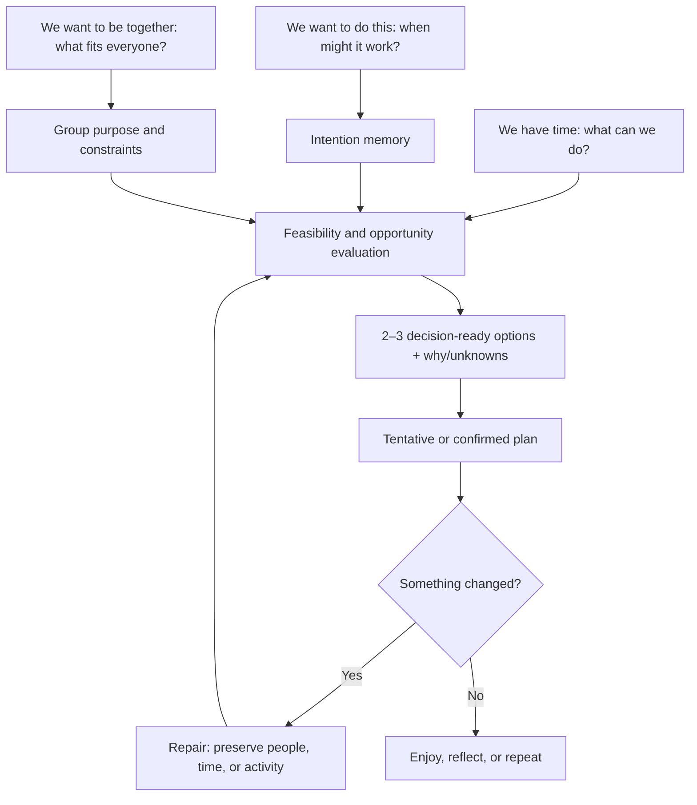

# SideQuest Deep Research: the unmet job, competitors, research literature, and a buildable roadmap

**27 October 2026 · Research memo, not an MVP scope change.** Sources: the group's original P0, P1 [interviews](https://docs.google.com/document/d/1NRX14JTG78lvDj_AUFRzaricBm-QR4vECJiLfvXGu1M/edit), [P1 analysis](https://docs.google.com/document/d/13OOI6XF8nOiJcPj4t3Jdfxqid2EOuCfh78p7x7cYOGE/edit), [P3 requirements](https://docs.google.com/document/d/11Yq8sW1aOphznZHP-zbul2OedCbLJtxczb-ZZDD3oR8/edit), [P4 architecture](https://drive.google.com/file/d/1xiZGXQeScuJx14yKNUcwj1XtWTfOb-l4/view), [verified extra-credit rubric](https://docs.google.com/document/d/12slKo80yu17NZw5nbrB0U1C_nj7mLq6h6uQoSbkCVQk/edit?usp=sharing), current software competitors, and peer-reviewed HCI/recommender research. Each claim should remain distinguishable as observation, external research, or team hypothesis.

## Executive finding

The agreed MVP (post a campus event → browse → find full fit → plan on this device) is a legitimate first vertical slice, but the **actual interviews discuss informal outings and places much more than formal campus events**. The eventual product's main job should be *turning a real opportunity or unfinished desire into a workable outing with the right people, then repairing a plan when circumstances change*. Do not describe SideQuest as another Meetup/Luma/SCU calendar clone.

**Research hypothesis:** SideQuest might add value in the *transition* between (a) free time or social desire, (b) feasible options, (c) tentative group commitment, and (d) adaptation. Group polls, synced calendars and event discovery alone are already served by other products.

## Original interview evidence: two people, not representative statistics

**Interview 1** (both interviewers' notes): small rotating 2–3-person outings; frequent Google/AI search followed by Snapchat, Discord, Instagram, calls and messages; group decision takes a long time; sometimes interested places are forgotten until after making plans; common trips 2–3 hours and one destination; difficulty finding places open in the evening; group changes when friends are busy; on failure, switch venue or reschedule. Travel limits depend on outing. Avoid treating one reported number as a global radius.

**Interview 2** (primary interviewer notes; second-note heading blank): making plans is mainly about being with specific friends. Organizer willing to arrange bookings/driving still couldn't coordinate desired Corpus Christi outing because of work/end-of-term obligations. Google Calendar doesn't capture some commitments; advance availability is not fully known. Luma, word-of-mouth, flyers, Instagram and screenshots already source ideas. Registration can close, and transport cost/mode matters. Group occasionally downshifts a large outing into a nearby dinner; the participant doesn't want anyone excluded. A casual “I'm down” is not necessarily confirmed attendance.

**Evidence → hypotheses:**

| Actual finding | Best design hypothesis to test | What not to assume |
| --- | --- | --- |
| Forgotten places and ideas | Store `Intention` separate from a planned `Event`; contextually resurface | Generic push reminders will fix memory |
| Endless suggestion/messages | Show 2–3 decision-ready feasible options with a shareable link | More recommendations means better decisions |
| Social purpose matters | Capture **keep these people**, **keep this time**, **keep this activity**, **minimize effort** as planning intent | Highest-scoring activity equals best outing |
| Missing informal commitments | Allow manual and **tentative** availability, scoped to a plan | A synced calendar establishes truth |
| Plans downshift to local dinner | Repair a plan with **preserved invariants**; defer original intention | Failure should erase the desired experience |
| Luma/flyers/screenshot source fragmentation | Save URL or screenshot of a future place/event with user confirmation | We need to rebuild Luma registration |
| Transport and registration fail | Use source-aware feasibility with UNKNOWN state, verified travel estimates and freshness labels | A full time-window match implies attendance is feasible |

## A more honest competitor landscape

| Competitor | Demonstrated feature | Research implication |
| --- | --- | --- |
| [Howbout](https://howbout.app/groups) | Group calendar, availability finder, time polls, RSVP/chat; [availability details](https://howbout.app/get-help/find-availability/) | **Do not claim “friends' overlapping free time” or chat are novel** |
| [Partiful](https://help.partiful.com/en-us/articles/15525422-can-i-poll-or-survey-my-guests) | Find-a-Time **Yes/Maybe/No**, RSVPs, guest questionnaires, cohosts, invited guests | Lightweight no-app polls and invitations are solved interaction patterns |
| [Luma](https://help.luma.com/p/searching-for-events) | Discover/search by interest/location/map, host calendars, event registration | Don't rebuild the event publishing stack |
| [SCU official events](https://events.scu.edu/campus-calendar/all) and [club directory](https://www.scu.edu/csi/getconnected/) | Listings, type filters, directories, subscription | Add time-and-person constraints as a **decision layer**, not a duplicate event directory |
| Conventional Google calendars + group chat | Busy blocks and social discussion | Incomplete commitments and missing activity memory need additional representation |

**Differentiation hypothesis needing evaluation:** “We help a group preserve what mattered about a plan when it no longer works.” Existing products can edit/reschedule events, so the test is whether a constraint-driven repair interaction is substantially better than those workflows.

## The outside research that deepens the design

1. [Togedule (CSCW 2025)](https://research.ibm.com/publications/togedule-scheduling-meetings-with-large-language-models-and-adaptive-representations-of-group-availability): adaptive choice presentation + LLMs; controlled experiments with total **N=66** found reduced attendee cognitive load and improved organizer speed/decision quality. **Use dynamic prompts that ask only for the unresolved constraints**; don't force a full survey.
2. [“I Want It That Way” (ACM TiiS)](https://doi.org/10.1145/3685053): study shows **calendar data is incomplete** and scheduling requests omit information; tools should elicit/confirm missing duration, preferences and commitments. This is closely analogous but originates largely in meeting scheduling, not student leisure.
3. [Haze / uncertainty in digital scheduling (CHI 2022)](https://www.research.ed.ac.uk/en/publications/exploring-uncertainty-in-digital-scheduling-and-the-wider-implica/): qualitative studies total **21 participants** examine temporal uncertainty and its social implications. **Unknown**, **maybe**, and **cannot commit yet** need real states, not “no.”
4. [groupTime (CHI 2006)](https://hci.stanford.edu/publications/paper.php?id=25): preference-based group scheduling acknowledges social pressure and plausible deniability. **A group member may privately decline to reveal why a time doesn't work**.
5. [Group fairness study (N=399 + 288)](https://link.springer.com/article/10.1007/s11257-023-09363-0): grouping/aggregation method affects perceived fairness and satisfaction; the best method depends on group configuration. **Average scores alone can marginalize a dissenting participant**. Do not claim that attaching longer explanations always improves fairness; this study did not find consistent added value from them.
6. [Sequential group recommendations](https://link.springer.com/article/10.1007/s10844-021-00652-x): average and least-misery aggregation have different failure modes, especially for shifting/ephemeral groups. **Treat each round of planning as a negotiated process rather than one eternal preference ranking**.
7. [Prospective memory and implementation intentions](https://pubmed.ncbi.nlm.nih.gov/19130080/) plus [recognition vs recall](https://www.nngroup.com/articles/recognition-and-recall/): visible, context-triggered ideas can reduce the burden of recalling intentions unaided. SideQuest should **resurface relevant intentions** when a matching opportunity exists; not assume a static saved list will always be revisited.
8. [Satisficing literature](https://pubs.aeaweb.org/doi/10.1257/jel.20201396): under uncertainty, “good enough” choices can be rational. **Aim for a small shortlist meeting hard constraints**, rather than an endless feed ranked by speculative desirability.
9. [Plan commitment / plan repair](https://www.sciencedirect.com/science/article/pii/S0952197623004591) (autonomous-planning paper, **not** a direct user study of leisure): distinguishes full replanning from retaining prior commitments. Apply this as a design analogy: preserve people, time, or activity when they are costly to change.
10. [A Good Plan Is Hard to Find (EMNLP 2025)](https://aclanthology.org/2025.emnlp-main.585/): user preference for a plan is not a reliable proxy for objective success. **Test whether users actually reach a feasible plan, not only which AI explanation feels impressive.**

## A product design worth prototyping (hypotheses, not shipped features)

### Two entry points, one planning engine



**Example 1: forgotten interest.** User once saved “try rock climbing.” Their current free window is 2–5 p.m., climbing gym open, travel time feasible, friend also interested. Surface “This old idea may fit now” with source and confidence. If hours are stale, clearly label the uncertainty and provide a link to check.

**Example 2: Corpus Christi-style failure.** The group wants a trip but workload conflicts. Offer **keep the people and time, switch to a short dinner**; or **keep the trip as a deferred intention and retry after exams**. Don't presume all participants have agreed just because the organizer selected a replacement.

**Example 3: temporary rotating friends.** One organizer shares a planning link. Others answer simple context questions (“maybe after 3,” “near campus only,” “no car”) without creating a full permanent social calendar. Only confirmed information becomes shared planning state. Private restrictions may yield a simple “this doesn't work for one participant” rather than exposing sensitive details.

### Constraint model (later, not M2)

```ts
type Availability = 'YES' | 'MAYBE' | 'NO' | 'UNKNOWN'
type Hardness = 'REQUIRED' | 'PREFERRED'
type OptionStatus = 'FEASIBLE' | 'CONDITIONAL' | 'INFEASIBLE' | 'UNKNOWN'
type PlanningPriority = 'KEEP_PEOPLE' | 'KEEP_TIME' | 'KEEP_ACTIVITY' | 'LOW_EFFORT'

type Constraint = {
  kind: 'time' | 'travel' | 'budget' | 'participation' | 'weather'
  hardness: Hardness
  source: 'manual' | 'calendar' | 'provider' | 'ai-proposed'
  confirmed: boolean
  visibility: 'private' | 'group'
}
```

Apply **hard constraints first**; identify **unknowns second**; rank by preferences and low burden only among viable candidates. Never translate “unknown” into “no” or an uncertain AI guess into “confirmed.” Group satisfaction requires checking whose preferences are being overridden. These fields are a **design sketch**, not a new M2 TypeScript contract.

## Architecture extensions without trashing M2

- **Preserve now:** typed `CampusEvent` with stable server-generated ID and `hostName`, shared `EventCatalogPort`, deterministic `fitsFully`, and a separate browser-local Schedule of planned Event IDs.
- **Boundary now, no empty classes:** encapsulate `date/start/end` parsing and wall-clock semantics; keep Supabase access behind one adapter; version local Schedule storage; keep UI independent of DB columns. This is the difference between “designed to grow” and speculative overengineering.
- **Add for final product, when features demand:** `Place/Activity` (repeatable unscheduled option), `Intention` (wanted/deferred/completed/rejected), `Plan` (chosen option and commitments), `Constraint/AvailabilityClaim`, `FitEvaluation` (FULL/PARTIAL/NONE/UNKNOWN + reasons), and `OpportunitySource` with provenance/freshness.
- **Keep three different truths separate:** (1) event facts from an organizer or external source, (2) participant-reported preferences/constraints, (3) AI's unverified interpretation. AI cannot fabricate facts or confer permission.
- **Future shared groups require real authorization** or carefully scoped invitation tokens. The current unverified `hostName` is never an account or access-control key.
- **Expect one migration rather than zero changes:** later `EventOccurrence` with timezone/recurrence and plan status requires an explicit adapter/migration from same-day `date/start/end` and `Schedule` IDs. Avoid falsely promising “no rewrite whatsoever.”

## Extra credit: evidence-based plan, actual rubric maximum 5

Original: [Final Project Extra Credit Opportunities](https://docs.google.com/document/d/12slKo80yu17NZw5nbrB0U1C_nj7mLq6h6uQoSbkCVQk/edit?usp=sharing). Core project first; class grade ≥76% beginning of Week 9; good standing; team agreement; individual awards; final presentation can extend up to 5 minutes; **keys kept server-side** per instructor.

| Category | Max | Evidence of good implementation | Best fit / risk |
| --- | ---: | --- | --- |
| Advanced architecture beyond MVC | **1.00** | Clearly justified ports-and-adapters / hexagonal core, dependency directions, real alternate adapters, architecture diagram; explain change in M2 reflection | **High payoff, medium risk.** Renaming existing MVC folders alone is insufficient; check instructor accepts the actual architectural shift |
| Realtime WebSocket | **1.00** | Two browsers: event creation appears without refresh; test reconnect and duplicate events | **High fit** with shared EventCatalog; [Supabase Realtime](https://supabase.com/docs/guides/realtime/subscribing-to-database-changes) offers Postgres Changes (easy) and Broadcast (scales better). Need resolve class key policy |
| External integration/device | **0.75** | Mode-aware real route/travel data, Mapbox or Google Routes, error/unknown handling; demonstrate personal constraint | **High user value**. [Google route matrix](https://developers.google.com/maps/documentation/routes/compute_route_matrix) supports transit; [Mapbox Directions](https://docs.mapbox.com/api/navigation/directions/) focuses on walking/cycling/driving, so provider choice affects interview 2's transit needs |
| Automated browser E2E in CI | **0.50** | [Playwright separate browser contexts](https://playwright.dev/docs/browser-contexts): A posts, B sees, one device plans, other unchanged; [GitHub CI](https://playwright.dev/docs/ci), report attached | **High confidence / low architecture risk** |
| AI API using app data | **0.50** | Ground explanations/conditional alternatives in actual catalog and confirmed constraints; compare result with deterministic baseline; server-only key | **High eventual fit**, but requires enough real data and clear checks |
| Security | **0.50** | Modern auth/authorization/roles if needed for real shared plans or event ownership | **Deferred.** Login contradicts no-account M2 and is unsafe to rush solely for points |
| Accessibility | **0.25** | Manual keyboard + screen reader review, focus, contrast, labels, useful errors | Core-quality win; demonstrate |
| Publishing | **0.25** | Stable public working deployment, no local-only backend; abuse protection for anonymous posts | Core-quality win; demonstrate |
| Advanced external library | **0.25** | Substantial real React usage, not merely installed | Already likely relevant; instructor decides |

**Conditional maximum without security:** 4.5 points if every other category qualifies at its maximum. **All categories sum to 5.0**, but don't chase the maximum at the expense of working core behavior.

### Important credential conflict to resolve *before* architecture lock

The instructor's rubric says **all API keys server-side, never frontend**. Supabase's publishable key is intentionally public and normally used with browser RLS, but **do not assume the professor distinguishes publishable from secret keys**. Ask her whether client-side Supabase publishable keys satisfy the rubric; if not, use a server-side catalog endpoint. It also complicates direct client-side Supabase WebSocket subscriptions. Don't call SSE/polling a WebSocket implementation. Never bundle a service-role or AI-secret key into the React app.

**If classroom and deployment time are short:** finish M2, then secure + test + publish, then real-time updates; use maps and AI only if feasible and testable. Plan a justified advanced architecture refactor for the final phase only if the course rubric can be met without destabilizing the MVP.

## Concrete validation experiments

| Research question | Test task | Outcome to measure |
| --- | --- | --- |
| Is matching within free time enough? | “Find something two people can do 2–5 p.m., no car” | Time to **viable** option, number of outside checks, unsuitable suggestions |
| Do unrecorded commitments matter? | One member says “probably free after 3,” another has unlisted obligations | Whether the system incorrectly declares agreement; error recovery |
| Does a group value its social purpose? | Original trip fails due to availability; propose dinner vs rescheduling trip | Which change is acceptable, what gets preserved, number of messages/steps |
| Does intention memory help? | Reintroduce an activity mentioned during an earlier simulated session | Recall rate, usefulness/timing of resurfacing, perceived annoyance |
| Does fairness need more than average scores? | Three people, one travel-constrained; compare top average vs feasible compromise | Whether someone is effectively excluded; perceived fairness and group willingness |
| Does AI help, or just sound convincing? | Compare deterministic explanation against AI answer for the **same real data** | Correctness of facts/reasons, user task success, unsupported claims |

For baseline, have users perform tasks using their normal Google/Maps/Luma/messaging method (with consent), then test a SideQuest prototype. Avoid claiming statistically significant outcomes from two P1 interviews. Follow up with SCU students outside the original pair, including someone organizing an activity and someone who has been invited but not planning it.

## Decisions for the four-person team

**Cynthia:** research, accessible information hierarchy, two entry points, comparison/repair prototypes and usability protocol. **Devonny:** event results/details, provenance and link sharing. **Daven:** catalog service, source adapters, real-time publishing and safe endpoints. **Sembiyan:** time matching, pure feasibility evaluation and eventual plan constraints. Agree before anyone writes shared model changes; one teammate integrates App.tsx.

**Timeline:** P5 coursework must be submitted as required separately; M2 prototype remains the three-class vertical slice; after M2 add the new full CRC/ER classes for M2 Part 2. Never instruct coding agents to ship the future models during the current milestone merely because this memo describes them.

## Source bibliography

**Interviews and course:** [raw notes](https://docs.google.com/document/d/1NRX14JTG78lvDj_AUFRzaricBm-QR4vECJiLfvXGu1M/edit), [derived P1 research](https://docs.google.com/document/d/13OOI6XF8nOiJcPj4t3Jdfxqid2EOuCfh78p7x7cYOGE/edit), [P3](https://docs.google.com/document/d/11Yq8sW1aOphznZHP-zbul2OedCbLJtxczb-ZZDD3oR8/edit), [course extra credit](https://docs.google.com/document/d/12slKo80yu17NZw5nbrB0U1C_nj7mLq6h6uQoSbkCVQk/edit?usp=sharing), [earlier interview+rubric synthesis](INTERVIEW_FINDINGS_AND_EXTRA_CREDIT.md).

**Competitors:** [Howbout groups](https://howbout.app/groups), [Howbout availability](https://howbout.app/get-help/find-availability/), [Partiful time poll](https://help.partiful.com/en-us/articles/15525422-can-i-poll-or-survey-my-guests), [Luma search](https://help.luma.com/p/searching-for-events), [SCU event calendar](https://events.scu.edu/campus-calendar/all).

**HCI/research:** [IBM Togedule 2025](https://research.ibm.com/publications/togedule-scheduling-meetings-with-large-language-models-and-adaptive-representations-of-group-availability), [I Want It That Way](https://doi.org/10.1145/3685053), [Haze/uncertainty](https://www.research.ed.ac.uk/en/publications/exploring-uncertainty-in-digital-scheduling-and-the-wider-implica/), [groupTime](https://hci.stanford.edu/publications/paper.php?id=25), [Group fairness](https://link.springer.com/article/10.1007/s11257-023-09363-0), [Group recommender sequential fairness](https://link.springer.com/article/10.1007/s10844-021-00652-x), [prospective memory](https://pubmed.ncbi.nlm.nih.gov/19130080/), [Satisficing](https://pubs.aeaweb.org/doi/10.1257/jel.20201396), [Plan commitment](https://www.sciencedirect.com/science/article/pii/S0952197623004591), [Plan success vs preference](https://aclanthology.org/2025.emnlp-main.585/).
