# SideQuest Deep Research: the unmet job, competitors, research literature, and a buildable roadmap

**27 October 2026 · Research memo, not an MVP scope change.** Sources: the group's original P0, P1 [interviews](https://docs.google.com/document/d/1NRX14JTG78lvDj_AUFRzaricBm-QR4vECJiLfvXGu1M/edit), [P1 analysis](https://docs.google.com/document/d/13OOI6XF8nOiJcPj4t3Jdfxqid2EOuCfh78p7x7cYOGE/edit), [P3 requirements](https://docs.google.com/document/d/11Yq8sW1aOphznZHP-zbul2OedCbLJtxczb-ZZDD3oR8/edit), [P4 architecture](https://drive.google.com/file/d/1xiZGXQeScuJx14yKNUcwj1XtWTfOb-l4/view), [verified extra-credit rubric](https://docs.google.com/document/d/12slKo80yu17NZw5nbrB0U1C_nj7mLq6h6uQoSbkCVQk/edit?usp=sharing), current software competitors, and peer-reviewed HCI/recommender research. Each claim should remain distinguishable as observation, external research, or team hypothesis.

> **This is the fully illustrated research document.** It consolidates the original interviews, competitor review, HCI literature, product hypotheses, the extra-credit rubric, implementation guardrails, and **editable Mermaid source diagrams**. The [MVP implementation contract](MVP_TEAM_PLAYBOOK.md#shared-event-data-contract) remains authoritative for what the four agents should code **now**; future flowcharts do not authorize M2 scope changes.

**P5 coursework context (28 October):** the [selected P5 ER drawing](https://drive.google.com/file/d/1gzbESV0y6hdACNoPJeH3hnO1zxFQ54Lv/view) contains USER, EVENT and AVAILABILITY_WINDOW and is explained [directly in the MVP Playbook](MVP_TEAM_PLAYBOOK.md#p5-coursework-er-diagram--current-drawio-and-mermaid). That **coursework diagram is separate from the smaller M2 implementation**; user accounts, saved availability and cost fields are not shipped merely because they appear in P5.

**Jump to:** [research atlas](#visual-research-atlas-and-full-design-implications) · [raw interviews](#original-interview-evidence-two-people-not-representative-statistics) · [competition](#a-more-honest-competitor-landscape) · [HCI findings](#the-outside-research-that-deepens-the-design) · [prototype](#a-product-design-worth-prototyping-hypotheses-not-shipped-features) · [future-proof architecture](#architecture-extensions-without-trashing-m2) · [extra credit](#extra-credit-evidence-based-plan-actual-rubric-maximum-5) · [usability studies](#concrete-validation-experiments) · [peer feedback, 4 Nov](#peer-feedback-after-the-live-catalog-test-4-november) · [design exploration, 5 Nov](#design-exploration-since-the-extra-credit-plan-4-to-5-november)


## Executive finding

The agreed MVP (post a campus event → browse → find full fit → plan on this device) is a legitimate first vertical slice, but the **actual interviews discuss informal outings and places much more than formal campus events**. The eventual product's main job should be *turning a real opportunity or unfinished desire into a workable outing with the right people, then repairing a plan when circumstances change*. Do not describe SideQuest as another Meetup/Luma/SCU calendar clone.

**Research hypothesis:** SideQuest might add value in the *transition* between (a) free time or social desire, (b) feasible options, (c) tentative group commitment, and (d) adaptation. Group polls, synced calendars and event discovery alone are already served by other products.

## Visual research atlas and full design implications

The graphics here are **Mermaid diagrams stored as source code in this Markdown document**. They are not screenshots, nor changes to the P4 draw.io submission. All future-product features are **hypotheses or proposed interfaces**, not code currently running in M2.

### Figure A — The four different objects we must not collapse into Event

A scheduled university workshop is not the same sort of object as a recurring opportunity to go bowling, an unfulfilled desire to try bowling, or a confirmed weekend bowling plan. The raw interviews contain all four.

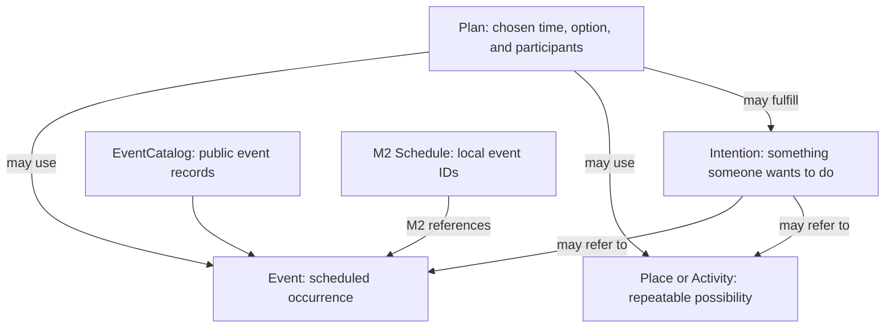

**Precise semantics:**

| Concept | Example | Does it require a fixed event time? | What changes later? |
| --- | --- | --- | --- |
| `Event` | Photography workshop on Friday 2–4 p.m. | Yes | It may expire, cancel, sell out, or change its details |
| `Place/Activity` | Museum, bowling, boba outing | Not inherently | Opening hours, travel modes, price, availability and duration |
| `Intention` | “I'd like to try rock climbing” | No | Active, deferred, fulfilled, or rejected; remains useful beyond one event |
| `Plan` | “Three friends, rock gym, Saturday 3 p.m.” | Yes, once proposed | Tentative, confirmed, completed, canceled, postponed, repaired |

Do **not** force unscheduled outings into fake public Event rows with invented start times. That creates a brittle catalog and prevents the genuine intention-to-opportunity workflow.

### Figure B — Interview evidence, not a persona-only abstraction

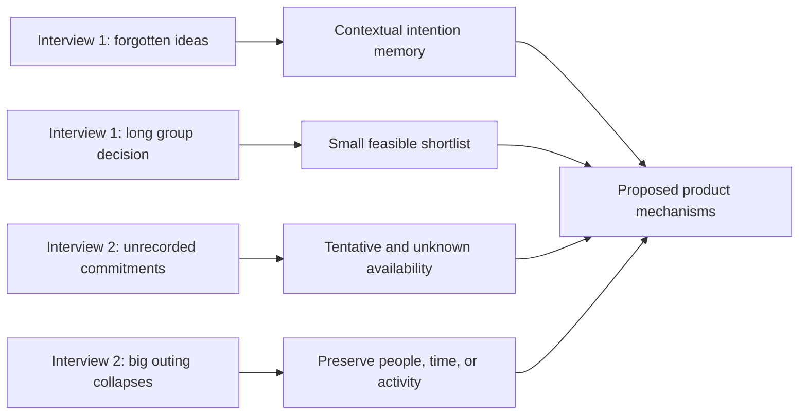

This maps only what the participants or interviewers' notes substantiate. **It does not establish prevalence or prove that these mechanisms will solve the problem.** Interview 1 has primary and secondary notes; the retrieved Interview 2 secondary-notes heading has no content. Follow-up usability studies should test both interpretations.

### Figure C — Two planning motivations, plus the unfinished-intention entry point

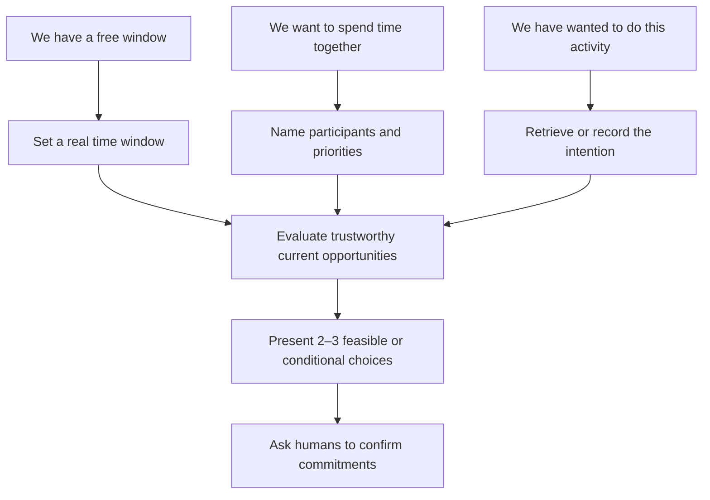

The *free-time* path is closest to the current MVP. The *social-occasion* path is rooted in the second interview: an alternative dinner can fulfill the goal even if the original trip never happens. The *intention* path responds to the first interview's reported forgotten places.

### Figure D — Four availability states, not a binary calendar

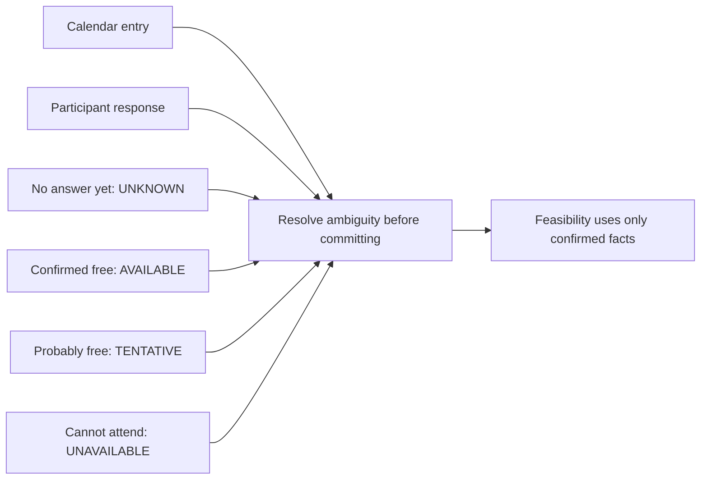

**Availability truth table (future group feature):**

| Statement | Stored interpretation | Safe behavior |
| --- | --- | --- |
| “Yes, I can make it” | AVAILABLE, participant-confirmed | Candidate participant; still check destination and cost |
| “I can probably do after 3” | TENTATIVE; earliest time conditional | Keep conditional; ask for confirmation near decision |
| “No, I work until 7” | UNAVAILABLE during the earlier window | Treat as hard exclusion for that time |
| Silence, no shared calendar, or ambiguous message | UNKNOWN | Do **not** infer availability or agreement |
| Calendar appears blank | Evidence insufficient | Ask rather than declaring someone free |

A time poll that reduces `UNKNOWN` to `NO` hides missing information; one that reduces `TENTATIVE` to `YES` can create an unwanted social obligation. These are design inferences from the interviews and related scheduling research, not M2 requirements.

### Figure E — Decision quality: hard constraints, negotiable preferences, and unknowns

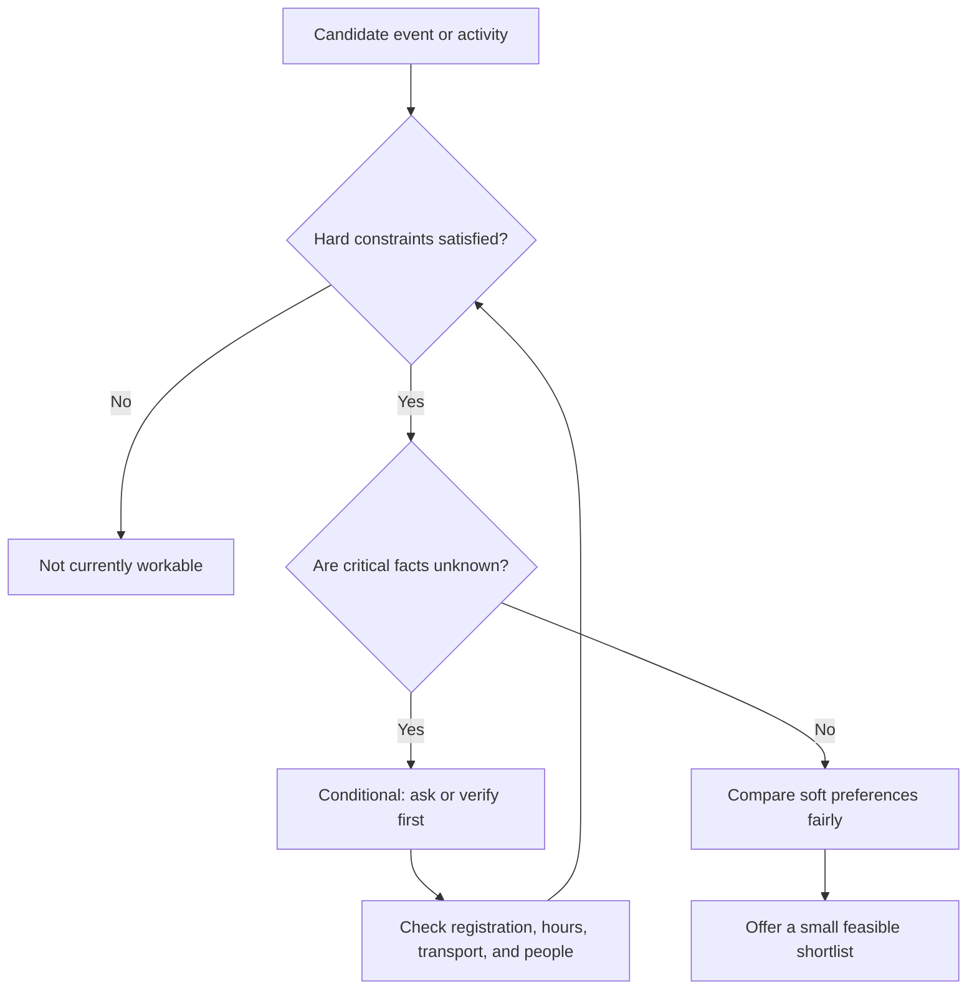

**Research insight:** averaging group preferences can still exclude a travel-constrained participant. Start with constraints everyone must satisfy; compare preferences among viable options; show unknowns explicitly. Never present a numerical “92% feasible” score unless its definition and data provenance can be explained and tested. A group fairness study ([article](https://link.springer.com/article/10.1007/s11257-023-09363-0)) cautions against assuming one aggregation algorithm works for all group types.

### Figure F — Plan repair: preserve the goal rather than erase the plan

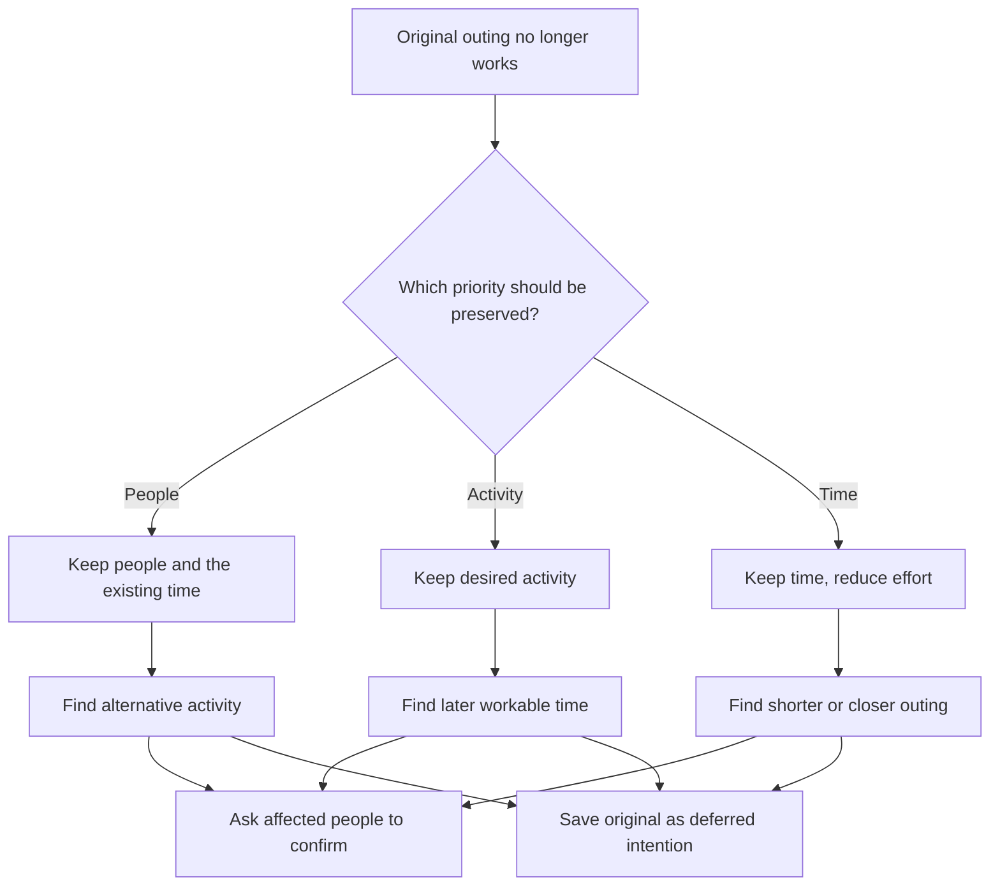

**Interactive screen translated into written behavior:**

| User's choice | What the UI should preserve | What the system should change | What it should not assume |
| --- | --- | --- | --- |
| **Keep the people and time** | Intended attendees and shared window | Location or activity; perhaps choose nearby dinner | That the original trip is now permanently rejected |
| **Keep the activity** | Desired place/activity | Date/time, potentially transportation | That rescheduling makes everyone automatically available |
| **Keep the time, lower effort** | Current window | Duration, distance, cost, commitment | That low effort is identical to low preference or low enjoyment |

The original *Corpus Christi* trip illustrates the potential value of preserving intent after a schedule conflict; the interview does **not** establish that the participant would prefer these exact options. Test choices with users rather than attributing them to the interviewee.

### Figure G — Where AI belongs, and where it doesn't

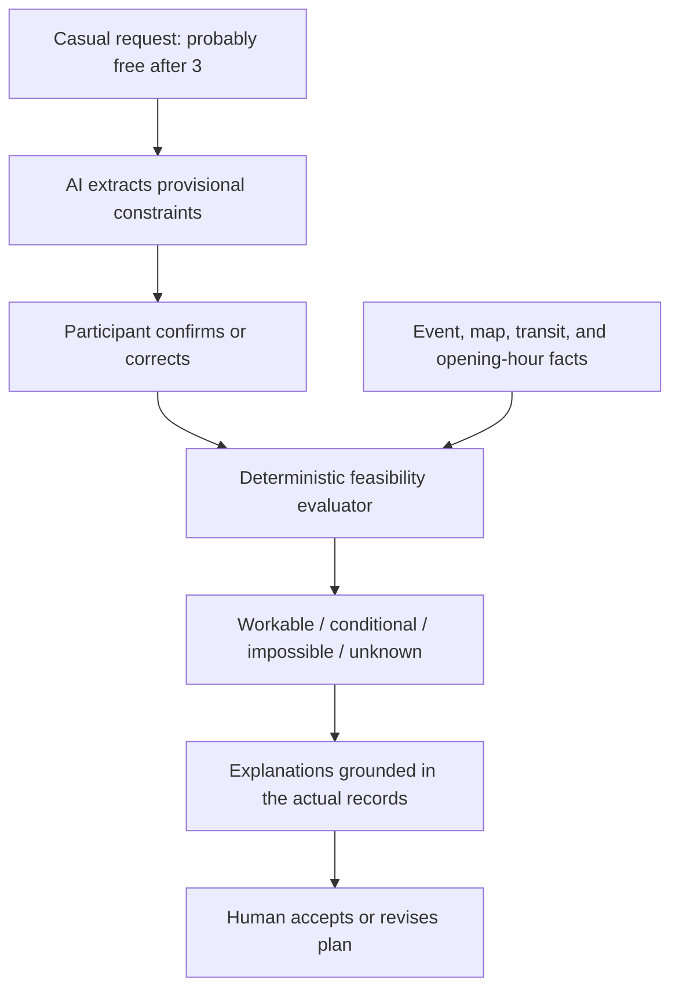

**AI is not authoritative:** an AI API feature should work on *actual SideQuest records* and confirmed constraints; it should not fabricate route times, dates, tickets, people, or commitments. AI use during development via Cline/Claude does **not** count as in-app AI extra credit. Published research on AI plan preference versus success motivates testing objective task completion rather than just perceived cleverness.

### Figure H — Preserve the M2 code boundaries and add new concepts later

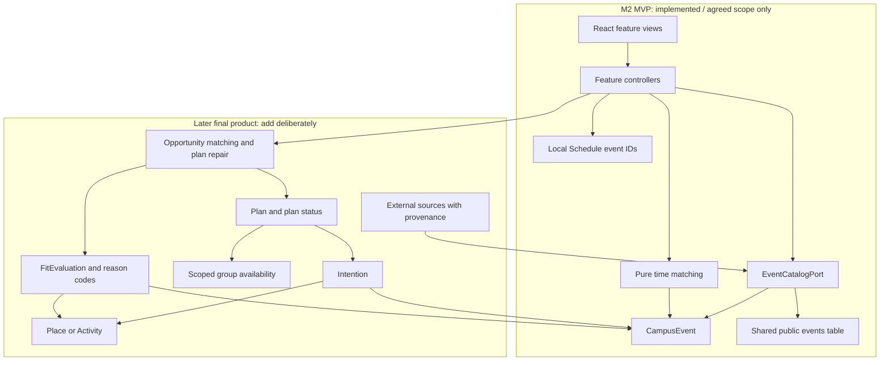

The arrow from `Controller` to `Repair` is **future extensibility**, not an M2 implementation task. Keep Supabase behind `EventCatalogPort`, local planned IDs separately, and time checks in pure functions. Do not add unused classes to claim future-proofing.

### Figure I — Research, implementation, and extra-credit evidence loop

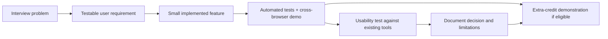

This is the standard to apply to each optional feature. Extra-credit points cannot be claimed just because a named technology appears in `package.json` or because an agent generated an attractive demo. Every feature needs a reliable behavior, evidence, and a human explanation.


## Original interview evidence: two people, not representative statistics

**Interview 1** (both interviewers' notes): small rotating 2–3-person outings; frequent Google/AI search followed by Snapchat, Discord, Instagram, calls and messages; group decision takes a long time; sometimes interested places are forgotten until after making plans; common trips 2–3 hours and one destination; difficulty finding places open in the evening; group changes when friends are busy; on failure, switch venue or reschedule. Travel limits depend on outing. Avoid treating one reported number as a global radius.

**Interview 2** (primary interviewer notes; second-note heading blank): making plans is mainly about being with specific friends. Organizer willing to arrange bookings/driving still couldn't coordinate desired Corpus Christi outing because of work/end-of-term obligations. Google Calendar doesn't capture some commitments; advance availability is not fully known. Luma, word-of-mouth, flyers, Instagram and screenshots already source ideas. Registration can close, and transport cost/mode matters. Group occasionally downshifts a large outing into a nearby dinner; the participant doesn't want anyone excluded. A casual “I'm down” is not necessarily confirmed attendance.

**Evidence → hypotheses:**

| Actual finding | Best design hypothesis to test | What not to assume |
| --- | --- | --- |
| Forgotten places and ideas | Store `Intention` separate from a planned `Event`; contextually resurface | Generic push reminders will fix memory |
| Endless suggestion/messages | Show 2–3 decision-ready feasible options with a shareable link | More recommendations means better decisions |
| Social purpose matters | Capture **keep these people**, **keep this time**, **keep this activity**, **minimize effort** as planning intent | Highest-scoring activity equals best outing |
| Missing informal commitments | Allow manual and **tentative** availability, scoped to a plan | A synced calendar establishes truth |
| Plans downshift to local dinner | Repair a plan with **preserved invariants**; defer original intention | Failure should erase the desired experience |
| Luma/flyers/screenshot source fragmentation | Save URL or screenshot of a future place/event with user confirmation | We need to rebuild Luma registration |
| Transport and registration fail | Use source-aware feasibility with UNKNOWN state, verified travel estimates and freshness labels | A full time-window match implies attendance is feasible |

## A more honest competitor landscape

| Competitor | Demonstrated feature | Research implication |
| --- | --- | --- |
| [Howbout](https://howbout.app/groups) | Group calendar, availability finder, time polls, RSVP/chat; [availability details](https://howbout.app/get-help/find-availability/) | **Do not claim “friends' overlapping free time” or chat are novel** |
| [Partiful](https://help.partiful.com/en-us/articles/15525422-can-i-poll-or-survey-my-guests) | Find-a-Time **Yes/Maybe/No**, RSVPs, guest questionnaires, cohosts, invited guests | Lightweight no-app polls and invitations are solved interaction patterns |
| [Luma](https://help.luma.com/p/searching-for-events) | Discover/search by interest/location/map, host calendars, event registration | Don't rebuild the event publishing stack |
| [SCU official events](https://events.scu.edu/campus-calendar/all) and [club directory](https://www.scu.edu/csi/getconnected/) | Listings, type filters, directories, subscription | Add time-and-person constraints as a **decision layer**, not a duplicate event directory |
| Conventional Google calendars + group chat | Busy blocks and social discussion | Incomplete commitments and missing activity memory need additional representation |

**Differentiation hypothesis needing evaluation:** “We help a group preserve what mattered about a plan when it no longer works, using trusted local opportunities and remembered goals.” Existing apps already support rescheduling, AI scheduling, and group memory, so we must demonstrate that our combined feasibility, provenance and low-friction decision workflow performs better on a representative task.

### Stronger direct competition found in the second research pass

The initial competitor set understated the market. Current self-descriptions show even **AI-based scheduling, structured response semantics, and memory/repair** are being offered elsewhere:

| Product | Actual advertised behavior | SideQuest consequence |
| --- | --- | --- |
| [Cue Events](https://apps.apple.com/us/app/cue-events/id6760505921) | Participants state availability in **natural language**, AI weighs **hard vs soft** constraints and gives a scored explanation; supports rescheduling and live updates | **No novelty claim for LLM availability parsing or constraint-score explanations alone.** Limited independently visible ratings; vendor description is not independent usability verification. |
| [Ask](https://getask.io/) | Plans structure natural text; responses **Going, Suggest, Busy, Pass**; organizer approves proposed changes | **No novelty claim for “Maybe means maybe” or human-confirmed rescheduling alone.** Study semantics and UI, avoid recreating a chat app. |
| [Boba](https://boba.app/) | Works via **existing group chats** with shared memory, planning, research and group decisions; marketed rescheduling and remembering plans | **No novelty claim for group-chat AI memory/replanning alone**. Requires firsthand task testing to identify deficiencies. Read its privacy policy before proposing students route private group messages through an AI. |
| [TimeLoop](https://trytimeloop.com/) | Natural-language time planning with deterministic scheduling and day replanning, including circles for families/friends | A deterministic scheduler behind AI extraction is a **sound pattern**, but not inherently original. |
| [Timeleft](https://timeleft.com/how-it-works/) | Matches strangers into small-group social outings and handles the booking | Distinct social context: SideQuest interviewees mostly wanted to spend time with **existing friends**, rather than meet new people. |

**Stricter differentiating question:** Can SideQuest connect an older specific intention, a particular group’s priorities, and *verified* current local feasible opportunities to produce a better **conditional decision** than Luma + a group chat + existing scheduling AI? This is a testable *hypothesis*, not proven uniqueness.

**Market evidence limitation:** most product-feature claims here are first-party descriptions and app-store listings; we have not run side-by-side competitor task tests. Do not infer competitors cannot perform an action solely because their marketing pages omit it.

### Feature-by-feature competitive audit: what cannot be our novelty claim

| Feature | Competitor evidence | Honest opportunity for SideQuest |
| --- | --- | --- |
| Hosting, event browsing, registration and maps | Luma and SCU official listings | Add clear *personal feasibility* information to real events |
| Shared group calendars and time polls | Howbout and Partiful | Reduce actual decision cost, not merely add another poll |
| Tentative participation semantics | Partiful and Ask | Make uncertainty explicit and prompt only for genuinely unresolved information |
| Natural-language availability and constraint explanation | Cue Events and other scheduling assistants | Treat AI interpretation as provisional and cross-check against facts |
| Group-chat memory and help with reorganization | Boba | Evaluate whether remembered **specific intentions** resurface at truly appropriate opportunities |
| Calendar and day replanning | TimeLoop and conventional calendars | Handle unscheduled activities and ephemeral groups rather than only scheduled tasks |
| Matching strangers for planned social gatherings | Timeleft | Respect that the interviews mostly concern **existing friends**, an importantly different social goal |

**Market-evidence caveat:** current product descriptions can establish that a feature is advertised; they do not establish how reliable, usable, or comprehensive it is. We have not yet run firsthand side-by-side tests, so do not label these products deficient without verification.


### Where SideQuest wins (4 November)

A second check covered the apps the interviewees named, plus SCU's own channels, Qlusion and Meetup. Each one answers a different question. None of them answers "what fits the time I actually have, with the people I want."

| App | What it's for | What it leaves out |
| --- | --- | --- |
| [SCU calendar](https://events.scu.edu/campus-calendar/all) and the [SCU Events app](https://apps.apple.com/us/app/id6677027333) | Official events. The Events app is a guide to big weekends such as Welcome Weekend and Grand Reunion | Club and student events, your schedule, friends |
| [Qlusion](https://scu.edu/cioccacenter/qlusion) | Campus calendar and ticketing for departments and clubs, from SCU's Ciocca Center | Little public detail. Nothing found about free time or friends |
| [Meetup](https://www.engadget.com/mobile/meetups-new-mobile-app-is-designed-to-make-it-easier-to-meet-people-irl-150000920.html) | Interest groups of mostly strangers. RSVP lists show an age and gender breakdown | Existing friends, your schedule |
| [Luma](https://help.luma.com/p/luma-ios-app) (Interview 2) | Hosting and RSVPs, following calendars, QR check-in, chatting with people you attended with | Whether an event fits your day |
| Instagram, flyers, screenshots (Interview 2) | Where students hear about things | No time check, and ideas get lost in camera rolls |
| Snapchat, Discord, texting (Interview 1) | Talking it over. [Snap Map](https://www.socialmediatoday.com/news/snap-adds-new-discovery-tools-to-snap-map-highlighting-happening-events/519792) shows where friends are | Deciding takes a long time, the complaint in Interview 1 |
| Google Calendar (Interview 2) | Busy blocks | Informal plans, and anything about events |
| Google, AI search, Maps, Yelp (Interviews 1 and 2) | Places, hours, reviews, travel | Campus events, friends, your free window |
| Howbout, Partiful (above) | Picking a time for a plan already chosen | Picking events for a time you already have |

**The advantage, in one line:** everyone else tells you what's happening, and SideQuest tells you what fits. The full-fit rule already shipped in M2 is the core of it. **Don't compete on** ticketing (Qlusion, Luma), meeting strangers (Meetup), chat (Discord, Snapchat) or maps (Google). Link out to them instead.

**Caveat:** this compares what each product advertises, not hands-on tests, and Qlusion's public pages say very little.

## The outside research that deepens the design

1. [Togedule (CSCW 2025)](https://research.ibm.com/publications/togedule-scheduling-meetings-with-large-language-models-and-adaptive-representations-of-group-availability): adaptive choice presentation + LLMs; controlled experiments with total **N=66** found reduced attendee cognitive load and improved organizer speed/decision quality. **Use dynamic prompts that ask only for the unresolved constraints**; don't force a full survey.
2. [“I Want It That Way” (ACM TiiS)](https://doi.org/10.1145/3685053): study shows **calendar data is incomplete** and scheduling requests omit information; tools should elicit/confirm missing duration, preferences and commitments. This is closely analogous but originates largely in meeting scheduling, not student leisure.
3. [Haze / uncertainty in digital scheduling (CHI 2022)](https://www.research.ed.ac.uk/en/publications/exploring-uncertainty-in-digital-scheduling-and-the-wider-implica/): qualitative studies total **21 participants** examine temporal uncertainty and its social implications. **Unknown**, **maybe**, and **cannot commit yet** need real states, not “no.”
4. [groupTime (CHI 2006)](https://hci.stanford.edu/publications/paper.php?id=25): preference-based group scheduling acknowledges social pressure and plausible deniability. **A group member may privately decline to reveal why a time doesn't work**.
5. [Group fairness study (N=399 + 288)](https://link.springer.com/article/10.1007/s11257-023-09363-0): grouping/aggregation method affects perceived fairness and satisfaction; the best method depends on group configuration. **Average scores alone can marginalize a dissenting participant**. Do not claim that attaching longer explanations always improves fairness; this study did not find consistent added value from them.
6. [Sequential group recommendations](https://link.springer.com/article/10.1007/s10844-021-00652-x): average and least-misery aggregation have different failure modes, especially for shifting/ephemeral groups. **Treat each round of planning as a negotiated process rather than one eternal preference ranking**.
7. [Prospective memory and implementation intentions](https://pubmed.ncbi.nlm.nih.gov/19130080/) plus [recognition vs recall](https://www.nngroup.com/articles/recognition-and-recall/): visible, context-triggered ideas can reduce the burden of recalling intentions unaided. SideQuest should **resurface relevant intentions** when a matching opportunity exists; not assume a static saved list will always be revisited.
8. [Satisficing literature](https://pubs.aeaweb.org/doi/10.1257/jel.20201396): under uncertainty, “good enough” choices can be rational. **Aim for a small shortlist meeting hard constraints**, rather than an endless feed ranked by speculative desirability.
9. [Plan commitment / plan repair](https://www.sciencedirect.com/science/article/pii/S0952197623004591) (autonomous-planning paper, **not** a direct user study of leisure): distinguishes full replanning from retaining prior commitments. Apply this as a design analogy: preserve people, time, or activity when they are costly to change.
10. [A Good Plan Is Hard to Find (EMNLP 2025)](https://aclanthology.org/2025.emnlp-main.585/): user preference for a plan is not a reliable proxy for objective success. **Test whether users actually reach a feasible plan, not only which AI explanation feels impressive.**

### Connecting the literature to exact SideQuest interactions

| Research mechanism | Concrete UI implication | What to test empirically |
| --- | --- | --- |
| Calendar incompleteness and missing scheduling parameters | “Are you actually free, or just have nothing recorded?” plus a duration field | Frequency of false-positive feasibility recommendations |
| Temporal uncertainty and social meaning | Separate AVAILABLE / TENTATIVE / UNAVAILABLE / UNKNOWN states | Whether people feel pressured or prematurely committed |
| Adaptive availability representations | Ask only the one unresolved question preventing a decision | Total questions and cognitive load versus a full planning form |
| Fairness in group recommendation | Check each person's non-negotiable needs before comparing aggregated preference | Whether any participant is excluded or ignored |
| Prospective memory / contextual reminders | Resurface a deferred place only when there is a suitable window | Useful rediscovery versus unwanted interruption |
| Satisficing / bounded choice | Provide 2–3 decision-ready viable options rather than an infinite feed | Time to mutually accepted plan and choice overload |
| AI planning preference vs actual success | Pair AI explanations with deterministic checks and source provenance | Grounded correctness, accepted plan, failed attendance or follow-up |

**Transferability warning:** many cited studies investigate meeting scheduling or generic group recommenders, not student leisure. Their findings suggest design hypotheses; they do not prove these SideQuest interactions will work without the proposed usability tests.


## A product design worth prototyping (hypotheses, not shipped features)

### Two entry points, one planning engine

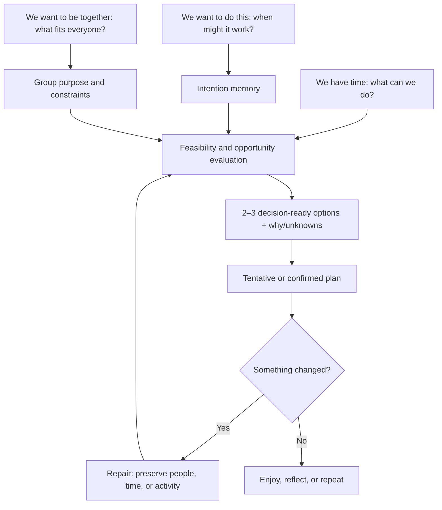

**Example 1: forgotten interest.** User once saved “try rock climbing.” Their current free window is 2–5 p.m., climbing gym open, travel time feasible, friend also interested. Surface “This old idea may fit now” with source and confidence. If hours are stale, clearly label the uncertainty and provide a link to check.

**Example 2: Corpus Christi-style failure.** The group wants a trip but workload conflicts. Offer **keep the people and time, switch to a short dinner**; or **keep the trip as a deferred intention and retry after exams**. Don't presume all participants have agreed just because the organizer selected a replacement.

**Example 3: temporary rotating friends.** One organizer shares a planning link. Others answer simple context questions (“maybe after 3,” “near campus only,” “no car”) without creating a full permanent social calendar. Only confirmed information becomes shared planning state. Private restrictions may yield a simple “this doesn't work for one participant” rather than exposing sensitive details.

### Constraint model (later, not M2)

```ts
type Availability = 'YES' | 'MAYBE' | 'NO' | 'UNKNOWN'
type Hardness = 'REQUIRED' | 'PREFERRED'
type OptionStatus = 'FEASIBLE' | 'CONDITIONAL' | 'INFEASIBLE' | 'UNKNOWN'
type PlanningPriority = 'KEEP_PEOPLE' | 'KEEP_TIME' | 'KEEP_ACTIVITY' | 'LOW_EFFORT'

type Constraint = {
  kind: 'time' | 'travel' | 'budget' | 'participation' | 'weather'
  hardness: Hardness
  source: 'manual' | 'calendar' | 'provider' | 'ai-proposed'
  confirmed: boolean
  visibility: 'private' | 'group'
}
```

Apply **hard constraints first**; identify **unknowns second**; rank by preferences and low burden only among viable candidates. Never translate “unknown” into “no” or an uncertain AI guess into “confirmed.” Group satisfaction requires checking whose preferences are being overridden. These fields are a **design sketch**, not a new M2 TypeScript contract.

## Architecture extensions without trashing M2

- **Preserve now:** typed `CampusEvent` with stable server-generated ID and `hostName`, shared `EventCatalogPort`, deterministic `fitsFully`, and a separate browser-local Schedule of planned Event IDs.
- **Boundary now, no empty classes:** encapsulate `date/start/end` parsing and wall-clock semantics; keep Supabase access behind one adapter; version local Schedule storage; keep UI independent of DB columns. This is the difference between “designed to grow” and speculative overengineering.
- **Add for final product, when features demand:** `Place/Activity` (repeatable unscheduled option), `Intention` (wanted/deferred/completed/rejected), `Plan` (chosen option and commitments), `Constraint/AvailabilityClaim`, `FitEvaluation` (FULL/PARTIAL/NONE/UNKNOWN + reasons), and `OpportunitySource` with provenance/freshness.
- **Keep three different truths separate:** (1) event facts from an organizer or external source, (2) participant-reported preferences/constraints, (3) AI's unverified interpretation. AI cannot fabricate facts or confer permission.
- **Future shared groups require real authorization** or carefully scoped invitation tokens. The current unverified `hostName` is never an account or access-control key.
- **Expect one migration rather than zero changes:** later `EventOccurrence` with timezone/recurrence and plan status requires an explicit adapter/migration from same-day `date/start/end` and `Schedule` IDs. Avoid falsely promising “no rewrite whatsoever.”

## Going for all nine extra credits (team decision, 4 November)

The team wants every category in the [bonus rubric](https://docs.google.com/document/d/12slKo80yu17NZw5nbrB0U1C_nj7mLq6h6uQoSbkCVQk/edit?usp=sharing), which adds up to the 5-point cap. This section replaces the older order and the "Security: deferred" advice further down. The eligibility rules still apply: core work done first, a class grade of at least 76% at the start of Week 9, team agreement, points awarded per student, a presentation, and every key kept on the server.

**One idea ties it together.** SideQuest's advantage is that it starts from your free time, not from the event list (see [the competitor check](#where-sidequest-wins-4-november)). Each credit below either feeds that "what fits" engine with better data or shares its answer with friends. That keeps the extras from becoming a trophy shelf.

### The nine credits, with what we build and what proves it

| # | Credit | Points | What we build | Evidence for the grader | Proposed owner | Needs first |
| --- | --- | ---: | --- | --- | --- | --- |
| 1 | Automated end-to-end testing | 0.50 | Keep the Playwright suite in CI (18 tests today). Add a two-browser test where A posts and B sees it with no reload, a sign-in test, and a load test on `/api/events` that records response times | Green CI runs with the Playwright report and a load-test summary attached | Cynthia, everyone adds specs | Nothing |
| 2 | Accessibility | 0.25 | A written keyboard-only and screen-reader walkthrough of Discover, Post and My Schedule. Automated axe checks in Playwright. Contrast fixes | The audit in `docs/`, axe passing in CI, a short screen-reader clip | Devonny with Cynthia | Nothing |
| 3 | Publishing | 0.25 | The Node server hosted on Render, with every key as a server environment variable and a rate limit on posting | A public URL in the README that works in a fresh browser | Daven | Supabase live check |
| 4 | Advanced libraries | 0.25 | React 19 is already used throughout. Document where it matters: hooks, state, component structure | A section in the README and reflection | Cynthia | Nothing |
| 5 | Real-time WebSocket | 1.00 | The server listens to Supabase changes and pushes them to browsers over a WebSocket, so no key reaches the browser. First feature: a "new events" pill on Discover. Later: friends' plans appear live | The two-browser Playwright test, plus reconnect and duplicate-message tests | Daven (server), Cynthia (UI) | Publishing |
| 6 | Security | 0.50 | Sign in with Google through Supabase Auth, kept in a server session. Roles: an event's owner can edit and delete it, and a group's host can invite and remove members. Database row rules enforce both | A demo of a non-owner being refused, and tests for each role | Daven, Sembiyan reviews | Team agrees accounts are now in scope |
| 7 | External systems | 0.75 | Google Calendar, using the same Google sign-in. Read busy times to fill your free windows automatically, and "Also add to Google Calendar" when planning | The free-time search filled from a real calendar, with a busy event correctly excluded | Sembiyan (availability), Daven (OAuth) | Security |
| 8 | AI | 0.50 | Paste a flyer screenshot and get a filled Post form to confirm field by field. Plain-English search such as "something chill after 3 for two hours", turned into a normal search that the fit engine then checks | Side-by-side: the AI draft, the confirmed post, and the same validation rules applied | Devonny, Cynthia on the review screen | Publishing (server key) |
| 9 | Advanced architecture | 1.00 | Ports and adapters (below), with the diagram and the justification in the M2 reflection | The diagram, the reflection paragraph, and two adapters swapped for the same port in tests | Whole team, Cynthia drafts the diagram | Grows with 5 to 8 |

**Adding accounts changes the agreed M2 scope.** The M2 contract says no accounts, logins or user table. Going for Security means the team updates `REQUIREMENTS.md` and `SPECIFICATIONS.md` for the final project, and replaces the edit-code idea for "My posts" (#7 in the peer feedback table) with real ownership. Agree this in writing before anyone starts.

### Order of work

1. **Sure points first (1.25):** publishing, the libraries write-up, the accessibility audit with axe in CI, and the load test.
2. **Real-time (1.00):** live new events, tested with two browsers.
3. **Sign-in and roles (0.50), then Google Calendar (0.75):** one Google sign-in serves both.
4. **AI (0.50):** the flyer reader first, then plain-English search.
5. **Architecture (1.00):** formalize each port as its adapter lands, then write it up. By the end, the adapters are the proof.

Each step should end with its evidence captured, not only working code.

### Which product ideas each credit unlocks

| Idea from the design boards | Uses |
| --- | --- |
| What fits in the gap, Almost fits | The core fit engine. Google Calendar fills the window, and travel times could follow |
| Fog over Thursday | Real-time, Google Calendar |
| Down, if… and I'll go if you go | Security, real-time |
| Friends on the ticket, your circles, pop-up groups | Security (groups and visibility), real-time |
| Ideas that ripen | AI (flyer to idea), external data |
| Event photos as stamps | Security (ownership), storage |
| Gold "events waiting" counts, one question, Sunday check-in | Google Calendar (fewer questions once classes are known) |
| Pencil and pen, "Still on?", Also add to Google Calendar | External systems, real-time |
| Friends answer by link, worst-off ranking, maybes with deadlines | Real-time (answers arrive live), Security once accounts exist |
| Voice mode | AI (same draft endpoint as the flyer reader), Accessibility as an extra beyond WCAG |
| Will it happen? odds, who you're waiting on | Real-time |
| Fit lab, why it fits worked out | The core fit engine, no new data |

### Advanced architecture: ports and adapters

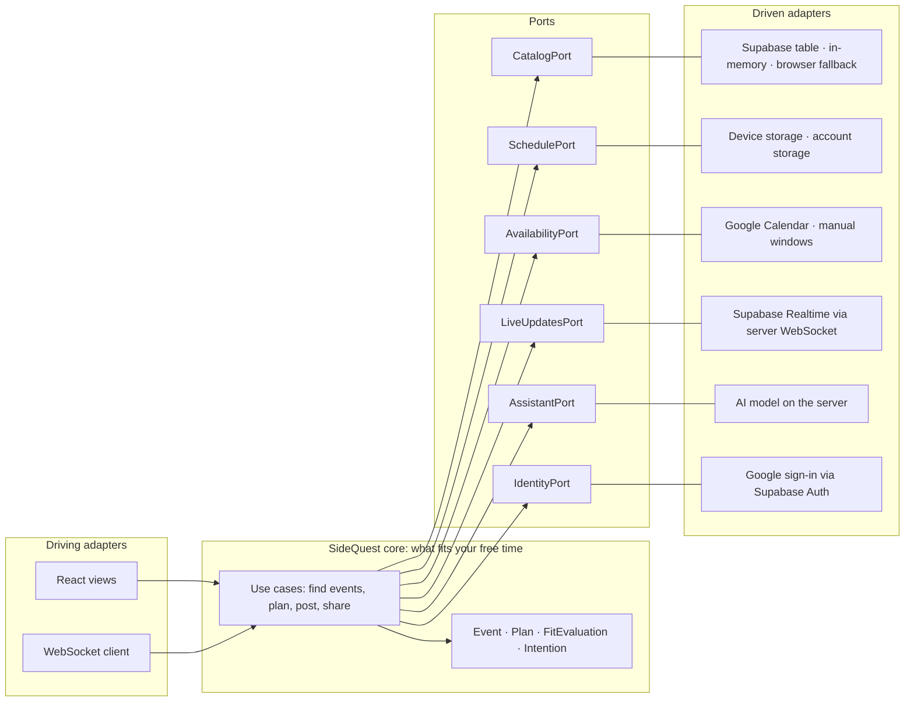

**Draft justification for the M2 reflection.** MVC organizes an app around its screens. SideQuest's growth is not in screens. It is in sources: student posts, the SCU calendar, flyer screenshots, Google Calendar, live updates and accounts. Ports and adapters put the fit rules in a core that knows nothing about Supabase, Google or React, and plug each source in through a port. The M2 code already started this way: `EventCatalogPort` has a Supabase table, an in-memory table and a browser fallback behind it, and the same tests run against them. The final project extends that pattern instead of replacing it. In practice this means three things. Every new integration is one adapter plus its tests. The fit engine stays easy to test with fakes. And swapping a data source never touches the views. The core is also the product's advantage, so the architecture protects the part worth protecting.

### Risks to watch

- **Google sign-in in testing mode** only works for test users added in the Google Cloud console. Add every teammate and the grader before the demo.
- **AI** must never post on its own. Every field is confirmed by the person, then checked by the same Model rules as a typed post. Keep the key on the server and cap usage.
- **Publishing anonymous posting** invites spam. Rate limits come before the public URL, and sign-in for posting removes most of the risk.
- **Points per student:** each teammate should own and present at least one credit.

## Extra credit: evidence-based plan, actual rubric maximum 5

Original: [Final Project Extra Credit Opportunities](https://docs.google.com/document/d/12slKo80yu17NZw5nbrB0U1C_nj7mLq6h6uQoSbkCVQk/edit?usp=sharing). Core project first; class grade ≥76% beginning of Week 9; good standing; team agreement; individual awards; final presentation can extend up to 5 minutes; **keys kept server-side** per instructor.

| Category | Max | Evidence of good implementation | Best fit / risk |
| --- | ---: | --- | --- |
| Advanced architecture beyond MVC | **1.00** | Clearly justified ports-and-adapters / hexagonal core, dependency directions, real alternate adapters, architecture diagram; explain change in M2 reflection | **High payoff, medium risk.** Renaming existing MVC folders alone is insufficient; check instructor accepts the actual architectural shift |
| Realtime WebSocket | **1.00** | Two browsers: event creation appears without refresh; test reconnect and duplicate events | **High fit** with shared EventCatalog; [Supabase Realtime](https://supabase.com/docs/guides/realtime/subscribing-to-database-changes) offers Postgres Changes (easy) and Broadcast (scales better). Need resolve class key policy |
| External integration/device | **0.75** | Mode-aware real route/travel data, Mapbox or Google Routes, error/unknown handling; demonstrate personal constraint | **High user value**. [Google route matrix](https://developers.google.com/maps/documentation/routes/compute_route_matrix) supports transit; [Mapbox Directions](https://docs.mapbox.com/api/navigation/directions/) focuses on walking/cycling/driving, so provider choice affects interview 2's transit needs |
| Automated browser E2E in CI | **0.50** | [Playwright separate browser contexts](https://playwright.dev/docs/browser-contexts): A posts, B sees, one device plans, other unchanged; [GitHub CI](https://playwright.dev/docs/ci), report attached | **High confidence / low architecture risk** |
| AI API using app data | **0.50** | Ground explanations/conditional alternatives in actual catalog and confirmed constraints; compare result with deterministic baseline; server-only key | **High eventual fit**, but requires enough real data and clear checks |
| Security | **0.50** | Modern auth/authorization/roles if needed for real shared plans or event ownership | **Now planned** with Google sign-in and roles. See [Going for all nine](#going-for-all-nine-extra-credits-team-decision-4-november) |
| Accessibility | **0.25** | Manual keyboard + screen reader review, focus, contrast, labels, useful errors | Core-quality win; demonstrate |
| Publishing | **0.25** | Stable public working deployment, no local-only backend; abuse protection for anonymous posts | Core-quality win; demonstrate |
| Advanced external library | **0.25** | Substantial real React usage, not merely installed | Already likely relevant; instructor decides |

**Conditional maximum without security:** 4.5 points if every other category qualifies at its maximum. **All categories sum to 5.0**, but don't chase the maximum at the expense of working core behavior.

### Extra-credit delivery sequence: build evidence, not a trophy shelf

**Recommended order if the team agrees and all core requirements are met:**

1. **Playwright end-to-end tests (+0.25–0.5):** one browser posts, another sees the new Event, matching respects exact boundary conditions, and adding/removing one local plan does not alter the other browser's Schedule. Run automatically in CI.
2. **Accessibility (+0.25):** keyboard-only navigation, focus order, visible validation messages, screen-reader announcements, contrast and controls on mobile. Demonstrate actual testing.
3. **Publishing (+0.25):** an accessible, stable deployed site with real shared persistence. If anonymous posting is internet-facing, address misuse before calling it safe.
4. **Substantial advanced library use (+0.25):** show where React materially supports the architecture; merely installing it does not qualify.
5. **WebSocket real-time (+1):** the second browser sees newly posted events without refresh, reconnection works, and duplicate messages don't create repeated cards. This is useful now and later for group-plan coordination.
6. **External systems (+0.25–0.75):** travel modes and route times or a permissioned calendar connection. A provider lacking public transit would not address the second interviewee's principal transport concern.
7. **AI API (+0.25–0.5):** an app feature interprets preferences and explains *real* SideQuest data, with confirmed human actions and server-side secret keys. Compare against a non-AI baseline.
8. **Advanced architecture (+1):** only if an actual beyond-MVC refactor improves extension and testability; document and justify it in the M2 reflection and provide an architecture diagram.
9. **Security (+0.25–0.5):** potentially valuable when real shared plans need private data and permissions, but adding account infrastructure merely to score points conflicts with the no-account MVP.

**Eligibility and maximum:** The [rubric](https://docs.google.com/document/d/12slKo80yu17NZw5nbrB0U1C_nj7mLq6h6uQoSbkCVQk/edit?usp=sharing) caps extra credit at **5 points**. The class-grade threshold is at least 76% at the beginning of Week 9 after Quiz 2/M2 grades; all core work must be complete; team must agree; each student's eligibility is individual; there is a presentation obligation, and exposed API keys can forfeit extra credit. Without the security category the arithmetic maximum is 4.5 points, **not an expected award**.


### Important credential conflict to resolve *before* architecture lock

The instructor's rubric says **all API keys server-side, never frontend**. Supabase's publishable key is intentionally public and normally used with browser RLS, but **do not assume the professor distinguishes publishable from secret keys**. The current M2 release uses a server-side catalog endpoint and keeps even the publishable database key out of the browser, so no client-key exception is assumed. It also complicates direct client-side Supabase WebSocket subscriptions. Don't call SSE/polling a WebSocket implementation. Never bundle a service-role or AI-secret key into the React app.

**If classroom and deployment time are short:** finish M2, then secure + test + publish, then real-time updates; use maps and AI only if feasible and testable. Plan a justified advanced architecture refactor for the final phase only if the course rubric can be met without destabilizing the MVP.

## Concrete validation experiments

| Research question | Test task | Outcome to measure |
| --- | --- | --- |
| Is matching within free time enough? | “Find something two people can do 2–5 p.m., no car” | Time to **viable** option, number of outside checks, unsuitable suggestions |
| Do unrecorded commitments matter? | One member says “probably free after 3,” another has unlisted obligations | Whether the system incorrectly declares agreement; error recovery |
| Does a group value its social purpose? | Original trip fails due to availability; propose dinner vs rescheduling trip | Which change is acceptable, what gets preserved, number of messages/steps |
| Does intention memory help? | Reintroduce an activity mentioned during an earlier simulated session | Recall rate, usefulness/timing of resurfacing, perceived annoyance |
| Does fairness need more than average scores? | Three people, one travel-constrained; compare top average vs feasible compromise | Whether someone is effectively excluded; perceived fairness and group willingness |
| Does AI help, or just sound convincing? | Compare deterministic explanation against AI answer for the **same real data** | Correctness of facts/reasons, user task success, unsupported claims |

For baseline, have users perform tasks using their normal Google/Maps/Luma/messaging method (with consent), then test a SideQuest prototype. Avoid claiming statistically significant outcomes from two P1 interviews. Follow up with SCU students outside the original pair, including someone organizing an activity and someone who has been invited but not planning it.

### Full research protocol: compare actual decisions, not screenshots

**Recruitment:** Follow up beyond the two original interviews. Include a student who typically organizes and a student who is usually invited; include participants who use transit, students with unrecorded commitments, and a mix of existing friend groups. Get consent for observing planning activity; don't expose private chats or calendars to demos.

**Baseline:** have participants complete tasks using the tools they actually use (for example group messages, search, maps, or Luma), then a SideQuest prototype with equivalent inputs and realistic, sourced event information. Counterbalance task order where feasible to limit practice effects.

**Task 1 — bounded window:** two friends have Saturday 2–5 p.m. and no car. Record time to a *truly feasible* proposal, irrelevant options and verification steps. Distinguish travel unknown from feasible.

**Task 2 — tentative participant:** a friend says “probably after 3” and has an unrecorded commitment. Record whether the system mistakenly marks attendance confirmed and whether participants can correct it without embarrassment.

**Task 3 — failed group trip:** participants want to spend time together but the planned outing is impossible. Allow (a) keep time + people, switch activity; (b) preserve activity and reschedule; (c) lower effort. Record whether the substitute preserves the group's stated purpose and who has to agree.

**Task 4 — forgotten interest:** a participant saved a place weeks ago. Test whether a later context-sensitive suggestion is useful and non-intrusive, and whether users can defer instead of delete.

**Task 5 — three-person fairness:** one participant cannot use a car. Compare a top-average-interest recommendation with a shortlist filtered by hard constraints and fairness. Record whether anyone gets excluded.

**Task 6 — AI versus verified rules:** provide the same catalog and confirmed inputs to a deterministic baseline and to AI explanation. Check hallucinated costs, times, registration, routes and people; measure completed decisions and appropriate uncertainty, not “sounds convincing”.

**Evaluation:** track time to confirmed plan, number of steps/messages, number of infeasible or unverified suggestions, task completion, whether any participant was excluded, comprehension of why a result is shown, and trust calibration. Use interviews/think-aloud comments to explain observed outcomes. A small student usability study may be persuasive for a course presentation; do not present it as large-sample statistical proof.


## Original interview evidence — detailed field-note table

The following is retained from the team's earlier interview analysis, with the direct source distinguished from product inference. The participants are **two people** and the interviews are **notes, not verbatim transcripts**.

### Evidence-to-design observations

These are **interviewers' notes**, not verbatim interview transcripts. Interview 1 has both primary and secondary notes; Interview 2 contains primary notes and a blank secondary-notes heading in the accessible document. Treat findings as exploratory evidence from **two participants**, not population-level research. The example personas Jordan/Maya were constructed later.

| Observed interview finding | Where it appears | What it suggests | Status |
| --- | --- | --- | --- |
| Interview 1: he searches Google/AI and messages friends on Instagram, Discord, Snapchat or by phone; the group has a **long process deciding and agreeing** | Interview 1 primary notes | Discovery and decision-making are separated across tools; a short feasible shortlist + native share link might remove repeated work | Observed frustration → hypothesis |
| Interview 1: only two or three people go together; friend groups change; friends' availability is a **biggest hindrance** | Interview 1 both note sets | Avoid forcing a permanent friend network just to make a short outing plan; support rotating, plan-scoped groups later | Observed |
| Interview 1: he remembers places through conversation and **sometimes remembers them only after deciding on plans** | Interview 1 both note sets | “Save intention for later” and resurface it when the right moment arrives may be more valuable than a conventional bookmark | Observed → recommendation |
| Interview 1: short outings are often **2–3 hours**, one destination; 30–60 minute travel limit for day trips; evenings are hard because places close | Interview 1 primary notes | Time matching alone is incomplete; account for trip effort, opening hours and transportation only when the later evaluator can validate them | Observed |
| Interview 1: if a place is unavailable, find another place or reschedule | Interview 1 both note sets | Repair should distinguish **keep this time, swap place** from **keep this place, move time** | Observed |
| Interview 2: going with friends matters more than any specific event; participant can feel an outing is pointless alone | Interview 2 primary notes | Group fit and social purpose need explicit representation, not only Event search rank | Observed |
| Interview 2: a desired Corpus Christi outing failed even though participant was ready to do booking and driving; everyone had work and end-of-term commitments | Interview 2 primary notes | **The organizer may shoulder effort while actual availability collapses**; tentative commitments and low-effort substitutes matter | Observed |
| Interview 2: shared availability is hardest to predict **1–2 weeks ahead** because some plans aren't recorded in calendars | Interview 2 primary notes | Calendar import cannot be the only scheduling source. Support manual, tentative, plan-specific availability | Observed |
| Interview 2: registration can close, timing can conflict, transit can rule out options; for driving, acceptable travel may be 15–20 minutes | Interview 2 primary notes | Track freshness and reason codes; avoid a single universal 'distance threshold' for every user | Observed |
| Interview 2: she considers nobody feeling left out important; the group often defaults to nearby Thai food when deciding fails | Interview 2 primary notes | Favor group fairness, close-to-campus fallback choices, and preserving the social occasion over optimizing for novelty | Observed |
| Interview 2: people screenshot event information and send it, using Luma, Instagram, flyers, Maps, Yelp and messages | Interview 2 primary notes | Link/screenshot capture is a strong future idea; does not imply building another entire event-registration system | Observed |
| Interview 2: plans often move a week or turn into something low-commitment like dinner within five minutes' walk of SCU | Interview 2 primary notes | Preserve deferred intentions; support **reduce commitment** as a specific repair operation | Observed |

### Follow-up questions raised by the interviews

1. **When someone says “I'm down,” is that a commitment or tentative enthusiasm?** Interview 2 says group agreement often appears that way, but it doesn't establish that every member can attend.
2. **Is the real unit of success an event attendance or spending time with particular people?** Interview 2 explicitly emphasizes company; a fallback dinner may succeed even when the planned trip fails.
3. **Which constraint is worth saving?** For Jordan it may be a 2–3 hour outing. For the second participant it may be keeping the group together, within transit limits and current workload.
4. **What is the “least costly workable plan,” rather than simply the top-ranked activity?** Two interviewees describe swapping or downgrading outings after scheduling failures.
5. **Where do forgotten ideas live before anyone sets a date?** Interview 1 remembers places late, and interview 2 mentions mentally retaining ideas brought up by friends. A future Intention object solves a different problem from an Event.
6. **How should the system represent an unknown fact?** Registration status, timetable, transit, or uncertain availability should produce UNKNOWN and a suggested check, not a fabricated certainty.

**Research caveat:** some interview notes are fragmented, inconsistent in pronouns or timing, or paraphrased by two different students. We should confirm interpretations with usability tests rather than treating every note as a definitive requirement.


## Engineering expansion rules — preserved from the old roadmap

The diagram in **Figure H** above visualizes these boundaries. The rules below specify how to preserve the working M2 architecture while later adding more capable domain objects.

### Detailed extension points

#### Identity and event source
- Public events use **stable opaque `id`**, never title or hostName as key. Generate IDs in the shared store.
- `hostName` is self-reported display text. It is **not** verified poster identity or permission to edit/delete.
- Keep `EventCatalogPort` as an interface; implementation can change from fake adapter to Supabase to another provider without rewriting the views.
- For future official SCU import, support **provenance and external IDs** at the adapter/data layer when needed: `sourceKind`, `sourceProvider`, `externalId`, `sourceUrl`, `lastCheckedAt`. Distinguish *official record* from *self-reported student post*, and prevent duplicated imported events by unique provider + external ID.
- Do **not** import or claim official verification just because someone typed “SCU” into a host field. Do not scrape private campus systems without authorization.
- Editing or deleting a post needs proof of ownership that `hostName` cannot give. The current proposal is a per-post private edit code, described under [peer feedback, 4 Nov](#peer-feedback-after-the-live-catalog-test-4-november).

#### Time semantics: preserve today, isolate tomorrow
- The selected M2 contract uses `date` (YYYY-MM-DD) and `start,end` (HH:mm) **on one day, America/Los_Angeles**. It is a narrower scope than the original P4 separate start/end dates.
- **Do not scatter time parsing throughout React.** Put `toMinutes`, `fitsFully`, validation, duration, and any future timezone conversion in `model/time.ts` or a small dedicated utility; the actual filename is a suggestion.
- Add a **pure conversion boundary** in the catalog adapter so a future `EventOccurrence {startAt,endAt,timeZone}` can be introduced without changing every screen. For M2 it returns the existing format.
- Do **not** insert timezone-converted UTC strings into the current wall-clock format silently. Test exact boundaries, dates and negative duration.

#### The crucial difference between Event, Intention and Plan
- **Event:** a dated occurrence in the world, e.g. “Art Workshop Friday 2:30–3:30”. Other people can discover it.
- **Place or Activity:** a location or general thing to do, e.g. “hike at Alum Rock”. It can have hours, price and conditions without being scheduled as an Event.
- **Intention:** a wish to do an Event, visit a Place, or try an Activity, even with no time selected. May be active, deferred, done, or rejected.
- **Plan:** a chosen activity/event with a selected time, participants, status, and constraints. Could be proposed, tentative, committed, completed, postponed, or canceled.
- **M2 Schedule:** just a list of planned **Event IDs on this device**, with no fake group participation or extra entities. This is a *simple projection* of future personal plans, not the full final Plan model.
- Later, migrate `sidequest.planned-event-ids.v1` into a versioned local `PlanRef` representation via a **one-time tested migration**. Do not retroactively pretend every saved Event was formally RSVP'd or attended.

#### Evaluation, not brittle boolean decisions
- Preserve the tested pure `fitsFully(event,window)` boolean in M2.
- Future callers should use an *additive wrapper* such as:
```ts
type FitStatus = 'FULL' | 'PARTIAL' | 'NONE' | 'UNKNOWN'
type FitEvaluation = {
  status: FitStatus
  reasons: string[]
  usableMinutes?: number
  constraintsChecked: string[]
  constraintsUnknown: string[]
}
```
- M2's evaluation wrapper can map boolean full-fit to FULL or NONE for **time only**. Never label an event “realistically feasible” if distance, registration, transport, or safety is unknown. Use “fits your selected time window”.
- Later modules independently evaluate event timing, participation policy, transit, hours, registration, weather and budget; the orchestrator combines them. Do not bake travel or partial-attendance rules into `CampusEvent` or React UI.

#### Extensible location / costs / participation
- Keep the M2 `location` free-text field. Later add an optional normalized `Place`/geocoded location object and `ParticipationPolicy` rather than changing the meaning of `location`.
- Do not create UI elements and SQL columns for cost, capacity, waitlist, registration, accessibility, or travel until a feature requires them. Plan their interface as optional **feature-specific** metadata.
- An event time window, a location's opening hours, and registration eligibility are distinct kinds of availability; keep them separate in future models.

#### Group and privacy constraints
- For P1's rotating groups, invite-by-link or plan-scoped participation can come before full persistent social networks, **but real shared plans will eventually need identity/authorization or a carefully scoped invitation token**.
- Never assume arbitrary `hostName`/anonymous `posterId` is safe authorization.
- People may be tentative and only willing to participate in one particular plan. Availability is plan-scoped data, not a globally true “free/busy” record.
- Support hard vs soft constraints and confirmation of inferences before building an AI planner. Keep private budgets or scheduling restrictions private even while using a yes/no feasibility answer.

#### Extensibility and testability
- Keep domain models/framework-independent and pure functions for evaluation.
- Views call feature controllers; controllers depend on ports/interfaces; Supabase is one concrete adapter, not imported into every component.
- Separate `EventCatalogPort`, `SchedulePort`, and future `PlaceSource`, `FeasibilityEvaluator`, `IntentionsStore`, `GroupPlanPort`. Don't implement empty abstractions yet; document extension points and add them when there is a real consumer.
- Add repository contract tests and seeded fake adapters for all UI work, including empty/error/slow responses.
- Version localStorage keys and database migrations. Write regression tests for every migration and previously valid schedule ID.


## Original P1/P3 features ranked for the later product

| Feature | Prior source | Priority for final product | Technical prerequisite |
| --- | --- | --- | --- |
| Full/partial/no-fit with explanations and usable attendance time | P3 broader MVP | **High** | FitEvaluation + ParticipationPolicy |
| Transit/walking-time and location feasibility | P0/P3 | **High if reliable travel data can be sourced** | Normalized Place + travel estimator + explicit uncertainty |
| Event source category / official vs student | P3 | **Medium** | Provenance, no falsely verified claims |
| Stable event sharing | P3 | **Quick win** | Shareable URL for `eventId`; ordinary device share sheet |
| Intention list: do later vs no longer interested | P1/P3 later | **Highest strategic priority** | Intention entity + status |
| Resurface an intention when a feasible opportunity appears | P1 | **Highest differentiating value, later** | Intention + evaluator + event/place source |
| Plan repair / substitution / postponement | P1/P3 later | **Highest differentiating value, later** | Plan status + constraints + compare alternatives |
| Friend/rotating group availability, tentative statuses | P1/P3 later | **High** | GroupPlan + scoped participation + privacy |
| Weather, budget, distance filters | P0/P1/P3 later | **Medium** | External data connectors, cached freshness, careful missing-data behavior |
| Calendar integration and uncertain availability | P1/P3 later | **Medium** | Permissioned calendar adapter + manual override |
| Previous experiences and personal/group ratings | P0/P1/P3 later | **Medium** | Experience memory; private by default |
| Off-campus place/activity discovery | P0/P3 later | **Medium** | PlaceSource separated from EventCatalog |
| Conversational group AI assistant | P1 exploratory idea | **Only after actual group planning works** | Confirmed structured constraints, no silent commitments |
| Popularity/gamification and generic recommendations | P1 references, broad market | **Low differentiation** | Validated users; avoid building for novelty alone |


## Peer feedback after the live catalog test (4 November)

Peers tested the integrated UI after Daven connected the shared Supabase catalog. Their test posts (one-letter titles, a 2,000-character string with no spaces, an event in the year 9999) also served as a stress test. **These are proposals, not agreed scope.** Each needs its owner's agreement, and the *final project* items belong in the M2 Part 2 plan with owners and internal deadlines.

| # | Feedback | Recommendation | When | Owner(s) |
| --- | --- | --- | --- | --- |
| 1 | Long text broke the layout; picked and unpicked events looked alike; the picked card still moved on hover | Done on `feature/ui-foundation-cynthia`: trail tickets shorten long text, the details card shows all of it within the screen, and the picked ticket gets a solid red stub and stays still | Done | Cynthia |
| 2 | A shortcut to My Schedule, without forcing it | Done: the toast after planning links to **See My Schedule**. Nothing redirects | Done | Cynthia |
| 3 | Do not allow very long input; the year 9999 was accepted | Tighten limits and cap the date (for example, at most one year ahead) in the Model and the database rule, with Sembiyan's Schedule check matching | Before the final demo | Daven, team agrees |
| 4 | Show invalid input while typing, not only on submit | Yes, small change (details below) | Before the final demo | Daven, with Cynthia |
| 5 | Use real SCU events instead of test posts | Yes for the demo, posted by hand. Automated import only through a confirmed feed | Demo: now. Import: final project, if possible | Daven, whole team |
| 6 | My Schedule as a timeline, with card height matching event length | Yes. It makes overlaps visible instead of described | Final project, or late M2 if time allows | Cynthia, Sembiyan reviews |
| 7 | Tell my posts apart from others'; edit and delete my own | Yes, through a private edit code instead of accounts | Final project | Daven (data, server), Devonny (details actions), Cynthia (visuals) |
| 8 | Images on events, framed as a postcard stamp | Yes, only after #7 exists. Design picked: four stamp frames chosen by photo shape, sitting in the ticket stub | Final project | Daven (storage), Cynthia (frame) |
| 9 | Discover scrolling left to right to fit more events | No. Use denser columns instead | Not planned | Cynthia |
| 10 | Bigger cards | Ask testers what "bigger" meant before changing anything | Next test session | Cynthia, Devonny |

### Live validation (#4)
Check a field when the student leaves it (on blur). Once a field shows an error, re-check it on every keystroke so the error clears as soon as it is fixed. Keep the full check on submit. Errors on the first keystroke would scold half-typed input. The live check calls the same Model validator as submit, so the rules stay in one place. The form already sets `aria-invalid` and links each error with `aria-describedby`. Keep the summary alert for submit only, so screen readers are not interrupted on every keystroke.

### Real SCU events (#5)
**For the demo:** Daven clears the test rows in the Supabase dashboard. Then the team posts 15 to 25 real upcoming events from [SCU's official calendar](https://events.scu.edu/campus-calendar/all) through SideQuest itself, so the demo also exercises posting. Host is the organizing group. Each description ends with `Source:` and the calendar link.

**Automated import:** the official calendar runs on LiveWhale, a platform that often provides iCal or JSON feeds. On 4 November its public page showed no feed or subscribe link, so a feed is **unconfirmed**. Ask the calendar office before building an importer. If a feed is approved, use the provenance fields in [Identity and event source](#identity-and-event-source), and mark imported events as official and not editable in SideQuest. Do not scrape department pages.

### My Schedule as a timeline (#6)
Each day becomes a time column. A plan's card **height matches its length**. Plans that **start together run side by side**, and earlier and later plans sit above and below.
- **Very short events:** give every card a minimum height of about 30 minutes, and keep the exact times written on the card.
- **Long empty stretches:** collapse gaps over an hour into a break line such as `· 3 hr free ·`. That also shows the student their free time, which fits SideQuest's free-time focus.
- **Many overlaps:** at most 3 cards side by side on desktop and 2 on phones, then `+N more at this time`.
- **Architecture:** the presenter in `controller/presentScreens.ts` computes each card's lane, top and height. The View only draws positions. Sembiyan reviews, because overlap detection is his Model logic.

### My posts, edit and delete (#7)
The MVP has no accounts, and the database rightly blocks anonymous edits and deletes. Otherwise anyone could change anyone's event.
1. Posting returns a random **edit code**. This browser keeps it beside the event ID, like My Schedule keeps planned IDs.
2. The database stores only a hash of the code.
3. Edit and delete go through the server, which checks the code against the hash. Direct anonymous updates stay blocked.
4. Events whose code this browser holds get a **Mine** ribbon on their ticket, plus **Edit** and **Delete** in the details card. Edit reuses the Post form, filled in.

**Limits:** the code lives on one device, so clearing the browser or switching devices loses edit rights, unless the app shows the code once so the poster can save it. Other students' Schedules already show a deleted event as "no longer available". This needs a schema change, new server endpoints and the M2 Part 2 CRC/ER updates.

### Event images as postcard stamps (#8)
Design sketches from 4 November. These are drawings only, and no app code has changed. Sketches are in [`docs/design/photo-stamps/`](design/photo-stamps/).

**Four frames, picked by the photo's shape.** Nobody has to crop. The app compares the photo's width and height with each frame and picks the one that trims the least. The photo then fills the frame from the center.

| Frame | Shape | Usually fits | Look |
| --- | --- | --- | --- |
| Classic | Tall 4:5 | Phone photos held upright, printed Letter flyers | White border, perforated edge |
| Commemorative | Wide 3:2 | Phone photos held sideways | Thin red inner line and a caption band for the place name |
| Sticker | Square 1:1 | Square posts | Wavy die-cut edge, like a peel-off stamp |
| Airmail | Poster 2:3 | Flyers and screenshots | Red and blue striped border |

With four frames, the trim is small for common photos: about 3% for a Letter flyer, 6% for an upright phone photo, 11% for a sideways one, 16% for a story-size 9:16 flyer and nothing for a square. A panorama loses about half in any frame, so it may need a crop step later. With only tall and wide, squares would lose 20% and story flyers 30%, which is why four frames won.

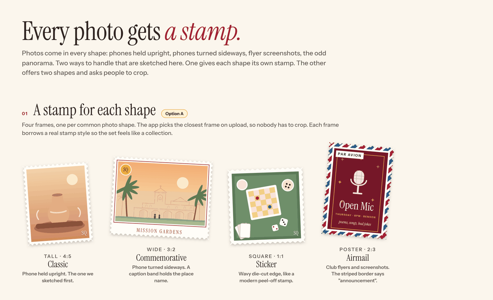

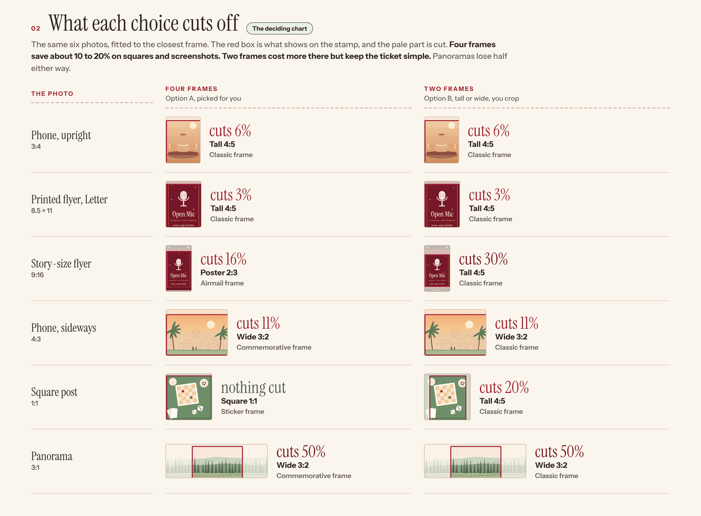

**The stamp stays inside the ticket.** It sits in the stub, to the right of the time, and the stub grows to the stamp's height. Nothing sticks out past the ticket's edge, and the stamp never covers the time, title, facts or Plan button. In the sketches a photo adds 16 to 58px to the ticket's height, and the airmail frame adds the most. The ticket's existing date postmark shrinks and sits on the stamp's top corner, so it only touches the rim. No cancellation lines cross the photo.

**Smaller time, bigger "until" line**, on every details ticket, with or without a photo, so the time column has room beside a stamp and every ticket matches. The time gets about 20% smaller at each screen size (the sketches go from 76px to 60px). The "until" line gets about 3px bigger, and the length moves to its own line in muted text.

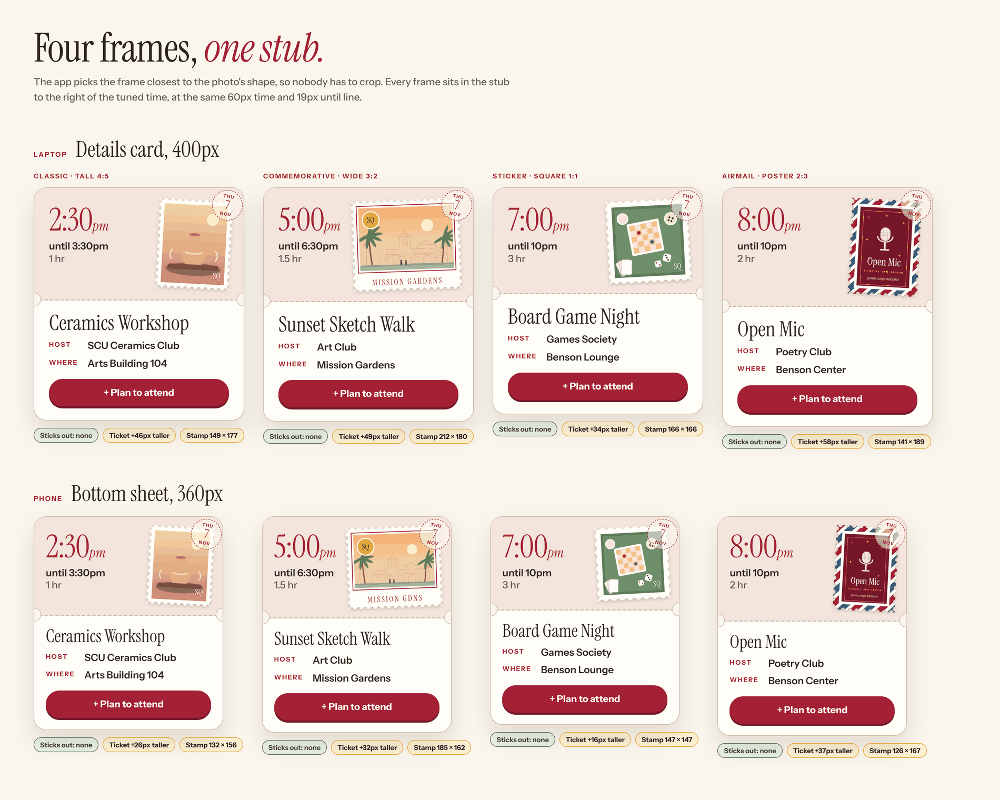

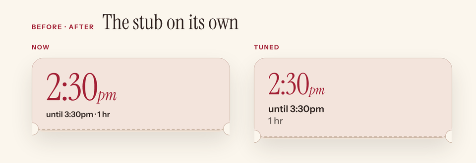

Trail tickets stay text-only to keep the list dense. A small stamp in the stub's corner is sketched in case testers miss photos there. Events without an image show no empty frame.

**Building it later:** store the image's width and height with the event. The presenter picks the frame from those numbers, and the View only draws the frame it is given. Accept JPEG, PNG or WebP up to 2 MB, resized on the server, with **alt text required**. Store in Supabase Storage through the server, never with a browser key. Anonymous public uploads need a removal path, so images wait for #7.

### Why Discover stays vertical (#9)
Most people never scroll sideways, so events past the right edge go unseen. Sideways scrolling is awkward with a keyboard, a screen reader and many trackpads, and on phones it fights the back-swipe gesture. The vertical day trail is also the core of SideQuest's look. To show more events per screen: tickets already go two per row when the trail is wide enough. Next could be three per row on very wide screens, a compact ticket with a narrower time stub, and day headers that stick while scrolling.

### "Bigger cards" (#10)
This pulls against fitting more events on screen, so first ask what testers meant: bigger text, a bigger time, or a bigger click area. Since 4 November, tickets go one per row whenever the trail is narrower than 700px, which already made them wider on most laptops. Show testers the current version first.

## Design exploration since the extra-credit plan (4 to 5 November)

Everything below is design work, drawn as screens and not yet built. It answers the hardest question the interviews raised: **Google Calendar knows a student's classes but not the rest of their life, so how does SideQuest learn the rest without asking anyone to type their week in?** It also collects every UI idea drawn so far, so the team can pick from one place.

All images are in [`docs/design/exploration-2026-11/`](design/exploration-2026-11/). Cynthia also keeps a review page (a Claude artifact) with all 173 screens, where each one is marked Keep, Maybe or Toss with a note. Ask her to share it.

### The calendar gap: what we decided

1. **Blank is "not sure yet," never "free."** Empty calendar time is drawn as fog. Discover still works on day one: an event in unknown time says **"Fits if you're free 4–5:30"** with the exact hours, so the list is useful before any setup. This builds on [Figure D's four states](#figure-d--four-availability-states-not-a-binary-calendar).
2. **Read busy or free from Google, never titles.** The connect sheet says so right above the button. Each block shows where it came from: G for Google, a pencil mark for something the student said, a check for a confirmed free time.
3. **Ask one question, only when it decides something.** Each foggy stretch carries a gold count of the events waiting on it ("4 events are waiting on Thursday 3–6"). Answering pays off immediately, and a second optional tap ("Every Thursday?") fills the slot for the semester.
4. **Learn from taps students make anyway, and confirm before using them.** Hiding an event can carry one tap of "Bad time," which saves the time, not the event. Three passes on the same slot produce one suggestion with its evidence listed ("You passed on Pottery, Trivia and Study Jam here"). A friend's "If… I finish work" becomes their availability for the next poll. Nothing is blocked silently.
5. **An optional ten-second Sunday check-in.** At most four cards, only for stretches where next week's events pile up, answered Free, Busy or Depends, or all at once with "Same as last week." Skipping it costs nothing.
6. **Classes in one go, if wanted.** Google Calendar connect or a one-time class schedule import sits in Settings. Neither is required. (Whether SCU's student system exports a usable file is not checked yet.)
7. **Pencil and pen.** Plans start in pencil (drawn as a sketch) and become pen (printed) after one "Still on?" two days before. Pen plans can also go to Google Calendar.
8. **Friends answer without the app.** The planner sends 2 or 3 options by link. Friends answer Works, If… or Can't in a browser, and a "maybe" carries a deadline. Options are ranked by the **worst-off friend** (least misery), so the most-voted option can still lose if it strands someone.
9. **Travel per person, with a private limit.** Each friend picks how they're getting there and the longest trip they'd make for this outing. The planner sees only "fits" or "too far," never the number. A "pick up Ari?" card goes into the friend's normal group chat.
10. **Plan repair.** When a plan breaks, the group picks up to two things to protect (same people, same day, same plan, keep it easy), sees swaps that keep them, and the dropped idea waits in Someday.

### Storyboard 1: a week with Maya (34 screens)

One student's week, Sunday to the weekend after, told with real phone and laptop screens.

| Act | What it shows | Image |
| --- | --- | --- |
| Sunday | Connect calendar with the promise, fog for blank time, drag to block club practice, type "I work Saturdays 9 to 1" for an AI draft to check | [week-1](design/exploration-2026-11/week-1-sunday-tell-it-your-week.jpg) |
| Monday | Discover starts from today's free gap. Faded tickets explain why they don't fit, including "almost fits, leave at 6." One question clears Thursday | [week-2](design/exploration-2026-11/week-2-monday-discover-from-free-time.jpg) |
| Tuesday | "Why it fits" with fresh facts, pencil vs pen in My Schedule, "Still on?" notification, laptop week with sources | [week-3](design/exploration-2026-11/week-3-tuesday-pencil-and-pen.jpg) |
| Wednesday | Pick 2 or 3 options, Kai answers in his browser, answers ranked by worst-off, a maybe with a deadline | [week-4](design/exploration-2026-11/week-4-wednesday-ask-friends-no-app.jpg) |
| Thursday | Travel mode and private limit, per-friend travel, ride ask in the group chat | [week-5](design/exploration-2026-11/week-5-thursday-getting-there.jpg) |
| Friday | Priya can't come, pick what to protect, two swaps, friends see the change as before and after, Someday shows what each idea waits for | [week-6](design/exploration-2026-11/week-6-friday-when-the-plan-breaks.jpg) |
| The night | "Leave by" nudge, running late in one tap, a "who's here" list with no map, the next-morning photo stamp | [week-7](design/exploration-2026-11/week-7-the-night-itself.jpg) |
| After | Share a flyer from Photos, AI reads it and marks what it isn't sure of, the idea speaks up when it fits, plain-English search | [week-8](design/exploration-2026-11/week-8-ideas-that-wait.jpg) |

### Storyboard 2: zero setup (12 screens)

Jordan never types his week. Three acts: [useful before any setup](design/exploration-2026-11/zero-1-useful-before-setup.jpg), [it learns from taps he makes anyway](design/exploration-2026-11/zero-2-learns-from-taps.jpg), and [ten seconds on Sunday, if he feels like it](design/exploration-2026-11/zero-3-ten-second-sunday.jpg). The tally on the last screen is the point: typed 0, taps this month 23.

### Voice mode and accessibility

**Wispr Flow was considered and set aside as a dependency.** Its developer API is "only available by exclusive access" after the Flow team approves an organization (enterprise@wisprflow.ai), with usage-based billing and no public price. Too risky for a quarter deadline. Students who already use the Wispr app can dictate into any text box anyway.

**Voice mode is an optional extra.** It asks the same questions as the gold count badges, out loud ([board](design/exploration-2026-11/style-2-voice-mode.jpg)):

- Push to talk only, and audio is never saved. Only the cards the student says yes to are kept.
- It keeps times, never reasons. "Busy, I see my therapist" is saved as busy, the reason is crossed out on screen, and the app says "Saved as busy. I don't keep why."
- It goes past the calendar: someday ideas, a weeknight travel limit, low-energy days.
- Every question can also be answered by tapping, and every spoken line also appears as text.
- When VoiceOver is on, SideQuest stays quiet and VoiceOver reads the question, so two voices never collide.
- Built on the browser's speech recognition and speech synthesis (Chrome and Safari, not Firefox) behind a **speech port**, with Wispr as a possible second adapter. The step that turns speech into a draft card reuses the flyer reader's server endpoint, so it adds to the AI credit with no new infrastructure.

**The accessibility credit itself rests on WCAG basics:** real labels on every control, keyboard-only use, contrast, image descriptions, a sensible screen-reader order. Matching visible labels to accessible names (WCAG 2.5.3) also makes the whole app usable with the voice control built into phones and laptops ("tap Post"). Two checks before shipping the new visual direction: contrast in the gold and dark rooms, and switching off motion under `prefers-reduced-motion`.

### Visual direction: each tab is a room

Testers and Cynthia found every tab looked the same: one cream page, one list of stubs. The fix keeps the type, the red and the ticket shape everywhere, and gives each tab its own room ([board](design/exploration-2026-11/style-1-four-rooms.jpg)):

| Tab | Room | Hero object | Signature motion |
| --- | --- | --- | --- |
| Discover | Paper | A huge date, today's free time as a gold ticket band, one featured event with a drawn picture | The featured ticket slides in like a ticket from a printer |
| My Schedule | Night ink | A ticket book: pen plans bright and stamped IN PEN, pencil plans as outlines, past photo stamps in the corner | The stamp thunks down when a plan goes to pen |
| Post | Print-shop gold | The event as a taped-up poster, posting is pressing a round stamp | The poster peels off and flies to the trail |
| Someday | Sage | A jar of paper slips, the ready one pops out the top | Slips settle when added, the ready one wiggles once |

Event pictures are original drawings (clay, games, sketch, improv, books, market) so the app never depends on clubs supplying photos. The tab bar floats, and the active tab is notched like a ticket stub.

### Options to choose from (rounds 2 and 3)

Every option has a phone and a laptop version. The team should pick one or two per tab.

**Round 2** ([Discover](design/exploration-2026-11/round2-1-discover.jpg) · [My Schedule](design/exploration-2026-11/round2-2-my-schedule.jpg) · [Post](design/exploration-2026-11/round2-3-post.jpg) · [Someday](design/exploration-2026-11/round2-4-someday.jpg) · [Voice](design/exploration-2026-11/round2-5-voice.jpg) · [Tab bar](design/exploration-2026-11/round2-6-tab-bar.jpg))

| Tab | Options |
| --- | --- |
| Discover | D1 ticket counter, D2 departures board (FITS, IF FREE, ENDS LATE), D3 today as a timeline, D4 one card at a time, D5 poster wall, D6 campus trail map, D7 the daily paper, D8 clock dial, D9 how much time do you have? |
| My Schedule | S1 ticket book at night, S2 wallet passes, S3 week of dots, S4 fridge month with photo stamps, S5 planner page, S6 boarding pass with countdown, S7 scrapbook, S8 Pencil · Pen · Done columns, S9 countdown |
| Post | P1 print shop, P2 snap or drop a flyer, P3 fill in the sentence, P4 pick a cover, P5 just say it, P6 run it again, P7 start from a kind of event, P8 poster builder |
| Someday | J1 jar, J2 corkboard, J3 night sky, J4 garden, J5 semester list, J6 shelf of jars per crew, J7 wish map, J8 draw a card, J9 almost ripe (time, people, open) |
| Voice | V1 plum and calm, V2 on air, V3 chat transcript, V4 lock screen, V5 small bar over Discover, V6 big captions, V7 index cards, V8 breathing orb |
| Tab bar | T1 ticket stub, T2 big Post stamp, T3 pen underline, T4 room swatches, T5 top switch, T6 stamps, T7 icons only, T8 floating Post |

**Round 3: lessons from Fanout** ([Discover](design/exploration-2026-11/round3-1-discover.jpg) · [My Schedule](design/exploration-2026-11/round3-2-my-schedule.jpg) · [Post](design/exploration-2026-11/round3-3-post.jpg) · [Someday](design/exploration-2026-11/round3-4-someday.jpg))

[Fanout](https://fanout.sh/) is a learning site for engineers whose launch was praised mostly for its interface. What transfers to SideQuest: explain with one small worked example and real numbers, labs where you move one control and watch the result, dense indexes with counts, maps of how things connect, roadmaps with progress, one pick a day, and privacy you can see (tools that run on the device and export an image).

| Tab | Options |
| --- | --- |
| Discover | F1 why it fits, worked out (150 free − 60 event − 12 walking = 78 spare), F2 fit lab (drag your free window), F3 tonight's index with counted filters, F4 one pick a day, F5 interest map, F6 worth the trip? (distance vs liking, best-option line), F7 compare two, F8 flyer jargon decoder ("GBM"), F9 next on the trail |
| My Schedule | M1 day dial with overlaps flagged, M2 will it happen? (each friend's answer as a chance: 40% all four, 87% at least three), M3 quarter plan in chapters, M4 what plans really cost (travel and buffer included), M5 share your week as an image, M6 log with heatmap, M7 who you're waiting on, M8 a battery per day, M9 before-you-go checklist |
| Post | K1 when should it be? (students free at each start time, counts only), K2 three questions (first 10 minutes, who it's for, what to bring), K3 readiness scan, K4 multi-week series, K5 three previews (Discover, lock screen, link), K6 paste anything, K7 what worked (turnout, counts only), K8 spots and waitlist, K9 co-host with overlapping clubs |
| Someday | Y1 what if… (tap "Ari is free Saturday," see what becomes ready), Y2 index with time, people, open dots, Y3 one idea a day, Y4 ideas linked by shared needs, Y5 big goal split into side quests, Y6 saved from anywhere, Y7 by season, Y8 a crew's shared list, Y9 ideas fade instead of piling up |

**Round 4: from Cynthia's reference boards** ([Discover](design/exploration-2026-11/round4-1-discover.jpg) · [My Schedule](design/exploration-2026-11/round4-2-my-schedule.jpg) · [Post](design/exploration-2026-11/round4-3-post.jpg) · [Someday, onboarding, widgets](design/exploration-2026-11/round4-4-someday-onboarding-widgets.jpg))

Drawn from MoodGallery (emotion blobs, "every emotion becomes art"), Figma Make's liquid glass editor, Laws of UX cards, Pinterest retro-window and sticker pins, Godly's layered cards, Dribbble's tilted book covers, Refero's blue-pen and Comet onboarding, Mozi's "see where you overlap," and Headspace on Mobbin. A new element runs through it: small geometric characters (round, star, triangle, cloud) that stand for kinds of events and for feelings.

| Tab | Options |
| --- | --- |
| Discover | A1 event globe (shake for one), A2 shapes, not photos, A3 retro desktop (tonight.exe), A4 scroll into tonight (3D layers), A5 poster shelf, A6 blue pen notebook, A7 free-time lens (liquid glass + sliders + Random), A8 see where you overlap, A9 sunny guide, A10 feeling first |
| My Schedule | B1 your week, painted, B2 streak, B3 The Jordan Weekly, B4 leave-by card, B5 your shelf of book spines, B6 calendar.exe, B7 how it felt, B8 sticker diary, B9 ambient clock |
| Post | C1 poster editor with control panel, C2 sticker pack, C3 new_event.exe wizard, C4 blocks like a design system, C5 what are you hosting?, C6 doodle a flyer, C7 poster in layers, C8 what's the vibe?, C9 countdown story |
| Someday, onboarding, widgets | E1 hey friend, E2 the hour that's yours, E3 a place for your free time, E4 widgets, E5 someday machine, E6 a quarter of doodles, E7 someday.zip, E8 every plan becomes art, E9 empty states |

### Older boards, kept for reference

These came before the storyboards and several are already linked from the [extra-credit table](#which-product-ideas-each-credit-unlocks).

| Board | Idea | Image |
| --- | --- | --- |
| Ideas | The hour that shrank: time-use data on how little time students spend hanging out | [older-ideas-0](design/exploration-2026-11/older-ideas-0-the-hour-that-shrank.jpg) |
| Ideas | What fits in the gap: free time as a pocket that events, travel included, must slip into | [older-ideas-1](design/exploration-2026-11/older-ideas-1-what-fits-in-the-gap.jpg) |
| Ideas | Fog over Thursday: four friends' week, ask the one question that clears the most fog | [older-ideas-2](design/exploration-2026-11/older-ideas-2-fog-over-thursday.jpg) |
| Ideas | Down, if…: a maybe carries what would make it a yes, and only that person hears again | [older-ideas-3](design/exploration-2026-11/older-ideas-3-down-if.jpg) |
| Ideas | Save the part that mattered: plan repair by protecting up to two things | [older-ideas-4](design/exploration-2026-11/older-ideas-4-save-the-part.jpg) |
| Ideas | Ideas that ripen: a jar fills as its conditions come true, a ? never counts as yes | [older-ideas-5](design/exploration-2026-11/older-ideas-5-ideas-that-ripen.jpg) |
| Ideas | Nobody left on the curb: rank options by the worst-off friend | [older-ideas-6](design/exploration-2026-11/older-ideas-6-nobody-left-out.jpg) |
| Ideas | A passport for ordinary Tuesdays: a stamp journal, and who you made time for | [older-ideas-7](design/exploration-2026-11/older-ideas-7-passport.jpg) |
| Ideas | Which to build first: distance from competitors vs effort | [older-ideas-8](design/exploration-2026-11/older-ideas-8-which-to-build-first.jpg) |
| Friends | What survives from the September mockups, with verdicts | [older-friends-0](design/exploration-2026-11/older-friends-0-what-survives.jpg) |
| Friends | Friends on the ticket: your people as stickers, everyone else as a tally | [older-friends-1](design/exploration-2026-11/older-friends-1-friends-on-the-ticket.jpg) |
| Friends | Your circles decide who sees a plan | [older-friends-2](design/exploration-2026-11/older-friends-2-circles.jpg) |
| Friends | Pop-up groups that close after the plan | [older-friends-3](design/exploration-2026-11/older-friends-3-pop-up-groups.jpg) |
| Friends | I'll go if you go: a sealed match, nobody knows unless both tap | [older-friends-4](design/exploration-2026-11/older-friends-4-ill-go-if-you-go.jpg) |
| Friends | Almost fits: let the seam out and watch events drop in | [older-friends-5](design/exploration-2026-11/older-friends-5-almost-fits.jpg) |
| Friends | A fork in the road: which ideas need accounts and which don't | [older-friends-6](design/exploration-2026-11/older-friends-6-fork-in-the-road.jpg) |

### What this asks of the team

- **Pick per tab** from rounds 2 and 3 (Cynthia's review page records Keep, Maybe and Toss per screen).
- **Decide whether "not sure yet" replaces "free"** as the default for blank time. It changes Discover's copy and the fit engine's output from two states to three.
- **Confirm voice mode stays optional** and that the accessibility audit (WCAG basics, axe in CI) is the evidence for that credit.
- Nothing here changes the M2 contract until the team agrees to it in `REQUIREMENTS.md` and `SPECIFICATIONS.md`.

## Final-project demonstration ladder

**Demonstration A — graded MVP:** Poster A creates an event with hostName. Browser B sees it, searches a matching free-time window, adds it to local plans, refreshes, removes the plan, and confirms the public event remains. Show error/empty states, two browsers, meaningful tests, passing CI.

**Demonstration B — strongest next feature:** “I want to try the makerspace workshop, but Saturday doesn't work.” Store an intention with status **deferred**, show why an available event doesn't currently fit, then show a later compatible opportunity. This adds genuine distinction without a huge new social backend.

**Demonstration C — plan repair:** Student has a tentative group outing, but one constraint changes. Compare **keep time, change activity** vs **keep activity, move time**. Show reasons and uncertainties. For the final course project, one polished branch of this decision can be more convincing than half-working calendar, chat, travel and weather integrations.

**Demonstration D — optional group layer:** Two or three participants submit availability for one plan. SideQuest identifies a common window, evaluates candidate activities, then creates a proposed plan. Avoid claiming verified identity if invitations aren't authenticated.

Choose scope by actual time and interview feedback; these are **recommendations**, not bonus-feature requirements.

## 8. A rigorous quality and course-evidence checklist

### Engineering
- Maintain Model–View–Controller separation; draw CRC/ER changes at the assignment milestone.
- GitHub PRs and teammate reviews; run Vitest and production build on every change.
- Test meaningful boundaries: date/time equality, corrupt local storage, duplicate plan IDs, second browser, missing event, hostName persistence.
- Make accessible views: keyboard, focus, labels, validation feedback, mobile layouts, empty/loading/error states.
- Track known limitations honestly: unverified host labels, no account permissions, anonymous spam risk, no live SCU import, same-day-only times, full-fit only.
- Require explicit approval before public deployment; published events require validation, abuse protection, and an appropriate source/ownership policy.

### Evidence for course requirements
- [Fall 2026 syllabus](https://docs.google.com/document/d/1QvOyric501Vr8A7nzD6WWwF3Dp8FdvAkp6l7SAkXee4/edit): software lifecycle, interviews, UX testing, architecture documentation, teamwork, independent technical judgment, exams, AI policy and late policy.
- [M2 Part 2 instructions](https://docs.google.com/document/d/1qIx_8k4ZOGWPrISXNYXf-sOifYsXk3SWoPVkoOBP3es/edit): after MVP, revise full CRC+ER in draw.io and submit individual reflection identifying changes, future key features, contributions and internal deadlines. **The retrieved assignment displays inconsistent date/day text (“Wednesday, Nov. 9th”); check the actual Camino/Gradescope due time rather than relying on that string.**
- [P3 requirements and professor comments](https://docs.google.com/document/d/11Yq8sW1aOphznZHP-zbul2OedCbLJtxczb-ZZDD3oR8/edit): broader MVP list, later list, and optional professor feedback about saving.
- [P1 personas and scenarios](https://docs.google.com/document/d/13OOI6XF8nOiJcPj4t3Jdfxqid2EOuCfh78p7x7cYOGE/edit): Jordan, Maya, intention/plan/opportunity distinctions, uncertainty and adaptive replanning.
- [M1 requirements](../REQUIREMENTS.md) and [specifications](../SPECIFICATIONS.md): current narrower walking skeleton.
- **Extra credit:** [Verified final project bonus rubric](https://docs.google.com/document/d/12slKo80yu17NZw5nbrB0U1C_nj7mLq6h6uQoSbkCVQk/edit?usp=sharing): up to five points, contingent on eligibility, complete core work, approved team choices and actual functioning bonus features. [Raw interview and bonus analysis](#original-interview-evidence--detailed-field-note-table). The separate syllabus oral reassessment is another program.

**Do not publish professor copyrighted slides outside authorized class access.** This page summarizes relevant course instructions and links to student-accessible documents; do not copy lecture decks wholesale.


## Decisions for the four-person team

**Cynthia:** research, accessible information hierarchy, two entry points, comparison/repair prototypes and usability protocol. **Devonny:** event results/details, provenance and link sharing. **Daven:** catalog service, source adapters, real-time publishing and safe endpoints. **Sembiyan:** time matching, pure feasibility evaluation and eventual plan constraints. Agree before anyone writes shared model changes; one teammate integrates App.tsx.

**Timeline:** P5 coursework must be submitted as required separately; M2 prototype remains the three-class vertical slice; after M2 add the new full CRC/ER classes for M2 Part 2. Never instruct coding agents to ship the future models during the current milestone merely because this memo describes them.

## Source bibliography

**Interviews and course:** [raw notes](https://docs.google.com/document/d/1NRX14JTG78lvDj_AUFRzaricBm-QR4vECJiLfvXGu1M/edit), [derived P1 research](https://docs.google.com/document/d/13OOI6XF8nOiJcPj4t3Jdfxqid2EOuCfh78p7x7cYOGE/edit), [P3](https://docs.google.com/document/d/11Yq8sW1aOphznZHP-zbul2OedCbLJtxczb-ZZDD3oR8/edit), [course extra credit](https://docs.google.com/document/d/12slKo80yu17NZw5nbrB0U1C_nj7mLq6h6uQoSbkCVQk/edit?usp=sharing), [earlier interview+rubric synthesis](#original-interview-evidence--detailed-field-note-table).

**Competitors:** [Howbout groups](https://howbout.app/groups), [Howbout availability](https://howbout.app/get-help/find-availability/), [Partiful time poll](https://help.partiful.com/en-us/articles/15525422-can-i-poll-or-survey-my-guests), [Luma search](https://help.luma.com/p/searching-for-events), [SCU event calendar](https://events.scu.edu/campus-calendar/all).

**HCI/research:** [IBM Togedule 2025](https://research.ibm.com/publications/togedule-scheduling-meetings-with-large-language-models-and-adaptive-representations-of-group-availability), [I Want It That Way](https://doi.org/10.1145/3685053), [Haze/uncertainty](https://www.research.ed.ac.uk/en/publications/exploring-uncertainty-in-digital-scheduling-and-the-wider-implica/), [groupTime](https://hci.stanford.edu/publications/paper.php?id=25), [Group fairness](https://link.springer.com/article/10.1007/s11257-023-09363-0), [Group recommender sequential fairness](https://link.springer.com/article/10.1007/s10844-021-00652-x), [prospective memory](https://pubmed.ncbi.nlm.nih.gov/19130080/), [Satisficing](https://pubs.aeaweb.org/doi/10.1257/jel.20201396), [Plan commitment](https://www.sciencedirect.com/science/article/pii/S0952197623004591), [Plan success vs preference](https://aclanthology.org/2025.emnlp-main.585/).
