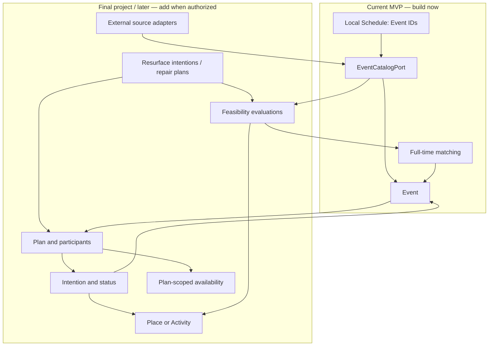

# SideQuest — Product Vision, Future-Proof MVP, and Final-Project Roadmap

**Working research and architecture recommendation, 27 October 2026.** This document is for the SideQuest team, not a change to the agreed M2 MVP scope. It reconstructs the early project proposal, P1 personas and scenarios, P3 requirements, P4 three-class design, the implemented M1 code, the selected same-day/Supabase contract, and a comparison with existing platforms. **Existing source requirements, confirmed implementation decisions, and new recommendations are marked separately.**

> **Positioning:** SideQuest helps students identify what they can actually do with the time and people available, remember activities they still want to do, and adapt when plans change. The initial MVP validates the first slice: post → browse → find full fit → plan locally.

## 1. Why we're building it

**P0 team proposal:** students waste time checking many sources for activities, places and events. The problem includes free-time feasibility and spontaneous coordination with friends. The proposal envisioned saving/rating past activities, weather considerations and transport differences, beyond the limited MVP.

**P1 research (two distinct situations):**
- **Jordan, lightweight opportunity planner:** one bounded free-time window, small rotating friend group, rapid discovery and low-friction coordination. Often starts with the activity.
- **Maya, relationship-centered coordinator:** uncertain/partly undocumented schedules, repeat friends, multiple practical constraints, remembering ideas that were postponed. Often starts with people and asks what the group can do.
- The P1 working thesis was to turn free time and unfinished activity ideas into feasible plans and adapt when conditions change.
- **Important P1 design insight:** *Event*, *Intention*, and *Plan* are different concepts. A deferred plan is not a rejected one. An intention can be kept for a later opportunity, without fabricating a scheduled Event.

**P3 broader MVP proposal:** official/student event discovery; full/partial/no-fit reasons; usable partial attendance time; campus travel; description, cost/registration and participation rules; student posting; sharing by existing messaging. Professor Kandel said her comments were optional and suggested create → find → possibly save/revisit as a complete path.

**P4 current class architecture / M2 MVP agreement:** Event, EventCatalog, Schedule; shared posted events; same-device planned Event identities; full-event temporal fit; anyone can post with hostName; no accounts/cost/registration/partial/travel for this milestone. The Supabase and same-day choices are documented in [MVP Implementation Contract](MVP_IMPLEMENTATION_CONTRACT.md). **That contract is a selected development proposal, not a completed hosted backend**.

**M2 Part 2 coursework:** after the MVP prototype, the assignment requires a **full final-project CRC diagram** and **full ER diagram**, revised with new classes, attributes and relationships, plus an individual reflection explaining decisions and team division. That is an appropriate milestone for the expanded architecture.

## 2. Competitive positioning: compare honestly

| Platform | Verified capabilities | SideQuest should aim to contribute |
| --- | --- | --- |
| **SCU event calendar and CSI directory** | Official event lists, categories, searches, a student-organizations directory | User-specific *time and feasibility* decisions, including informal posts and opportunities |
| **Meetup** | Groups, events, RSVP, recurring events, personalized recommendations | Short-window and group-condition feasibility, intention memory and plan repair |
| **Luma** | Hosting, registration, maps, personalized feeds, search, calendars | Preserve the user’s constraints and unfinished activity desires, not another event-hosting layer |
| **Conventional calendars** | Record commitments and show availability | Work even when availability is tentative, unrecorded, or different for every group |
| **When2meet-style scheduling** | Gather overlapping availability | Turn overlap into a feasible *activity choice*, taking place, travel and preferences into account |

References: [SCU calendar](https://events.scu.edu/campus-calendar/all) · [SCU organizations](https://www.scu.edu/csi/getconnected/) · [Meetup event creation](https://help.meetup.com/hc/en-us/articles/39790436736525-Creating-an-event) · [Meetup recommendations](https://help.meetup.com/hc/en-us/articles/39489043789325-How-can-I-improve-visibility-for-my-events-and-groups) · [Luma discovering events](https://help.luma.com/p/discovering-events) · [Luma search](https://help.luma.com/p/searching-for-events).

**Avoid overclaiming**: basic calendar intersections, availability voting, social event discovery, simple weather/budget filters, and generic AI chat have existing competitors. The specific differentiator worth testing is *intention → opportunity → commitment → adaptation*, with understandable evidence for feasibility.

## 3. The staged product: protect the course MVP

| Stage | User-visible value | Status | New concepts |
| --- | --- | --- | --- |
| **M1 walking skeleton** | Create in this browser, save locally, find full event within time window | Implemented in `app/src`; tests/CI exist | `CampusEvent`, time validation, `fitsFully` |
| **M2 MVP prototype** | Shared event posting, browsing/details with hostName, full-fit search, device-local My Schedule | Agreed scope, implementation planned | Shared catalog adapter; separate local Schedule; description and hostName |
| **Final project foundation** | Stronger feasibility explanations and preserved intentions, plus at least one useful planning extension validated with users | Recommended; **not committed MVP scope** | `FitEvaluation`, `Intention`, `Plan`, time/location metadata |
| **Later product** | Partial participation, travel/weather, informal group constraints, resurface wishes, group decision making, plan repair | P1/P3 future requirements; stage as capacity permits | Evaluators, preferences, invite links, plan status history |
| **Exploratory long term** | Context-aware recommendations, calendar imports, private group AI participant, multi-source availability, sophisticated personalization | Research directions, not assignment requirements | Adapter-based data import, optional identities, conversational confirmation |

**Do not confuse “later requirement in P3/P1” with official extra-credit grading.** The checked [Fall 2026 syllabus](https://docs.google.com/document/d/1QvOyric501Vr8A7nzD6WWwF3Dp8FdvAkp6l7SAkXee4/edit) explicitly offers an instructor-approved **extra-credit oral assessment within one week of a released grade**. No reviewed source establishes bonus course points for adding SideQuest features, so do not promise them. Meet graded requirements first: project milestones, correct diagrams, user evidence, tests/CI, documented team contributions, and working demo.

## 4. Future-proof MVP rules: small choices with large consequences

### 4.1 Identity and event source
- Public events use **stable opaque `id`**, never title or hostName as key. Generate IDs in the shared store.
- `hostName` is self-reported display text. It is **not** verified poster identity or permission to edit/delete.
- Keep `EventCatalogPort` as an interface; implementation can change from fake adapter to Supabase to another provider without rewriting the views.
- For future official SCU import, support **provenance and external IDs** at the adapter/data layer when needed: `sourceKind`, `sourceProvider`, `externalId`, `sourceUrl`, `lastCheckedAt`. Distinguish *official record* from *self-reported student post*, and prevent duplicated imported events by unique provider + external ID.
- Do **not** import or claim official verification just because someone typed “SCU” into a host field. Do not scrape private campus systems without authorization.

### 4.2 Time semantics: preserve today, isolate tomorrow
- The selected M2 contract uses `date` (YYYY-MM-DD) and `start,end` (HH:mm) **on one day, America/Los_Angeles**. It is a narrower scope than the original P4 separate start/end dates.
- **Do not scatter time parsing throughout React.** Put `toMinutes`, `fitsFully`, validation, duration, and any future timezone conversion in `model/time.ts` or a small dedicated utility; the actual filename is a suggestion.
- Add a **pure conversion boundary** in the catalog adapter so a future `EventOccurrence {startAt,endAt,timeZone}` can be introduced without changing every screen. For M2 it returns the existing format.
- Do **not** insert timezone-converted UTC strings into the current wall-clock format silently. Test exact boundaries, dates and negative duration.

### 4.3 The crucial difference between Event, Intention and Plan
- **Event:** a dated occurrence in the world, e.g. “Art Workshop Friday 2:30–3:30”. Other people can discover it.
- **Place or Activity:** a location or general thing to do, e.g. “hike at Alum Rock”. It can have hours, price and conditions without being scheduled as an Event.
- **Intention:** a wish to do an Event, visit a Place, or try an Activity, even with no time selected. May be active, deferred, done, or rejected.
- **Plan:** a chosen activity/event with a selected time, participants, status, and constraints. Could be proposed, tentative, committed, completed, postponed, or canceled.
- **M2 Schedule:** just a list of planned **Event IDs on this device**, with no fake group participation or extra entities. This is a *simple projection* of future personal plans, not the full final Plan model.
- Later, migrate `sidequest.planned-event-ids.v1` into a versioned local `PlanRef` representation via a **one-time tested migration**. Do not retroactively pretend every saved Event was formally RSVP'd or attended.

### 4.4 Evaluation, not brittle boolean decisions
- Preserve the tested pure `fitsFully(event,window)` boolean in M2.
- Future callers should use an *additive wrapper* such as:
```ts
type FitStatus = 'FULL' | 'PARTIAL' | 'NONE' | 'UNKNOWN'
type FitEvaluation = {
  status: FitStatus
  reasons: string[]
  usableMinutes?: number
  constraintsChecked: string[]
  constraintsUnknown: string[]
}
```
- M2's evaluation wrapper can map boolean full-fit to FULL or NONE for **time only**. Never label an event “realistically feasible” if distance, registration, transport, or safety is unknown. Use “fits your selected time window”.
- Later modules independently evaluate event timing, participation policy, transit, hours, registration, weather and budget; the orchestrator combines them. Do not bake travel or partial-attendance rules into `CampusEvent` or React UI.

### 4.5 Extensible location / costs / participation
- Keep the M2 `location` free-text field. Later add an optional normalized `Place`/geocoded location object and `ParticipationPolicy` rather than changing the meaning of `location`.
- Do not create UI elements and SQL columns for cost, capacity, waitlist, registration, accessibility, or travel until a feature requires them. Plan their interface as optional **feature-specific** metadata.
- An event time window, a location's opening hours, and registration eligibility are distinct kinds of availability; keep them separate in future models.

### 4.6 Group and privacy constraints
- For P1's rotating groups, invite-by-link or plan-scoped participation can come before full persistent social networks, **but real shared plans will eventually need identity/authorization or a carefully scoped invitation token**.
- Never assume arbitrary `hostName`/anonymous `posterId` is safe authorization.
- People may be tentative and only willing to participate in one particular plan. Availability is plan-scoped data, not a globally true “free/busy” record.
- Support hard vs soft constraints and confirmation of inferences before building an AI planner. Keep private budgets or scheduling restrictions private even while using a yes/no feasibility answer.

### 4.7 Extensibility and testability
- Keep domain models/framework-independent and pure functions for evaluation.
- Views call feature controllers; controllers depend on ports/interfaces; Supabase is one concrete adapter, not imported into every component.
- Separate `EventCatalogPort`, `SchedulePort`, and future `PlaceSource`, `FeasibilityEvaluator`, `IntentionsStore`, `GroupPlanPort`. Don't implement empty abstractions yet; document extension points and add them when there is a real consumer.
- Add repository contract tests and seeded fake adapters for all UI work, including empty/error/slow responses.
- Version localStorage keys and database migrations. Write regression tests for every migration and previously valid schedule ID.

## 5. How the final system can expand



This is a **suggested future class map**, not a revised P4 or P5 submission. P4's three present classes stay. The added classes are for the **full CRC and ER** diagrams required later by M2 Part 2. Do not ship the future boxes in the M2 prototype.

## 6. Features in the original requirements, ranked by strategic value

| Feature | Prior source | Priority for final product | Technical prerequisite |
| --- | --- | --- | --- |
| Full/partial/no-fit with explanations and usable attendance time | P3 broader MVP | **High** | FitEvaluation + ParticipationPolicy |
| Transit/walking-time and location feasibility | P0/P3 | **High if reliable travel data can be sourced** | Normalized Place + travel estimator + explicit uncertainty |
| Event source category / official vs student | P3 | **Medium** | Provenance, no falsely verified claims |
| Stable event sharing | P3 | **Quick win** | Shareable URL for `eventId`; ordinary device share sheet |
| Intention list: do later vs no longer interested | P1/P3 later | **Highest strategic priority** | Intention entity + status |
| Resurface an intention when a feasible opportunity appears | P1 | **Highest differentiating value, later** | Intention + evaluator + event/place source |
| Plan repair / substitution / postponement | P1/P3 later | **Highest differentiating value, later** | Plan status + constraints + compare alternatives |
| Friend/rotating group availability, tentative statuses | P1/P3 later | **High** | GroupPlan + scoped participation + privacy |
| Weather, budget, distance filters | P0/P1/P3 later | **Medium** | External data connectors, cached freshness, careful missing-data behavior |
| Calendar integration and uncertain availability | P1/P3 later | **Medium** | Permissioned calendar adapter + manual override |
| Previous experiences and personal/group ratings | P0/P1/P3 later | **Medium** | Experience memory; private by default |
| Off-campus place/activity discovery | P0/P3 later | **Medium** | PlaceSource separated from EventCatalog |
| Conversational group AI assistant | P1 exploratory idea | **Only after actual group planning works** | Confirmed structured constraints, no silent commitments |
| Popularity/gamification and generic recommendations | P1 references, broad market | **Low differentiation** | Validated users; avoid building for novelty alone |

## 7. Recommended final-project demonstration ladder

**Demonstration A — graded MVP:** Poster A creates an event with hostName. Browser B sees it, searches a matching free-time window, adds it to local plans, refreshes, removes the plan, and confirms the public event remains. Show error/empty states, two browsers, meaningful tests, passing CI.

**Demonstration B — strongest next feature:** “I want to try the makerspace workshop, but Saturday doesn't work.” Store an intention with status **deferred**, show why an available event doesn't currently fit, then show a later compatible opportunity. This adds genuine distinction without a huge new social backend.

**Demonstration C — plan repair:** Student has a tentative group outing, but one constraint changes. Compare **keep time, change activity** vs **keep activity, move time**. Show reasons and uncertainties. For the final course project, one polished branch of this decision can be more convincing than half-working calendar, chat, travel and weather integrations.

**Demonstration D — optional group layer:** Two or three participants submit availability for one plan. SideQuest identifies a common window, evaluates candidate activities, then creates a proposed plan. Avoid claiming verified identity if invitations aren't authenticated.

Choose scope by actual time and interview feedback; these are **recommendations**, not bonus-feature requirements.

## 8. A rigorous quality and course-evidence checklist

### Engineering
- Maintain Model–View–Controller separation; draw CRC/ER changes at the assignment milestone.
- GitHub PRs and teammate reviews; run Vitest and production build on every change.
- Test meaningful boundaries: date/time equality, corrupt local storage, duplicate plan IDs, second browser, missing event, hostName persistence.
- Make accessible views: keyboard, focus, labels, validation feedback, mobile layouts, empty/loading/error states.
- Track known limitations honestly: unverified host labels, no account permissions, anonymous spam risk, no live SCU import, same-day-only times, full-fit only.
- Require explicit approval before public deployment; published events require validation, abuse protection, and an appropriate source/ownership policy.

### Evidence for course requirements
- [Fall 2026 syllabus](https://docs.google.com/document/d/1QvOyric501Vr8A7nzD6WWwF3Dp8FdvAkp6l7SAkXee4/edit): software lifecycle, interviews, UX testing, architecture documentation, teamwork, independent technical judgment, exams, AI policy and late policy.
- [M2 Part 2 instructions](https://docs.google.com/document/d/1qIx_8k4ZOGWPrISXNYXf-sOifYsXk3SWoPVkoOBP3es/edit): after MVP, revise full CRC+ER in draw.io and submit individual reflection identifying changes, future key features, contributions and internal deadlines. **The retrieved assignment displays inconsistent date/day text (“Wednesday, Nov. 9th”); check the actual Camino/Gradescope due time rather than relying on that string.**
- [P3 requirements and professor comments](https://docs.google.com/document/d/11Yq8sW1aOphznZHP-zbul2OedCbLJtxczb-ZZDD3oR8/edit): broader MVP list, later list, and optional professor feedback about saving.
- [P1 personas and scenarios](https://docs.google.com/document/d/13OOI6XF8nOiJcPj4t3Jdfxqid2EOuCfh78p7x7cYOGE/edit): Jordan, Maya, intention/plan/opportunity distinctions, uncertainty and adaptive replanning.
- [M1 requirements](../REQUIREMENTS.md) and [specifications](../SPECIFICATIONS.md): current narrower walking skeleton.
- **Extra credit:** the syllabus mentions a possible approved oral reassessment within one week of grade release. No checked source grants extra credit just for optional features.

**Do not publish professor copyrighted slides outside authorized class access.** This page summarizes relevant course instructions and links to student-accessible documents; do not copy lecture decks wholesale.

## 9. Concrete team plan, with the future in mind

| Contributor | M2 owned slice | Keep open for later |
| --- | --- | --- |
| **Cynthia** | Design tokens, accessible EventCard/Detail and reusable states; coordinate with Devonny | Intention capture, opportunity explanations, plan-repair UX, responsive research prototypes |
| **Devonny** | Browse, details, typed catalog reads and empty/error states | Unified discovery of Events and Places; source provenance UI; share links |
| **Daven** | Shared event posting, Supabase adapter, validation and stable IDs | Source adapters, de-duplication, additional tables when justified, safe host ownership |
| **Sembiyan** | Full-fit functions and local Schedule ID persistence | FitEvaluation, participation policy, time windows, group availability, plan-state transitions |
| **Everyone** | Migrations/contracts, real CI assertions, integration, peer review, user testing | Full CRC/ER, decision records, evaluated course demonstration |

**Next steps:** finish P5 hand-in; get the Supabase adapter working; have every teammate implement against the same [MVP Implementation Contract](MVP_IMPLEMENTATION_CONTRACT.md); deliver M2 and record what the user testing actually finds. After M2, do one team workshop on **Intention vs Event vs Plan**, then revise the full CRC/ER according to the M2 Part 2 assignment. Resist implementing the big future model this week.

---

### User research and official sources

[P0 team proposal](https://docs.google.com/document/d/1sz24aVNedVlzwqg5Iamuo0IYeSwjN80AHVI0s3glTpg/edit) · [P1 full scenarios](https://docs.google.com/document/d/13OOI6XF8nOiJcPj4t3Jdfxqid2EOuCfh78p7x7cYOGE/edit) · [P1 early group requirements](https://docs.google.com/document/d/1_K94shes9GwiGuYoyyj5H6G38f4TX0zCNjAF9TVU0UI/edit) · [P3 MVP and later requirements](https://docs.google.com/document/d/11Yq8sW1aOphznZHP-zbul2OedCbLJtxczb-ZZDD3oR8/edit) · [P4 architecture](https://drive.google.com/file/d/1xiZGXQeScuJx14yKNUcwj1XtWTfOb-l4/view) · [Syllabus](https://docs.google.com/document/d/1QvOyric501Vr8A7nzD6WWwF3Dp8FdvAkp6l7SAkXee4/edit).
