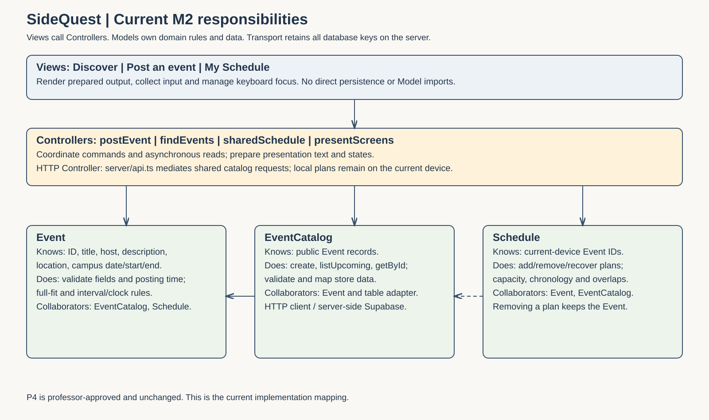
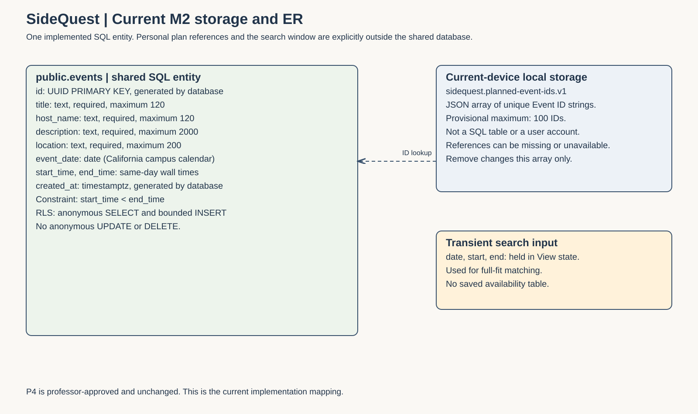

# Current M2 implementation diagrams

## Editable files for M2 Part 1 review

- **[CRC / responsibilities diagram (.drawio)](diagrams/M2_CRC.drawio)** — standalone editable Draw.io source.
- **[Storage / ER diagram (.drawio)](diagrams/M2_STORAGE_ER.drawio)** — standalone editable Draw.io source, distinguishing the one shared SQL events table from device-local planned IDs.
- [Combined two-page source (.drawio)](diagrams/M2_IMPLEMENTATION.drawio) — preserved for convenience.
- **[Google Drive team folder](https://drive.google.com/drive/folders/1Nr67cdT8tEKPWBe9j3LNm6Wzw6alGgPc)** — contains the original combined editable file and separate [CRC](https://drive.google.com/file/d/1EQOXQXHnbeXry1-HULe60I2nKLw_gMR-/view) and [ER](https://drive.google.com/file/d/1gIQn3a0d6uCOkaqzQsg2r29I_IUkml-e/view) `.drawio` copies.

For Professor Kandel: `jkandel-scu` has verified write/collaborator access to this private GitHub repository. The source files in this section are available on `master`, without requiring Google Drive access. SCU-account access to the Drive copies is permitted, but those links are not public anonymous links.

These supplement the professor-approved P4 without changing its accepted symbols or ownership decisions. They describe the combined implementation for M2 rather than the broader P5 future design.

Open [M2_IMPLEMENTATION.drawio](diagrams/M2_IMPLEMENTATION.drawio) in diagrams.net. It contains two editable pages. GitHub can display the SVG previews below directly.

## Responsibilities / CRC mapping

Event, EventCatalog and Schedule remain the domain concepts from the accepted P4. TypeScript records and Model functions implement their responsibilities. Feature Controllers mediate their operations. The server HTTP Controller is a transport boundary; it adds no account or new domain entity.

`DiscoverView`, `PostEventForm` and `ScheduleTrailView` render Controller output and report user actions. `postEvent`, `findEvents`, `personalSchedule`, `sharedSchedule` and `presentScreens` coordinate operations. Models own field/posting validity, full-fit matching, clock/interval rules, local ID integrity, overlaps and persistence. The browser HTTP port calls the Node API; only its Model adapter talks to Supabase.

## Implemented storage / ER

The implemented SQL schema has one entity, `public.events`. Its fields, key, same-day constraint and anonymous permissions match the existing migration. There are no USER, persistent AVAILABILITY_WINDOW or SQL planned-attendance tables.

The current browser stores a unique list of planned Event IDs under `sidequest.planned-event-ids.v1`. That list is outside SQL and references public events by ID. It is not an enforced database foreign key: a reference may outlive the corresponding record or fail to load temporarily. Only successful null lookups count as missing; failed requests preserve the ID and offer retry. Removing a personal reference leaves the public event intact.

The free-time window is temporary form state, not a saved database record. The earlier P5 drawing remains an archived broader conceptual coursework artifact. Use this current M2 storage page when explaining what is actually implemented.

**P4 status: approved and resolved. No P4 changes are requested.**
