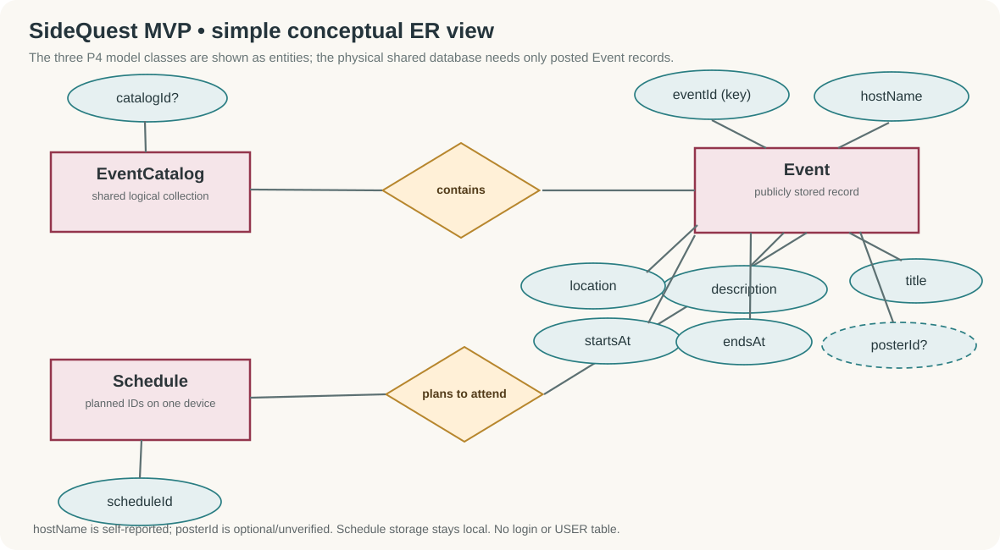

# SideQuest P5 — simple MVP ER model and implementation notes

**Working design explanation · October 27, 2026.** This replaces the earlier exploratory proposal that introduced USER accounts, saved availability windows, cost fields, and a server-side attendance table. Those extra entities are **not** the MVP the team chose.

**Source of truth for scope:** [original P4 draw.io class diagram](https://drive.google.com/file/d/1xiZGXQeScuJx14yKNUcwj1XtWTfOb-l4/view) and [P4 submission/feedback](https://docs.google.com/document/d/11MKHb3f40Yl81Rx__Mna2lRFf5ooZZUD22QEUnmpiO4/edit). The ER drawing below is an **updated design suggestion**, not a claim that P4 already contained host information or that a final P5 draw.io submission is complete.

## The small design in one picture

[Open the diagram](assets/playbook/er-mvp.svg) · [MVP team implementation playbook](MVP_TEAM_PLAYBOOK.md)

## Event host name versus user account

A student needs to know who is hosting an event. **That does not require a login system.**

- **`eventId` — required key:** generated for every Event; used to retrieve an event and reference it from a Schedule. Two events may have the same title or host name but never the same ID.
- **`hostName` — required display value (proposed P4 amendment):** e.g., “SCU Photography Club,” “Cynthia,” or “Student Wellness.” The person posting types this in. It can be shown on Event cards and detail pages.
- **`posterId` — optional *unverified* identifier:** if the team wants to associate posts originating from the same browser, it could generate and store a random local identifier. This is **not** a student ID, verified host ID, or authentication credential. It must not grant editing rights or imply that the displayed host is genuine.
- **No `USER` table for MVP:** without sign-in, there is no trustworthy relationship between an arbitrary account record and the person posting. A host name is enough for the initial creation/browse/find/plan path.

**Why not make `hostName` a foreign key to USER?** It would add identity management and account-related semantics that are absent from P4. If a later version needs verified organizations, claims ownership, or supports editing one's own posts, then a real Host/User entity, authentication, and permissions become justified. That is future scope.

## Model classes versus persistent database tables

Professor Kandel's [P5 assignment](https://docs.google.com/document/d/1FcjgTh3lBprpDxkFNuENM1RRAky9lYFeMOAeaJLnAC8/edit) states **“Each model class is its own entity.”** P4 defines three model classes, so a **conceptual classroom ER diagram should show all three**.

| P4 model class / conceptual entity | Relationship | Actual MVP persistence |
| --- | --- | --- |
| **EventCatalog** | One catalog contains zero or more public Events | Application service/collection; may have no separate SQL table |
| **Event** | Each public Event belongs to the shared catalog; may be referenced by many Schedules | Shared persisted Event records with unique `eventId` and host display information |
| **Schedule** | Each personal Schedule refers to zero or more Events; each Event can be referenced by multiple Schedules | Planned `eventId` list **only on that browser/device**, not a centralized attendance table |

**This is the key distinction:** the professor's conceptual diagram instruction is about how to draw entities for the course; a deployed backend does not automatically require one physical table for every application class. The public shared store may consist of one `events` collection/table. The local Schedule can be a `localStorage` array of event IDs. An optional logical `catalogId` (shown as optional in the illustration) is unnecessary for a single global catalog.

### Suggested Event attributes

| Attribute | Requirement | Notes |
| --- | --- | --- |
| `eventId` | **Required; unique key** | Generated by the application/database |
| `title` | Required | Student-facing event title |
| `hostName` | **Required proposal** | Who is hosting; self-reported, not verified |
| `description` | Required | Present in P4 |
| `location` | Required | Present in P4 |
| Start date/time | Required | P4 includes start date and time |
| End date/time | Required | Must follow start; full-event fit only |
| `posterId` | Optional | Anonymous device identifier, not a login/user ID |

No cost, ticketing, registration verification, persistent accounts, saved availability windows, travel-time feasibility or partial attendance is being added.

## How to draw the relationships

**EventCatalog — Event:** one logical shared catalog holds many Events. The [professor's P4 feedback](https://docs.google.com/document/d/11MKHb3f40Yl81Rx__Mna2lRFf5ooZZUD22QEUnmpiO4/edit) specifically recommends a **filled composition diamond** on the catalog end of the *UML class diagram*, since published Events live in the catalog. That is a UML ownership symbol, **not** a Chen ER diamond. In the P5 ER diagram, connect the catalog/entity pair according to her one-to-many notation rather than copying a UML diamond.

**Schedule — Event:** an Event may be planned by many separate local Schedules, and each Schedule can contain many Event references. Show this many-to-many relationship conceptually if following the three-class P5 drawing. But **do not implement a centralized PLANNED_ATTENDANCE table** without changing the agreed local Schedule scope. Removing a planned Event deletes only its local reference; the public Event remains.

**Schedule — EventCatalog:** in P4 this is a *lookup dependency* used to resolve an Event ID. It is not a separate persistent join table or a fourth kind of record.

### Example, without accounts

| Event ID | Title | Host shown to visitors |
| --- | --- | --- |
| e-101 | Art Workshop | SCU Art Club |
| e-102 | Evening Study Group | Cynthia |
| e-103 | Trail Walk | Outdoor Recreation |

One device might locally store `["e-101","e-103"]` as plans. A second device may store only `["e-102"]`. Both devices browse the *same* public EventCatalog. Deleting `"e-101"` from the first device's local list must not remove e-101 from the shared catalog.

## P5 hand-in requirements: do not substitute this Markdown

The current P5 assignment says **Wednesday, October 28, 2026, end of day**, and requires a photo of the in-class hand drawing and a completed draw.io ER diagram, shared as **everyone with the link can comment**, submitted via **Gradescope**. One person submits and adds contributing teammates.

This page is a design discussion/reference for translating P4 into P5. **It is not itself the submitted draw.io diagram**, and this graphic is simplified rather than claiming to be an exact Chen rendering of every attribute. Review the final draw.io shapes/keys and the professor's literal “each model class is its own entity” requirement before submission. Update P4 and P5 descriptions consistently if the team formally approves the additional `hostName` field.

## Technical checks for MVP

1. Post an Event with `hostName`; retrieve it in another browser and verify the same name displays.
2. Reject empty/whitespace-only `hostName`, invalid event dates/times and duplicate event IDs.
3. Allow different events to share the same `hostName` without conflating their IDs.
4. Add an Event ID to Schedule only once; save only IDs locally and resolve details from the shared EventCatalog.
5. Remove a planned event locally and confirm its public Event remains listed.
6. Test an exact full-fit boundary and an event ending one minute outside a free-time window.

**Other references:** [P3 broader requirements and professor comments](https://docs.google.com/document/d/11Yq8sW1aOphznZHP-zbul2OedCbLJtxczb-ZZDD3oR8/edit) · [M1 walking-skeleton specs](../SPECIFICATIONS.md) · [GitHub playbook](MVP_TEAM_PLAYBOOK.md).
