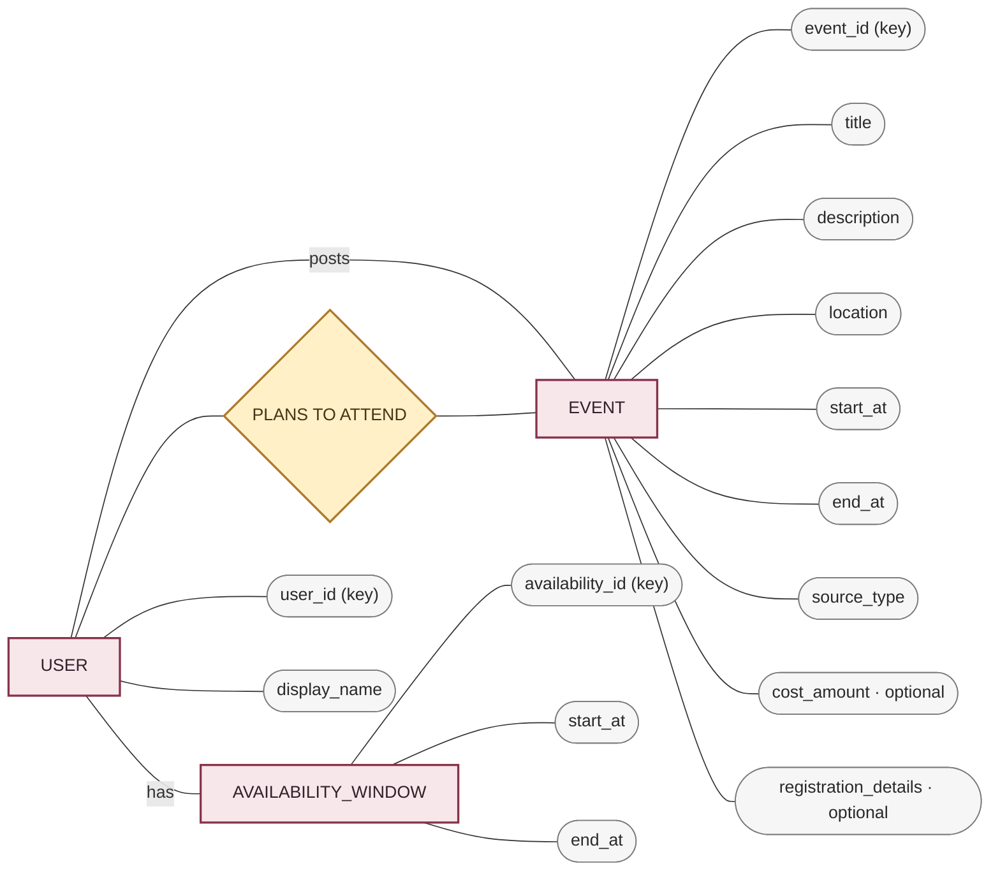

# SideQuest MVP — Chen ER diagram and database design rationale

**Course:** CSCI 187 · **Assignment:** P5 MVP ER Diagram  
**Status:** proposed **MVP database** design for team review. This is not a description of the existing M1 browser-only storage.

## Diagram (Mermaid, rendered directly on GitHub)

**Reading the picture:** rectangles = entities/tables; rounded ovals = attributes/columns; diamond = a many-to-many relationship that becomes a table. Mermaid's stadium shapes approximate Chen's true ovals. When transferring to draw.io, **underline the key attributes** user_id, event_id, availability_id. The words “(key)” here stand in for that underline. In accordance with our in-class discussion, we do **not** write M/N cardinality labels on the picture. We explain cardinality below.

**Working assumptions:** We are choosing to store **persistent users and multiple saved dated availability windows** for the MVP. This is newer than the team's P4 architecture, which deferred accounts and kept plans on the current device. The [P3 requirements](https://docs.google.com/document/d/11Yq8sW1aOphznZHP-zbul2OedCbLJtxczb-ZZDD3oR8/edit) do not mandate saved availability; specifying a search window can be temporary. These assumptions need team agreement before implementation.

## From our P4 model classes to the database

The [P4 architecture source](https://drive.google.com/file/d/1xiZGXQeScuJx14yKNUcwj1XtWTfOb-l4/view) describes **EventCatalog, Event, Schedule**. Its classes specify responsibilities and interaction; our P5 ER diagram asks what **records** need persistence.

| P4 component | Our treatment | Why |
| --- | --- | --- |
| **Event** | Keep as EVENT | Every published activity is a distinct row: title, times, location, description, and stable ID. |
| **EventCatalog** | **No separate catalog table/ID** | The app has one logical shared catalog, not multiple named catalogs. Its operations (add, list, retrieve, search) act on EVENT rows. A one-row catalog table with no independent fields adds nothing. The EventCatalog **class/service** can still exist. |
| **Schedule** | Implement as **PLANS TO ATTEND** association | P4 says Schedule holds references to events someone plans to attend. If each student has one unnamed list, their list is exactly the events connected to their user_id. The Schedule **class/UI** remains useful without a separately identified Schedule **table**. |
| **User** | Add USER | To associate public posts, personal plans and saved windows with one persistent identity, USER needs a stable key. A user account/login mechanism is a separate decision. |
| **Availability** | Add AVAILABILITY_WINDOW if saving it is in scope | One student can save multiple dated time intervals. Each interval can be edited/deleted individually. It is not a single value on USER. |

**Important P5 instruction:** The [assignment](https://docs.google.com/document/d/1FcjgTh3lBprpDxkFNuENM1RRAky9lYFeMOAeaJLnAC8/edit?usp=sharing) actually says “Each model class is its own entity.” Our choice not to draw EventCatalog and Schedule as rectangles **departs from that literal classroom instruction**. We think it is defensible on data-modeling grounds, but it should be reviewed with the professor. This design is not presented as if she approved the omission.

**About Professor's P4 feedback:** She commented that EventCatalog–Event is composition in the *class diagram* because posted events live in the catalog. UML class ownership and database foreign-key/table structure are not the same question. Omitting an EventCatalog table does not undo EventCatalog responsibilities; however, the team must agree on what deleting an Event means.

**Not implemented yet:** the current M1 React app persists events in localStorage on one browser. This proposal involves a real shared database and a user identity strategy, neither of which exists on the current master branch.

## Why each entity attribute exists

### USER

| Attribute | Reason |
| --- | --- |
| **user_id — key** | Unambiguous, stable identifier. Different students can share a display name; posted events, saved time windows and plans must reference the correct one. Matches the professor's lecture on IDs (slides 8–10). |
| **display_name** | Label to show in the UI and alongside student-posted events. It belongs to USER so a name change need not update many EVENT rows. |

We deliberately **do not include password, student ID, authentication token or email** merely to make the ER diagram longer. Identity verification/login is a security and MVP-scope choice still to be decided. A persisted user ID by itself does **not** prove the person is authenticated.

### EVENT

| Attribute | Reason |
| --- | --- |
| **event_id — key** | Distinguishes events even when titles repeat. Needed for discovery and planned-event references. |
| **title** | What users scan in results or their planned list. |
| **description** | What the activity involves; requested by P3 and included in P4's Event model. |
| **location** | Where students go. Keeping a place label is not the same as implementing travel-time estimates. |
| **start_at** | Includes the event's start **date and time** in one value. Avoids having a start time without knowing its day. |
| **end_at** | Includes the event's end **date and time**; needed for duration, validation and full-fit comparisons. Must be later than start_at. |
| **source_type** | Simple official-SCU vs student-posted category. In P3 feedback the professor explicitly said this category need not verify that the poster represents SCU. |
| **cost_amount (optional)** | P3 asks students to see the price when applicable. Free can be zero; not every event needs a price. An exact decimal or integer number of cents avoids floating-point currency errors. |
| **registration_details (optional)** | Ticket/registration instructions or link, only when applicable, as P3 requests. |

We **do not** separately store event_date, because the date is already part of start_at; nor duration, which is computed from end_at minus start_at. A permanent “fits” flag would be wrong because suitability depends on the individual student's chosen availability window.

P4 narrowed matching to **entire-event fit** and deferred partial attendance and travel calculations. The earlier P3 had broader feasibility ambitions; this difference should be resolved by the team rather than silently assumed away. Source, cost and registration are proposed here from P3 and can be marked deferred if the team approves a smaller MVP.

### AVAILABILITY_WINDOW

| Attribute | Reason |
| --- | --- |
| **availability_id — key** | Identifies one saved interval so users can edit/delete that exact record. This is convenient, not mathematically mandatory: an appropriate composite key could also be designed. |
| **start_at** | The beginning **date and time** of a saved free-time interval. |
| **end_at** | The ending **date and time**; must be later than start_at. |

**Why a new entity rather than USER.available_time?** Each student may have multiple windows. Storing multiple entries in one ordinary field would create a repeating group or a hard-to-query list. Separating the windows follows the normalization guidance linked below.

**Why no recurring weekday fields?** “Every Tuesday 2–4” requires recurrence rules and exceptions; a date-specific window is a simpler initial requirement.

**If saved availability is not actually approved for MVP:** remove this rectangle and its one-to-many link. The date/time window remains a temporary input to matching and needs no database table. P3 requires users to **enter** free time but not explicitly to **save** it.

## Relationship justification — and why no extra relationship IDs

### USER — posts — EVENT: one-to-many (direct line)

A user can submit several events; each event has one posting user in the simplest version. When implementing the relational table, EVENT can contain a **posted_by_user_id** foreign key referencing USER.user_id. There is no separate POSTS table and no need to repeat that foreign-key oval in the Chen picture.

The source_type attribute describes whether the poster categorizes the event as official/student-posted. It is not an endorsement check. If anonymous or organization-owned posts are needed, this ownership assumption must change.

### USER — has — AVAILABILITY_WINDOW: one-to-many (direct line)

A user can save zero or many windows. Each window belongs to one user. AVAILABILITY_WINDOW would include user_id as a foreign key in SQL; no separate HAS table or diamond is needed.

### USER — PLANS TO ATTEND — EVENT: many-to-many (diamond)

One user can plan multiple events; the same event may appear in many students' lists. Under the P5 lecture's many-to-many rule, this **must** become a relationship/junction table in a relational implementation: **PLANNED_ATTENDANCE**.

The junction table needs only two columns to represent this MVP behavior:

- user_id (foreign key to USER)
- event_id (foreign key to EVENT)

The pair **(user_id, event_id)** can be its *composite primary key*. The class example in slides 16–17 explicitly explains that these two keys are **implied by the relationship**; we shouldn't draw two duplicate ID ovals attached to the diamond. Nor do we need schedule_id or planned_attendance_id for a single one-per-user-per-event association.

When a user removes an event from a personal Schedule, **delete the association row only**. The public event and other students' plans must remain. This preserves P4's explicit deletion behavior.

We include no relationship attribute at the moment. The event date/title/location live on EVENT, not on the attendance link. An optional added_at or attendance_status could be justified in a later version if the actual product needs it.

**Why no SCHEDULE rectangle or schedule_id?** P4's Schedule represents a single list of event references. A query over PLANNED_ATTENDANCE is sufficient to construct it. If students later have *multiple separately named schedules*, make SCHEDULE an entity and reevaluate the relationship keys.

## Resulting relational tables (the diamond is implied)

| Table | Key | Other references |
| --- | --- | --- |
| USER | user_id | display_name |
| EVENT | event_id | posted_by_user_id → USER.user_id |
| AVAILABILITY_WINDOW | availability_id | user_id → USER.user_id |
| PLANNED_ATTENDANCE | **(user_id, event_id)** | Both columns reference their corresponding entity; prevents duplicate plans. |

Example data for PLANNED_ATTENDANCE:

| user_id | event_id |
| --- | --- |
| U01 | E10 |
| U01 | E20 |
| U02 | E10 |

Event E10 exists **once** in EVENT and is planned by **two** users. Removing (U01, E10) does not delete the event itself.

This table listing is a logical translation from Chen ER to relational tables, **not** four rectangles to place in the Chen diagram. The implementation may use PostgreSQL, SQLite or another database; we have not selected a specific product here.

## Intentionally omitted / deferred scope

- **EventCatalog as a table:** one shared collection without independent catalog data. Retain its class/service.
- **Schedule as a table:** unnecessary for one unnamed planned list; keep its behavior and queries.
- **Email, passwords, account implementation:** no decision yet; a USER row is not an authentication system.
- **Partial fits, travel time, registration enforcement:** not in P4's narrowed matching implementation; do not store speculative derived flags.
- **Permanent search match records:** matching is computed from the event and the supplied (or saved) window.
- **Friend groups, personal recommendations, RSVPs, named schedules:** later aspirational features in P3, not prerequisites for this ER diagram.
- **An extra ID on the PLANS TO ATTEND diamond:** its two entity IDs are already sufficient as a pair.
- **An ID on the posts/has lines:** they are one-to-many connections implemented with foreign keys, not independent relationship objects.

## GitHub Mermaid vs. the professor's P5 submission

This Markdown document is excellent for **version-controlled discussion**: GitHub automatically renders the embedded Mermaid code. It belongs in the repository's docs/ folder and can be linked from README.

However, **GitHub Mermaid is not the required P5 deliverable**. The [P5 assignment](https://docs.google.com/document/d/1FcjgTh3lBprpDxkFNuENM1RRAky9lYFeMOAeaJLnAC8/edit?usp=sharing) requires (1) a **photo of the hand-drawn class ER diagram** and (2) a completed **draw.io** diagram shared as “Anyone with the link can comment,” with the link submitted through **Gradescope**. The assignment page says **Friday, October 30, 2026, end of day**; the final lecture slide says Wednesday, so use the currently posted Gradescope deadline if they disagree.

Use this Mermaid as the editable conceptual source, and recreate the same rectangles, **true ovals**, underlined keys and diamond in draw.io before submission.

## Sources — direct links

**Course and team sources**

- [P5: MVP ER Diagram assignment](https://docs.google.com/document/d/1FcjgTh3lBprpDxkFNuENM1RRAky9lYFeMOAeaJLnAC8/edit?usp=sharing)
- **14_Database_Design.pdf**, class lecture upload: slides 7–10 (IDs/relationships), 15–17 (Chen shapes and implied keys), 18–20 (one-to-many versus many-to-many), 22 (Playlist–Song example), 26 (P5 activity). No verified public URL was supplied for this uploaded PDF.
- [P4 system architecture draw.io source](https://drive.google.com/file/d/1xiZGXQeScuJx14yKNUcwj1XtWTfOb-l4/view)
- [P4 submission and instructor's composition comment](https://docs.google.com/document/d/11MKHb3f40Yl81Rx__Mna2lRFf5ooZZUD22QEUnmpiO4/edit)
- [P3 MVP requirements and instructor feedback](https://docs.google.com/document/d/11Yq8sW1aOphznZHP-zbul2OedCbLJtxczb-ZZDD3oR8/edit)
- [M1 requirements (repository)](../REQUIREMENTS.md) — current walking-skeleton scope only.

**Public technical references**

- [GitHub Docs — Creating Mermaid diagrams in Markdown](https://docs.github.com/en/get-started/writing-on-github/working-with-advanced-formatting/creating-diagrams)
- [Mermaid official flowchart shapes/syntax](https://mermaid.js.org/syntax/flowchart.html)
- [Mermaid official ER syntax (crow's-foot, not Chen)](https://mermaid.js.org/syntax/entityRelationshipDiagram.html)
- [PostgreSQL official docs — primary/foreign/composite keys and many-to-many association tables](https://www.postgresql.org/docs/current/ddl-constraints.html)
- [Microsoft Learn — database normalization, including repeating groups](https://learn.microsoft.com/en-us/office/troubleshoot/access/database-normalization-description)
- [PostgreSQL official docs — exact numeric values for money](https://www.postgresql.org/docs/current/datatype-numeric.html)

**What is sourced versus our judgment:** The professor specifies P5's notation, model-first approach and join-table rule. Database documentation supports keys, normalization and relational implementation. **Omitting EventCatalog/Schedule tables, adding USER and saved AVAILABILITY_WINDOW, and choosing the precise fields are SideQuest team design proposals**, not requirements handed down by the professor.
