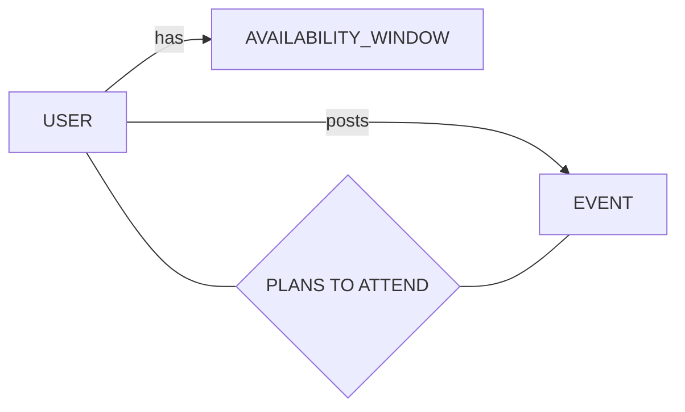

# SideQuest | Team Playbook

**Reconciled November 13, 2026 | Current operational guide; final-product extensions require team approval.** This is the short operational guide for the four contributors. It distinguishes **implemented M2**, **final-project direction**, and **optional designs**. New human-reported live Supabase checks are recorded below; unmerged features, deployment, migrations and external integrations are not assumed complete.

> **Rule zero:** Do not change a shared data model or architecture because one document, diagram, or AI agent suggests it. Identify the mismatch, decide the intended scope with the team, then update requirements, diagrams, contracts, implementation, and tests together.

> **Current evidence and PR states:** [Dated status/decision register](CURRENT_STATUS_AND_DECISIONS_2026-11-13.md). PRs [#34](https://github.com/haiiroWednesday/SideQuest-CSCI187/pull/34) and [#37](https://github.com/haiiroWednesday/SideQuest-CSCI187/pull/37) are merged. [#32](https://github.com/haiiroWednesday/SideQuest-CSCI187/pull/32), [#33](https://github.com/haiiroWednesday/SideQuest-CSCI187/pull/33), [#35](https://github.com/haiiroWednesday/SideQuest-CSCI187/pull/35), [#38](https://github.com/haiiroWednesday/SideQuest-CSCI187/pull/38), [#39](https://github.com/haiiroWednesday/SideQuest-CSCI187/pull/39), [#40](https://github.com/haiiroWednesday/SideQuest-CSCI187/pull/40), and [#41](https://github.com/haiiroWednesday/SideQuest-CSCI187/pull/41) are unmerged as of this update. PR #41 is stacked on #39. Its exact-commit CI (373 Vitest, 24 Playwright, 4 selected mutants killed) is **branch evidence, not master evidence**. Original long-form instructions and October test examples remain [archived here](MVP_TEAM_PLAYBOOK_ARCHIVED_2026-10.md).

## Source of truth and decisions

| Purpose | Authoritative reference | How to use it |
| --- | --- | --- |
| Course requirements | [M2 Part 1](https://docs.google.com/document/d/1_LlAb9mtASfutgVjKdjjt7Esh7g0ab6J4FmCzREJDEU/edit), [M2 Part 2](https://docs.google.com/document/d/1qIx_8k4ZOGWPrISXNYXf-sOifYsXk3SWoPVkoOBP3es/edit), [extra-credit rubric](https://docs.google.com/document/d/12slKo80yu17NZw5nbrB0U1C_nj7mLq6h6uQoSbkCVQk/edit) | Course instructions supersede team assumptions. |
| **Current M2 behavior** | [REQUIREMENTS](../REQUIREMENTS.md), [SPECIFICATIONS](../SPECIFICATIONS.md), merged code and SQL migration | Do not describe future ideas as shipped; test the actual implementation. |
| **Current M2 diagrams** | [CRC preview](diagrams/M2_CRC_PREVIEW.md), [ER preview](diagrams/M2_ER_PREVIEW.md), [editable sources](M2_IMPLEMENTATION_DIAGRAMS.md) | Must describe current M2 responsibilities and storage truthfully. |
| **Prior course designs** | [Original P4 CRC](https://drive.google.com/file/d/1xiZGXQeScuJx14yKNUcwj1XtWTfOb-l4/view), [original P5 ER](https://drive.google.com/file/d/1gzbESV0y6hdACNoPJeH3hnO1zxFQ54Lv/view) | Design inputs and history, not automatic instructions to create SQL tables. |
| **Final-project ideas** | [Research, nine-credit plan, and design boards](DEEP_RESEARCH_PRODUCT_STRATEGY_2026.md) | Detailed proposals; only become an implementation contract after a recorded team decision. |
| Running, deployment, contribution | [README](../README.md), [team setup](../TEAM_SETUP_GUIDE.md), [Supabase setup](SUPABASE_LOCAL_SETUP.md), [AGENTS](../AGENTS.md) | Use current commands and security conventions. |

**Decision ledger (as of November 13; re-check linked PR states before merging):**

- **Implemented for M2:** anonymous public event posting/browsing, full-event free-time matching, and current-device My Schedule. Public events use the shared Supabase adapter when configured; the fallback is explicitly browser-only. **November 7 human report:** Daven confirmed a real Supabase post in `public.events`, visibility in Firefox/Chrome/Edge, persistence after refresh, browser-isolated personal plans and a visible error on offline posting. This is teammate-reported manual acceptance, not an independently reproduced audit.
- **Confirmed direction from the project discussion, requiring team architecture sign-off:** user accounts and friend groups for the final project. The broader roadmap also proposes shared plans, Someday, maps and travel, calendar connectivity, photo stamps, AI, and live updates. Do not assume every proposed subfeature or provider has final team approval.
- **Nine-category extra-credit ambition:** recorded in the research memo, conditional on professor eligibility, team agreement, complete core features, and evidence. **Maximum is five points total**, not nine separate uncapped awards.
- **Undecided implementation details:** authentication/session pattern, group visibility and roles, saved vs plan-scoped availability, how maps and calendar connect, final timetable, and exact tables. Record decisions before implementation.

**Conflict procedure:** When instructions disagree, open a short architecture decision in the relevant PR stating (1) conflicting sources, (2) the user requirement, (3) alternatives and consequences, (4) selected design and approvers, (5) affected diagrams, schema, tests, and migration. **Do not silently choose one document.** A historical P5 diagram may be broader than M2 without making its M2 implementation incorrect.

## The one-page plan

**The product problem:** Help SCU students turn available time, interesting places/events, and friends' tentative commitments into workable outings, then adapt when a plan changes. A plain calendar or an event directory alone does not complete that task.

**M2 vertical slice, already coded:** Post an event → another student discovers it → search by a full free-time window → plan to attend → revisit/remove the local plan. Anonymous posting and local plans were an intentional **M2 scope reduction**, not a permanent rejection of accounts and groups.

**Final-product direction:** Keep that working slice; add identity and secure ownership, persistent friendships and group membership, proposed group outings and responses, meaningful location/travel checks, and remembered intentions. Optional extensions include calendar import, map-based discovery, real-time updates, event images, flyer interpretation, plan repair, and voice. Develop only the subset the team can implement, test, and demonstrate reliably.

**Explicit concepts:** An `Event` is a dated occurrence; a `Place/Activity` can be visited without an event time; an `Intention` is something worth doing later; a `Plan` is a selected time/activity with participants and a status. These must not all be forced into `events` rows. Distinguish an organizer's facts, a student's report, external-provider data, and an AI suggestion.

## The chosen three-class design

The professor-reviewed **P4 conceptual CRC** uses `Event`, `EventCatalog`, and `Schedule`. Keep those responsibilities where they still apply:

- **Event:** stable identity, validated details and start/end times; the M2 comparison accepts the **whole event** within a valid free window.
- **EventCatalog:** create, list upcoming, fetch by ID, validate at the Model boundary, and persist through an adapter.
- **Schedule:** remember planned Event identities, sort and detect overlaps; removing a plan never deletes its public Event.

In M2 these are TypeScript types, functions, and ports rather than three literal instantiated classes. A CRC describes responsibilities and dependencies; an **ER diagram describes persistent entities, attributes, keys and relationships**. Do not turn every component into a table or treat every table as a UI class.

For the final application, revise the **full CRC or appropriate architecture diagram** and the **full ER** before building new shared features. Professor Kandel's [M2 Part 2 instructions](https://docs.google.com/document/d/1qIx_8k4ZOGWPrISXNYXf-sOifYsXk3SWoPVkoOBP3es/edit) explicitly call for redesign to support the *entire* final project, rather than squeezing new wants into an obsolete model.

## Shared Event data contract

The **implemented M2 contract** is `CampusEvent` in `app/src/model/eventCatalog.ts`:

```ts
type CampusEvent = {
  id: string;
  title: string;
  hostName: string;
  description: string;
  location: string;
  date: string;  // YYYY-MM-DD, America/Los_Angeles
  start: string; // HH:mm, same day
  end: string;   // HH:mm, strictly after start
};
```

- `EventDraft` omits `id`; the catalog generates stable UUIDs. SQL uses `host_name`, `event_date`, `start_time` and `end_time`; translate **once at the adapter**, rather than inventing parallel field names.
- Current maximum lengths: title 120, host 120, required description 2,000, location 200 characters. Nonempty trimmed fields, valid dates, same-day `start < end` and new-event posting **today through one year ahead, inclusive, in campus time** belong in the Model. PR #34/#37 implemented the one-year rule and corresponding database insertion policy. The database has corresponding field-length/time constraints; verify both when changing a limit.
- `EventCatalogPort`: `create(draft)`, `listUpcoming()`, `getById(id)`. Failed remote reads are different from a confirmed missing event.
- Full fit: same date and `window.start <= event.start` and `event.end <= window.end`; equal boundaries fit. This is **time-only** feasibility, not proof about travel, cost, attendance rules or registration.
- Time is campus wall-clock (`America/Los_Angeles`). Overnight events and recurrence are not supported by the M2 record shape. A future timestamp/occurrence model needs explicit conversion and migration tests.
- The M1 `LegacyCampusEvent` is historical compatibility. Do not substitute its old field limits or storage semantics for the public M2 contract.

**Shared-catalog live check (Daven's November 7 report):** posted records appeared in the real Supabase `public.events` table, were available in Firefox/Chrome/Edge, and survived refresh. Personal Schedule additions stayed isolated between those browsers; an offline post showed an error. Preserve this as **reported manual verification**. Still verify denied unauthorized UPDATE/DELETE and RLS grants, independent devices if required, and any release-specific acceptance evidence. Fixtures alone cannot establish those checks.

## P5 coursework ER diagram — current draw.io and Mermaid

[Original P5 editable ER](https://drive.google.com/file/d/1gzbESV0y6hdACNoPJeH3hnO1zxFQ54Lv/view) models `USER`, `EVENT`, `AVAILABILITY_WINDOW`, the user-posts-event relationship, and `PLANS TO ATTEND`. It was broader than M2, which intentionally deferred accounts, stored availability and synchronized attendance. **That difference is documented design scope, not proof an individual implementer ignored the diagram.**

[Current M2 ER preview](diagrams/M2_ER_PREVIEW.md) and [SQL migration](../supabase/migrations/20261103000000_create_events.sql) show **one** shared `public.events` table. Planned event UUIDs live in browser `localStorage` (`sidequest.planned-event-ids.v1`); the free-time search window is temporary UI input. A browser ID lookup is **not a SQL foreign key**.

**P5 conceptual relationships (a Mermaid transcription, not deployed SQL):**



The Database Design lecture's P5 exercise says to begin with model classes as ER entities. For the real SQL schema, distinguish persistent records from nonpersistent services and browser state; if the course's diagram convention requires a different representation, ask the instructor rather than inventing a stored table to fit a drawing.

**Final-project ER gate:** Before adding accounts, groups, maps or shared plans, produce a proposed ER with PKs, FKs, cardinality, nullable ownership for historical anonymous events, uniqueness, deletion behavior, and access permissions. Show many-to-many relationships as junction tables when persisted. Compare it explicitly with P5 and existing `public.events`. Get Daven, Sembiyan, and at least one other teammate to approve the corresponding schema/interface changes.

## Proposed final architecture (requires approval)

**Use existing MVC boundaries with a ports-and-adapters domain core.** The React Views render and forward actions; Controllers/use cases orchestrate; framework-independent Models own validation and evaluations; ports describe dependencies; adapters integrate SQL, calendar, maps, AI, and real-time transport. The Model must not depend on React, Views or Controllers. This is a **proposed advanced architecture**, not an extra-credit claim until implemented with genuinely interchangeable adapters and documented advantages over MVC alone.

```text
React UI (Discover, Map, Post, Schedule, Someday, Friends)
    ↓ action / view state
Application use cases (post, find, evaluate, plan, invite, repair)
    ↓ domain types + ports
Event | Place/Activity | Intention | Plan | Group | FitEvaluation
    ↓ interfaces
Catalog | Identity | Groups | PlanStore | Availability | Places/Routes
Calendar | LiveUpdates | Assistant | Media
    ↓ adapters / services
Node API + Supabase Auth/Postgres/Storage | Google Calendar
independently verified SCU pedestrian graph + optional external directions/route adapter | server WebSocket | server AI provider
```

| Domain | Proposed persistent data | Key rule |
| --- | --- | --- |
| Identity | Auth identity + `profiles` | Auth user ID is the identity; display names and `hostName` grant no permission. |
| Events | **Keep** `events` and existing IDs; possibly nullable `owner_id`, source metadata, location references | Preserve anonymous legacy records. Organizer edits require ownership checks and explicit migration/RLS review. |
| Friends and groups | `friendships`, `groups`, `group_members` | Enforce accepted connections, membership, group roles, invite/revoke semantics and unique relationships. |
| Plans | `plans`, `plan_participants`, optionally `plan_options` and responses | A plan is separate from an Event; responses have `yes/maybe/no/unknown`, and only the participant confirms participation. |
| Availability | Explicit claims/windows scoped to a user or a specific plan **if approved** | Blank calendars mean **unknown**, not free. Share only authorized availability or fit outcomes. |
| Places and maps | Optional `places` with coordinates/provider IDs; existing event `location` remains | Route durations depend on origin, destination, mode and time; obtain them from a provider, label stale/unavailable results. |
| Someday and memories | `intentions`, optional experience records/media references | Unscheduled ideas need no invented event start time. Personal history defaults to private. |
| Imports and media | Source provider/external ID/URL/check time; image references and permissions | Do not infer official status from host text. Deduplicate by provider + stable external ID when possible; review cancellations. |

**Generally compute rather than persist:** current map routes, fit explanations, temporary search windows, AI-generated suggestions and weather; cache only with a justified lifetime and provenance. Persist plan status, consent, membership and user-confirmed inputs. Avoid inventing ten empty tables merely to make a diagram look complete.

**Migration sequence:** preserve the current `events` table, add new entities and nullable columns via reviewed migrations, apply permissions and tests, then introduce new adapters/use cases. If account-based plans replace `localStorage` IDs, migrate them **only through an explicit, tested opt-in path**; do not silently attribute anonymous posts or plans to a newly signed-in user. Preserve old behavior until the replacement is verified.

### SCU-only campus map and routing proposal (NOT IMPLEMENTED)

The initial geographic scope is Santa Clara University, not a clone of Google Maps. Learn primarily from the [official interactive SCU map](https://www.scu.edu/map/), with additional guidance from [SCU Grad Bash activity maps](https://www.scu.edu/alumni/events/gradbash/gradbashmaps/) and the [official building directory](https://university-operations.scu.edu/facilities/space-data/building-information/). Confirm permission to reuse artwork, geometry, or an official live feed first. Use independently verified building aliases, entrances, paths, closures and accessible alternatives. Dijkstra/A* may be suitable for the bounded campus graph, but results are valid only to the extent that paths and entrance restrictions have been verified. Keep existing `CampusEvent.location` free text until a new optional place-reference contract has team agreement and backward-compatibility tests.

On campus, prefer the verified local path graph. Outside campus or with incomplete graph coverage, provide correctly labeled external directions or a separately approved route-provider adapter. Google Routes API is **optional**, not the primary on-campus dependency. The map's distinctive value to SideQuest is explaining which real opportunities fit a student's time and travel constraints, and later helping groups coordinate, remember Someday intentions and repair plans. No map, route graph or travel-inclusive fit is in the current M2 code. See [the reviewed routing plan](FINAL_PROJECT_TEAM_ROLES_RACI_2026-11.md#a-scu-campus-map-pedestrian-graph-and-external-directions-revised-november-13).

## Implementation contract — database and Supabase setup

### Proposed Postgres storage and SQL

- The committed M2 migrations include `20261103000000_create_events.sql`, `20261108000000_event_date_sanity_bound.sql` and `20261110000000_event_date_posting_horizon.sql`. The base migration It creates `public.events` with nine columns (UUID `id`, title, host_name, description, location, event_date, start_time, end_time, created_at). It enables RLS and anonymous SELECT/limited INSERT, **not anonymous UPDATE/DELETE**.
- The browser communicates through same-origin Node `/api/catalog` and `/api/events`. Supabase values `SUPABASE_URL` and `SUPABASE_PUBLISHABLE_KEY` stay in the Node environment for this course project. Never put service-role/secret keys, OAuth refresh tokens or AI credentials into the browser, source, screenshots or PRs.
- `{"shared":true}` reports configuration, **not** a successful live query, applied migration or valid permissions. Daven reports having confirmed live read/insert and multiple-browser visibility on November 7. The screenshot does not establish the exact SQL grants or denied unauthorized mutations; verify UPDATE/DELETE denial and RLS against the configured project before claiming that permission gate passed.
- Adding Google sign-in changes the auth, session, RLS and API contract. Review secure, HTTP-only session handling; never grant group/event access because a client supplies an arbitrary profile ID. Restrict every group read/write by membership and role.
- Hosting must run the Node API; static-only Vite hosting cannot serve the shared catalog. Public posting needs abuse controls and an explicit deployment approval. Follow [setup](SUPABASE_LOCAL_SETUP.md) and the [current API implementation](../app/server/api.ts).

## Delivery plan and ownership

**Phase gates, not simultaneous agent-generated feature branches:**

1. **Protect M2:** preserve post → discover → full fit → plan/remove; record Daven's November 7 real Supabase and Firefox/Chrome/Edge manual acceptance evidence; independently review the still-open unauthorized mutation/RLS and deployment checks. Run tests/build. Approve reviewed real-event data before seeding; [PR #32](https://github.com/haiiroWednesday/SideQuest-CSCI187/pull/32) is a draft and has not established a live import.
**Event import status (November 7, 2026):** [PR #32](https://github.com/haiiroWednesday/SideQuest-CSCI187/pull/32) remains a draft, unmerged, and has not published the 19 reviewed SCU event occurrences. Daven's Nov 7 review reports that 13 occurrences remained future at his dry-run time, with unit/build checks passing, but flagged a possible 1–5 PM versus 2–6 PM Global Learning Advising Hours mismatch, conflicting Slices of Religious Life venue sources, a clock-dependent test, redirect handling, overly broad source allowlist, and duplicate normalization. **Do not seed the shared catalog until the relevant source details and script safety issues are resolved and the team explicitly authorizes posting.** Test an approved future subset first, then verify exact event IDs and attributes through actual Supabase and another browser. Import is independent of the validated ordinary-posting workflow. The current script does not perform scheduled sync, source updates, or cancellation handling.\n\n2. **Architecture decision for M2 Part 2:** lock final priority features, complete updated full CRC/architecture and ER, define identity/ownership and group access, list migrations and contracts. No schema writes until review.
3. **Identity and owned records:** Google/Supabase sign-in, profiles, permissions, event ownership, existing-event compatibility, negative RLS tests.
4. **Friends and group plans:** invitations, membership, candidate outings, participant responses; then optional plan-scoped availability and sync. Ensure users can use the core app even without a connected calendar.
5. **Feasibility and discovery:** SCU-only place/entrance model and independently validated pedestrian walkway graph for on-campus routes; separate off-campus directions/optional sourced external adapter; reviewed SCU event sources and possible Place/Intention model; explicit unknown/blocked-path/error states. The map is a proposal and must support time-aware student decisions, not become a stand-alone competitor to Google Maps.
6. **Integrations and polish:** Google Calendar, WebSockets, AI-assisted drafts/search, photos, optional repair/voice. Add only complete, demonstrable slices; reserve time for two usability studies, final presentation/video and regression fixes.

**Team ownership, to confirm for the final milestone:**

| Person | Primary responsibility | Required collaborator |
| --- | --- | --- |
| **Daven** | EventCatalog, database/schema migrations, Node APIs, server integrations, auth/ownership implementation | Sembiyan on data/permission contracts; Devonny on event consumption |
| **Sembiyan** | Free-time/feasibility, Schedule and account-plan migration, group availability, calendar semantics | Daven on persistence; Cynthia on feedback states |
| **Devonny** | Discover/details, source and location presentation, accessibility/user-flow verification, AI draft review UI | Cynthia on interface and map UX; Daven on endpoints |
| **Cynthia** | Shared UI/design, product and architecture documentation, diagram coordination, integration/UX testing | Whole team for architecture and PR reviews |
| **Everyone** | A meaningful coding contribution, tests, accurate documentation, reciprocal review, demo evidence | No unilateral shared-contract changes |

**PR protocol:** One owner per feature PR; another teammate reviews before merge. State behavior, changed contracts, diagram/ER effects, migration and permissions, test evidence, and UX impact. Critical interface changes require cross-feature owner review. A reviewer must inspect intent, performance, accessibility, failure cases, naming and documentation, not merely green tests. Rebase/merge carefully; never force-overwrite a teammate's work or live data.

## Nine extra credits: planned evidence, not claims

The [professor's rubric](https://docs.google.com/document/d/12slKo80yu17NZw5nbrB0U1C_nj7mLq6h6uQoSbkCVQk/edit) awards **at most five points total**, subject to core completeness, a >=70% grade at the specified Week 9 checkpoint, good standing, team consent, per-person contributions, demonstration, and server-side API secrets.

| Category (maximum) | Concrete SideQuest evidence to produce |
| --- | --- |
| Advanced architecture **1.00** | Beyond-MVC justification in reflection, updated architecture diagram, actual ports/adapters and tests swapping implementations; MVC directory renaming does not qualify. |
| WebSockets **1.00** | Two clients observe a new event or authorized group update **without reload**; reconnect, ordering, dedup and permission tests. Polling is not a WebSocket. |
| External system/device **0.75** | A real Google Calendar busy-time import **or** sourced map/travel estimate used to improve a planning decision, with consent/failure handling. Multiple providers share this category cap. |
| Browser E2E / performance **0.50** | Isolated Playwright CI, two independent sessions, meaningful assertions and optionally measured API load. Live database acceptance is additionally required for deployment claims. |
| AI integration **0.50** | Server-backed flyer-to-draft or natural-language search **on actual app records**, with user review and deterministic validation; AI development assistance itself does not count. |
| Security **0.50** | Real sign-in, ownership and group permissions; negative tests for nonowner/nonmember access, secure secret handling. |
| Accessibility **0.25** | Phone and keyboard/screen-reader walkthrough, visible focus/error feedback, contrast and automated checks where applicable. |
| Publishing **0.25** | A reliably accessible deployed full application (API plus persistence), tested from a fresh browser. |
| Advanced library **0.25** | Show substantive React-based implementation and explain why the library matters. |

**Priority:** core reliability and course deliverables first; then identity/permissions and a complete friend-group flow. Stage other bonus features by evidence, dependency, and time. Do not promise full credit in advance.

### Current QA evidence, proposed release gates

Coverage PR [#39](https://github.com/haiiroWednesday/SideQuest-CSCI187/pull/39) and the stacked [QA PR #41](https://github.com/haiiroWednesday/SideQuest-CSCI187/pull/41) passed their own CI but are unmerged. On #41 head `c9aec5ad`, GitHub verified **373 Vitest tests, 24 Playwright checks, 4/4 hand-selected interval mutations killed, and 93.04% statement / 88.75% branch / 96.19% function / 95.95% line coverage**. Automated axe testing discovered a serious text contrast error on the Post navigation control; it was corrected and passed on the branch. These are **not** full mutation, visual pixel-snapshot, screen-reader or live-Supabase certifications.

Use the [requirements-to-tests matrix and risk-based acceptance plan](https://github.com/haiiroWednesday/SideQuest-CSCI187/pull/41) to trace positive, negative, boundary and transition cases, isolate browser/database fixtures, track permissions, check accessibility and gather unguided student usability evidence. Do not promote Daven's Nov 7 reported real Supabase test to independently verified release acceptance without exact environment, RLS/grant negatives, browser IDs and tester/reviewer records.

## Design and review rules from CSCI 187

- **Abstraction and modularity (Architecture lecture):** Name components and responsibilities before implementation; show actual communication arrows. Keep implementation details out of high-level diagrams. Model owns domain data/rules, Controller orchestrates, View presents.
- **ER design (Database lecture):** Stable IDs; use keys and one-to-many foreign keys accurately; represent persisted many-to-many relationships with junction tables; avoid duplicate facts copied into unrelated records.
- **MVP and refactoring (MVP and Refactoring lectures):** Build an entire user journey first, then extend with an approved redesign for the final system. A refactor preserves observable behavior; a feature/scope change needs revised requirements and tests.
- **Clean code (Clean Code lecture):** Descriptive searchable names; named constants; short single-purpose functions; few arguments/options rather than boolean flags; comments explain *why* and warn about consequences, not what syntax does. Keep documentation direct and scannable.
- **UX (Usability lecture):** Scannable hierarchy, clear affordances, predictable controls, feedback for loading/errors/success, readable phone layouts, accessible labels and keyboard focus. State what is unknown instead of inventing success or availability.
- **Reviews (Code Review lecture):** Review architectural fit, functionality, human usefulness, security, edge cases, efficiency, tests, naming, comments, style and docs. Tests can confirm an incorrect assumption; check the assumption against requirements and diagrams.

## Use AI tools without losing control of the project

**First ask for a plan; authorize a small implementation only after review.** Paste this into a coding agent:

> Read `README.md`, `REQUIREMENTS.md`, `SPECIFICATIONS.md`, `docs/MVP_TEAM_PLAYBOOK.md`, `AGENTS.md`, original P4/P5 diagrams and current M2 diagrams. My feature is **[feature]**. Tell me what is **currently implemented**, **approved for the final project**, and **still proposed**. Compare existing code/interfaces/SQL with the diagrams. List every proposed schema, ownership, permission, storage, time or UX change and which teammates must approve it. Identify a minimal file-by-file plan, migration/backward compatibility, meaningful tests, and demo proof. **Do not write code yet; do not silently revise architecture, invent providers, expose secrets, or claim live verification from fixtures.** After approval, implement one reviewable slice and report actual test results.

An AI response, passing build or generated diagram is a **proposal/evidence**, never team approval. Human contributors are responsible for source accuracy, user impact, and reconciliation across shared contracts.

## Appendix — detailed unit testing examples

For the [risk-based requirements testing matrix and live acceptance plan](https://github.com/haiiroWednesday/SideQuest-CSCI187/pull/41), the [archived long-form test examples](MVP_TEAM_PLAYBOOK_ARCHIVED_2026-10.md), and runnable examples in current code see [app tests](../app/tests/), [Playwright scenarios](../app/e2e/), [SPECIFICATIONS](../SPECIFICATIONS.md), and [team setup](../TEAM_SETUP_GUIDE.md). From `app/`:

```bash
npm ci
npm test
npm run build
npx playwright install chromium
npm run test:e2e
# After #39 and #41 merge, also run:
# npm run test:coverage
# npm run test:mutation:pilot
# npx playwright install --with-deps chromium firefox webkit
```

**Stop locally running app servers before Playwright.** The E2E suite uses isolated fake backend servers, never the team's real Supabase project. Key acceptance checks:

1. Valid, invalid, boundary, duplicate and past-date event posting, with server+Model enforcement.
2. Browser A posts and independent Browser B discovers; My Schedule state remains separate in the **M2** implementation.
3. Complete/partial/invalid free windows and start/end equality; same-day clock and timezone edge cases.
4. With future accounts: authorized owner edits, nonowner denied, group member versus nonmember reads, invitation revocation, RLS checks, session expiry.
5. With future maps/calendar/AI: unreachable/stale routes stay **unknown**; blank calendar time is **unknown**; AI output remains a draft until user confirmation.
6. Mobile keyboard focus, screen reader and design review; actual live deployment and Supabase tests recorded separately from fixture CI.

**Practical definition of done:** A real user can complete the intended path; happy-path and failure tests pass; privacy/authorization are enforced at the server and database; the diagram, requirements, migration and code agree; a teammate has reviewed the PR; and deployment/demonstration claims have observed evidence.

## References and course handoff

- [Implementation architecture lecture](https://docs.google.com/presentation/d/1S5NFSWBuB7DNCxgtnEIwg7Yq-osRQyr4eVQB9pk-UqI/edit), [database design lecture](https://docs.google.com/presentation/d/1y7-cq3NetQaeaAsczXYfNkJ3yNjV-OJWO_FQpUAWaIo/edit), [clean code](https://docs.google.com/presentation/d/1PHrPPbAgmuRK1Nx4yscSPgbZCXcMPePesPGj-Oa2IZ8/edit), [code review](https://docs.google.com/presentation/d/1gKGQi7yyhd0Ec8iMf2A0aO04cwP9_elCbgZXGdTxUKo/edit), [refactoring](https://docs.google.com/presentation/d/1-0Z0HvjJcVcsid9mWBQxRekZcZC_BJoa1m3Dd2vmx3A/edit), [UX](https://docs.google.com/presentation/d/1rJoNnm9l0OQMszpxIUb0bgP4HkO5JJpWTl8zZY11X0M/edit).
- [Original P3 requirements and feedback](https://docs.google.com/document/d/11Yq8sW1aOphznZHP-zbul2OedCbLJtxczb-ZZDD3oR8/edit), [M2 diagram and code evidence](M2_IMPLEMENTATION_DIAGRAMS.md), [M2 integration checks](M2_INTEGRATION_VERIFICATION.md), [M2 review record](M2_CODE_REVIEW_RECORD.md), [detailed product and design research](DEEP_RESEARCH_PRODUCT_STRATEGY_2026.md).
- **M2 Part 2**: final-project plan includes revised full diagrams and an individual reflection. The assignment states **Wednesday, November 11, beginning of class** for the reflection; verify the course portal before submission. In the reflection, explain actual diagram changes, exact teammate responsibilities, review feedback, and dates/milestones, without claiming unperformed work.
- Full playbook history and prior long-form examples remain [available in an explicitly labeled archive](MVP_TEAM_PLAYBOOK_ARCHIVED_2026-10.md) and Git history. This revision deliberately keeps the operational contract short and delegates historical tutorials to the sources above.
