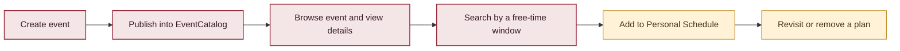
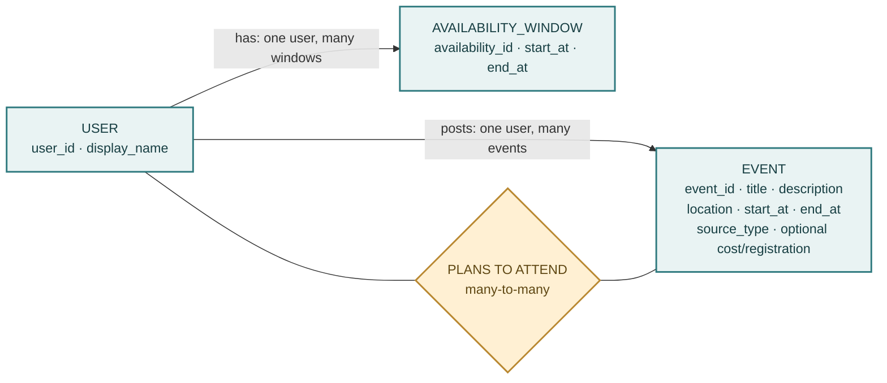
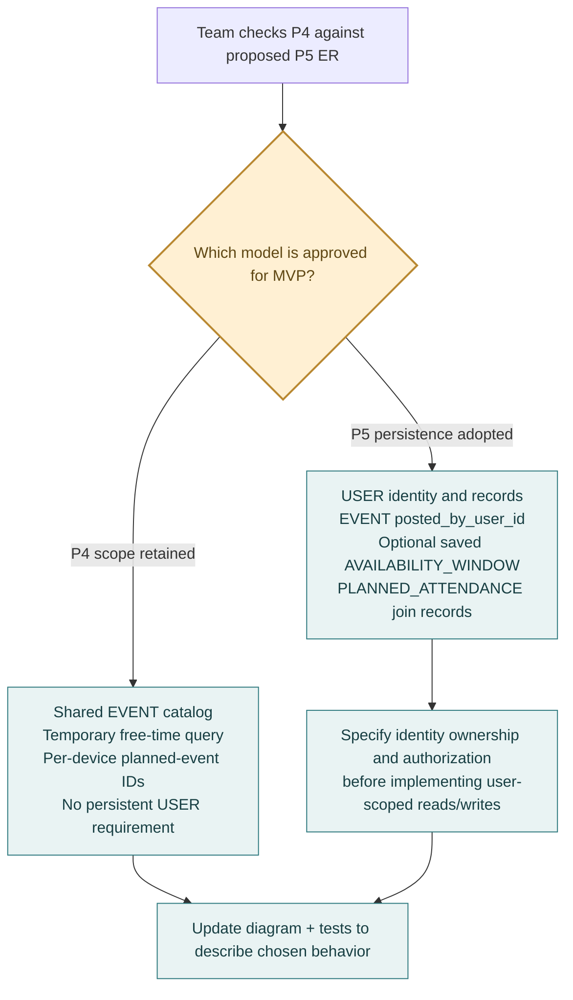
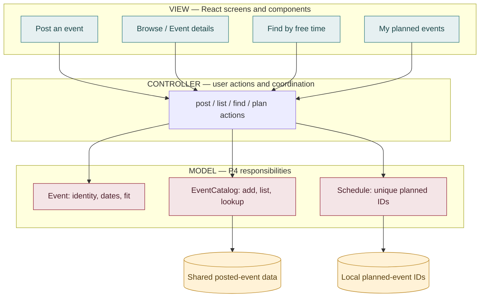
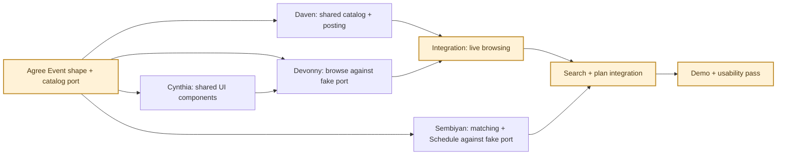
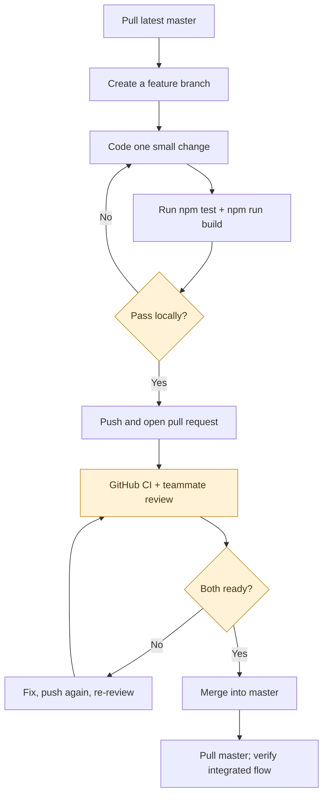
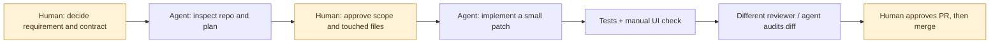
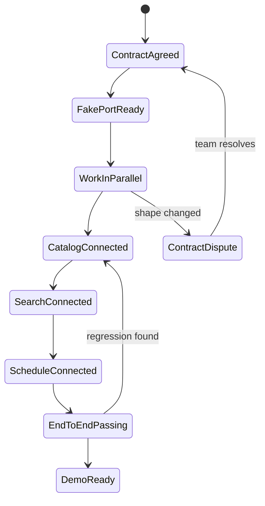
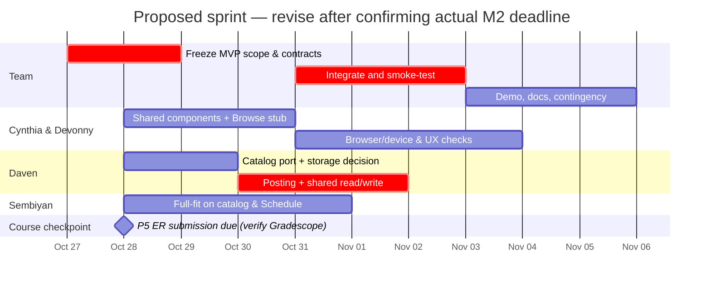

# SideQuest MVP — the team's build playbook

**Revised guide · 27 October 2026 · CSCI 187 · ER-aligned edition**  
**Repository:** [`haiiroWednesday/SideQuest-CSCI187`](https://github.com/haiiroWednesday/SideQuest-CSCI187) · **Branch:** `master`  
**Status:** Suggested implementation plan for team review. Role preferences are confirmed in group discussion; architecture contracts, dates, and technical decisions below are **proposals**, not a new professor-approved specification.

> **Read this first.** The target is a small experience that works end to end: someone posts an event; another student can browse it; a student can search for events that completely fit their free time; and they can add an event to a list of things they plan to attend. Do not spend the week implementing the full aspirational SideQuest product.

## The one-page plan

| Workstream | Lead | Teammates / boundary | A visible result |
|---|---|---|---|
| Visual language & reusable UI | **Cynthia** | Devonny collaborates; everyone follows shared components | A coherent, responsive app, not four differently styled pages |
| Event discovery & details | **Devonny** | Cynthia co-designs; reads through catalog interface | A browseable list and detail view sourced from the catalog |
| Event posting & EventCatalog storage | **Daven** | Contract reviewed by everyone; Devonny consumes it | A created event is readable again from shared catalog storage |
| Full-fit search & Personal Schedule | **Sembiyan** | Depends on catalog read API and event identity | An event matches the right window and can be added/removed from plans |
| Tests, integration, reviews, demo | **All four** | Every PR needs one teammate review | End-to-end scenario works and CI remains green |

### The actual MVP, in five steps



**Done means** this journey works with real application state, including validation, empty states, and a refresh. **Not done** means a pretty page with hard-coded events, a demo where a post never reaches another browser, or a Schedule that deletes the public event when you remove a plan.

### Where we are today

- `app/src/App.tsx` currently handles a create form, free-time search, matching cards, and a list of the **events created in the current browser**.
- `app/src/controller/findEvents.ts` has `createEvent` and `findEvents`. `app/src/model/events.ts` has `CampusEvent`, `fitsFully`, date/time checks, and local-storage helpers.
- Current `master` has **26 passing tests in 11 files** and a passing React build (verified 27 October). The test suite proves the M1 slice, **not** the future shared catalog or Personal Schedule.
- The default branch is **`master`**, not `main`. App commands run inside `app/`.
- `docs/MVP_ER_DIAGRAM.md` is our **proposed P5 ER design**. This guide now maps its USER, EVENT, AVAILABILITY_WINDOW, and PLANS TO ATTEND concepts to possible MVP code, while clearly marking the conflicts with P4. It is **not an approved implementation mandate**.

## 1. Start from the course materials, not assumptions

The professor's [MVP lecture](https://docs.google.com/presentation/d/1G3QYEDONfO21IupTmfIlAm0b0nRTHTLRYXH2QmDKXz0/edit) describes the MVP as the smallest working subset that provides value. Her [implementation lecture](https://docs.google.com/presentation/d/1YxzkSxyK5kZIJjCdwa69SmrmPgtytcaWBwcARaJGcm0/edit) connects classes to Model, pages to View, and main actions to Controller. It also says to give agents requirements and diagrams, code in chunks, and check their work.

Your team's [P4 draw.io diagram](https://drive.google.com/file/d/1xiZGXQeScuJx14yKNUcwj1XtWTfOb-l4/view) defines **Event**, **EventCatalog**, and **Schedule**. It says **full-event** time matching, planned events on the **current device**, and a **shared** posted catalog. Partial attendance, travel estimates, accounts, cross-device personal schedules and calendar sync are postponed. “Save” in this diagram means **plan to attend**, not a second bookmark collection.

The [original P3 requirements](https://docs.google.com/document/d/11Yq8sW1aOphznZHP-zbul2OedCbLJtxczb-ZZDD3oR8/edit) were broader. Professor Kandel suggested create → find → save/revisit as a useful end-to-end path, but explicitly marked that suggestion optional. The team must agree on any changes that make P3 and P4 differ, rather than silently adding features. **The newer P5 ER draft is a third source to reconcile: do not equate an ER entity with an already-built or approved feature.**

**One professor comment to resolve:** on the [P4 submission](https://docs.google.com/document/d/11MKHb3f40Yl81Rx__Mna2lRFf5ooZZUD22QEUnmpiO4/edit), she said the EventCatalog–Event relationship should use **composition (filled diamond)** because posted Events live in the catalog. The current drawing depicts aggregation and says records outlive the catalog. Discuss the intended lifecycle and correct the diagram/documentation consistently. That is a diagram-and-ownership decision, not an invitation to delete events when somebody removes them from a personal Schedule.

### A scope-decision board — settle these before major coding

| Question | Default recommended for this sprint | Why it matters / who decides |
|---|---|---|
| Is only **full fit** in the MVP? | **Yes**, as in P4 | Sembiyan, with team agreement; do not build partial-fit math by accident |
| Is Personal Schedule a bookmark or an attendance plan? | **Plan to attend** | Sembiyan/Cynthia wording and behavior: add once, remove link only |
| Do posted events need to be visible across devices? | **Yes**, if claiming a shared catalog | Daven leads implementation proposal; everyone tests it |
| Does `USER` imply a login? | **Not by itself.** Decide whether USER is a real persisted identity or only a conceptual/prototype reference. | P5 draws USER; P4 defers accounts. A display name or browser ID is not authentication. |
| Does `AVAILABILITY_WINDOW` really persist? | **Undecided**: P5 draws saved windows; P4 uses temporary free-time input. | If saved, Sembiyan owns operations; if not, revise the ER proposal to avoid promising a table. |
| How are anonymous posting and edit/delete handled? | Publish only into a controlled class demo catalog; **public deletion, moderation and identity claims deferred** | Daven proposes safeguards and documents limitations; no exposed write credentials |
| Do costs, registration, SCU source label ship now? | Agree a small display-only subset; do not implement registration enforcement | P3 requests them, P4 does not model them in detail |
| Is the M2 deadline exactly November 2/4/6? | **Not verified**. Course timeline puts the M2 prototype in the week of Nov 2–6. | Confirm the live Camino/Gradescope due time before setting calendar dates |

**P5 warning:** the new ER diagram explicitly says its USER and AVAILABILITY_WINDOW choices are proposals, and that omitting EventCatalog/Schedule database entities differs from a literal P5 classroom instruction. Do **not** implement that whole diagram as a fait accompli. The currently available P5 assignment says **Wednesday, October 28, 2026, end of day**. That replaces the mistaken October 30 date in the earlier guide. Check the active Gradescope page before submitting.

## ER alignment — what our P5 graph changes (read before Section 2)

**Source checked:** [`docs/MVP_ER_DIAGRAM.md`](MVP_ER_DIAGRAM.md) is the versioned **proposed** Chen-style ER graph in this repository. The linked [P5 instructions](https://docs.google.com/document/d/1FcjgTh3lBprpDxkFNuENM1RRAky9lYFeMOAeaJLnAC8/edit) say **each model class is its own entity**. The repository graph intentionally takes a different logical-database approach, so the team must decide whether to revise its draw.io submission or get the professor's approval for the deviation. The actual finalized P5 draw.io submission is **not verified here**; do not label the proposal as the submitted diagram.

### A faithful reading of the proposed ER graph



This is an **annotated simplification of the repository proposal**, not the professor-required Chen drawing. The original needs true Chen entity rectangles, attribute ovals, underlined identifiers, and the relationship diamond. In that proposal, `USER` **posts** `EVENT` (one-to-many), `USER` **has** `AVAILABILITY_WINDOW` (one-to-many), and `USER` **PLANS TO ATTEND** `EVENT` (many-to-many).

| ER concept (proposal) | Relational representation **if implemented literally** | Who would own the application behavior | What cannot be assumed |
|---|---|---|---|
| `USER` (`user_id`, `display_name`) | `users`, stable key | Team agrees identity; Daven coordinates schema; each feature consumes scoped ID | Having a USER row does **not** mean login, secure authentication, or verified authorship. |
| `EVENT` (`event_id`, title, location, description, timestamps, source, optional cost/registration) | `events`, `posted_by_user_id` foreign key | **Daven** writes/validates/persists; **Devonny** lists/displays | Don't let individual browsers invent conflicting event IDs or claim official verification. |
| `AVAILABILITY_WINDOW` (`availability_id`, start/end timestamps) | `availability_windows`, `user_id` foreign key | **Sembiyan**, *only if saved windows are approved*; Cynthia supplies UI components | P4 currently accepts a temporary window; the P5 record is an unapproved new persistence feature. |
| `PLANS TO ATTEND` (`USER` ↔ `EVENT`) | `planned_attendance` with **composite key `(user_id, event_id)`** | **Sembiyan** writes/reads plan association; Devonny/Cynthia show actions | A plan is not a global `event.saved` flag. Removing the link must not delete EVENT. |
| `EventCatalog` and `Schedule` (from P4) | **Not drawn as tables in this proposed P5 graph** | Catalog API remains **Daven**; Schedule logic remains **Sembiyan** | Professor says each model class is an entity. This omission needs an explicit P5 review; don't treat it as approved. |

### The identity and storage fork — the decision that affects everyone



**Path A — preserve P4's smaller MVP (recommended for the short prototype schedule unless your team revises it).** Persist a shared posted-event catalog, keep each browser's planned IDs locally, and use a temporary availability input. A real `USER` record, saved-window entity, and persisted `PLANNED_ATTENDANCE` junction would then be **future or diagram-only proposals**, not functioning MVP tables. The P5 drawing and its explanation must clearly disclose that mismatch or be revised for the professor's model-entity instruction.

**Path B — implement the P5 proposal literally (substantial scope increase).** Daven coordinates shared database schema and event posting, while Sembiyan implements user-specific plan association and, if approved, saved availability-window operations. The team must define how a stable `user_id` is obtained and what authorizes one person to access or alter another person's records. **A random local user ID is not a secure account** and must never be described as one; if no safe identity route can be established for the demo, do not claim multi-user personal persistence. A complete solution needs more tests and time than Path A.

**Either way:** do not implement two competing versions of `Schedule` (one local IDs list and one remote join table) without an intentional migration decision. The existing M1 `sidequest.created-events.v1` localStorage key contains **created events**, not personal attendance plans. Do not silently reuse it as either planned-attendance storage or the shared catalog.

### ER constraints become tests, not just labels on a diagram

| Relationship or rule | Concrete acceptance test | Owner |
|---|---|---|
| `EVENT.event_id` is unique and stable | Create two distinct events; both remain addressable after refresh | Daven |
| `USER` posts `EVENT` (Path B only) | Stored event references an existing `user_id`; reject or handle invalid author according to agreed policy | Daven |
| Catalog is shared | Post in one session; discover in a second independent browser; refresh and still see the event | Daven + Devonny |
| Full-fit matching | Exact start/end boundaries match; events outside the window never appear | Sembiyan |
| `PLANS TO ATTEND` unique per user/event (Path B only) | Adding the same `(user_id,event_id)` twice creates only one link | Sembiyan |
| Remove a plan without removing the event | Remove association or local ID, then confirm the event is still in public browsing | Sembiyan + Devonny |
| `AVAILABILITY_WINDOW` ownership (if saved) | Each window has an owner, valid start/end and isolated access | Sembiyan |
| Missing referenced event | An old planned-event link resolves to a clear unavailable state, not a crash | Sembiyan + Cynthia |

### Practical ER-to-code contract, without deciding the database prematurely

Keep **database records**, **model objects**, and **React props** separate. This is a *proposed* naming sketch; do not copy into code until the team settles Path A or B.

```ts
// P5 relational view (only if persistence choices are approved)
type UserRow = { user_id: string; display_name: string }
type EventRow = {
  event_id: string; posted_by_user_id: string;
  title: string; description: string; location: string;
  start_at: string; end_at: string; source_type: 'scu' | 'student';
  cost_amount?: number | null; registration_details?: string | null;
}
type PlannedAttendanceRow = { user_id: string; event_id: string }
type AvailabilityWindowRow = {
  availability_id: string; user_id: string;
  start_at: string; end_at: string;
}
// P4-facing APIs can still expose EventRecord, EventCatalogPort, SchedulePort.
// An adapter translates rows to the current date + HH:MM model if needed.
```

If the team chooses full timestamps, specify the time zone and test conversion: the current M1 model uses separate `date`, `start`, and `end` strings with **same-day** assumptions. A database `start_at` timestamp cannot be silently substituted without updating matching, UI and tests.

### P5 deliverables — separate from the MVP software build

The [current P5 assignment](https://docs.google.com/document/d/1FcjgTh3lBprpDxkFNuENM1RRAky9lYFeMOAeaJLnAC8/edit) says **Wednesday, October 28, end of day** and requires **both** (1) a picture of the in-class hand-drawn ER diagram and (2) the **draw.io** version with “everyone with the link can comment,” submitted via **Gradescope**. One group member submits and lists all contributors. A Mermaid diagram in GitHub, this playbook, or a Word diagram **cannot replace those submissions**.

**Team checkpoint before that submission:** check the P4 class names against the P5 “each model class is its own entity” instruction; choose what the P5 ER is meant to describe; review keys and user-to-event attendance links; then make the **draw.io** reflect the agreed graph. If the graph remains a future persistence proposal rather than MVP scope, state that clearly when asking the professor about the design. This checkpoint should be completed **on October 28, not October 29**.

### Changed handoffs because of the ER graph

- **Daven → Devonny:** an EventCatalog read API returning stable event IDs, public details, and documented error/empty behavior; `posted_by_user_id` only when the team chooses Path B.
- **Daven → Sembiyan:** event lookup by ID and the catalog's authoritative event identity. If Path B, coordinate migration ownership; Sembiyan should own the *plan operations*, not independently change Daven's `events` table.
- **Sembiyan → Cynthia/Devonny:** clear `isPlanned`, `addPlan`, `removePlan`, `listPlans` interface; include a user scope only if Path B is approved, and decide who handles missing events.
- **Cynthia ↔ Devonny:** agree how event source, optional cost/registration and plan status appear in cards and details; labels distinguish **created events** from **planned events**.
- **Whole team:** make a one-paragraph decision record with selected path, schema fields, naming, identities, and deferred items. Update the P4/P5 diagrams and tests *together*, not through separate agent guesses.

## 2. How the pieces should fit together



**Important:** this is an **implementation map we propose**, not a claim that these files/classes already exist. The actual M1 code has one React page and browser-local event storage. Keep the MVC direction: a view asks the controller to do something; the model doesn't import React.

```mermaid
sequenceDiagram
    participant Poster as Student A (poster)
    participant UI as React UI
    participant Cat as EventCatalog interface
    participant Store as Shared event store
    participant Reader as Student B (different browser)
    participant Sch as Personal Schedule
    Poster->>UI: Submit a valid event
    UI->>Cat: createEvent(draft)
    Cat->>Store: Write event with unique ID
    Store-->>Cat: Created event
    Cat-->>UI: Confirmation
    Reader->>UI: Open Browse
    UI->>Cat: listUpcomingEvents()
    Cat->>Store: Read events
    Store-->>UI: Event list via catalog
    Reader->>UI: Search free time
    UI->>Cat: listEvents() then full-fit selection
    Reader->>Sch: Plan to attend(eventId)
    Sch-->>Reader: Planned list updated in this browser
    Reader->>Sch: Remove plan
    Note over Sch,Store: Delete only local plan link; do not delete public event
```

### The P4-facing contract: agree first, then code

The team should approve one typed interface before anyone changes storage or component props. This is the **Path A P4-facing interface** (local plans, temporary windows). If Path B is chosen, extend it explicitly with user-scoped methods; do not pretend this local-only SchedulePort implements the `PLANNED_ATTENDANCE` database relationship. Below is **illustrative TypeScript, not implemented production code**. Don't commit these names as public API until the team has checked them.

```ts
// PROPOSAL — shape to discuss, not current app/src/model/events.ts
export type EventRecord = {
  id: string; title: string; description?: string; location: string;
  date: string; start: string; end: string; // existing YYYY-MM-DD / HH:MM
  sourceType?: 'scu' | 'student';
};

export interface EventCatalogPort {
  listUpcoming(): Promise<EventRecord[]>;
  getById(id: string): Promise<EventRecord | null>;
  create(draft: Omit<EventRecord, 'id'>): Promise<EventRecord>;
}

export interface SchedulePort {
  listPlannedIds(): string[];
  add(eventId: string): { added: boolean };
  remove(eventId: string): void;
}
```

- Keep **`id` stable** across posting, browsing, searching and Schedule. Do not use the event title as identity.
- Keep dates/times consistent with the M1 code until the team deliberately migrates them. If you change to timezone-aware timestamps, update **every** consumer and test together.
- Keep `fitsFully(event, date, start, end)` as the source of truth for temporal matching unless the team deliberately replaces it. Boundary equality counts as a match.
- A Schedule stores **event IDs**, not a second copy of title/date/location. If a public event disappears, render a sensible “event unavailable” state rather than crashing.
- Distinguish **catalog shared storage** from **this browser's planned list**. P4 deliberately does not promise that a student's plans follow them to another device.
- Do not make a `saved: true` flag on a public Event: it would wrongly represent one student's choice as global state.
- For demo storage, separate the port/interface from its implementation; this makes it possible to test with fake data and switch strategies without rewriting views.

### Feature dependency map



## 3. Cynthia — design the experience, and build it

**ER handoff:** use the agreed EventRow-to-EventRecord mapper; show `source_type` and optional event details only when the team actually supports them. If plans are user-scoped under Path B, never guess the current user from a public Event.

**What you own:** visual direction and reusable interface patterns. You co-design browsing with Devonny, rather than taking over all her feature code. You still implement real React components and test their states.

**First pass — decisions (one focused session):**

1. Open the working M1 app and draw four tiny screen sketches: Browse, Event Detail, Search, My Schedule. Decide whether these are separate routes or sections; don't invent a router if a small tab/section layout is enough.
2. Inventory what every event card must show at a glance: title, date/time, place, and a clear way to inspect details. Decide how optional fields are represented without awkward blank labels.
3. Define tokens once (e.g., `--color-*`, spacing, corner radius, font scale). Keep the existing SCU maroon/gold identity unless the group agrees otherwise. Avoid global CSS changes that unexpectedly restyle everyone's forms.
4. Sketch real **states**: no events, loading, error, full list, no match, an event missing after being planned, mobile narrow screen.
5. Share a screenshot/Figma frame or annotated sketch and ask Devonny to confirm the component interface **before** implementation.

**Implementation path:**

1. Make a feature branch such as `feature/ui-system-cynthia` from current `master`.
2. Extract non-domain-specific UI components (e.g., `PageShell`, `EmptyState`, `EventCard`) only when they have an actual caller. Component filenames are examples, not mandated names.
3. Prefer explicit props: `EventCard({event, actionLabel, onAction})`, not direct imports from a database adapter. The view must remain usable with mock events.
4. Build keyboard focus, visible button labels, accessible error/empty feedback, and responsive layout at roughly 375px and desktop width.
5. Avoid overly ambitious animation and redesign of every page in the same PR. First deliver a usable UI kit and one screen.
6. Review Devonny's Browse PR for information hierarchy and consistency; she reviews your components for integration practicality.

**Your acceptance checks:** Browse cards don't overflow on a phone; essential event facts are legible; tab order and buttons work; missing optional data doesn't produce “undefined”; an empty catalog shows a useful message; the UI doesn't perform matching or storage itself.

**Handoff to Devonny:** a screenshot or link, component names/props, tokens, sample empty/loading/error screens, and which files you'll edit. Agree that Devonny owns catalog-to-browse behavior while you own cross-screen patterns.

## 4. Devonny — make discovery real, with Cynthia

**ER handoff:** read EVENT data through Daven's catalog contract. You do not need to create a separate EventCatalog SQL table just to render public events; confirm that architectural decision with the team and the professor before finalizing P5.

**What you own:** presenting events from an agreed catalog read interface, navigating/selecting an event, and the Browse feature's state transitions. Help choose UI details with Cynthia. You **do not** separately own catalog persistence internals.

**Implementation path:**

1. Confirm the shape and sample output of `listUpcoming()`/`getById()` with Daven. If the real adapter isn't ready, create a **clearly named test fake** used only in stories/tests or development, not a pretend shared production catalog.
2. Make `feature/browse-devonny` and build a pure Browse view that renders a passed-in event list: upcoming order, key details, distinct identities.
3. Add loading/error/empty handling around the read operation, without relying on the posting feature being complete.
4. Add event selection/details: `getById(id)` or passed event object, agreed with Daven; keep title-only identity out of the design.
5. Use Cynthia's shared components and style tokens. If something is missing, ask for a small shared-component addition rather than duplicating the CSS.
6. When Daven's real catalog implementation is ready, swap fake data for the port, manually open the app in a second browser, and verify a newly posted event appears there.
7. Write tests for sorted/listed events and visible empty/error states. Pair with Cynthia for one keyboard/mobile review.

**Done:** a real event created by Daven's posting flow appears in the discovery UI (without manually editing a local sample list); selecting it shows its correct fields; network failure has an honest message, not a blank page.

## 5. Daven — posting plus the catalog's one source of truth

This is a larger, more foundational workstream. It is reasonable because the M1 create/validate logic already exists, **but do not build database accounts, saved availability and production moderation at the same time**.

**ER ownership:** coordinate the EVENT persistence schema, foreign keys and migrations. If USER identity is approved, collaborate on who creates/resolves `user_id`. Do **not** leave PLANNED_ATTENDANCE and AVAILABILITY_WINDOW operations unassigned; Sembiyan can own those feature operations after the schema is agreed.

**First decision — storage strategy:**

| Route | What it proves | Risk / when to use |
|---|---|---|
| Shared service + datastore (recommended if feasible) | Two browsers see the same newly posted event | Requires deployment, safe write path, and clear setup; agree on host and credentials |
| One local shared development server on a reachable machine | Two local clients can read/write one catalog | Suitable only for a controlled demo, not a claim of internet-wide availability |
| Fixed sample dataset | Browsing and matching UI can be rehearsed | **Not equivalent to user-posted shared persistence**; fallback only with explicit scope disclosure |
| Browser `localStorage` only (current M1) | One-browser create→search works | **Does not implement a shared posted catalog** |

**Implementation path:**

1. Agree on `EventRecord` fields and port before changing `events.ts`. Decide if description/sourceType is required now or optional.
2. Keep existing `createEvent` validation behavior or reuse its rules behind the new posting controller. Don't overwrite tested logic without replacement tests.
3. Build `listUpcoming`, `getById`, and `create` against a fake in-memory adapter **first**. Include unique IDs and persistent ordering.
4. Choose the shared storage route the team can operate, document how to start/deploy it, and keep secrets off GitHub and outside browser bundles. Never ship an unrestricted public write API or a server admin key in React code.
5. Connect the creation form to the agreed controller/port; return clear field-level errors and a success message containing the created event ID or stable reference.
6. Verify a new event can be retrieved in a **second browser/session**. Restart the service if persistence is promised and verify again.
7. Write model/controller/API tests: empty titles, invalid date, `end <= start`, duplicate IDs, successful reads after writes, server failure.
8. Hand Devonny and Sembiyan a stable port and sample responses; freeze contract changes behind team review once integration begins.

**Workload guardrail:** if deployment is blocking the others, make the fake adapter ready within the first day and ask for one short pairing session. Delegate docs, manual cross-browser checks, or deployment verification—but keep one owner for the catalog implementation itself.

**Done:** posting creates a valid Event; a fresh client lists or gets it by ID; no private credentials leak; malformed data is rejected; clear setup steps exist.

## 6. Sembiyan — full-fit search and the Personal Schedule

**ER ownership:** under Path A, plan references stay local and free-time inputs are temporary. Under Path B, your scope explicitly expands to PLANNED_ATTENDANCE join-table operations and, if approved, AVAILABILITY_WINDOW records scoped to a stable user ID. Align keys and migration boundaries with Daven rather than having two agents edit schema files independently.

**What you own:** the free-time matching flow and local “plan to attend” list. These share event IDs but are separate behaviors; separate tests and PRs are encouraged if scope grows.

**Implementation path:**

1. Confirm Daven's catalog read port and Event schema. Work with fake records while shared storage is underway.
2. Reuse existing `fitsFully` and `findEvents` logic as a starting point. Preserve same-date checks, ordered results, valid window checks, and inclusive exact boundaries.
3. Treat “partially fits” and travel time as **out of scope** for this P4 MVP unless the team explicitly changes requirements.
4. Add search controls to Browse or a dedicated Find section, agreed with Cynthia; filtering needs to work against **catalog events**, not only the old browser-created-event list.
5. **Path A:** implement `Schedule` as a local collection of stable event IDs, e.g. storage key `sidequest.planned-event-ids.v1` (proposed name). **Path B:** implement a user-scoped planned-attendance association through the agreed service. In both paths: add once, handle duplicate requests safely, remove only the plan link, never delete the public event.
6. Resolve IDs through the catalog to display current event information. Show an unavailable-state if an event no longer exists. Keep display order predictable (event start time/date).
7. Test refresh persistence, duplicate add, remove, invalid/corrupt local storage, same event title with different IDs, missing catalog event, and exact time boundaries.
8. Share actions/props with Cynthia and Devonny before their screen integrations; coordinate copy: **“Plan to attend”**, **“My plans”**, **“Remove from plans”**, not “Delete event”.

**Done:** the correct public events match; one click adds a stable event ID to My Schedule; refreshing preserves the appropriate plan representation (on the same device in Path A, or safely scoped to an authorized user in Path B); removing a plan does not change the public catalog.

## 7. Everyone — work in small, reviewable slices

### The branch-to-merge path



**Run these commands from the cloned repository root** (not inside `app/` for the branch commands):

```bash
git status
git fetch origin
git switch master
git pull --ff-only origin master
git switch -c feature/short-description-yourname

# After editing:
cd app
npm install             # first time only, or after package changes
npm test
npm run build
cd ..
git status
git add <only-the-files-you-intended-to-change>
git commit -m "feat: explain the one behavior added"
git push -u origin feature/short-description-yourname
# Open a PR targeting master, request another teammate's review.
```

Do not run `git reset --hard`, force-push another person's branch, commit `.env`, credentials, `node_modules`, or `dist`, or merge a failed CI run to save time. If `git status` shows work you don't recognize, stop and ask before switching branches. Protect `master` with required review and required checks if the repository settings allow it; this is a recommendation, **not** a statement that protection is already on.

**Each PR should say:** what changed, why it matters to one requirement, files affected, how to test it, screenshots if visible UI changed, and what hasn't been finished. If the shared schema changed, tag everyone who consumes it.

### The team's definition of done

- Feature is integrated with its actual data boundary (or explicitly labeled fake during development).
- Error, empty, loading, and normal states are addressed where applicable.
- Tests assert the application's output, not just the test input or an always-true fact.
- `npm test` and `npm run build` pass locally; React CI passes on the PR.
- At least one teammate reads the diff and tries the behavior (extra important for AI-generated code).
- No unrelated files, secret keys, or speculative feature additions; documentation stays accurate.
- The demo path on latest `master` still works after merge.

### Review owners — distribute review load

| Author | First reviewer | Second eyes when needed |
|---|---|---|
| Cynthia, UI kit/layout | Devonny | Sembiyan for search/Schedule controls |
| Devonny, browse UI | Cynthia | Daven when catalog contract is touched |
| Daven, posting/catalog | Sembiyan | Devonny for read/list integration |
| Sembiyan, matching/Schedule | Daven | Cynthia for user-facing interaction |

This matrix is **proposed coordination**, not an exclusive review permission system. Anyone can review; avoid self-approval as the only review.

## 8. Use AI tools without losing control of the project

Your professor permits coding with agents but warns that they can invent architecture, misunderstand UX, and silently make decisions outside the prompt. Treat an agent as a fast contributor, not as the product owner.



**Claude Console workspace:** manage API keys, access and usage limits; it does **not** automatically clone the GitHub project or serve as a shared filesystem. **Playground:** compare prompt ideas, explore UI copy or architecture choices, and test model behavior; it does **not** itself change repository files. **Cline / coding agent in VS Code:** reads the *opened local repo* with the granted permissions and can propose edits and run commands. Each person's local agent is not a shared live chat that automatically knows their teammate's unpushed changes.

**Safe five-step agent session:**

1. Start on your own feature branch with clean `git status` and an agreed issue/feature.
2. Provide the M1 files, [P4 draw.io](https://drive.google.com/file/d/1xiZGXQeScuJx14yKNUcwj1XtWTfOb-l4/view), this playbook, and the **specific** contract. Request **Plan** first: list touched files, data shapes, risks, tests; forbid edits in this first response.
3. Read the plan. Reject new accounts, saved windows, travel calculations, styling overhauls, or new libraries unless approved.
4. Permit one small implementation; ask the agent to run `npm test` and `npm run build` and quote the actual results. Never give it unchecked write/deploy privileges or place API keys in prompts/code.
5. Inspect the Git diff yourself, perform one manual use case, then request an independent reviewer. Two AIs agreeing is **not** proof that the feature works.

**Ready-to-paste planning prompt:**

> You are working in `haiiroWednesday/SideQuest-CSCI187`, React/TypeScript app under `app/`, default branch `master`. Read `README.md`, `REQUIREMENTS.md`, `SPECIFICATIONS.md`, `docs/MVP_TEAM_PLAYBOOK.md`, **`docs/MVP_ER_DIAGRAM.md`**, and the P4 class diagram before proposing code. My assigned feature is [FEATURE]. Follow Model–View–Controller boundaries, reuse tested M1 code, and respect our **approved P4-versus-P5 scope decision**: full fit only; Schedule means plan to attend; shared posted catalog; USER, PLANNED_ATTENDANCE and saved AVAILABILITY_WINDOW are **conditional on our documented data-model choice**. Before coding, state whether the feature uses Path A or Path B and why. **Do not edit yet.** Tell me your understanding, the smallest possible file-by-file plan, proposed interfaces, edge cases, and tests. Mark all inferred choices as questions. Do not modify unrelated files.

**Ready-to-paste implementation prompt (after approval):**

> Implement **only Step 1** of the plan we approved. Use the interfaces we agreed on. Do not alter files outside [FILES]. Add unit tests that would fail if the behavior were wrong. Run `npm test` and `npm run build` from `app/`. Report exact results and list all modified files. Stop before committing, merging or deploying; I will review the diff.

**Ready-to-paste reviewer prompt:**

> Review the diff on my feature branch against `master`. Focus on violations of P4 scope or MVC boundaries, missing event-ID invariants, data loss, misleading “saved” semantics, test assertions that do not call real behavior, browser-only state masquerading as shared data, accessibility and responsive breakage, and credential leaks. Do not rewrite anything. Rank findings by severity, file and line, and suggest the smallest correction.

**Protect the credits and everyone’s work:** each teammate uses their own authorized provider setup or a team-approved credential arrangement; don't paste API keys into group chat. Keep model/agent configuration separate from Git repository secrets. Do not make agents work in parallel on the same files in the same branch.

## 9. Test the actual experience, not just small functions

The existing **26 tests / 11 files** are the M1 baseline. They do not certify a shared datastore, a posting API, browser states, or planned-attendance persistence. Add focused tests as each feature arrives.

| Scenario | Expected result | Owners |
|---|---|---|
| Post valid event | Created ID is stable; event can be listed/read | Daven |
| Reject reversed event time or missing title | No public record created; clear error | Daven |
| Browse no events / storage unavailable | Meaningful empty/error state, no crash | Devonny + Cynthia |
| Open an event detail | Correct ID and event facts, even if two titles match | Devonny |
| Same-day, entire-event availability | Full-fit events returned in time order | Sembiyan |
| Event ends exactly when free time ends | Included | Sembiyan |
| Event ends one minute after free time | Excluded | Sembiyan |
| Plan the same event twice | One planned ID, not duplicates | Sembiyan |
| Remove plan | Removes only local reference; catalog event remains | Sembiyan + Daven |
| Refresh / corrupt planned storage | Plans survive same-browser refresh or fail safely | Sembiyan |
| Different browser posts / reads event | Shared catalog actually works | Daven + Devonny |
| Phone-sized screen / keyboard-only use | Layout, labels, buttons, and focus are usable | Cynthia + Devonny |

**One end-to-end smoke test (repeat after every merge):**

1. Open a clean browser window, post **Art Workshop**, on a valid future date, **14:30–15:30**, location **Arts Building**.
2. In a **different browser or device**, load Browse and find that exact ID/title. If this fails, the shared catalog is unfinished, even if M1 local search works.
3. Search the same day with free time **14:00–16:00** → it matches. Search **15:45–17:00** → it does not.
4. Select **Plan to attend**. Verify it appears once in My Schedule. Refresh that browser; it should remain.
5. Remove it from My Schedule. Browse again: the posted event must still exist.
6. Test empty state, invalid form input, narrow screen, and keyboard navigation.

**Manual UI spot check:** each UI change should include one desktop and one small-phone screenshot, and ideally one quick teammate walkthrough where the tester narrates what they think each action will do. Don't call that a formal usability test unless it follows the actual course protocol.

## 10. The integration plan — prevent four incompatible branches



**Gate 0 — contract (first):** One Event type, catalog read/write port, ID rule, persistence choice and UI file ownership. Document the decision in this guide or a short PR. Everyone signs off.

**Gate 1 — independent work:** Daven creates real/fake catalog ports; Devonny and Sembiyan build against the fake; Cynthia ships UI components. All branches stay short-lived; do not rewrite the entire app all at once.

**Gate 2 — vertical integration:** Merge the smallest common interface first. Connect real catalog → browse, then matching → catalog events, then plan actions → current-device IDs, then appearance/polish. Run smoke scenario after each merge.

**Gate 3 — final checks:** Freeze speculative features. Fix real broken paths, record known limits, update the README, capture demo, confirm submissions. If there's a regression, revert the offending PR rather than piling on new patch features.

### File coordination — suggestion, not a rigid directory policy

| Area | Primary editor | Others |
|---|---|---|
| Shared UI tokens/components | Cynthia | Devonny reviews and consumes |
| Browse view/interaction | Devonny | Cynthia co-designs |
| Event creation + catalog storage adapter | Daven | Sembiyan reviews contract |
| Matching / Schedule domain helpers | Sembiyan | Daven reviews invariants |
| Shared `EventRecord` and port definitions | **Joint change** | Review required from Daven, Devonny, Sembiyan before merge |
| `App.tsx` composition/navigation | Agree one integrator per PR | Avoid simultaneous broad edits |
| Tests for each feature | Feature owner | Every teammate verifies integrated suite |

**Conflict rule:** if two people need the same file today, pair briefly or merge one small branch first. Do not each ask an agent to regenerate `App.tsx` independently and hope Git resolves it.

## 11. A workable schedule, starting October 27

**These are proposed internal dates, not the official M2 due time.** Class materials put the M2 MVP prototype milestone in the **week of Nov 2–6**. Use the current course submission page as the source of truth; if the deadline is earlier, move the integration gates forward.



**Suggested 10-minute daily check-in:** each person says (a) what worked since yesterday, (b) what will be merged next, (c) which teammate or contract is blocking them. Put links to PRs and screenshots in the message. Use one shared list of decisions and blockers, not four unrelated agent conversations.

**Fallback if shared storage is late:** continue UI, matching and Schedule development using a fake port, but label the demo accurately. Don't claim cross-browser posting until it has been tested. Prioritize fixing the public catalog before decorating screens. Ask the professor about acceptable MVP trade-offs if the due time forces a narrower slice.

## 12. Demo script, final checks, and unresolved decisions

**A five-minute demo:**

1. **10 seconds — problem:** Students have limited free time and can't easily tell what campus activities fit.
2. **50 seconds — posting:** Daven posts a valid event and shows clear confirmation.
3. **60 seconds — discovery:** Devonny opens another client and finds the posted event; Cynthia points out the readable card/detail structure.
4. **60 seconds — matching:** Sembiyan enters a free-time window, shows one full fit and one non-fit, and explains the exact boundary rule.
5. **60 seconds — plans:** Add the event to My Schedule, refresh, remove it, then prove the original event is still discoverable.
6. **40 seconds — quality:** Show GitHub CI, tests, one mobile screenshot, and honestly describe what's postponed.

**Before calling MVP complete:** confirm the current course deadline and P5 requirements; resolve the professor's composition feedback; **choose ER Path A or B and document USER/AVAILABILITY_WINDOW/PLANS TO ATTEND behavior**; decide the shared catalog approach; reconcile the P5 ER proposal with P4 scope; identify a human reviewer for every PR; keep all secrets private; and run the cross-browser scenario on `master`.

### Documented source links and ownership

**Team artifacts:** [P5 current assignment](https://docs.google.com/document/d/1FcjgTh3lBprpDxkFNuENM1RRAky9lYFeMOAeaJLnAC8/edit) · [P3 requirements and instructor comments](https://docs.google.com/document/d/11Yq8sW1aOphznZHP-zbul2OedCbLJtxczb-ZZDD3oR8/edit) · [P4 draw.io architecture](https://drive.google.com/file/d/1xiZGXQeScuJx14yKNUcwj1XtWTfOb-l4/view) · [P4 professor feedback](https://docs.google.com/document/d/11MKHb3f40Yl81Rx__Mna2lRFf5ooZZUD22QEUnmpiO4/edit) · [M1 walking skeleton specs](../SPECIFICATIONS.md) · [P5 proposed ER rationale](MVP_ER_DIAGRAM.md).

**Course:** [MVP](https://docs.google.com/presentation/d/1G3QYEDONfO21IupTmfIlAm0b0nRTHTLRYXH2QmDKXz0/edit) · [System Architecture](https://docs.google.com/presentation/d/1S5NFSWBuB7DNCxgtnEIwg7Yq-osRQyr4eVQB9pk-UqI/edit) · [Implementation and AI guidance](https://docs.google.com/presentation/d/1YxzkSxyK5kZIJjCdwa69SmrmPgtytcaWBwcARaJGcm0/edit) · [Walking Skeleton](https://docs.google.com/presentation/d/1W_RSFcWNTL-NINOeRiGBVvvOtcZncaio5pE5-QtSRmw/edit).

**External workflow references:** [GitHub PR workflow](https://docs.github.com/en/pull-requests/get-started/about-pull-requests) · [Branch protection](https://docs.github.com/en/repositories/configuring-branches-and-merges-in-your-repository/managing-protected-branches/about-protected-branches) · [Mermaid diagrams in GitHub](https://docs.github.com/en/get-started/writing-on-github/working-with-advanced-formatting/creating-diagrams) · [GitHub Actions for Node](https://docs.github.com/en/actions/tutorials/build-and-test-code/nodejs).

*This playbook is the team's proposed way to work. The P3/P4/P5 materials and class instructions remain the sources for what the assignments actually require. When a decision changes, record it and update the code, diagrams, and acceptance tests together.*