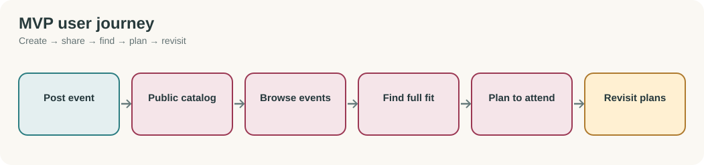
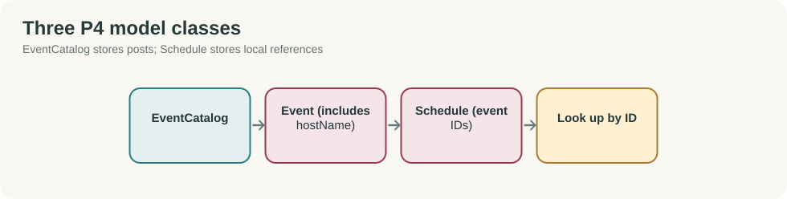
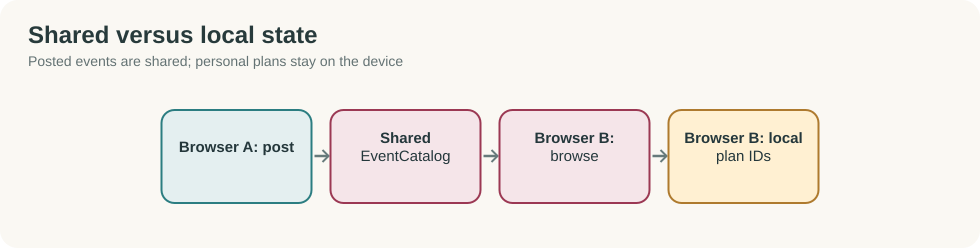
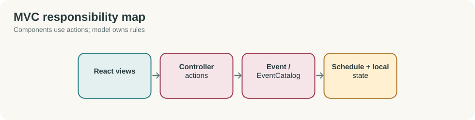
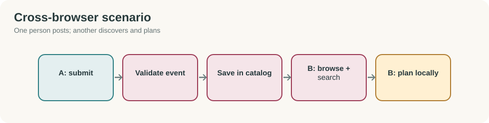
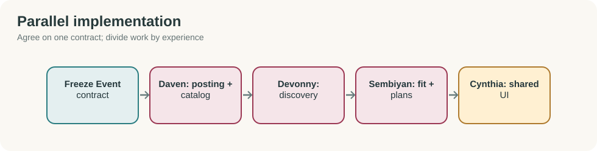
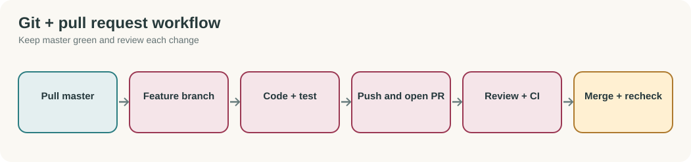
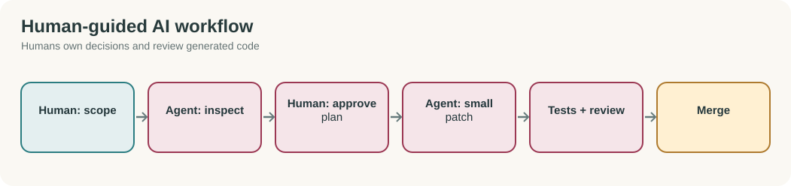
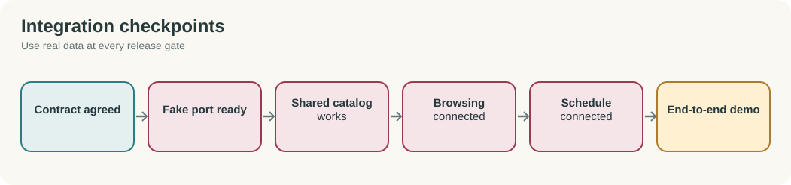
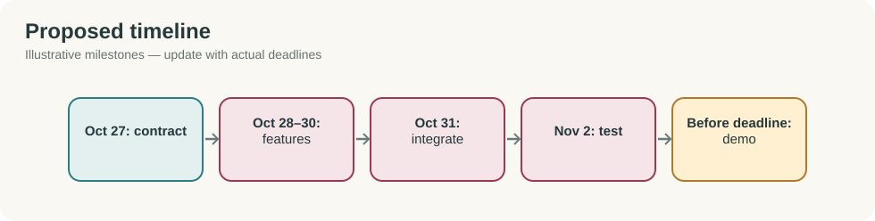

# SideQuest MVP — the team's build playbook

**Updated 27 October 2026 · CSCI 187 · P4-simple MVP with event host names**  
**Repository:** [`haiiroWednesday/SideQuest-CSCI187`](https://github.com/haiiroWednesday/SideQuest-CSCI187) · **Branch:** `master`  
**Status:** Team-confirmed small MVP scope, checked against both pages of the original P4 draw.io diagram. Technical interfaces and the proposed daily schedule remain implementation suggestions, not additional course requirements.

> **Read this first.** The target is a small experience that works end to end: someone posts an event; another student can browse it; a student can search for events that completely fit their free time; and they can add an event to a list of things they plan to attend. Do not spend the week implementing the full aspirational SideQuest product.

## The one-page plan

| Workstream | Lead | Teammates / boundary | A visible result |
|---|---|---|---|
| Visual language & reusable UI | **Cynthia** | Devonny collaborates; everyone follows shared components | A coherent, responsive app, not four differently styled pages |
| Event discovery & details | **Devonny** | Cynthia co-designs; reads through catalog interface | A browseable list and detail view sourced from the catalog |
| Event posting & EventCatalog storage | **Daven** | Contract reviewed by everyone; Devonny consumes it | A created event is readable again from shared catalog storage |
| Full-fit search & Personal Schedule | **Sembiyan** | Depends on catalog read API and event identity | An event matches the right window and can be added/removed from plans |
| Tests, integration, reviews, demo | **All four** | Every PR needs one teammate review | End-to-end scenario works and CI remains green |

### The actual MVP, in five steps



[View journey diagram](assets/playbook/journey.svg)

**Done means** this journey works with real application state, including validation, empty states, and a refresh. **Not done** means a pretty page with hard-coded events, a demo where a post never reaches another browser, or a Schedule that deletes the public event when you remove a plan.

### Where we are today

- `app/src/App.tsx` currently handles a create form, free-time search, matching cards, and a list of the **events created in the current browser**.
- `app/src/controller/findEvents.ts` has `createEvent` and `findEvents`. `app/src/model/events.ts` has `CampusEvent`, `fitsFully`, date/time checks, and local-storage helpers.
- Current `master` has **26 passing tests in 11 files** and a passing React build (verified 27 October). The test suite proves the M1 slice, **not** the future shared catalog or Personal Schedule.
- The default branch is **`master`**, not `main`. App commands run inside `app/`.
- `docs/MVP_ER_DIAGRAM.md` is an **earlier exploratory P5 proposal**, not the chosen MVP. Its former USER, AVAILABILITY_WINDOW, PLANNED_ATTENDANCE and cost/registration proposals have been replaced with MVP-aligned guidance.

## 1. Start from the course materials, not assumptions

The professor's [MVP lecture](https://docs.google.com/presentation/d/1G3QYEDONfO21IupTmfIlAm0b0nRTHTLRYXH2QmDKXz0/edit) describes the MVP as the smallest working subset that provides value. Her [implementation lecture](https://docs.google.com/presentation/d/1YxzkSxyK5kZIJjCdwa69SmrmPgtytcaWBwcARaJGcm0/edit) connects classes to Model, pages to View, and main actions to Controller. It also says to give agents requirements and diagrams, code in chunks, and check their work.

Your team's [P4 draw.io diagram](https://drive.google.com/file/d/1xiZGXQeScuJx14yKNUcwj1XtWTfOb-l4/view) defines **Event**, **EventCatalog**, and **Schedule**. It says **full-event** time matching, planned events on the **current device**, and a **shared** posted catalog. Partial attendance, travel estimates, accounts, cross-device personal schedules and calendar sync are postponed. “Save” in this diagram means **plan to attend**, not a second bookmark collection.

The [original P3 requirements](https://docs.google.com/document/d/11Yq8sW1aOphznZHP-zbul2OedCbLJtxczb-ZZDD3oR8/edit) were broader, but the team chose the smaller P4 implementation. Professor Kandel suggested create → find → save/revisit as a useful end-to-end path and marked that suggestion optional. Our personal Schedule supplies that simple list of plans. Do not reintroduce discarded P3 features or the exploratory P5 schema simply because they appear in older documents.

**One professor comment to resolve:** on the [P4 submission](https://docs.google.com/document/d/11MKHb3f40Yl81Rx__Mna2lRFf5ooZZUD22QEUnmpiO4/edit), she said the EventCatalog–Event relationship should use **composition (filled diamond)** because posted Events live in the catalog. The current drawing depicts aggregation and says records outlive the catalog. Discuss the intended lifecycle and correct the diagram/documentation consistently. That is a diagram-and-ownership decision, not an invitation to delete events when somebody removes them from a personal Schedule.

### The settled MVP rules — do not reopen these inside coding prompts

| Decision | Our agreed behavior | Owner / consequence |
|---|---|---|
| Users | **No accounts, login or USER database.** Everyone can post and browse. A host display name is still needed for each event. | Nobody implements authentication or `USER` rows. |
| Posted events | **One shared EventCatalog.** Anyone can create a public event; everyone sees the same catalog. | Daven builds the shared posted-event store and write/read operations. |
| Event content | **ID, hostName, title, description, location, start/end date and time.** hostName is a proposed addition to P4, not an original field. No cost or registration system. | Daven defines the event data contract; Devonny and Sembiyan consume it. |
| Finding events | Events must fit **completely** inside the input free-time window; equal start/end boundaries are valid. | Sembiyan uses the existing full-fit rule. No partial/travel features. |
| Schedule | **A list of events this browser/device currently plans to attend.** Store only stable event IDs, not copies of event data. | Sembiyan owns the local planned-ID list. No server-side per-user plans. |
| Removing a plan | Remove the event ID from this browser's Schedule only. The posted Event stays in the public catalog. | Test after removing a planned event. |
| Free-time input | Enter date and available start/end times for a search; don't store availability windows as records. | No `AVAILABILITY_WINDOW` table. |
| Time and delivery | P5 assignment says **Wednesday, Oct. 28, end of day**; M2 exact time must be verified in the course portal. | Treat proposed team dates as internal targets. |

**Two different meanings of “save” must not be conflated:** `EventCatalog` persists **publicly posted events** for everyone; `Schedule` persists **local references to events planned by this device**. `app/src/model/events.ts` currently stores **the events created locally in M1**, which is a third, transitional state. It must not become the public catalog or planned-events list by renaming the header.

## Data-model alignment — P4 is the implementation source of truth

I checked both pages of the [original P4 draw.io file](https://drive.google.com/file/d/1xiZGXQeScuJx14yKNUcwj1XtWTfOb-l4/view). They define precisely **three model classes**: EventCatalog, Event and Schedule. The diagram says: “Posts stay in the shared catalog. Planned Event identities stay on the current device. Accounts and cross-device schedules are Wants.” It also says “Save means plan to attend.”

### The chosen three-class design



[View classes diagram](assets/playbook/classes.svg)

**Class responsibilities drawn directly from P4:**

- **EventCatalog:** accepts posts; supplies current/upcoming events; finds by unique ID; finds events completely inside a free-time window; keeps the shared collection.
- **Event:** provides event data, duration calculation, full-fit comparison and valid end-after-start time rules.
- **Schedule:** retrieves selected Event by ID from EventCatalog; adds it once; removes only its local reference; shows planned events in time order; uses current Event details without copying them.

**P4 relationship notes:** The drawing uses a hollow aggregation diamond for `EventCatalog`→`Event` and for `Schedule`→`Event`, plus a dashed `Schedule`→`EventCatalog` lookup dependency. Professor Kandel specifically suggested **composition** for the catalog-to-event relationship because posts live in the catalog. That is an open **UML notation/lifecycle feedback item**, not a reason to add accounts, erase plans, or create another feature.

### Implementation storage: simple, not a new account system



[View storage diagram](assets/playbook/storage.svg)

**No USER rows, author foreign keys, PLANNED_ATTENDANCE table, saved AVAILABILITY_WINDOW table, or cost fields.** Each Event has an unverified display `hostName`. An optional generated browser `posterId` would not authenticate the host. Each visitor can post and read the same public catalog. Because there is no identity system, the app cannot securely distinguish who posted an event or restrict who may modify another person's posts; omit public edit/delete operations and be explicit that the prototype is not production-secure. The shared service must still protect its credentials and apply basic validation/rate limits where feasible.

This is a conceptual database view. An implementation might use **one `events` collection/table** behind EventCatalog with stable event IDs. `EventCatalog` and `Schedule` remain real *application classes/services* in the MVC design even if one is backed by a single events table and the other by browser localStorage. That distinction does **not** mean the P5 classroom ER diagram is automatically correct: [P5 instructions](https://docs.google.com/document/d/1FcjgTh3lBprpDxkFNuENM1RRAky9lYFeMOAeaJLnAC8/edit) ask the group to show each model class as an entity, so the team should make the hand drawing and draw.io submission reflect its chosen simplification and confirm notation with the professor if needed. The older [revised P5 ER guidance](MVP_ER_DIAGRAM.md) describes this simplified design; the actual final P5 draw.io submission has not been verified here.

### Host identity without user accounts

The original P4 Event lists ID, title, description, location and times but **does not include a host**. We propose a required `hostName` display field: e.g., “SCU Photography Club.” It is self-reported and unverified. `eventId`, not `hostName`, links Catalog and local Schedule records. No separate USER table or login is needed. An optional anonymous `posterId` generated per browser could group posts, but it is not a verified user ID and should not grant edit/delete permissions.

### Proposed TypeScript contract — exact names to be reviewed by the team

This is illustrative code for the chosen architecture, **not code already implemented**. P4 names start and end *dates and times*. M1 only has one `date`, `start`, and `end` for same-day events, so agree how to migrate or deliberately limit MVP events to one day before writing either adapter.

```ts
export type EventRecord = {
  id: string
  title: string
  hostName: string // proposed addition: person, club, or organization running it
  description: string
  location: string
  startDate: string // YYYY-MM-DD
  startTime: string // HH:MM
  endDate: string   // YYYY-MM-DD
  endTime: string   // HH:MM
}

export interface EventCatalogPort {
  create(draft: Omit<EventRecord, 'id'>): Promise<EventRecord>
  listUpcoming(): Promise<EventRecord[]>
  getById(eventId: string): Promise<EventRecord | null>
}

export interface SchedulePort { // stored only in this browser
  listPlannedIds(): string[]
  add(eventId: string): { added: boolean }
  remove(eventId: string): void
}
```

The catalog service is the only authority for public Event IDs and data. The Schedule holds just local IDs and asks EventCatalog for current details. Never set `event.saved = true` in shared Event data; that would confuse a device's plan with a public property.

### Contract tests that match the diagram

| Check | Expected | Primary reviewer |
|---|---|---|
| Post then retrieve an Event | A created ID survives a reload, and another browser sees the same title/details | Daven + Devonny |
| Full-fit matching | Equal time boundaries count; an event ending one minute late is excluded | Sembiyan |
| Plan twice | Schedule includes one ID, not two duplicates | Sembiyan |
| Remove a plan | Only this device's ID disappears; the public Event remains accessible | Sembiyan + Daven |
| Different browser Schedule | Browser A and B can read same catalog, but their local plans do not synchronize | Sembiyan + Devonny |
| Planned ID no longer in catalog | My Schedule shows a clear unavailable state instead of a crash | Sembiyan + Cynthia |
| M1 → MVP model migration | Event descriptions, dates and full-fit behavior remain correct after adapting old fields | Daven + Sembiyan |

### P5 assignment checkpoint, separate from implementation

The P5 assignment currently states **Wednesday, October 28, 2026, end of day**. It asks for **a photo of the in-class hand-drawn ER diagram** plus a **draw.io ER diagram** shared as “everyone with the link can comment,” submitted through **Gradescope**. One teammate submits and adds contributors. GitHub Markdown or this playbook does not replace either file. **Do not submit the old USER/AVAILABILITY_WINDOW proposal as though it were the agreed simple architecture.** Check the professor's “each model class is its own entity” instruction and ask about the correct representation if your actual database has only public Event records plus local planned IDs.

### Clear handoffs, no schema split

- **Daven → Devonny:** public list and lookup results, event fields, stable IDs and loading/error responses. Devonny owns Browse, *not* the catalog datastore.
- **Daven → Sembiyan:** public event lookup by ID and agreed temporal fields. Sembiyan implements full-fit and the **local** planned-ID Schedule; no user table or attendance join table.
- **Cynthia ↔ Devonny:** shared card/details components with Event props and distinct “Plan to attend” action. No price blocks or account UI.
- **Whole team:** agree field names and which class owns `fitsFully`; then agents implement independent slices. Changing EventRecord requires a coordinated PR and matching tests.

## 2. How the pieces should fit together



[View mvc diagram](assets/playbook/mvc.svg)

**Important:** this is an **implementation map we propose**, not a claim that these files/classes already exist. The actual M1 code has one React page and browser-local event storage. Keep the MVC direction: a view asks the controller to do something; the model doesn't import React.



[View sequence diagram](assets/playbook/sequence.svg)

### One agreed contract, not two competing schemas

Use the **EventRecord, EventCatalogPort and SchedulePort** proposal in [the Data-model alignment section above](#proposed-typescript-contract--exact-names-to-be-reviewed-by-the-team). It reflects the chosen P4-simple design. Finalize names with the team before merging code; there is no alternative user-scoped Path B in this MVP.

- Keep Event IDs stable from publishing through Browse, Search and Schedule. Two events may have identical titles; IDs distinguish them.
- Agree on the P4 start/end date/time representation versus the M1 same-day fields. Do not let each coding agent invent a different interface.
- Keep `fitsFully` as the validated source of truth for temporal matching. Exact matching boundaries are inclusive.
- `Schedule` keeps **only event IDs in this browser's local storage**. It asks EventCatalog for current details when rendering; it does not copy an Event or add a global `saved` property.
- Never use `sidequest.created-events.v1` as the planned-attendance key. That legacy M1 key stores browser-created events, not planned event IDs or a cross-browser catalog.
- Keep a fake EventCatalog adapter for isolated UI tests, clearly labeled as a test fixture; do not call it shared persistence in the demo.

### Feature dependency map



[View dependencies diagram](assets/playbook/dependencies.svg)

## 3. Cynthia — design the experience, and build it

**Architecture handoff:** design components around the agreed Event fields and local `isPlanned` state. No account screens, price labels or account-scoped props.

**What you own:** visual direction and reusable interface patterns. You co-design browsing with Devonny, rather than taking over all her feature code. You still implement real React components and test their states.

**First pass — decisions (one focused session):**

1. Open the working M1 app and draw four tiny screen sketches: Browse, Event Detail, Search, My Schedule. Decide whether these are separate routes or sections; don't invent a router if a small tab/section layout is enough.
2. Inventory what every event card must show at a glance: title, **host name**, date/time, place, and a clear way to inspect details. Include the description in the detail presentation; omit cost and other unapproved fields rather than adding placeholders.
3. Define tokens once (e.g., `--color-*`, spacing, corner radius, font scale). Keep the existing SCU maroon/gold identity unless the group agrees otherwise. Avoid global CSS changes that unexpectedly restyle everyone's forms.
4. Sketch real **states**: no events, loading, error, full list, no match, an event missing after being planned, mobile narrow screen.
5. Share a screenshot/Figma frame or annotated sketch and ask Devonny to confirm the component interface **before** implementation.

**Implementation path:**

1. Make a feature branch such as `feature/ui-system-cynthia` from current `master`.
2. Extract non-domain-specific UI components (e.g., `PageShell`, `EmptyState`, `EventCard`) only when they have an actual caller. Component filenames are examples, not mandated names.
3. Prefer explicit props: `EventCard({event, actionLabel, onAction})`, not direct imports from a database adapter. The view must remain usable with mock events.
4. Build keyboard focus, visible button labels, accessible error/empty feedback, and responsive layout at roughly 375px and desktop width.
5. Avoid overly ambitious animation and redesign of every page in the same PR. First deliver a usable UI kit and one screen.
6. Review Devonny's Browse PR for information hierarchy and consistency; she reviews your components for integration practicality.

**Your acceptance checks:** Browse cards don't overflow on a phone; essential event facts are legible; tab order and buttons work; missing event data doesn't produce “undefined”; an empty catalog shows a useful message; the UI doesn't perform matching or storage itself.

**Handoff to Devonny:** a screenshot or link, component names/props, tokens, sample empty/loading/error screens, and which files you'll edit. Agree that Devonny owns catalog-to-browse behavior while you own cross-screen patterns.

## 4. Devonny — make discovery real, with Cynthia

**Architecture handoff:** read shared Event records through Daven's EventCatalog interface; the browsing page never reads or edits database internals directly.

**What you own:** presenting events from an agreed catalog read interface, navigating/selecting an event, and the Browse feature's state transitions. Help choose UI details with Cynthia. You **do not** separately own catalog persistence internals.

**Implementation path:**

1. Confirm the shape and sample output of `listUpcoming()`/`getById()` with Daven. If the real adapter isn't ready, create a **clearly named test fake** used only in stories/tests or development, not a pretend shared production catalog.
2. Make `feature/browse-devonny` and build a pure Browse view that renders a passed-in event list: upcoming order, key details, distinct identities.
3. Add loading/error/empty handling around the read operation, without relying on the posting feature being complete.
4. Add event selection/details: `getById(id)` or passed event object, agreed with Daven; display hostName and never use titles as event identity.
5. Use Cynthia's shared components and style tokens. If something is missing, ask for a small shared-component addition rather than duplicating the CSS.
6. When Daven's real catalog implementation is ready, swap fake data for the port, manually open the app in a second browser, and verify a newly posted event appears there.
7. Write tests for sorted/listed events and visible empty/error states. Pair with Cynthia for one keyboard/mobile review.

**Done:** a real event created by Daven's posting flow appears in the discovery UI (without manually editing a local sample list); selecting it shows its correct fields; network failure has an honest message, not a blank page.

## 5. Daven — posting plus the catalog's one source of truth

This is a foundational workstream. M1 create/validate logic already exists. Build the shared posted-event catalog, not accounts, user profiles, saved availability, prices, or a production-scale moderation system.

**Data ownership:** Daven owns the shared Event records, unique IDs, creation and retrieval API, and integration with the posting form. There is **no user foreign key or planned-attendance table** in the chosen implementation.

**First decision — storage strategy:**

| Route | What it proves | Risk / when to use |
|---|---|---|
| Shared service + datastore (recommended if feasible) | Two browsers see the same newly posted event | Requires deployment, safe write path, and clear setup; agree on host and credentials |
| One local shared development server on a reachable machine | Two local clients can read/write one catalog | Suitable only for a controlled demo, not a claim of internet-wide availability |
| Fixed sample dataset | Browsing and matching UI can be rehearsed | **Not equivalent to user-posted shared persistence**; fallback only with explicit scope disclosure |
| Browser `localStorage` only (current M1) | One-browser create→search works | **Does not implement a shared posted catalog** |

**Implementation path:**

1. Agree on the P4 `EventRecord` fields and port before changing `events.ts`. **Description comes from P4.** Add hostName for display, not authentication. No login, cost, or USER table. An optional anonymous posterId is not verified identity. Resolve same-day M1 fields versus P4 start/end dates deliberately.
2. Keep existing `createEvent` validation behavior or reuse its rules behind the new posting controller. Don't overwrite tested logic without replacement tests.
3. Build `listUpcoming`, `getById`, and `create` against a fake in-memory adapter **first**. Include unique IDs and persistent ordering.
4. Choose the shared storage route the team can operate, document how to start/deploy it, and keep secrets off GitHub and outside browser bundles. Never ship an unrestricted public write API or a server admin key in React code.
5. Connect the creation form to the agreed controller/port; return clear field-level errors and a success message containing the created event ID or stable reference.
6. Verify a new event can be retrieved in a **second browser/session**. Restart the service if persistence is promised and verify again.
7. Write model/controller/API tests: empty title/host name, invalid date, `end <= start`, duplicate IDs, hostName surviving create/read, server failure.
8. Hand Devonny and Sembiyan a stable port and sample responses; freeze contract changes behind team review once integration begins.

**Workload guardrail:** if deployment is blocking the others, make the fake adapter ready within the first day and ask for one short pairing session. Delegate docs, manual cross-browser checks, or deployment verification—but keep one owner for the catalog implementation itself.

**Done:** posting creates a valid Event; a fresh client lists or gets it by ID; no private credentials leak; malformed data is rejected; clear setup steps exist.

## 6. Sembiyan — full-fit search and the Personal Schedule

**Data ownership:** Schedule is a **current-device list of stable Event IDs** in localStorage; free-time is a temporary search input. No database join table, account state or saved availability entity.

**What you own:** the free-time matching flow and local “plan to attend” list. These share event IDs but are separate behaviors; separate tests and PRs are encouraged if scope grows.

**Implementation path:**

1. Confirm Daven's catalog read port and Event schema. Work with fake records while shared storage is underway.
2. Reuse existing `fitsFully` and `findEvents` logic as a starting point. Preserve same-date checks, ordered results, valid window checks, and inclusive exact boundaries.
3. Treat “partially fits” and travel time as **out of scope** for this P4 MVP unless the team explicitly changes requirements.
4. Add search controls to Browse or a dedicated Find section, agreed with Cynthia; filtering needs to work against **catalog events**, not only the old browser-created-event list.
5. Implement `Schedule` as a local collection of stable event IDs, e.g. storage key `sidequest.planned-event-ids.v1` (proposed name). Add once, handle duplicates, remove only the plan ID, and never delete the public Event.
6. Resolve IDs through the catalog to display current event information. Show an unavailable-state if an event no longer exists. Keep display order predictable (event start time/date).
7. Test refresh persistence, duplicate add, remove, invalid/corrupt local storage, same event title with different IDs, missing catalog event, and exact time boundaries.
8. Share actions/props with Cynthia and Devonny before their screen integrations; coordinate copy: **“Plan to attend”**, **“My plans”**, **“Remove from plans”**, not “Delete event”.

**Done:** the correct public events match; one click adds the event ID to My Schedule; same-device refresh preserves it; removing a plan does not change the public catalog.

## 7. Everyone — work in small, reviewable slices

### The branch-to-merge path



[View gitflow diagram](assets/playbook/gitflow.svg)

**Run these commands from the cloned repository root** (not inside `app/` for the branch commands):

```bash
git status
git fetch origin
git switch master
git pull --ff-only origin master
git switch -c feature/short-description-yourname

# After editing:
cd app
npm install             # first time only, or after package changes
npm test
npm run build
cd ..
git status
git add <only-the-files-you-intended-to-change>
git commit -m "feat: explain the one behavior added"
git push -u origin feature/short-description-yourname
# Open a PR targeting master, request another teammate's review.
```

Do not run `git reset --hard`, force-push another person's branch, commit `.env`, credentials, `node_modules`, or `dist`, or merge a failed CI run to save time. If `git status` shows work you don't recognize, stop and ask before switching branches. Protect `master` with required review and required checks if the repository settings allow it; this is a recommendation, **not** a statement that protection is already on.

**Each PR should say:** what changed, why it matters to one requirement, files affected, how to test it, screenshots if visible UI changed, and what hasn't been finished. If the shared schema changed, tag everyone who consumes it.

### The team's definition of done

- Feature is integrated with its actual data boundary (or explicitly labeled fake during development).
- Error, empty, loading, and normal states are addressed where applicable.
- Tests assert the application's output, not just the test input or an always-true fact.
- `npm test` and `npm run build` pass locally; React CI passes on the PR.
- At least one teammate reads the diff and tries the behavior (extra important for AI-generated code).
- No unrelated files, secret keys, or speculative feature additions; documentation stays accurate.
- The demo path on latest `master` still works after merge.

### Review owners — distribute review load

| Author | First reviewer | Second eyes when needed |
|---|---|---|
| Cynthia, UI kit/layout | Devonny | Sembiyan for search/Schedule controls |
| Devonny, browse UI | Cynthia | Daven when catalog contract is touched |
| Daven, posting/catalog | Sembiyan | Devonny for read/list integration |
| Sembiyan, matching/Schedule | Daven | Cynthia for user-facing interaction |

This matrix is **proposed coordination**, not an exclusive review permission system. Anyone can review; avoid self-approval as the only review.

## 8. Use AI tools without losing control of the project

Your professor permits coding with agents but warns that they can invent architecture, misunderstand UX, and silently make decisions outside the prompt. Treat an agent as a fast contributor, not as the product owner.



[View agentloop diagram](assets/playbook/agentloop.svg)

**Claude Console workspace:** manage API keys, access and usage limits; it does **not** automatically clone the GitHub project or serve as a shared filesystem. **Playground:** compare prompt ideas, explore UI copy or architecture choices, and test model behavior; it does **not** itself change repository files. **Cline / coding agent in VS Code:** reads the *opened local repo* with the granted permissions and can propose edits and run commands. Each person's local agent is not a shared live chat that automatically knows their teammate's unpushed changes.

**Safe five-step agent session:**

1. Start on your own feature branch with clean `git status` and an agreed issue/feature.
2. Provide the M1 files, [P4 draw.io](https://drive.google.com/file/d/1xiZGXQeScuJx14yKNUcwj1XtWTfOb-l4/view), this playbook, and the **specific** contract. Request **Plan** first: list touched files, data shapes, risks, tests; forbid edits in this first response.
3. Read the plan. Reject new accounts, saved windows, cost fields, travel calculations, styling overhauls, or new libraries unless the team deliberately revises the agreed architecture.
4. Permit one small implementation; ask the agent to run `npm test` and `npm run build` and quote the actual results. Never give it unchecked write/deploy privileges or place API keys in prompts/code.
5. Inspect the Git diff yourself, perform one manual use case, then request an independent reviewer. Two AIs agreeing is **not** proof that the feature works.

**Ready-to-paste planning prompt:**

> You are working in `haiiroWednesday/SideQuest-CSCI187`, React/TypeScript app under `app/`, default branch `master`. Read `README.md`, `REQUIREMENTS.md`, `SPECIFICATIONS.md`, `docs/MVP_TEAM_PLAYBOOK.md`, and **both pages of the original P4 class diagram**. The previous `docs/MVP_ER_DIAGRAM.md` proposal is superseded; it is not implementation scope before proposing code. My assigned feature is [FEATURE]. Follow Model–View–Controller boundaries, reuse tested M1 code, and respect our **confirmed P4-simple scope**: shared public EventCatalog, no user/login, no cost or saved-availability records, full-fit matching only, and one browser-local Schedule of planned Event IDs. The old P5 ER proposal is superseded for implementation. Do not propose account tables, planned-attendance junctions, saved availability tables or prices. **Do not edit yet.** Tell me your understanding, the smallest possible file-by-file plan, proposed interfaces, edge cases, and tests. Mark all inferred choices as questions. Do not modify unrelated files.

**Ready-to-paste implementation prompt (after approval):**

> Implement **only Step 1** of the plan we approved. Use the interfaces we agreed on. Do not alter files outside [FILES]. Add unit tests that would fail if the behavior were wrong. Run `npm test` and `npm run build` from `app/`. Report exact results and list all modified files. Stop before committing, merging or deploying; I will review the diff.

**Ready-to-paste reviewer prompt:**

> Review the diff on my feature branch against `master`. Focus on violations of P4 scope or MVC boundaries, missing event-ID invariants, data loss, misleading “saved” semantics, test assertions that do not call real behavior, browser-only state masquerading as shared data, accessibility and responsive breakage, and credential leaks. Do not rewrite anything. Rank findings by severity, file and line, and suggest the smallest correction.

**Protect the credits and everyone’s work:** each teammate uses their own authorized provider setup or a team-approved credential arrangement; don't paste API keys into group chat. Keep model/agent configuration separate from Git repository secrets. Do not make agents work in parallel on the same files in the same branch.

## 9. Test the actual experience, not just small functions

The existing **26 tests / 11 files** are the M1 baseline. They do not certify a shared datastore, a posting API, browser states, or planned-attendance persistence. Add focused tests as each feature arrives.

| Scenario | Expected result | Owners |
|---|---|---|
| Post valid event | Created ID is stable; event can be listed/read | Daven |
| Reject reversed event time or missing title | No public record created; clear error | Daven |
| Browse no events / storage unavailable | Meaningful empty/error state, no crash | Devonny + Cynthia |
| Open an event detail | Correct ID and event facts, even if two titles match | Devonny |
| Same-day, entire-event availability | Full-fit events returned in time order | Sembiyan |
| Event ends exactly when free time ends | Included | Sembiyan |
| Event ends one minute after free time | Excluded | Sembiyan |
| Plan the same event twice | One planned ID, not duplicates | Sembiyan |
| Remove plan | Removes only local reference; catalog event remains | Sembiyan + Daven |
| Refresh / corrupt planned storage | Plans survive same-browser refresh or fail safely | Sembiyan |
| Different browser posts / reads event | Shared catalog actually works | Daven + Devonny |
| Phone-sized screen / keyboard-only use | Layout, labels, buttons, and focus are usable | Cynthia + Devonny |

**One end-to-end smoke test (repeat after every merge):**

1. Open a clean browser window, post **Art Workshop**, on a valid future date, **14:30–15:30**, location **Arts Building**.
2. In a **different browser or device**, load Browse and find that exact ID/title. If this fails, the shared catalog is unfinished, even if M1 local search works.
3. Search the same day with free time **14:00–16:00** → it matches. Search **15:45–17:00** → it does not.
4. Select **Plan to attend**. Verify it appears once in My Schedule. Refresh that browser; it should remain.
5. Remove it from My Schedule. Browse again: the posted event must still exist.
6. Test empty state, invalid form input, narrow screen, and keyboard navigation.

**Manual UI spot check:** each UI change should include one desktop and one small-phone screenshot, and ideally one quick teammate walkthrough where the tester narrates what they think each action will do. Don't call that a formal usability test unless it follows the actual course protocol.

## 10. The integration plan — prevent four incompatible branches



[View integration diagram](assets/playbook/integration.svg)

**Gate 0 — contract (first):** One Event type, catalog read/write port, ID rule, persistence choice and UI file ownership. Document the decision in this guide or a short PR. Everyone signs off.

**Gate 1 — independent work:** Daven creates real/fake catalog ports; Devonny and Sembiyan build against the fake; Cynthia ships UI components. All branches stay short-lived; do not rewrite the entire app all at once.

**Gate 2 — vertical integration:** Merge the smallest common interface first. Connect real catalog → browse, then matching → catalog events, then plan actions → current-device IDs, then appearance/polish. Run smoke scenario after each merge.

**Gate 3 — final checks:** Freeze speculative features. Fix real broken paths, record known limits, update the README, capture demo, confirm submissions. If there's a regression, revert the offending PR rather than piling on new patch features.

### File coordination — suggestion, not a rigid directory policy

| Area | Primary editor | Others |
|---|---|---|
| Shared UI tokens/components | Cynthia | Devonny reviews and consumes |
| Browse view/interaction | Devonny | Cynthia co-designs |
| Event creation + catalog storage adapter | Daven | Sembiyan reviews contract |
| Matching / Schedule domain helpers | Sembiyan | Daven reviews invariants |
| Shared `EventRecord` and port definitions | **Joint change** | Review required from Daven, Devonny, Sembiyan before merge |
| `App.tsx` composition/navigation | Agree one integrator per PR | Avoid simultaneous broad edits |
| Tests for each feature | Feature owner | Every teammate verifies integrated suite |

**Conflict rule:** if two people need the same file today, pair briefly or merge one small branch first. Do not each ask an agent to regenerate `App.tsx` independently and hope Git resolves it.

## 11. A workable schedule, starting October 27

**These are proposed internal dates, not the official M2 due time.** Class materials put the M2 MVP prototype milestone in the **week of Nov 2–6**. Use the current course submission page as the source of truth; if the deadline is earlier, move the integration gates forward.



[View timeline diagram](assets/playbook/timeline.svg)

**Suggested 10-minute daily check-in:** each person says (a) what worked since yesterday, (b) what will be merged next, (c) which teammate or contract is blocking them. Put links to PRs and screenshots in the message. Use one shared list of decisions and blockers, not four unrelated agent conversations.

**Fallback if shared storage is late:** continue UI, matching and Schedule development using a fake port, but label the demo accurately. Don't claim cross-browser posting until it has been tested. Prioritize fixing the public catalog before decorating screens. Ask the professor about acceptable MVP trade-offs if the due time forces a narrower slice.

## 12. Demo script, final checks, and unresolved decisions

**A five-minute demo:**

1. **10 seconds — problem:** Students have limited free time and can't easily tell what campus activities fit.
2. **50 seconds — posting:** Daven posts a valid event and shows clear confirmation.
3. **60 seconds — discovery:** Devonny opens another client and finds the posted event; Cynthia points out the readable card/detail structure.
4. **60 seconds — matching:** Sembiyan enters a free-time window, shows one full fit and one non-fit, and explains the exact boundary rule.
5. **60 seconds — plans:** Add the event to My Schedule, refresh, remove it, then prove the original event is still discoverable.
6. **40 seconds — quality:** Show GitHub CI, tests, one mobile screenshot, and honestly describe what's postponed.

**Before calling MVP complete:** confirm the current course deadline and P5 submission details; discuss the professor's catalog composition feedback; ensure the submitted ER drawing reflects the **already-chosen simple architecture**, not the old exploratory proposal; implement a genuinely shared event catalog plus a browser-local Schedule; assign human reviewers; keep secrets private; and run the cross-browser scenario on `master`.

### Documented source links and ownership

**Team artifacts:** [P5 current assignment](https://docs.google.com/document/d/1FcjgTh3lBprpDxkFNuENM1RRAky9lYFeMOAeaJLnAC8/edit) · [P3 requirements and instructor comments](https://docs.google.com/document/d/11Yq8sW1aOphznZHP-zbul2OedCbLJtxczb-ZZDD3oR8/edit) · [P4 draw.io architecture](https://drive.google.com/file/d/1xiZGXQeScuJx14yKNUcwj1XtWTfOb-l4/view) · [P4 professor feedback](https://docs.google.com/document/d/11MKHb3f40Yl81Rx__Mna2lRFf5ooZZUD22QEUnmpiO4/edit) · [M1 walking skeleton specs](../SPECIFICATIONS.md) · [simplified ER guidance](MVP_ER_DIAGRAM.md).

**Course:** [MVP](https://docs.google.com/presentation/d/1G3QYEDONfO21IupTmfIlAm0b0nRTHTLRYXH2QmDKXz0/edit) · [System Architecture](https://docs.google.com/presentation/d/1S5NFSWBuB7DNCxgtnEIwg7Yq-osRQyr4eVQB9pk-UqI/edit) · [Implementation and AI guidance](https://docs.google.com/presentation/d/1YxzkSxyK5kZIJjCdwa69SmrmPgtytcaWBwcARaJGcm0/edit) · [Walking Skeleton](https://docs.google.com/presentation/d/1W_RSFcWNTL-NINOeRiGBVvvOtcZncaio5pE5-QtSRmw/edit).

**External workflow references:** [GitHub PR workflow](https://docs.github.com/en/pull-requests/get-started/about-pull-requests) · [Branch protection](https://docs.github.com/en/repositories/configuring-branches-and-merges-in-your-repository/managing-protected-branches/about-protected-branches) · [GitHub image embedding](https://docs.github.com/en/get-started/writing-on-github/getting-started-with-writing-and-formatting-on-github/basic-writing-and-formatting-syntax#images) · [GitHub Actions for Node](https://docs.github.com/en/actions/tutorials/build-and-test-code/nodejs).

*This playbook is the team's proposed way to work. The P3/P4/P5 materials and class instructions remain the sources for what the assignments actually require. When a decision changes, record it and update the code, diagrams, and acceptance tests together.*