# SideQuest MVP — the team's build playbook

**Updated 28 October 2026 · CSCI 187 · M2 implementation guide + separately identified P5 coursework ER**  
**Repository:** [`haiiroWednesday/SideQuest-CSCI187`](https://github.com/haiiroWednesday/SideQuest-CSCI187) · **Branch:** `master`  
**Status:** Team-confirmed small MVP scope, checked against both pages of the original P4 draw.io diagram. Technical interfaces and the proposed daily schedule remain implementation suggestions, not additional course requirements.

> **Read this first.** The target is a small experience that works end to end: someone posts an event; another student can browse it; a student can search for events that completely fit their free time; and they can add an event to a list of things they plan to attend. Do not spend the week implementing the full aspirational SideQuest product.

**Diagrams:** The architecture/workflow/ER illustrations here use editable Mermaid source. The **current P5 coursework diagram** also has an [editable draw.io file on Google Drive](https://drive.google.com/file/d/1gzbESV0y6hdACNoPJeH3hnO1zxFQ54Lv/view), linked beside its Mermaid transcription. Original course Google Docs are linked below the relevant drawings. Markdown does not replace the required P5 submission.

**Quick navigation:** [MVP scope and roles](#the-one-page-plan) · [P4 class diagram](#the-chosen-three-class-design) · [Shared TypeScript contract](#shared-event-data-contract) · [Current P5 ER + editable draw.io](#p5-coursework-er-diagram--current-drawio-and-mermaid) · [Supabase/SQL setup](#implementation-contract--database-and-supabase-setup) · [Feature work and integration](#2-how-the-pieces-should-fit-together) · [Agent workflow](#8-use-ai-tools-without-losing-control-of-the-project) · [Unit test appendix](#appendix--detailed-unit-testing-examples).

## The one-page plan

| Workstream | Lead | Teammates / boundary | A visible result |
|---|---|---|---|
| Visual language & reusable UI | **Cynthia** | Devonny collaborates; everyone follows shared components | A coherent, responsive app, not four differently styled pages |
| Event discovery & details | **Devonny** | Cynthia co-designs; reads through catalog interface | A browseable list and detail view sourced from the catalog |
| Event posting & EventCatalog storage | **Daven** | Contract reviewed by everyone; Devonny consumes it | A created event is readable again from shared catalog storage |
| Full-fit search & Personal Schedule | **Sembiyan** | Depends on catalog read API and event identity | An event matches the right window and can be added/removed from plans |
| Tests, integration, reviews, demo | **All four** | Every PR needs one teammate review | End-to-end scenario works and CI remains green |

### The actual MVP, in five steps

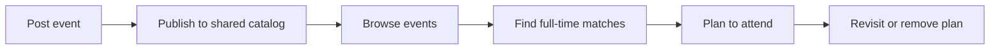


**Done means** this journey works with real application state, including validation, empty states, and a refresh. **Not done** means a pretty page with hard-coded events, a demo where a post never reaches another browser, or a Schedule that deletes the public event when you remove a plan.

### Where we are today

- `app/src/App.tsx` currently handles a create form, free-time search, matching cards, and a list of the **events created in the current browser**.
- `app/src/controller/findEvents.ts` has `createEvent` and `findEvents`. `app/src/model/events.ts` has `CampusEvent`, `fitsFully`, date/time checks, and local-storage helpers.
- Current `master` has **26 passing tests in 11 files** and a passing React build (verified 27 October). The test suite proves the M1 slice, **not** the future shared catalog or Personal Schedule.
- The default branch is **`master`**, not `main`. App commands run inside `app/`.
- The **current selected P5 coursework ER** and its **editable Google Drive draw.io link** are preserved below, distinct from the small M2 implementation contract and the classroom photograph.

## 1. Start from the course materials, not assumptions

The professor's [MVP lecture](https://docs.google.com/presentation/d/1G3QYEDONfO21IupTmfIlAm0b0nRTHTLRYXH2QmDKXz0/edit) describes the MVP as the smallest working subset that provides value. Her [implementation lecture](https://docs.google.com/presentation/d/1YxzkSxyK5kZIJjCdwa69SmrmPgtytcaWBwcARaJGcm0/edit) connects classes to Model, pages to View, and main actions to Controller. It also says to give agents requirements and diagrams, code in chunks, and check their work.

Your team's [P4 architecture Google Doc](https://docs.google.com/document/d/11MKHb3f40Yl81Rx__Mna2lRFf5ooZZUD22QEUnmpiO4/edit) defines **Event**, **EventCatalog**, and **Schedule**. It says **full-event** time matching, planned events on the **current device**, and a **shared** posted catalog. Partial attendance, travel estimates, accounts, cross-device personal schedules and calendar sync are postponed. “Save” in this diagram means **plan to attend**, not a second bookmark collection.

The [original P3 requirements](https://docs.google.com/document/d/11Yq8sW1aOphznZHP-zbul2OedCbLJtxczb-ZZDD3oR8/edit) were broader, but the team chose the smaller P4 implementation. Professor Kandel suggested create → find → save/revisit as a useful end-to-end path and marked that suggestion optional. Our personal Schedule supplies that simple list of plans. The current P5 coursework drawing contains USER and saved AVAILABILITY_WINDOW concepts, but those records are **not authorized as current M2 code features** unless the team explicitly expands scope.

**One professor comment to resolve:** on the [P4 submission](https://docs.google.com/document/d/11MKHb3f40Yl81Rx__Mna2lRFf5ooZZUD22QEUnmpiO4/edit), she said the EventCatalog–Event relationship should use **composition (filled diamond)** because posted Events live in the catalog. The current drawing depicts aggregation and says records outlive the catalog. Discuss the intended lifecycle and correct the diagram/documentation consistently. That is a diagram-and-ownership decision, not an invitation to delete events when somebody removes them from a personal Schedule.

### The settled MVP rules — do not reopen these inside coding prompts

| Decision | Our agreed behavior | Owner / consequence |
|---|---|---|
| Users | **No accounts, login or USER database.** Everyone can post and browse. A host display name is still needed for each event. | Nobody implements authentication or `USER` rows. |
| Posted events | **One shared EventCatalog.** Anyone can create a public event; everyone sees the same catalog. | Daven builds the shared posted-event store and write/read operations. |
| Event content | **ID, hostName, title, description, location, start/end date and time.** hostName is a proposed addition to P4, not an original field. No cost or registration system. | Daven defines the event data contract; Devonny and Sembiyan consume it. |
| Finding events | Events must fit **completely** inside the input free-time window; equal start/end boundaries are valid. | Sembiyan uses the existing full-fit rule. No partial/travel features. |
| Schedule | **A list of events this browser/device currently plans to attend.** Store only stable event IDs, not copies of event data. | Sembiyan owns the local planned-ID list. No server-side per-user plans. |
| Removing a plan | Remove the event ID from this browser's Schedule only. The posted Event stays in the public catalog. | Test after removing a planned event. |
| Free-time input | Enter date and available start/end times for a search; don't store availability windows as records. | No `AVAILABILITY_WINDOW` table. |
| Time and delivery | P5 assignment says **Wednesday, Oct. 28, end of day**; M2 exact time must be verified in the course portal. | Treat proposed team dates as internal targets. |

**Two different meanings of “save” must not be conflated:** `EventCatalog` persists **publicly posted events** for everyone; `Schedule` persists **local references to events planned by this device**. `app/src/model/events.ts` currently stores **the events created locally in M1**, which is a third, transitional state. It must not become the public catalog or planned-events list by renaming the header.

**Selected implementation proposal (27 Oct):** preserve M1's single `date` and `start`/`end` HH:mm fields (**same-day events only**, no overnight entries) and use **Supabase Postgres** for the one shared public EventCatalog. Full technical contract: [implementation contract below](#implementation-contract--database-and-supabase-setup). This narrows P4's separate start/end-date model; make the simplification explicit in MVP specs and tests. `hostName` is a display value, not a login. Daven still needs to create/configure a Supabase project, and the team should review the contract before independently editing consuming files.

## Data-model alignment — P4 is the implementation source of truth

I checked both pages of the [original P4 Google Doc](https://docs.google.com/document/d/11MKHb3f40Yl81Rx__Mna2lRFf5ooZZUD22QEUnmpiO4/edit). They define precisely **three model classes**: EventCatalog, Event and Schedule. The diagram says: “Posts stay in the shared catalog. Planned Event identities stay on the current device. Accounts and cross-device schedules are Wants.” It also says “Save means plan to attend.”

### The chosen three-class design

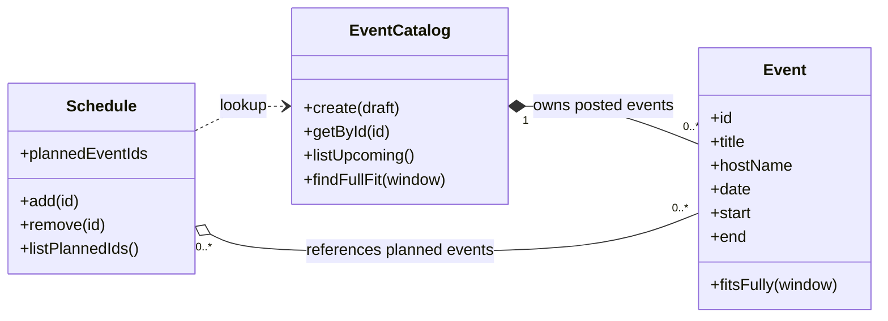

[Google Doc — P4 architecture and instructor feedback](https://docs.google.com/document/d/11MKHb3f40Yl81Rx__Mna2lRFf5ooZZUD22QEUnmpiO4/edit)


**Class responsibilities drawn directly from P4:**

- **EventCatalog:** accepts posts; supplies current/upcoming events; finds by unique ID; finds events completely inside a free-time window; keeps the shared collection.
- **Event:** provides event data, duration calculation, full-fit comparison and valid end-after-start time rules.
- **Schedule:** retrieves selected Event by ID from EventCatalog; adds it once; removes only its local reference; shows planned events in time order; uses current Event details without copying them.

**P4 relationship notes:** The drawing uses a hollow aggregation diamond for `EventCatalog`→`Event` and for `Schedule`→`Event`, plus a dashed `Schedule`→`EventCatalog` lookup dependency. Professor Kandel specifically suggested **composition** for the catalog-to-event relationship because posts live in the catalog. That is an open **UML notation/lifecycle feedback item**, not a reason to add accounts, erase plans, or create another feature.

### Implementation storage: simple, not a new account system

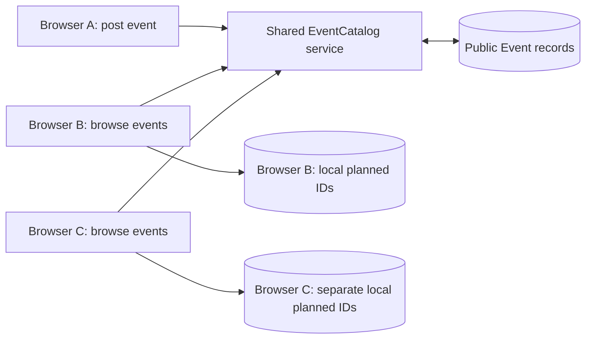


**No USER rows, author foreign keys, PLANNED_ATTENDANCE table, saved AVAILABILITY_WINDOW table, or cost fields.** Each Event has an unverified display `hostName`. An optional generated browser `posterId` would not authenticate the host. Each visitor can post and read the same public catalog. Because there is no identity system, the app cannot securely distinguish who posted an event or restrict who may modify another person's posts; omit public edit/delete operations and be explicit that the prototype is not production-secure. The shared service must still protect its credentials and apply basic validation/rate limits where feasible.

This describes the **proposed M2 implementation storage**, potentially one shared `events` table behind EventCatalog with stable event IDs; `EventCatalog` and `Schedule` remain application classes/services even without dedicated SQL tables. The [current P5 coursework ER below](#p5-coursework-er-diagram--current-drawio-and-mermaid) intentionally depicts an expanded USER/EVENT/AVAILABILITY_WINDOW model. Do not treat that coursework drawing as authorization to build three M2 tables. The course's literal 'each model class' requirement still needs instructor/team review.

### Host identity without user accounts

The original P4 Event lists ID, title, description, location and times but **does not include a host**. We propose a required `hostName` display field: e.g., “SCU Photography Club.” It is self-reported and unverified. `eventId`, not `hostName`, links Catalog and local Schedule records. No separate USER table or login is needed. An optional anonymous `posterId` generated per browser could group posts, but it is not a verified user ID and should not grant edit/delete permissions.

### Shared Event data contract

```ts
export type CampusEvent = {
  id: string
  title: string
  hostName: string
  description: string
  location: string
  date: string  // YYYY-MM-DD in America/Los_Angeles
  start: string // HH:mm on date
  end: string   // HH:mm on date, strictly after start
}

export type EventDraft = Omit<CampusEvent, 'id'>

export interface EventCatalogPort {
  create(draft: EventDraft): Promise<CampusEvent>
  listUpcoming(): Promise<CampusEvent[]>
  getById(id: string): Promise<CampusEvent | null>
}

export interface SchedulePort {
  listPlannedIds(): string[]
  add(id: string): { added: boolean }
  remove(id: string): void
}
```

**Existing code is not migrated yet.** M1 currently uses `CampusEvent` with `id,title,location,date,start,end`, a synchronous `createEvent` controller, and the browser-only `sidequest.created-events.v1` store. Add description and hostName carefully; update tests, form, and display consumers in coordinated PRs. Do not delete passing tests. Catalog calls are now asynchronous; adapt UI loading and errors. Catalog IDs come from the database, not from a random string chosen by a browser controller.

**Timezone rule:** treat `date` and `HH:mm` as the wall-clock date and time for Santa Clara campus (`America/Los_Angeles`). Keep the database `date`/`time without time zone` fields as local calendar fields. Do not round-trip them through `Date.toISOString()`, which can shift the event date. Overnight/DST-spanning events are deferred. Validate the full-fit rule as before with inclusive outer boundaries.


### Contract tests that match the diagram

| Check | Expected | Primary reviewer |
|---|---|---|
| Post then retrieve an Event | A created ID survives a reload, and another browser sees the same title/details | Daven + Devonny |
| Full-fit matching | Equal time boundaries count; an event ending one minute late is excluded | Sembiyan |
| Plan twice | Schedule includes one ID, not two duplicates | Sembiyan |
| Remove a plan | Only this device's ID disappears; the public Event remains accessible | Sembiyan + Daven |
| Different browser Schedule | Browser A and B can read same catalog, but their local plans do not synchronize | Sembiyan + Devonny |
| Planned ID no longer in catalog | My Schedule shows a clear unavailable state instead of a crash | Sembiyan + Cynthia |
| M1 → MVP model migration | Event descriptions, dates and full-fit behavior remain correct after adapting old fields | Daven + Sembiyan |

### P5 coursework ER diagram — current draw.io and Mermaid

**Current P5 drawing (revised October 28): [SideQuest_P5_ER_Diagram.drawio — editable Google Drive file](https://drive.google.com/file/d/1gzbESV0y6hdACNoPJeH3hnO1zxFQ54Lv/view)**.

This is the **current selected P5 coursework ER drawing**, based on the October 26 expanded ER proposal and subsequently refined in draw.io. It is intentionally distinct from (1) the photographed classroom sketch and (2) the small M2 app-storage contract. The link above is the actual editable submission candidate, not an SVG or a deleted GitHub draft.

**Latest checked draw.io structure:** three entities `USER`, `EVENT`, `AVAILABILITY_WINDOW`; direct labeled one-to-many lines `posts` (USER → EVENT) and `has` (USER → AVAILABILITY_WINDOW); a `PLANS TO ATTEND` diamond for the many-to-many relationship (USER ↔ EVENT); **no 1/M/N labels**, in keeping with the classroom discussion. The drawing's current `EVENT` attributes are `event_id (PK)`, `title`, `description`, `location`, `start_at`, `end_at`, `source_type`, and `cost_amount`. The latest Drive file **does not include** `registration_details`, although it was present in the older proposal. `USER` has `user_id (PK)` and `display_name`; `AVAILABILITY_WINDOW` has `availability_id (PK)`, `start_at`, and `end_at`.

#### A. Selected P5 ER — matching Mermaid source

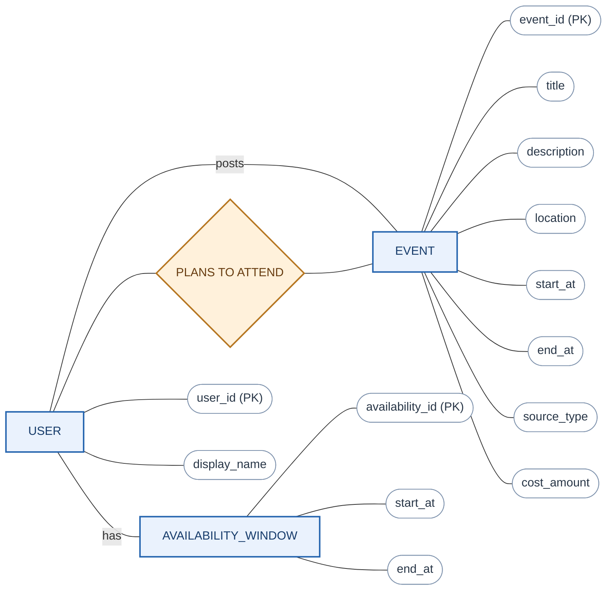

[**Open the same P5 drawing for editing in draw.io / Google Drive**](https://drive.google.com/file/d/1gzbESV0y6hdACNoPJeH3hnO1zxFQ54Lv/view) · [**P5 assignment requirements**](https://docs.google.com/document/d/1FcjgTh3lBprpDxkFNuENM1RRAky9lYFeMOAeaJLnAC8/edit)

**Important distinction for teammates and coding agents:** This P5 coursework ER illustrates a **broader data model**. It does **not** mean the team decided to implement user accounts, persistent availability records, costs or a central planned-attendance join table in the current **M2 MVP**. For code, follow the [small Event contract](#shared-event-data-contract), shared public EventCatalog and browser-local plans. A conceptual ER diagram and a shipped database schema can represent different scopes, but the team must clearly acknowledge that difference.

**Remaining P5 review before submission:** Professor Kandel's instruction says "Each model class is its own entity," whereas this selected P5 diagram models USER/EVENT/AVAILABILITY_WINDOW, not each P4 class. This mismatch has **not** been confirmed acceptable by the instructor. Also, Google Drive sharing is currently **SCU-domain with link: Commenter**, not public **Anyone with the link: Commenter**. Finally, the current drawing marks primary keys using `(PK)`; verify whether the professor expects Chen-style underlining instead. Do not claim submitted or instructor-approved until those checks are complete.

---

#### B. Original October 26 classroom sketch — faithful Mermaid transcription

This follows what is visibly present in the photograph: two entity rectangles **USERS** and **EVENTS**, a central **Schedule** relationship diamond, an attached `schedule-id` oval, three user attributes and the legible event attributes. **No EventCatalog rectangle is present in the photograph.** The photograph does not clearly establish relationship cardinalities, so none are invented here.

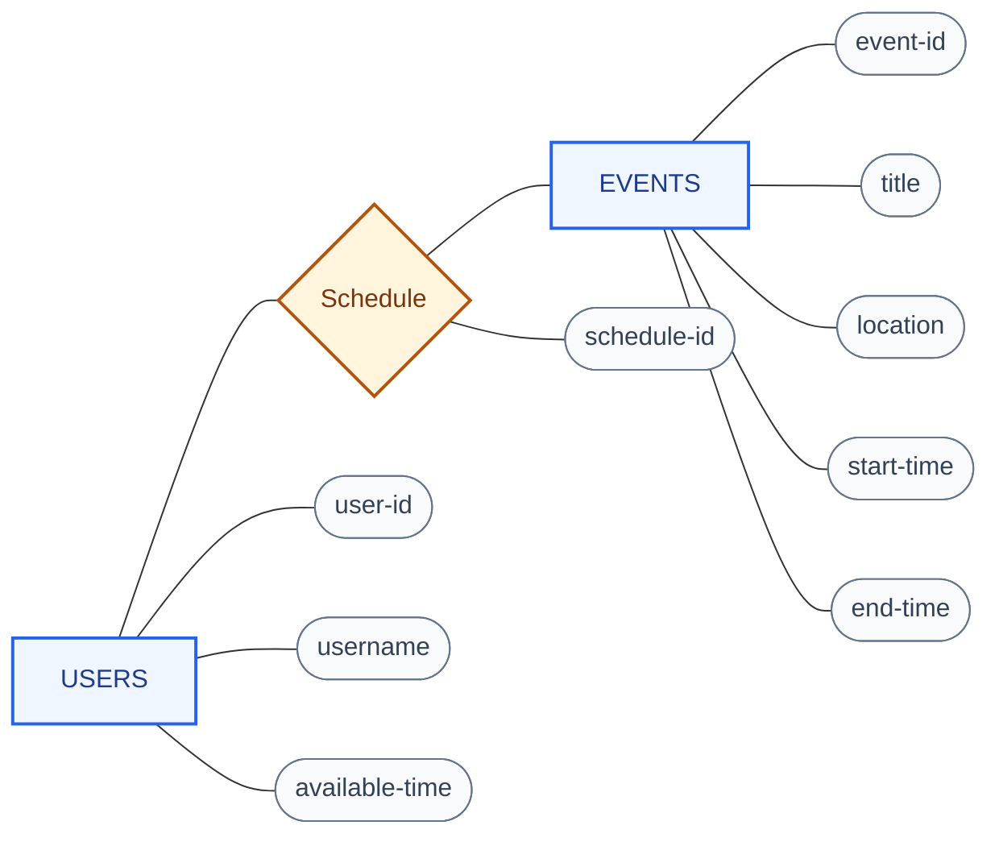

[**Original P5 Google Doc — photograph of the group's actual October 26 classroom ER drawing**](https://docs.google.com/document/d/1zr55kTHGyVltD1AqU7SrdVOWPlf2ClkwWczfdOT4yO0/edit)

**Photo-reading limitations:** Some pencil labels are faint. The labels above are those legible in the provided photograph; verify any ambiguities against the original high-resolution image and teammates' recollections before treating this transcription as a finished submission. In particular, **do not infer cardinalities or invent extra keys** merely to make the sketch look complete.


#### C. October 26 proposal history — source of the expanded ER model

The repo also once had a more elaborate P5 ER proposal, **before** the simplified three-class version was introduced. This is the *original code from that draft* (preserved here to stop losing earlier work):

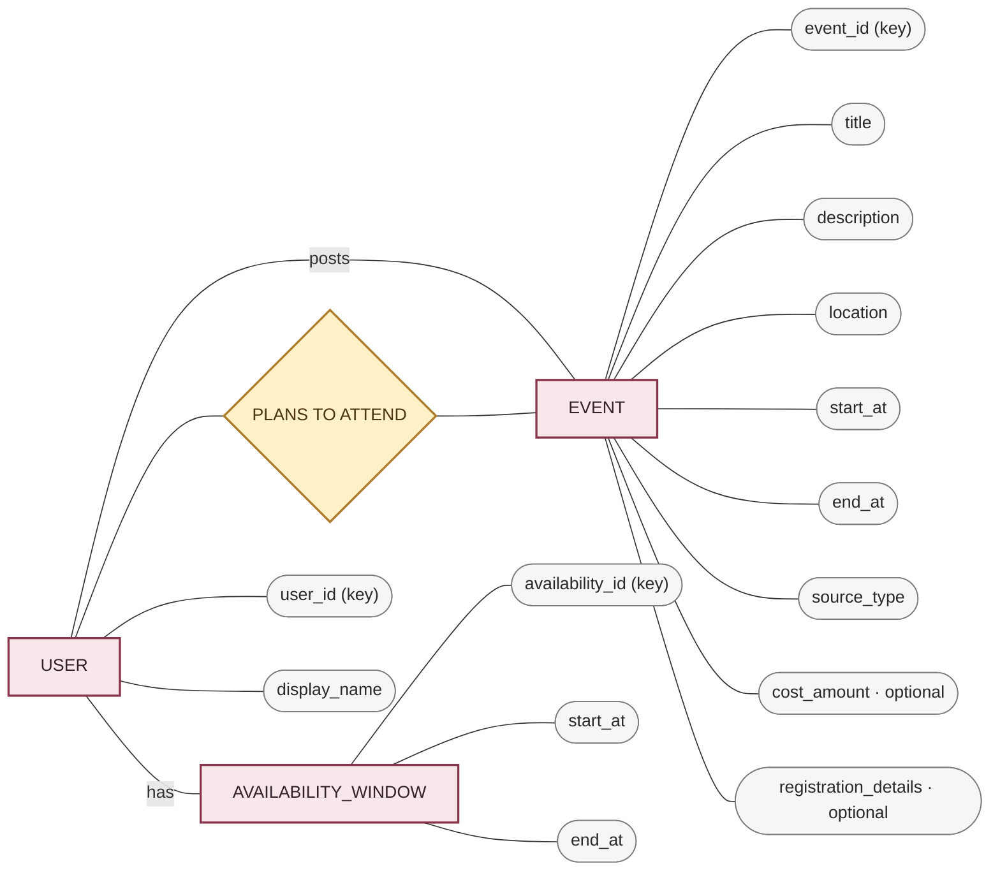

[**Historical October 26 Mermaid source in GitHub**](https://github.com/haiiroWednesday/SideQuest-CSCI187/blob/dda59d0e333b7f633b67d833e6c6887ff9aa44d3/docs/MVP_ER_DIAGRAM.md)

This historical proposal introduced USER accounts, stored availability windows, cost/registration fields, and server-side planned attendance. **It is not the M2 implementation contract**, because the team later selected anonymous event posting, a shared EventCatalog, full-event matching and browser-local planned IDs for M2. It is preserved as research/history rather than authorized requirements for coding agents.


**Which diagram is which:** The **current P5 file** is figure A above; the **photographed classroom sketch** is figure B; the **historical October 26 draft** is figure C. The **M2 implementation** is documented separately in the P4-derived class architecture and TypeScript contract. Do not silently replace the coursework drawing with the M2 model or vice versa.

### P5 assignment checkpoint, separate from implementation

The P5 assignment states **Wednesday, October 28, 2026, end of day**. Submit **(1) a photo of the in-class hand-drawn ER** and **(2) the current [editable draw.io ER diagram](https://drive.google.com/file/d/1gzbESV0y6hdACNoPJeH3hnO1zxFQ54Lv/view)** as a shared link through **Gradescope**. One teammate submits and includes all contributors. The requested permission is **Anyone with the link → Commenter**; the last verified setting is **SCU-domain with link → Commenter**, so the sharing must be checked before submitting. The selected P5 design remains conceptually broader than the agreed M2 data persistence and may conflict with the literal 'each model class is its own entity' direction: confirm this with the team/professor rather than asserting that the assignment is fully compliant or that the M2 contract has changed.

### Clear handoffs, no schema split

- **Daven → Devonny:** public list and lookup results, event fields, stable IDs and loading/error responses. Devonny owns Browse, *not* the catalog datastore.
- **Daven → Sembiyan:** public event lookup by ID and agreed temporal fields. Sembiyan implements full-fit and the **local** planned-ID Schedule; no user table or attendance join table.
- **Cynthia ↔ Devonny:** shared card/details components with Event props and distinct “Plan to attend” action. No price blocks or account UI.
- **Whole team:** agree field names and which class owns `fitsFully`; then agents implement independent slices. Changing CampusEvent requires a coordinated PR and matching tests.

## Implementation contract — database and Supabase setup

The selected backend is a **proposal that Daven must configure and validate**; it is not yet an implemented shared catalog. Client components depend on `EventCatalogPort` rather than database column names. The P5 coursework ER above does not authorize a USER/AVAILABILITY_WINDOW/PLANNED_ATTENDANCE implementation.

### Proposed Postgres storage and SQL

Daven owns the actual SQL migration. The following is a **reviewable starting point**, not SQL already deployed.

```sql
create table public.events (
  id uuid primary key default gen_random_uuid(),
  title text not null check (length(btrim(title)) between 1 and 120),
  host_name text not null check (length(btrim(host_name)) between 1 and 120),
  description text not null check (length(btrim(description)) between 1 and 2000),
  location text not null check (length(btrim(location)) between 1 and 200),
  event_date date not null,
  start_time time without time zone not null,
  end_time time without time zone not null,
  created_at timestamptz not null default now(),
  constraint same_day_event_times check (start_time < end_time)
);

alter table public.events enable row level security;
revoke all on table public.events from anon, authenticated;

-- An unauthenticated visitor can only read or submit approved data fields.
grant select on public.events to anon;
grant insert (title, host_name, description, location, event_date, start_time, end_time)
  on public.events to anon;

create policy "Anyone may read posted events"
  on public.events for select to anon using (true);

create policy "Anyone may submit a valid event"
  on public.events for insert to anon with check (true);
```

Review column permissions and policies with `supabase test db` as described in Supabase's [RLS documentation](https://supabase.com/docs/guides/database/postgres/row-level-security). The database generates `id` and `created_at`. No anonymous UPDATE/DELETE permission is granted. Database `date`/`time` map to the agreed TypeScript strings at the adapter boundary; don't let every feature write independent field translations.

**Important course extra-credit conflict (verify with the professor before deployment):** the [final-project bonus document](https://docs.google.com/document/d/12slKo80yu17NZw5nbrB0U1C_nj7mLq6h6uQoSbkCVQk/edit?usp=sharing) states that **all API keys must stay on the server, never in front-end code or on GitHub**, and exposed keys forfeit extra credit. Supabase normally expects an intended-public publishable client key to be bundled in the frontend and protected by RLS. These two rules need explicit instructor clarification; do **not** assume the Supabase publishable-key exception satisfies her grading condition. If the requirement is literal, use a server-side adapter/proxy for public database operations instead. Never expose service-role, secret, third-party, or AI keys. This affects the choice of catalog adapter, not the Event/Console domain contract.

**Security caveat:** because inserts are anonymous, someone who knows the public endpoint can post fake host names or flood the catalog. SQL constraints and RLS restrict operations and malformed field values, but do not prevent abuse. This is only acceptable for a **limited classroom prototype with monitored access**, not a broad public rollout. Before public deployment, require a separate protected and rate-limited write path (for example a small serverless/Edge Function with abuse checks). Never put a Supabase secret/service-role key into Vite code or a browser. A **publishable** key is intended to be public, subject to RLS.

### Connecting React to the catalog

1. Daven creates the team Supabase project and applies one reviewed SQL migration. The dashboard permissions are for team developers only; **students using SideQuest still do not log in**.
2. In `app/`, install `@supabase/supabase-js`. Create `app/.env.local` with `VITE_SUPABASE_URL` and `VITE_SUPABASE_PUBLISHABLE_KEY`. Keep `.env.local` out of Git; document variable **names**, not project secrets, in `.env.example`.
3. Implement **one** `EventCatalogPort` adapter that maps between camelCase (`hostName,date,start,end`) and SQL column names (`host_name,event_date,start_time,end_time`). For tests, provide a fake adapter implementing the identical interface; that fake is not public storage.
4. Devonny uses only the catalog port for browsing and details. Cynthia builds visual components from the agreed `CampusEvent` type. Sembiyan reuses the current full-fit logic with catalog results and stores planned Event IDs in `localStorage`.
5. Replace the M1 *created events* list deliberately rather than calling it My Schedule. Do not auto-upload old local test events into the public catalog.
6. Test a new event across **two independent browsers**, then add/remove a plan in only one browser. The public event must persist, while the other browser's Schedule stays unchanged.
7. Run `npm test`, `npm run build`, and PR CI; add policy tests asserting that anonymous SELECT/INSERT work while UPDATE/DELETE fail.


## 2. How the pieces should fit together

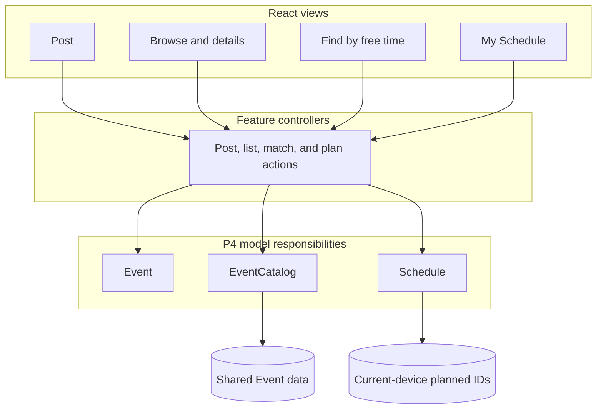


**Important:** this is an **implementation map we propose**, not a claim that these files/classes already exist. The actual M1 code has one React page and browser-local event storage. Keep the MVC direction: a view asks the controller to do something; the model doesn't import React.

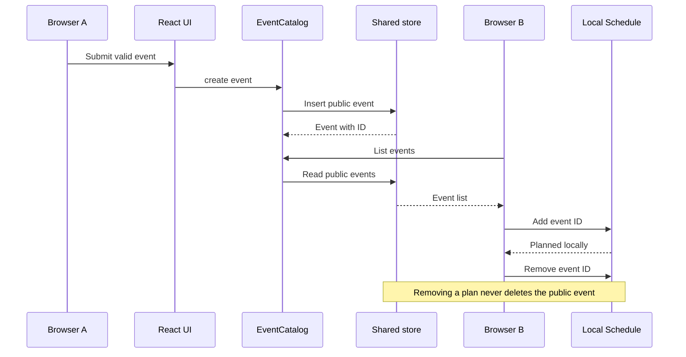


### One agreed contract, not two competing schemas

Use the **CampusEvent, EventCatalogPort and SchedulePort** proposal in [shared Event data contract above](#shared-event-data-contract). It reflects the chosen P4-simple design. Finalize names with the team before merging code; there is no alternative user-scoped Path B in this MVP.

- Keep Event IDs stable from publishing through Browse, Search and Schedule. Two events may have identical titles; IDs distinguish them.
- Use the selected M1-compatible `date`/`start`/`end` contract (same-day only). Do not let any agent independently introduce `startDate`, `endDate`, or timestamp fields into shared TypeScript props.
- Keep `fitsFully` as the validated source of truth for temporal matching. Exact matching boundaries are inclusive.
- `Schedule` keeps **only event IDs in this browser's local storage**. It asks EventCatalog for current details when rendering; it does not copy an Event or add a global `saved` property.
- Never use `sidequest.created-events.v1` as the planned-attendance key. That legacy M1 key stores browser-created events, not planned event IDs or a cross-browser catalog.
- Keep a fake EventCatalog adapter for isolated UI tests, clearly labeled as a test fixture; do not call it shared persistence in the demo.

### Feature dependency map

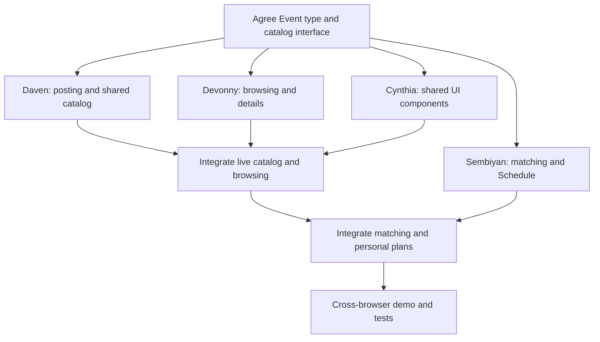


## 3. Cynthia — design the experience, and build it

**Architecture handoff:** design components around the agreed Event fields and local `isPlanned` state. No account screens, price labels or account-scoped props.

**What you own:** visual direction and reusable interface patterns. You co-design browsing with Devonny, rather than taking over all her feature code. You still implement real React components and test their states.

**First pass — decisions (one focused session):**

1. Open the working M1 app and draw four tiny screen sketches: Browse, Event Detail, Search, My Schedule. Decide whether these are separate routes or sections; don't invent a router if a small tab/section layout is enough.
2. Inventory what every event card must show at a glance: title, **host name**, date/time, place, and a clear way to inspect details. Include the description in the detail presentation; omit cost and other unapproved fields rather than adding placeholders.
3. Define tokens once (e.g., `--color-*`, spacing, corner radius, font scale). Keep the existing SCU maroon/gold identity unless the group agrees otherwise. Avoid global CSS changes that unexpectedly restyle everyone's forms.
4. Sketch real **states**: no events, loading, error, full list, no match, an event missing after being planned, mobile narrow screen.
5. Share a screenshot/Figma frame or annotated sketch and ask Devonny to confirm the component interface **before** implementation.

**Implementation path:**

1. Make a feature branch such as `feature/ui-system-cynthia` from current `master`.
2. Extract non-domain-specific UI components (e.g., `PageShell`, `EmptyState`, `EventCard`) only when they have an actual caller. Component filenames are examples, not mandated names.
3. Prefer explicit props: `EventCard({event, actionLabel, onAction})`, not direct imports from a database adapter. The view must remain usable with mock events.
4. Build keyboard focus, visible button labels, accessible error/empty feedback, and responsive layout at roughly 375px and desktop width.
5. Avoid overly ambitious animation and redesign of every page in the same PR. First deliver a usable UI kit and one screen.
6. Review Devonny's Browse PR for information hierarchy and consistency; she reviews your components for integration practicality.

**Your acceptance checks:** Browse cards don't overflow on a phone; essential event facts are legible; tab order and buttons work; missing event data doesn't produce “undefined”; an empty catalog shows a useful message; the UI doesn't perform matching or storage itself.

**Handoff to Devonny:** a screenshot or link, component names/props, tokens, sample empty/loading/error screens, and which files you'll edit. Agree that Devonny owns catalog-to-browse behavior while you own cross-screen patterns.

## 4. Devonny — make discovery real, with Cynthia

**Architecture handoff:** read shared Event records through Daven's EventCatalog interface; the browsing page never reads or edits database internals directly.

**What you own:** presenting events from an agreed catalog read interface, navigating/selecting an event, and the Browse feature's state transitions. Help choose UI details with Cynthia. You **do not** separately own catalog persistence internals.

**Implementation path:**

1. Confirm the shape and sample output of `listUpcoming()`/`getById()` with Daven. If the real adapter isn't ready, create a **clearly named test fake** used only in stories/tests or development, not a pretend shared production catalog.
2. Make `feature/browse-devonny` and build a pure Browse view that renders a passed-in event list: upcoming order, key details, distinct identities.
3. Add loading/error/empty handling around the read operation, without relying on the posting feature being complete.
4. Add event selection/details: `getById(id)` or passed event object, agreed with Daven; display hostName and never use titles as event identity.
5. Use Cynthia's shared components and style tokens. If something is missing, ask for a small shared-component addition rather than duplicating the CSS.
6. When Daven's real catalog implementation is ready, swap fake data for the port, manually open the app in a second browser, and verify a newly posted event appears there.
7. Write tests for sorted/listed events and visible empty/error states. Pair with Cynthia for one keyboard/mobile review.

**Done:** a real event created by Daven's posting flow appears in the discovery UI (without manually editing a local sample list); selecting it shows its correct fields; network failure has an honest message, not a blank page.

## 5. Daven — posting plus the catalog's one source of truth

This is a foundational workstream. M1 create/validate logic already exists. Build the shared posted-event catalog, not accounts, user profiles, saved availability, prices, or a production-scale moderation system.

**Data ownership:** Daven owns the shared Event records, unique IDs, creation and retrieval API, and integration with the posting form. There is **no user foreign key or planned-attendance table** in the chosen implementation.

**Selected backend: Supabase Postgres.** Create one shared `events` table, expose a typed catalog adapter through `@supabase/supabase-js`, and keep planned-event IDs in browser localStorage. For a restricted classroom prototype, anonymous readers may use SELECT and anonymous posters INSERT only, with RLS **and narrow SQL grants**; deny anonymous UPDATE and DELETE. Add database-side constraints, and acknowledge that no-login anonymous posting cannot reliably prevent spam or impersonation. Do not claim production-grade safety; add a server-side rate-limited write gate before broad public deployment. See [contract and security caveats](#implementation-contract--database-and-supabase-setup).

**Implementation path:**

1. Start from the selected same-day `CampusEvent` type (`id`, `title`, `hostName`, `description`, `location`, `date`, `start`, `end`) and shared catalog interface in the [implementation contract](#implementation-contract--database-and-supabase-setup). No login, cost, USER table, or alternate timestamp type.
2. Keep existing `createEvent` validation behavior or reuse its rules behind the new posting controller. Don't overwrite tested logic without replacement tests.
3. Build `listUpcoming`, `getById`, and `create` against a fake in-memory adapter **first**. Include unique IDs and persistent ordering.
4. Configure Supabase Postgres and version the table schema/privileges/RLS policy in a SQL migration; integrate it with the `@supabase/supabase-js` adapter. The **publishable** key is intended for client-side use; NEVER put a secret/service-role key in React or GitHub. For classroom anonymous inserts, enforce data constraints and SELECT/INSERT-only role permissions, and document the spam risk. For wider public access, add a server-side rate-limited write endpoint.
5. Connect the creation form to the agreed controller/port; return clear field-level errors and a success message containing the created event ID or stable reference.
6. Verify a new event can be retrieved in a **second browser/session**. Restart the service if persistence is promised and verify again.
7. Write model/controller/API tests: empty title/host name, invalid date, `end <= start`, duplicate IDs, hostName surviving create/read, server failure.
8. Hand Devonny and Sembiyan a stable port and sample responses; freeze contract changes behind team review once integration begins.

**Workload guardrail:** if deployment is blocking the others, make the fake adapter ready within the first day and ask for one short pairing session. Delegate docs, manual cross-browser checks, or deployment verification—but keep one owner for the catalog implementation itself.

**Done:** posting creates a valid Event; a fresh client lists or gets it by ID; no private credentials leak; malformed data is rejected; clear setup steps exist.

## 6. Sembiyan — full-fit search and the Personal Schedule

**Data ownership:** Schedule is a **current-device list of stable Event IDs** in localStorage; free-time is a temporary search input. No database join table, account state or saved availability entity.

**What you own:** the free-time matching flow and local “plan to attend” list. These share event IDs but are separate behaviors; separate tests and PRs are encouraged if scope grows.

**Implementation path:**

1. Confirm Daven's catalog read port and Event schema. Work with fake records while shared storage is underway.
2. Reuse existing `fitsFully` and `findEvents` logic as a starting point. Preserve same-date checks, ordered results, valid window checks, and inclusive exact boundaries.
3. Treat “partially fits” and travel time as **out of scope** for this P4 MVP unless the team explicitly changes requirements.
4. Add search controls to Browse or a dedicated Find section, agreed with Cynthia; filtering needs to work against **catalog events**, not only the old browser-created-event list.
5. Implement `Schedule` as a local collection of stable event IDs, e.g. storage key `sidequest.planned-event-ids.v1` (proposed name). Add once, handle duplicates, remove only the plan ID, and never delete the public Event.
6. Resolve IDs through the catalog to display current event information. Show an unavailable-state if an event no longer exists. Keep display order predictable (event start time/date).
7. Test refresh persistence, duplicate add, remove, invalid/corrupt local storage, same event title with different IDs, missing catalog event, and exact time boundaries.
8. Share actions/props with Cynthia and Devonny before their screen integrations; coordinate copy: **“Plan to attend”**, **“My plans”**, **“Remove from plans”**, not “Delete event”.

**Done:** the correct public events match; one click adds the event ID to My Schedule; same-device refresh preserves it; removing a plan does not change the public catalog.

## 7. Everyone — work in small, reviewable slices

### The branch-to-merge path

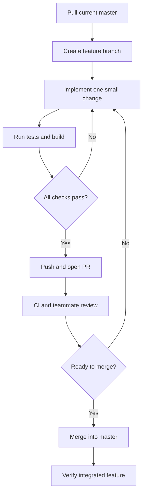


**Run these commands from the cloned repository root** (not inside `app/` for the branch commands):

```bash
git status
git fetch origin
git switch master
git pull --ff-only origin master
git switch -c feature/short-description-yourname

# After editing:
cd app
npm install             # first time only, or after package changes
npm test
npm run build
cd ..
git status
git add <only-the-files-you-intended-to-change>
git commit -m "feat: explain the one behavior added"
git push -u origin feature/short-description-yourname
# Open a PR targeting master, request another teammate's review.
```

Do not run `git reset --hard`, force-push another person's branch, commit `.env`, credentials, `node_modules`, or `dist`, or merge a failed CI run to save time. If `git status` shows work you don't recognize, stop and ask before switching branches. Protect `master` with required review and required checks if the repository settings allow it; this is a recommendation, **not** a statement that protection is already on.

**Each PR should say:** what changed, why it matters to one requirement, files affected, how to test it, screenshots if visible UI changed, and what hasn't been finished. If the shared schema changed, tag everyone who consumes it.

### The team's definition of done

- Feature is integrated with its actual data boundary (or explicitly labeled fake during development).
- Error, empty, loading, and normal states are addressed where applicable.
- Tests assert the application's output, not just the test input or an always-true fact.
- `npm test` and `npm run build` pass locally; React CI passes on the PR.
- At least one teammate reads the diff and tries the behavior (extra important for AI-generated code).
- No unrelated files, secret keys, or speculative feature additions; documentation stays accurate.
- The demo path on latest `master` still works after merge.

### Review owners — distribute review load

| Author | First reviewer | Second eyes when needed |
|---|---|---|
| Cynthia, UI kit/layout | Devonny | Sembiyan for search/Schedule controls |
| Devonny, browse UI | Cynthia | Daven when catalog contract is touched |
| Daven, posting/catalog | Sembiyan | Devonny for read/list integration |
| Sembiyan, matching/Schedule | Daven | Cynthia for user-facing interaction |

This matrix is **proposed coordination**, not an exclusive review permission system. Anyone can review; avoid self-approval as the only review.

## 8. Use AI tools without losing control of the project

Your professor permits coding with agents but warns that they can invent architecture, misunderstand UX, and silently make decisions outside the prompt. Treat an agent as a fast contributor, not as the product owner.

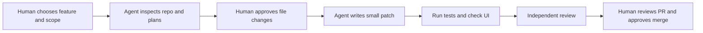


**Claude Console workspace:** manage API keys, access and usage limits; it does **not** automatically clone the GitHub project or serve as a shared filesystem. **Playground:** compare prompt ideas, explore UI copy or architecture choices, and test model behavior; it does **not** itself change repository files. **Cline / coding agent in VS Code:** reads the *opened local repo* with the granted permissions and can propose edits and run commands. Each person's local agent is not a shared live chat that automatically knows their teammate's unpushed changes.

**Safe five-step agent session:**

1. Start on your own feature branch with clean `git status` and an agreed issue/feature.
2. Provide the M1 files, [P4 Google Doc](https://docs.google.com/document/d/11MKHb3f40Yl81Rx__Mna2lRFf5ooZZUD22QEUnmpiO4/edit), this playbook, and the **specific** contract. Request **Plan** first: list touched files, data shapes, risks, tests; forbid edits in this first response.
3. Read the plan. Reject new accounts, saved windows, cost fields, travel calculations, styling overhauls, or new libraries unless the team deliberately revises the agreed architecture.
4. Permit one small implementation; ask the agent to run `npm test` and `npm run build` and quote the actual results. Never give it unchecked write/deploy privileges or place API keys in prompts/code.
5. Inspect the Git diff yourself, perform one manual use case, then request an independent reviewer. Two AIs agreeing is **not** proof that the feature works.

**Ready-to-paste planning prompt:**

> You are working in `haiiroWednesday/SideQuest-CSCI187`, React/TypeScript app under `app/`, default branch `master`. Read `README.md`, `REQUIREMENTS.md`, `SPECIFICATIONS.md`, `docs/MVP_TEAM_PLAYBOOK.md`, and **both pages of the original P4 class diagram**. Read the **current P5 coursework ER**, classroom drawing, and historical proposal sections for documentation context only; **none** overrides the current small M2 implementation contract. My assigned feature is [FEATURE]. Follow Model–View–Controller boundaries, reuse tested M1 code, and respect our **confirmed P4-simple scope**: shared public EventCatalog, no user/login, no cost or saved-availability records, full-fit matching only, and one browser-local Schedule of planned Event IDs. Older P5 proposals with USER accounts, saved availability and PLANNED_ATTENDANCE tables are superseded. Do not propose account tables, planned-attendance junctions, saved availability tables or prices. **Do not edit yet.** Tell me your understanding, the smallest possible file-by-file plan, proposed interfaces, edge cases, and tests. Mark all inferred choices as questions. Do not modify unrelated files.

**Ready-to-paste implementation prompt (after approval):**

> Implement **only Step 1** of the plan we approved. Use the interfaces we agreed on. Do not alter files outside [FILES]. Add unit tests that would fail if the behavior were wrong. Run `npm test` and `npm run build` from `app/`. Report exact results and list all modified files. Stop before committing, merging or deploying; I will review the diff.

**Ready-to-paste reviewer prompt:**

> Review the diff on my feature branch against `master`. Focus on violations of P4 scope or MVC boundaries, missing event-ID invariants, data loss, misleading “saved” semantics, test assertions that do not call real behavior, browser-only state masquerading as shared data, accessibility and responsive breakage, and credential leaks. Do not rewrite anything. Rank findings by severity, file and line, and suggest the smallest correction.

**Protect the credits and everyone’s work:** each teammate uses their own authorized provider setup or a team-approved credential arrangement; don't paste API keys into group chat. Keep model/agent configuration separate from Git repository secrets. Do not make agents work in parallel on the same files in the same branch.

## 9. Test the actual experience, not just small functions

The existing **26 tests / 11 files** are the M1 baseline. They do not certify a shared datastore, a posting API, browser states, or planned-attendance persistence. Add focused tests as each feature arrives.

| Scenario | Expected result | Owners |
|---|---|---|
| Post valid event | Created ID is stable; event can be listed/read | Daven |
| Reject reversed event time or missing title | No public record created; clear error | Daven |
| Browse no events / storage unavailable | Meaningful empty/error state, no crash | Devonny + Cynthia |
| Open an event detail | Correct ID and event facts, even if two titles match | Devonny |
| Same-day, entire-event availability | Full-fit events returned in time order | Sembiyan |
| Event ends exactly when free time ends | Included | Sembiyan |
| Event ends one minute after free time | Excluded | Sembiyan |
| Plan the same event twice | One planned ID, not duplicates | Sembiyan |
| Remove plan | Removes only local reference; catalog event remains | Sembiyan + Daven |
| Refresh / corrupt planned storage | Plans survive same-browser refresh or fail safely | Sembiyan |
| Different browser posts / reads event | Shared catalog actually works | Daven + Devonny |
| Phone-sized screen / keyboard-only use | Layout, labels, buttons, and focus are usable | Cynthia + Devonny |

**One end-to-end smoke test (repeat after every merge):**

1. Open a clean browser window, post **Art Workshop**, on a valid future date, **14:30–15:30**, location **Arts Building**.
2. In a **different browser or device**, load Browse and find that exact ID/title. If this fails, the shared catalog is unfinished, even if M1 local search works.
3. Search the same day with free time **14:00–16:00** → it matches. Search **15:45–17:00** → it does not.
4. Select **Plan to attend**. Verify it appears once in My Schedule. Refresh that browser; it should remain.
5. Remove it from My Schedule. Browse again: the posted event must still exist.
6. Test empty state, invalid form input, narrow screen, and keyboard navigation.

**Manual UI spot check:** each UI change should include one desktop and one small-phone screenshot, and ideally one quick teammate walkthrough where the tester narrates what they think each action will do. Don't call that a formal usability test unless it follows the actual course protocol.

## 10. The integration plan — prevent four incompatible branches

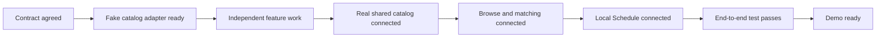


**Gate 0 — contract (first):** One Event type, catalog read/write port, ID rule, persistence choice and UI file ownership. Document the decision in this guide or a short PR. Everyone signs off.

**Gate 1 — independent work:** Daven creates real/fake catalog ports; Devonny and Sembiyan build against the fake; Cynthia ships UI components. All branches stay short-lived; do not rewrite the entire app all at once.

**Gate 2 — vertical integration:** Merge the smallest common interface first. Connect real catalog → browse, then matching → catalog events, then plan actions → current-device IDs, then appearance/polish. Run smoke scenario after each merge.

**Gate 3 — final checks:** Freeze speculative features. Fix real broken paths, record known limits, update the README, capture demo, confirm submissions. If there's a regression, revert the offending PR rather than piling on new patch features.

### File coordination — suggestion, not a rigid directory policy

| Area | Primary editor | Others |
|---|---|---|
| Shared UI tokens/components | Cynthia | Devonny reviews and consumes |
| Browse view/interaction | Devonny | Cynthia co-designs |
| Event creation + catalog storage adapter | Daven | Sembiyan reviews contract |
| Matching / Schedule domain helpers | Sembiyan | Daven reviews invariants |
| Shared `CampusEvent` and port definitions | **Joint change** | Review required from Daven, Devonny, Sembiyan before merge |
| `App.tsx` composition/navigation | Agree one integrator per PR | Avoid simultaneous broad edits |
| Tests for each feature | Feature owner | Every teammate verifies integrated suite |

**Conflict rule:** if two people need the same file today, pair briefly or merge one small branch first. Do not each ask an agent to regenerate `App.tsx` independently and hope Git resolves it.

## 11. A workable schedule, starting October 27

**These are proposed internal dates, not the official M2 due time.** Class materials put the M2 MVP prototype milestone in the **week of Nov 2–6**. Use the current course submission page as the source of truth; if the deadline is earlier, move the integration gates forward.

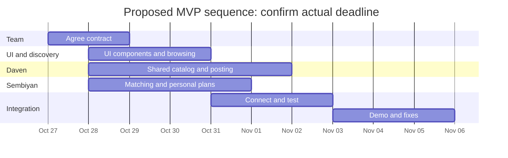


**Suggested 10-minute daily check-in:** each person says (a) what worked since yesterday, (b) what will be merged next, (c) which teammate or contract is blocking them. Put links to PRs and screenshots in the message. Use one shared list of decisions and blockers, not four unrelated agent conversations.

**Fallback if shared storage is late:** continue UI, matching and Schedule development using a fake port, but label the demo accurately. Don't claim cross-browser posting until it has been tested. Prioritize fixing the public catalog before decorating screens. Ask the professor about acceptable MVP trade-offs if the due time forces a narrower slice.

## 12. Demo script, final checks, and unresolved decisions

**A five-minute demo:**

1. **10 seconds — problem:** Students have limited free time and can't easily tell what campus activities fit.
2. **50 seconds — posting:** Daven posts a valid event and shows clear confirmation.
3. **60 seconds — discovery:** Devonny opens another client and finds the posted event; Cynthia points out the readable card/detail structure.
4. **60 seconds — matching:** Sembiyan enters a free-time window, shows one full fit and one non-fit, and explains the exact boundary rule.
5. **60 seconds — plans:** Add the event to My Schedule, refresh, remove it, then prove the original event is still discoverable.
6. **40 seconds — quality:** Show GitHub CI, tests, one mobile screenshot, and honestly describe what's postponed.

**Before calling MVP complete:** confirm P5 submission and public-commenter sharing, resolve the professor's literal 'each model class' P5 instruction against the current course drawing, discuss catalog composition feedback, preserve the distinction between the broader P5 ER and the small M2 code contract, implement a shared event catalog and browser-local Schedule, assign reviewers, secure credentials, and test the cross-browser journey on `master`.

### Documented source links and ownership

**Team artifacts:** [P5 current assignment](https://docs.google.com/document/d/1FcjgTh3lBprpDxkFNuENM1RRAky9lYFeMOAeaJLnAC8/edit) · [P3 requirements and instructor comments](https://docs.google.com/document/d/11Yq8sW1aOphznZHP-zbul2OedCbLJtxczb-ZZDD3oR8/edit) · [P4 architecture Google Doc](https://docs.google.com/document/d/11MKHb3f40Yl81Rx__Mna2lRFf5ooZZUD22QEUnmpiO4/edit) · [P4 professor feedback](https://docs.google.com/document/d/11MKHb3f40Yl81Rx__Mna2lRFf5ooZZUD22QEUnmpiO4/edit) · [M1 walking skeleton specs](../SPECIFICATIONS.md) · [current P5 Mermaid + draw.io](#p5-coursework-er-diagram--current-drawio-and-mermaid) · [editable P5 draw.io](https://drive.google.com/file/d/1gzbESV0y6hdACNoPJeH3hnO1zxFQ54Lv/view).

**Course:** [MVP](https://docs.google.com/presentation/d/1G3QYEDONfO21IupTmfIlAm0b0nRTHTLRYXH2QmDKXz0/edit) · [System Architecture](https://docs.google.com/presentation/d/1S5NFSWBuB7DNCxgtnEIwg7Yq-osRQyr4eVQB9pk-UqI/edit) · [Implementation and AI guidance](https://docs.google.com/presentation/d/1YxzkSxyK5kZIJjCdwa69SmrmPgtytcaWBwcARaJGcm0/edit) · [Walking Skeleton](https://docs.google.com/presentation/d/1W_RSFcWNTL-NINOeRiGBVvvOtcZncaio5pE5-QtSRmw/edit).

**External workflow references:** [GitHub PR workflow](https://docs.github.com/en/pull-requests/get-started/about-pull-requests) · [Branch protection](https://docs.github.com/en/repositories/configuring-branches-and-merges-in-your-repository/managing-protected-branches/about-protected-branches) · [GitHub Mermaid diagram syntax](https://docs.github.com/en/get-started/writing-on-github/working-with-advanced-formatting/creating-diagrams) · [GitHub Actions for Node](https://docs.github.com/en/actions/tutorials/build-and-test-code/nodejs).

*This playbook is the team's proposed way to work. The P3/P4/P5 materials and class instructions remain the sources for what the assignments actually require. When a decision changes, record it and update the code, diagrams, and acceptance tests together.*

## Appendix — detailed unit-testing examples

These examples are brought here from the older testing guide. They are **illustrative M1 examples**, not authorization to override the current `CampusEvent` contract, Supabase API, or date rules.

**Eight optional examples • Visual diagrams • Guidance for designing your own meaningful tests**

Optional contributor reference for the SideQuest **TypeScript + React** walking skeleton. **Our team brainstormed these eight example topics; Professor Kandel did not assign numbered testing categories.** Students choose their own meaningful tests, and these examples are not required project files.

> **These are suggestions, not an official checklist.** You can start from one of the examples below, adapt it to explore a different meaningful behavior, or devise a completely new test. Changing only an event name or filename does not make a test meaningfully distinct.

**Jump to:** [How to design a test](#how-to-design-a-test-of-your-own) · [Optional example topics](#optional-test-ideas-and-example-code) · [Red X → green check](#demonstrate-a-red-x-then-a-green-check)

**Before starting:** Check `git status`, preserve any uncommitted work, and update `master` with `git pull --ff-only origin master`. See the [team setup guide](../TEAM_SETUP_GUIDE.md) for help.

**Useful links:** [Team setup guide](../TEAM_SETUP_GUIDE.md) · [Current starter tests](../app/tests/) · [Our React CI](../.github/workflows/react-ci.yml) · [GitHub Actions](https://github.com/haiiroWednesday/SideQuest-CSCI187/actions)

## Writing meaningful tests

A contributor should choose a distinct, relevant behavior; add their name in a comment; run and understand the test; and check that the expected results match the specification. A separate practice branch can demonstrate that CI catches an intentional mistake (red X) and passes after the correction (green check).

AI can help draft syntax, but the contributor still needs to choose and verify the assertions.

## Unit test versus CI: the big picture

- A **unit test** checks a **real function** in isolation: “For this input, does it return the expected output or reject invalid input?” (Lecture slides 3, 6–7, and 15.)
- **CI** (Continuous Integration) is GitHub's automatic checking system. GitHub runs all the tests whenever your code is pushed or a pull request is opened/updated.
- **Vitest** runs the test files under `app/tests/`.
- The file `.github/workflows/react-ci.yml` tells GitHub to install the packages, run `npm test`, and run `npm run build`.
- The separate `.github/workflows/ci.yml` belongs to the legacy C++ starter. For the React app, use **React CI**.

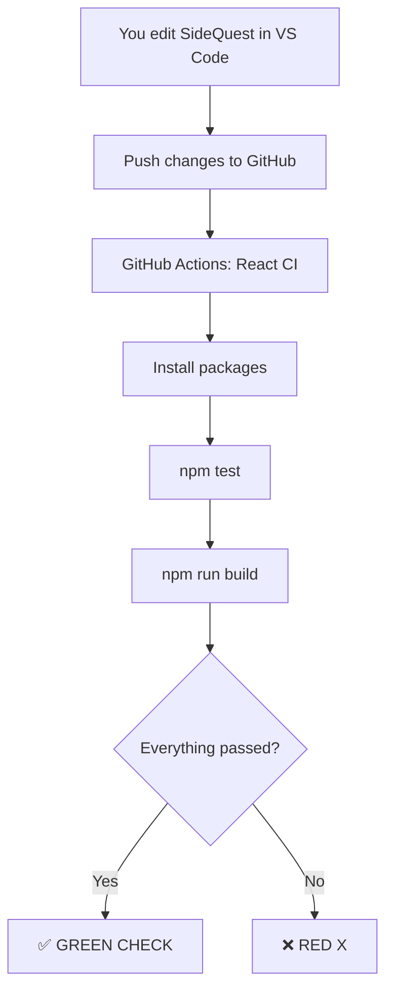

### What does a test actually look like?

```ts
// Test owner: [Your Name] — after choosing and verifying your test case.
import { expect, it } from 'vitest'
import { isValidDate } from '../src/model/events'

it('rejects an impossible calendar date', () => {
  expect(isValidDate('2026-04-31')).toBe(false)
})
```

| Part | Meaning |
| --- | --- |
| `// Test owner: ...` | A **comment** identifying who selected, checked, and contributed this test; disclose AI assistance if your course requires it |
| `it('...', ...)` | The **test name**, describing the checked behavior |
| `isValidDate('2026-04-31')` | A call to a **real function** in SideQuest |
| `.toBe(false)` | What you **expect** the correct result to be |

**Using example events inside a test is allowed and normal.** The application uses user-created events; controlled example inputs in unit tests are still appropriate.

## How to design a test of your own

The phrase “Make it yours” is too vague. Use these concrete steps instead:

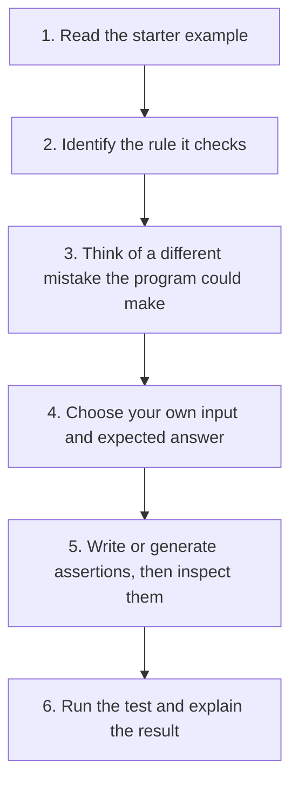

| Genuine new test behavior | Only a cosmetic change |
| --- | --- |
| Accept an event ending **exactly** at 4:00, reject 4:01 | Rename “Art Workshop” to “Choir” |
| Test the century leap-year exception (2000 vs. 1900) | Change a random date without changing the rule |
| Verify that a removed event **stays removed after saving** | Change only the filename |
| Search mixed eligible, invalid-date, and out-of-order events | Add your name to the unchanged starter code |
| Handle a corrupted JSON value in saved events | Reformat spaces or comments |

**The key is the behavior, not the number of edits or whether AI generated the syntax.** One thoughtful new case with a justified expected outcome beats many arbitrary changes.

### Avoid tests that check the wrong thing

A test can pass trivially while failing to check the rule it is supposed to exercise. For example, testing that a manually chosen start time comes before an end time does **not** prove SideQuest *rejects* an invalid event. Your test must call the real function and verify its response.

**Weak (doesn't exercise SideQuest):**

```ts
expect(14 < 16).toBe(true) // Of course it passes, regardless of SideQuest!
```

**Meaningful (exercises the real Controller):**

```ts
import { createEvent } from '../src/controller/findEvents'

const result = createEvent([], {
  title: 'Study Group', location: 'Library',
  date: '2026-10-23', start: '17:00', end: '16:00',
}, 'bad-times')

expect(result.error).not.toBeNull()
expect(result.events).toEqual([])
```

**A real test may fail at first.** The lecture's examples show that a failure can reveal a rule that hasn't been implemented yet. Investigate and fix the implementation when appropriate; never weaken the expected result merely to force a green check. This is different from the separately required, *intentional* red-X/green-check CI demonstration.

### Worked example: the one-minute boundary

Suppose a student is free from **14:00 to 16:00**. Is an event that ends at 16:00 allowed? Yes. What if it ends at 16:01? No.

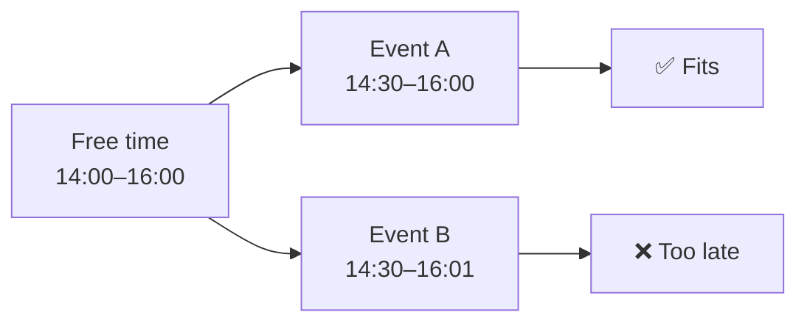

This code demonstrates how to *compare two outcomes*. It's another **learning example**, not your finished individual assignment.

```ts
import { expect, it } from 'vitest'
import { fitsFully, type CampusEvent } from '../src/model/events'

it('accepts the exact end boundary but not one minute later', () => {
  const event: CampusEvent = {
    id: 'art',
    title: 'Art Club',
    location: 'Studio',
    date: '2026-10-23',
    start: '14:30',
    end: '16:00',
  }

  expect(fitsFully(event, '2026-10-23', '14:00', '16:00')).toBe(true)

  const lateEvent = { ...event, end: '16:01' }
  expect(fitsFully(lateEvent, '2026-10-23', '14:00', '16:00')).toBe(false)
})
```

Try to complete this sentence for your own work: **“My test would catch a bug where SideQuest ______, because I expect ______.”**

---

## Optional test ideas and example code

The team brainstormed the following topics as starting points. They are **not official categories or required assignments**. Every student should select and verify an appropriate behavior for the actual SideQuest implementation; the team can coordinate to avoid duplicating tests. The code below uses real project functions.

| Example topic | A behavior worth exploring |
| --- | --- |
| Creating events | Does adding a second event preserve the first? |
| Event IDs | Are empty IDs rejected while new IDs succeed? |
| Calendar dates | Does leap-year logic work for century years? |
| Clock times | Are malformed and out-of-range times rejected? |
| Availability matching | What happens at the exact end-time boundary? |
| Event sorting | Does sorting still work when some events don't match? |
| Saving events | Do removed events stay removed after saving? |
| Storage errors | Does malformed saved data fail safely? |

### Event creation — successful creation

Suggested file: `app/tests/student-create-event.test.ts`

```ts
// Practice template — Test owner: [Your Name] (after choosing/verifying your case).
import { expect, it } from 'vitest'
import { createEvent } from '../src/controller/findEvents'

it('creates an event and trims accidental spaces', () => {
  const result = createEvent([], {
    title: '  Coding Workshop  ',
    location: '  Library  ',
    date: '2026-10-23',
    start: '14:00',
    end: '15:00',
  }, 'coding-1')

  expect(result.error).toBeNull()
  expect(result.events).toHaveLength(1)
  expect(result.events[0].title).toBe('Coding Workshop')
  expect(result.events[0].location).toBe('Library')
})
```

**Optional variation to try:** First create event A, then create event B with a *different* ID. Verify the result has **two events**, that A's title/date remain unchanged, and that B's time is correct. This checks **preserving existing data**, not merely creating the first event. Decide your own event values and write the final assertions.

### Duplicate events — reject a reused ID

Suggested file: `app/tests/student-duplicate-id.test.ts`

```ts
// Practice template — Test owner: [Your Name] (after choosing/verifying your case).
import { expect, it } from 'vitest'
import { createEvent } from '../src/controller/findEvents'

it('does not create another event using an existing ID', () => {
  const draft = {
    title: 'Study Group',
    location: 'Library',
    date: '2026-10-23',
    start: '16:00',
    end: '17:00',
  }
  const first = createEvent([], draft, 'same-id')
  const second = createEvent(first.events, { ...draft, title: 'Choir' }, 'same-id')

  expect(second.error).not.toBeNull()
  expect(second.events).toHaveLength(1)
  expect(second.events[0].title).toBe('Study Group')
})
```

**Optional variation to try:** Starting with an existing event, compare an attempt with an **empty ID** against one with a **new ID**. The empty-ID request should return an error and leave the list unchanged; the new ID should succeed. **Important:** duplicate *titles* and duplicate *IDs* are not the same thing.

### Calendar dates — reject impossible dates

Suggested file: `app/tests/student-date-validation.test.ts`

```ts
// Practice template — Test owner: [Your Name] (after choosing/verifying your case).
import { expect, it } from 'vitest'
import { isValidDate } from '../src/model/events'

it('rejects a non-existent calendar date', () => {
  expect(isValidDate('2026-04-31')).toBe(false)
  expect(isValidDate('2026-04-30')).toBe(true)
  expect(isValidDate('2027-02-29')).toBe(false)
})
```

**Optional variation to try:** Compare **February 29, 2000** with **February 29, 1900**. Decide which is a legitimate leap day, then write assertions for both. Optionally check a malformed date format like `2026/10/23`. This tests a different calendar rule from the sample's April 31.

### Clock-time input — handle midnight and the end of the day

Suggested file: `app/tests/student-clock-times.test.ts`

```ts
// Practice template — Test owner: [Your Name] (after choosing/verifying your case).
import { expect, it } from 'vitest'
import { toMinutes } from '../src/model/events'

it('converts valid boundary clock times and rejects 24:00', () => {
  expect(toMinutes('00:00')).toBe(0)
  expect(toMinutes('12:00')).toBe(720)
  expect(toMinutes('23:59')).toBe(1439)
  expect(toMinutes('24:00')).toBeNull()
})
```

**Optional variation to try:** Compare `09:05`, `09:60`, `9:05`, and an empty string. Determine which strings satisfy SideQuest's **HH:MM** format and what `toMinutes` should return. Include both a valid case and invalid cases. A missing leading zero matters to the current function.

### Availability matching — reject an event starting one minute too early

Suggested file: `app/tests/student-start-boundary.test.ts`

```ts
// Practice template — Test owner: [Your Name] (after choosing/verifying your case).
import { expect, it } from 'vitest'
import { fitsFully, type CampusEvent } from '../src/model/events'

it('rejects an event that starts one minute before free time', () => {
  const event: CampusEvent = {
    id: 'early',
    title: 'Art Club',
    location: 'Arts Building',
    date: '2026-10-23',
    start: '13:59',
    end: '14:30',
  }

  expect(fitsFully(event, '2026-10-23', '14:00', '15:00')).toBe(false)
  expect(fitsFully(event, '2026-10-23', '13:59', '15:00')).toBe(true)
})
```

**Optional variation to try:** Choose an event ending **exactly when** free time ends, then create a second version ending **one minute late**. Which matches? Write the two expected answers, or test the same clock times on a *different date*. This checks a specific boundary rather than changing one arbitrary minute.

### Search results — order matching events chronologically

Suggested file: `app/tests/student-sorting.test.ts`

```ts
// Practice template — Test owner: [Your Name] (after choosing/verifying your case).
import { expect, it } from 'vitest'
import { findEvents } from '../src/controller/findEvents'
import type { CampusEvent } from '../src/model/events'

it('lists qualifying events from earliest to latest', () => {
  const events: CampusEvent[] = [
    { id: 'later', title: 'Choir', location: 'Hall', date: '2026-10-23',
      start: '16:00', end: '16:30' },
    { id: 'earlier', title: 'Art Club', location: 'Studio', date: '2026-10-23',
      start: '14:00', end: '15:00' },
  ]

  const result = findEvents(events, '2026-10-23', '13:00', '17:00')

  expect(result.error).toBeNull()
  expect(result.matches.map(event => event.id)).toEqual(['earlier', 'later'])
})
```

**Optional variation to try:** Build a list of **four events in scrambled order**: two qualifying events, one on the wrong day, and one ending too late. Check the returned **IDs in the correct start-time order**. To demonstrate sorting, don't place the two matching events in order in the input.

### Browser storage — save and restore multiple events

Suggested file: `app/tests/student-save-events.test.ts`

```ts
// Practice template — Test owner: [Your Name] (after choosing/verifying your case).
import { expect, it } from 'vitest'
import { readStoredEvents, saveStoredEvents, type CampusEvent } from '../src/model/events'

it('restores both saved events in the original order', () => {
  const memory = new Map<string, string>()
  const storage = {
    getItem: (key: string) => memory.get(key) ?? null,
    setItem: (key: string, value: string) => { memory.set(key, value) },
  }
  const events: CampusEvent[] = [
    { id: 'one', title: 'Art', location: 'Studio', date: '2026-10-23',
      start: '14:00', end: '15:00' },
    { id: 'two', title: 'Music', location: 'Hall', date: '2026-10-23',
      start: '16:00', end: '17:00' },
  ]

  expect(saveStoredEvents(storage, events)).toBe(true)
  expect(readStoredEvents(storage)).toEqual(events)
})
```

**Optional variation to try:** Save two events using the in-memory storage object, then **save a shorter array** containing only one of them. Read storage again and check that the removed event does **not** return. This tests an updated saved state, not just the first save. It does not simulate clicking the UI Remove button.

### Storage errors — handle blocked browser storage safely

Suggested file: `app/tests/student-storage-errors.test.ts`

```ts
// Practice template — Test owner: [Your Name] (after choosing/verifying your case).
import { expect, it } from 'vitest'
import { readStoredEvents, saveStoredEvents } from '../src/model/events'

it('does not crash when browser storage is blocked', () => {
  const blocked = {
    getItem: (_key: string): string | null => {
      throw new Error('Storage blocked')
    },
    setItem: (_key: string, _value: string): void => {
      throw new Error('Storage blocked')
    },
  }

  expect(readStoredEvents(blocked)).toEqual([])
  expect(saveStoredEvents(blocked, [])).toBe(false)
})
```

**Optional variation to try:** Make a fake storage object's `getItem` return the corrupt string `{bad json`. Check that reading produces an **empty list without throwing**. Compare it with the valid JSON string `[]`. A blocked exception and corrupted JSON are different failure scenarios.

---

## Run your test locally

**Step 1.** In VS Code, open the `SideQuest-CSCI187` folder and find the `app/tests/` folder.

**Step 2.** Create a NEW file ending in `.test.ts` (for example, `yourname-calendar-dates.test.ts`). Paste a starter example or ask AI to draft the TypeScript for **your chosen testing scenario**. Inspect every assertion against the actual specification and verify it exercises the correct function. Add your name as the responsible student in a comment.

**Step 3.** In the terminal, enter the `app/` folder. If `npm run dev` is occupying the terminal, press **Control+C** first. Then run:

```bash
npm test
npm run build
```

**Step 4.** Confirm the new test appears in Vitest's results and passes. If it fails unexpectedly, inspect the **Expected** and **Received** values before changing anything. A passing test with the wrong expectation isn't helpful.

## Demonstrate a red X then a green check

To verify that CI detects an error, use a **separate experimental branch**, not the shared team branch.

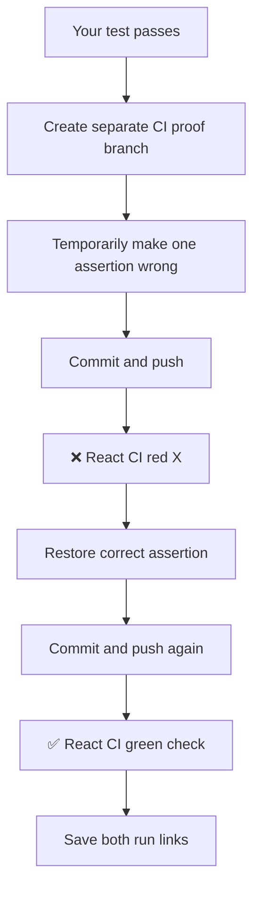

### What does deliberately breaking a test mean?

If `toMinutes('00:00')` correctly returns `0`, its assertion should be:

```ts
expect(toMinutes('00:00')).toBe(0) // Correct
```

For the **CI demonstration only**, temporarily **replace that line** with:

```ts
expect(toMinutes('00:00')).toBe(60) // Deliberately wrong
```

The test should fail because midnight is not 60 minutes after midnight. **Do not add both lines at once**. Correct the assertion after confirming GitHub catches it.

### Beginner-friendly Git commands

Run these from the **repository root** (`SideQuest-CSCI187/`). Start with `git status`. If you see uncommitted edits you don't understand, stop and ask a teammate rather than deleting them.

**Create your own normal test branch:**

```bash
git switch master
git pull --ff-only origin master
git switch -c tests-yourname
```

Write your test file, run `npm test` and `npm run build`, then push your working test:

```bash
git add app/tests/yourname-calendar-dates.test.ts
git commit -m "Add my calendar-date unit test"
git push -u origin tests-yourname
```

Replace the example filename with your actual one.

**Now make a separate proof branch from your working branch:**

```bash
git switch -c ci-proof-yourname
```

Temporarily make an assertion wrong, save the file, then:

```bash
git add app/tests/yourname-calendar-dates.test.ts
git commit -m "Demonstrate an intentionally failing test"
git push -u origin ci-proof-yourname
```

Open [GitHub Actions](https://github.com/haiiroWednesday/SideQuest-CSCI187/actions), find **SideQuest React CI** for `ci-proof-yourname`, and verify the **red X** is due to the intentional test failure. Save that run's link.

Now fix the assertion, save it, and run:

```bash
git add app/tests/yourname-calendar-dates.test.ts
git commit -m "Fix assertion and restore passing CI"
git push
```

Wait for the **green check** and save the second run link. Your team can review the **working** code for inclusion in the shared project. **Never merge intentionally broken code.**

> **Terminal location matters for file paths:** These Git commands assume you're in the repository root. If you're still in `app/`, use paths like `git add tests/yourname-calendar-dates.test.ts` instead.

### Team integration: pull requests and code review

**Push** uploads your branch; a **pull request** asks teammates to review and merge it. After your working individual test passes, open a pull request targeting **`master`**; ask a teammate to verify the scenario, assertions, and CI. Merge only after approval and passing checks. Pull often, make small commits, and avoid committing generated `node_modules/` or build output.

## Contributor test checklist

- [ ] My behavior is meaningfully distinct from my teammates' tests.
- [ ] I can finish: “My test catches a bug where SideQuest ______.”
- [ ] I chose the testing scenario and independently verified the expected results, including any AI-generated code.
- [ ] My test file is inside `app/tests/` and ends in `.test.ts`.
- [ ] The test includes my name in a comment identifying my work.
- [ ] `npm test` passes.
- [ ] `npm run build` passes.
- [ ] I used a separate branch for the intentional failing test.
- [ ] I saved the **red X** and **green check** GitHub Actions run links.
- [ ] The team reviewed the passing tests and confirmed they all work together.

**A good test doesn't have to be long or hand-typed; it has to exercise the real function and assert the rule you decided to check.**

