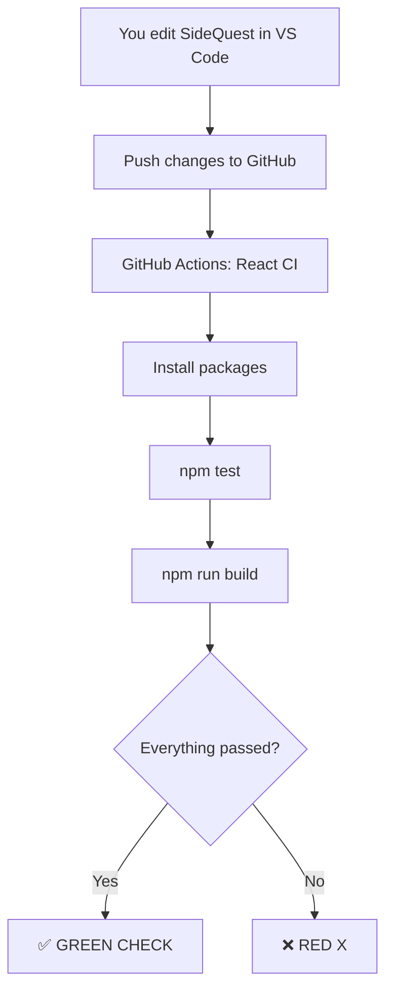
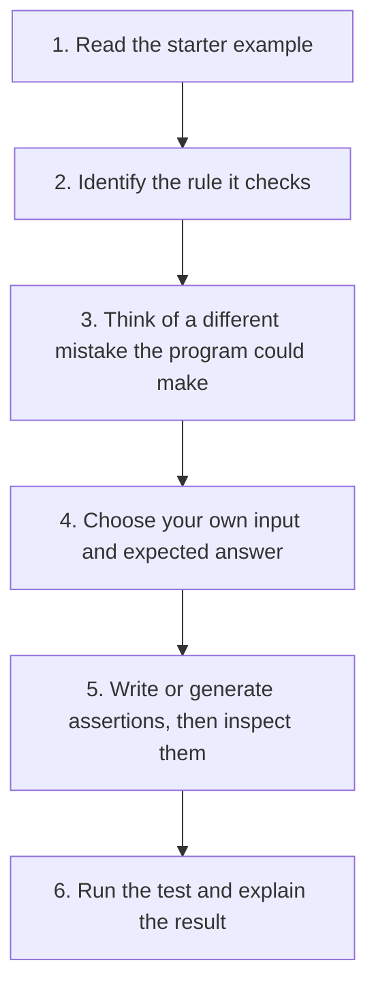
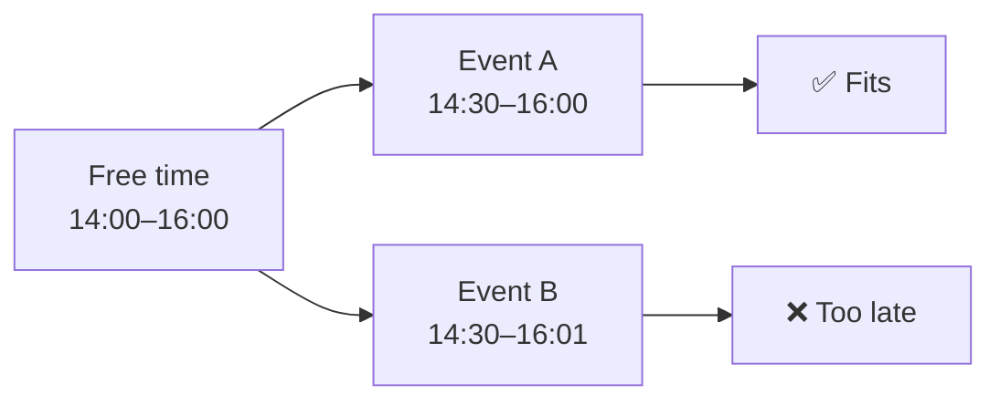
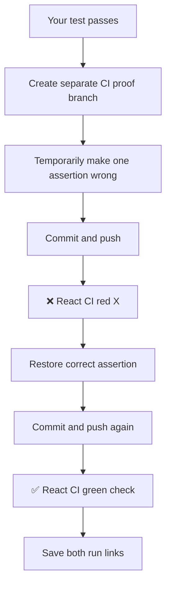

# SideQuest M1 · Team Guide to Individual Unit Tests

**8 ready-to-adapt code examples • Visual diagrams • Specific ways to design a meaningful original test**

For the SideQuest **TypeScript + React** walking skeleton. M1 due **Monday, October 26, 2026, at the beginning of class**.

> **You do not have to invent everything from scratch.** Choose one of the eight categories below, study the example, and use it to design a **different meaningful behavior or edge case** that you personally understand and can explain. A different event name, filename, or author comment by itself is not enough.

**Jump to:** [How to design a test](#how-to-design-a-test-of-your-own) · [All eight categories](#eight-test-categories-and-complete-code) · [Red X → green check](#demonstrate-a-red-x-then-a-green-check)

**Already ran SideQuest in class?** Update your existing clone with `git pull --ff-only origin react-starter` while on that branch before doing these tests. GitHub updates do not automatically change files on your laptop. See the [team setup guide](../TEAM_SETUP_GUIDE.md) if you are unsure which branch you are on.

**Useful links:** [Team setup guide](../TEAM_SETUP_GUIDE.md) · [Current starter tests](../app/tests/) · [Our React CI](../.github/workflows/react-ci.yml) · [GitHub Actions](https://github.com/haiiroWednesday/SideQuest-CSCI187/actions)

## What Professor Kandel wants

Each teammate must:

1. Write a **distinct, meaningful** unit test related to our walking skeleton.
2. Put **their own name in a comment** in the test file.
3. Run the test and be able to explain what it proves.
4. On a **separate branch**, deliberately make CI fail (red X), fix the issue, and confirm it passes (green check).
5. Coordinate with the team so everyone tests different behaviors.

**What the lecture actually permits:** On slide 10 of Professor Kandel's *Unit Testing, CI, Git Teamwork* lecture, she explicitly says **AI may write unit-test code**. The student's responsibilities are **(1) deciding what to test, and (2) checking that each test asserts what the student intended**. You may use an AI-assisted starter template or ask AI to generate TypeScript. What makes the submission yours is choosing a distinct, meaningful testing question, verifying the test's inputs and expected results, understanding its behavior, and identifying your work in the test file. Merely copying the shared starter unchanged and adding your name does not demonstrate those decisions.

## Unit test versus CI: the big picture

- A **unit test** checks a **real function** in isolation: “For this input, does it return the expected output or reject invalid input?” (Lecture slides 3, 6–7, and 15.)
- **CI** (Continuous Integration) is GitHub's automatic checking system. GitHub runs all the tests whenever your code is pushed or a pull request is opened/updated.
- **Vitest** runs the test files under `app/tests/`.
- The file `.github/workflows/react-ci.yml` tells GitHub to install the packages, run `npm test`, and run `npm run build`.
- The old `.github/workflows/ci.yml` is the professor's original **C++** workflow. Our **React** CI is separate.



**Running tests and CI does not use your Claude API credits.**

### What does a test actually look like?

```ts
// Test owner: [Your Name] — after choosing and verifying your test case.
import { expect, it } from 'vitest'
import { isValidDate } from '../src/model/events'

it('rejects an impossible calendar date', () => {
  expect(isValidDate('2026-04-31')).toBe(false)
})
```

| Part | Meaning |
| --- | --- |
| `// Test owner: ...` | A **comment** identifying who selected, checked, and contributed this test; disclose AI assistance if your course requires it |
| `it('...', ...)` | The **test name**, describing the checked behavior |
| `isValidDate('2026-04-31')` | A call to a **real function** in SideQuest |
| `.toBe(false)` | What you **expect** the correct result to be |

**Using example events inside a test is allowed and normal.** Our professor wanted us to replace the app's *hardcoded event list* with event creation, not eliminate controlled test inputs.

## How to design a test of your own

The phrase “Make it yours” is too vague. Use these concrete steps instead:



| Genuine new test behavior | Only a cosmetic change |
| --- | --- |
| Accept an event ending **exactly** at 4:00, reject 4:01 | Rename “Art Workshop” to “Choir” |
| Test the century leap-year exception (2000 vs. 1900) | Change a random date without changing the rule |
| Verify that a removed event **stays removed after saving** | Change only the filename |
| Search mixed eligible, invalid-date, and out-of-order events | Add your name to the unchanged starter code |
| Handle a corrupted JSON value in saved events | Reformat spaces or comments |

**The key is the behavior, not the number of edits or whether AI generated the syntax.** One thoughtful new case with a justified expected outcome beats many arbitrary changes.

### Warning from the lecture: don't test a fact you already know

Slides 11–15 show that an AI-generated test may pass trivially while failing to check the actual rule. For example, testing that a manually chosen start time comes before an end time does **not** prove SideQuest *rejects* an invalid event. Your test must call the real function and verify its response.

**Weak (doesn't exercise SideQuest):**

```ts
expect(14 < 16).toBe(true) // Of course it passes, regardless of SideQuest!
```

**Meaningful (exercises the real Controller):**

```ts
import { createEvent } from '../src/controller/findEvents'

const result = createEvent([], {
  title: 'Study Group', location: 'Library',
  date: '2026-10-23', start: '17:00', end: '16:00',
}, 'bad-times')

expect(result.error).not.toBeNull()
expect(result.events).toEqual([])
```

**A real test may fail at first.** The lecture's examples show that a failure can reveal a rule that hasn't been implemented yet. Investigate and fix the implementation when appropriate; never weaken the expected result merely to force a green check. This is different from the separately required, *intentional* red-X/green-check CI demonstration.

### Worked example: the one-minute boundary

Suppose a student is free from **14:00 to 16:00**. Is an event that ends at 16:00 allowed? Yes. What if it ends at 16:01? No.



This code demonstrates how to *compare two outcomes*. It's another **learning example**, not your finished individual assignment.

```ts
import { expect, it } from 'vitest'
import { fitsFully, type CampusEvent } from '../src/model/events'

it('accepts the exact end boundary but not one minute later', () => {
  const event: CampusEvent = {
    id: 'art',
    title: 'Art Club',
    location: 'Studio',
    date: '2026-10-23',
    start: '14:30',
    end: '16:00',
  }

  expect(fitsFully(event, '2026-10-23', '14:00', '16:00')).toBe(true)

  const lateEvent = { ...event, end: '16:01' }
  expect(fitsFully(lateEvent, '2026-10-23', '14:00', '16:00')).toBe(false)
})
```

Try to complete this sentence for your own work: **“My test would catch a bug where SideQuest ______, because I expect ______.”**

---

## Eight test categories and complete code

There are **eight options for four teammates**. Agree on who is taking which category before writing your final tests. Every sample below imports real SideQuest functions and can be used inside `app/tests/`.

| # | Category | A distinctive behavior to explore |
| --- | --- | --- |
| 1 | Creating events | Does adding a second event preserve the first? |
| 2 | Event IDs | Are empty IDs rejected while new IDs succeed? |
| 3 | Calendar dates | Does leap-year logic work for century years? |
| 4 | Clock times | Are malformed and out-of-range times rejected? |
| 5 | Availability matching | What happens at the exact end-time boundary? |
| 6 | Event sorting | Does sorting still work when some events don't match? |
| 7 | Saving events | Do removed events stay removed after saving? |
| 8 | Storage errors | Does malformed saved data fail safely? |

### 1. Event creation — successful creation

Suggested file: `app/tests/student-create-event.test.ts`

```ts
// Practice template — Test owner: [Your Name] (after choosing/verifying your case).
import { expect, it } from 'vitest'
import { createEvent } from '../src/controller/findEvents'

it('creates an event and trims accidental spaces', () => {
  const result = createEvent([], {
    title: '  Coding Workshop  ',
    location: '  Library  ',
    date: '2026-10-23',
    start: '14:00',
    end: '15:00',
  }, 'coding-1')

  expect(result.error).toBeNull()
  expect(result.events).toHaveLength(1)
  expect(result.events[0].title).toBe('Coding Workshop')
  expect(result.events[0].location).toBe('Library')
})
```

**Your precise M1 design challenge:** First create event A, then create event B with a *different* ID. Verify the result has **two events**, that A's title/date remain unchanged, and that B's time is correct. This checks **preserving existing data**, not merely creating the first event. Decide your own event values and write the final assertions.

### 2. Duplicate events — reject a reused ID

Suggested file: `app/tests/student-duplicate-id.test.ts`

```ts
// Practice template — Test owner: [Your Name] (after choosing/verifying your case).
import { expect, it } from 'vitest'
import { createEvent } from '../src/controller/findEvents'

it('does not create another event using an existing ID', () => {
  const draft = {
    title: 'Study Group',
    location: 'Library',
    date: '2026-10-23',
    start: '16:00',
    end: '17:00',
  }
  const first = createEvent([], draft, 'same-id')
  const second = createEvent(first.events, { ...draft, title: 'Choir' }, 'same-id')

  expect(second.error).not.toBeNull()
  expect(second.events).toHaveLength(1)
  expect(second.events[0].title).toBe('Study Group')
})
```

**Your precise M1 design challenge:** Starting with an existing event, compare an attempt with an **empty ID** against one with a **new ID**. The empty-ID request should return an error and leave the list unchanged; the new ID should succeed. **Important:** duplicate *titles* and duplicate *IDs* are not the same thing.

### 3. Calendar dates — reject impossible dates

Suggested file: `app/tests/student-date-validation.test.ts`

```ts
// Practice template — Test owner: [Your Name] (after choosing/verifying your case).
import { expect, it } from 'vitest'
import { isValidDate } from '../src/model/events'

it('rejects a non-existent calendar date', () => {
  expect(isValidDate('2026-04-31')).toBe(false)
  expect(isValidDate('2026-04-30')).toBe(true)
  expect(isValidDate('2027-02-29')).toBe(false)
})
```

**Your precise M1 design challenge:** Compare **February 29, 2000** with **February 29, 1900**. Decide which is a legitimate leap day, then write assertions for both. Optionally check a malformed date format like `2026/10/23`. This tests a different calendar rule from the sample's April 31.

### 4. Clock-time input — handle midnight and the end of the day

Suggested file: `app/tests/student-clock-times.test.ts`

```ts
// Practice template — Test owner: [Your Name] (after choosing/verifying your case).
import { expect, it } from 'vitest'
import { toMinutes } from '../src/model/events'

it('converts valid boundary clock times and rejects 24:00', () => {
  expect(toMinutes('00:00')).toBe(0)
  expect(toMinutes('12:00')).toBe(720)
  expect(toMinutes('23:59')).toBe(1439)
  expect(toMinutes('24:00')).toBeNull()
})
```

**Your precise M1 design challenge:** Compare `09:05`, `09:60`, `9:05`, and an empty string. Determine which strings satisfy SideQuest's **HH:MM** format and what `toMinutes` should return. Include both a valid case and invalid cases. A missing leading zero matters to the current function.

### 5. Availability matching — reject an event starting one minute too early

Suggested file: `app/tests/student-start-boundary.test.ts`

```ts
// Practice template — Test owner: [Your Name] (after choosing/verifying your case).
import { expect, it } from 'vitest'
import { fitsFully, type CampusEvent } from '../src/model/events'

it('rejects an event that starts one minute before free time', () => {
  const event: CampusEvent = {
    id: 'early',
    title: 'Art Club',
    location: 'Arts Building',
    date: '2026-10-23',
    start: '13:59',
    end: '14:30',
  }

  expect(fitsFully(event, '2026-10-23', '14:00', '15:00')).toBe(false)
  expect(fitsFully(event, '2026-10-23', '13:59', '15:00')).toBe(true)
})
```

**Your precise M1 design challenge:** Choose an event ending **exactly when** free time ends, then create a second version ending **one minute late**. Which matches? Write the two expected answers, or test the same clock times on a *different date*. This checks a specific boundary rather than changing one arbitrary minute.

### 6. Search results — order matching events chronologically

Suggested file: `app/tests/student-sorting.test.ts`

```ts
// Practice template — Test owner: [Your Name] (after choosing/verifying your case).
import { expect, it } from 'vitest'
import { findEvents } from '../src/controller/findEvents'
import type { CampusEvent } from '../src/model/events'

it('lists qualifying events from earliest to latest', () => {
  const events: CampusEvent[] = [
    { id: 'later', title: 'Choir', location: 'Hall', date: '2026-10-23',
      start: '16:00', end: '16:30' },
    { id: 'earlier', title: 'Art Club', location: 'Studio', date: '2026-10-23',
      start: '14:00', end: '15:00' },
  ]

  const result = findEvents(events, '2026-10-23', '13:00', '17:00')

  expect(result.error).toBeNull()
  expect(result.matches.map(event => event.id)).toEqual(['earlier', 'later'])
})
```

**Your precise M1 design challenge:** Build a list of **four events in scrambled order**: two qualifying events, one on the wrong day, and one ending too late. Check the returned **IDs in the correct start-time order**. To demonstrate sorting, don't place the two matching events in order in the input.

### 7. Browser storage — save and restore multiple events

Suggested file: `app/tests/student-save-events.test.ts`

```ts
// Practice template — Test owner: [Your Name] (after choosing/verifying your case).
import { expect, it } from 'vitest'
import { readStoredEvents, saveStoredEvents, type CampusEvent } from '../src/model/events'

it('restores both saved events in the original order', () => {
  const memory = new Map<string, string>()
  const storage = {
    getItem: (key: string) => memory.get(key) ?? null,
    setItem: (key: string, value: string) => { memory.set(key, value) },
  }
  const events: CampusEvent[] = [
    { id: 'one', title: 'Art', location: 'Studio', date: '2026-10-23',
      start: '14:00', end: '15:00' },
    { id: 'two', title: 'Music', location: 'Hall', date: '2026-10-23',
      start: '16:00', end: '17:00' },
  ]

  expect(saveStoredEvents(storage, events)).toBe(true)
  expect(readStoredEvents(storage)).toEqual(events)
})
```

**Your precise M1 design challenge:** Save two events using the in-memory storage object, then **save a shorter array** containing only one of them. Read storage again and check that the removed event does **not** return. This tests an updated saved state, not just the first save. It does not simulate clicking the UI Remove button.

### 8. Storage errors — handle blocked browser storage safely

Suggested file: `app/tests/student-storage-errors.test.ts`

```ts
// Practice template — Test owner: [Your Name] (after choosing/verifying your case).
import { expect, it } from 'vitest'
import { readStoredEvents, saveStoredEvents } from '../src/model/events'

it('does not crash when browser storage is blocked', () => {
  const blocked = {
    getItem: (_key: string): string | null => {
      throw new Error('Storage blocked')
    },
    setItem: (_key: string, _value: string): void => {
      throw new Error('Storage blocked')
    },
  }

  expect(readStoredEvents(blocked)).toEqual([])
  expect(saveStoredEvents(blocked, [])).toBe(false)
})
```

**Your precise M1 design challenge:** Make a fake storage object's `getItem` return the corrupt string `{bad json`. Check that reading produces an **empty list without throwing**. Compare it with the valid JSON string `[]`. A blocked exception and corrupted JSON are different failure scenarios.

---

## Run your test locally

**Step 1.** In VS Code, open the `SideQuest-CSCI187` folder and find the `app/tests/` folder.

**Step 2.** Create a NEW file ending in `.test.ts` (for example, `yourname-calendar-dates.test.ts`). Paste a starter example or ask AI to draft the TypeScript for **your chosen testing scenario**. Inspect every assertion against the actual specification and verify it exercises the correct function. Add your name as the responsible student in a comment.

**Step 3.** In the terminal, enter the `app/` folder. If `npm run dev` is occupying the terminal, press **Control+C** first. Then run:

```bash
npm test
npm run build
```

**Step 4.** Confirm the new test appears in Vitest's results and passes. If it fails unexpectedly, inspect the **Expected** and **Received** values before changing anything. A passing test with the wrong expectation isn't helpful.

### Coordinate the four individual contributions

| Teammate | Category | Your original test question | Your `.test.ts` filename |
| --- | --- | --- | --- |
| Teammate 1 | _Choose_ | _What bug would this catch?_ | _To be written_ |
| Teammate 2 | _Choose_ | _What bug would this catch?_ | _To be written_ |
| Teammate 3 | _Choose_ | _What bug would this catch?_ | _To be written_ |
| Teammate 4 | _Choose_ | _What bug would this catch?_ | _To be written_ |

## Demonstrate a red X then a green check

**The professor wants proof that CI detects a mistake, and that fixing it makes CI pass.** Do this on a **separate experimental branch**, not on the shared team branch.



### What does deliberately breaking a test mean?

If `toMinutes('00:00')` correctly returns `0`, its assertion should be:

```ts
expect(toMinutes('00:00')).toBe(0) // Correct
```

For the **CI demonstration only**, temporarily **replace that line** with:

```ts
expect(toMinutes('00:00')).toBe(60) // Deliberately wrong
```

The test should fail because midnight is not 60 minutes after midnight. **Do not add both lines at once**. Correct the assertion after confirming GitHub catches it.

### Beginner-friendly Git commands

Run these from the **repository root** (`SideQuest-CSCI187/`). Start with `git status`. If you see uncommitted edits you don't understand, stop and ask a teammate rather than deleting them.

**Create your own normal test branch:**

```bash
git switch react-starter
git pull origin react-starter
git switch -c tests-yourname
```

Write your test file, run `npm test` and `npm run build`, then push your working test:

```bash
git add app/tests/yourname-calendar-dates.test.ts
git commit -m "Add my calendar-date unit test"
git push -u origin tests-yourname
```

Replace the example filename with your actual one.

**Now make a separate proof branch from your working branch:**

```bash
git switch -c ci-proof-yourname
```

Temporarily make an assertion wrong, save the file, then:

```bash
git add app/tests/yourname-calendar-dates.test.ts
git commit -m "Demonstrate an intentionally failing test"
git push -u origin ci-proof-yourname
```

Open [GitHub Actions](https://github.com/haiiroWednesday/SideQuest-CSCI187/actions), find **SideQuest React CI** for `ci-proof-yourname`, and verify the **red X** is due to the intentional test failure. Save that run's link.

Now fix the assertion, save it, and run:

```bash
git add app/tests/yourname-calendar-dates.test.ts
git commit -m "Fix assertion and restore passing CI"
git push
```

Wait for the **green check** and save the second run link. Your team can review the **working** code for inclusion in the shared project. **Never merge intentionally broken code.**

> **Terminal location matters for file paths:** These Git commands assume you're in the repository root. If you're still in `app/`, use paths like `git add tests/yourname-calendar-dates.test.ts` instead.

### Team integration: pull requests and code review

Professor Kandel's lecture (slides 26–28 and 40–42) distinguishes **push** (upload your branch) from a **pull request** (ask your teammates to review and merge). After your **working** individual test passes, open a pull request targeting **`react-starter`**; ask a teammate to verify the scenario, assertions, and CI. Merge only after approval and passing checks. Pull often, make small commits, and avoid committing generated `node_modules/` or build output.

## Final M1 test checklist

- [ ] My behavior is meaningfully distinct from my teammates' tests.
- [ ] I can finish: “My test catches a bug where SideQuest ______.”
- [ ] I chose the testing scenario and independently verified the expected results, including any AI-generated code.
- [ ] My test file is inside `app/tests/` and ends in `.test.ts`.
- [ ] The test includes my name in a comment identifying my work.
- [ ] `npm test` passes.
- [ ] `npm run build` passes.
- [ ] I used a separate branch for the intentional failing test.
- [ ] I saved the **red X** and **green check** GitHub Actions run links.
- [ ] The team reviewed the passing tests and confirmed they all work together.

**A good test doesn't have to be long or hand-typed; it has to exercise the real function and assert the rule you decided to check.** Lecture source: *12_Git_Unit_Testing_CI.pdf*, especially slides 3, 6–15, 17, and 26–42.

Professor's references: [M1 assignment](https://docs.google.com/document/d/1xOsK1cmhXyVy8LsV7oHP_h9tr32ogga79DbsjQwo6yo/edit) · [Unit Testing and CI instructions](https://docs.google.com/document/d/15lPHkDDmZ3ZGUDSTBmNY9pQHpd8339qXaa1iSF7pbyY/edit)
