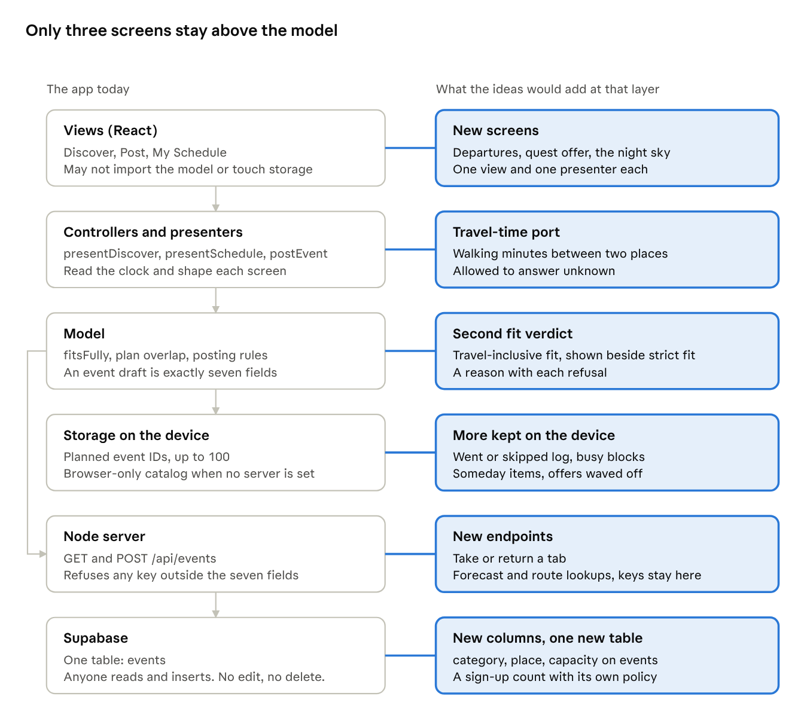

# SideQuest: What Rounds 12 and 13 Would Change in the Code

November 16, 2026 · Cynthia Jiao

An analysis for the team. It prices the design options and approves none of them. Live copy: https://claude.ai/artifact/H6Av95WZozSspYDKnGgoij

## Short answer

Nothing in Round 12 or Round 13 changes how the app behaves today. Both rounds sit in `docs/design/` on the `design/hero-drawing` branch and touch no file under `app/` or `supabase/`.

Building them is a different matter, and the cost swings widely from one idea to the next.

- **Three run on data the catalog already holds:** Departures, the stranger's quest, tonight's sky. Each is a new presenter and a new view. No schema change.
- **Two need new storage on the student's own device and no server work:** Quest complete, and a small Someday bag.
- **Two run in a reduced form until walking minutes exist:** the vending machine and the transit map.
- **Two cannot be drawn at all without new event data:** rings of minutes needs a place for every event, and tear-off tabs need a capacity plus a count everyone shares.

Friends appear in five of the nine screens. Every one of those needs accounts, which the M2 contract excludes. The phone nav in both rounds also shows a Friends tab, and the bag assumes a Someday page. The app has three routes today: Discover, Post, My Schedule.

## What the code does today

Read it top down. Views call controllers, controllers call the model, and the model reaches the device's storage and the server through ports. Each coloured box is what the ideas would add at that layer.

- **An event has eight fields:** `id`, `title`, `hostName`, `description`, `location`, `date`, `start`, `end`. Location is free text. There is no category, place, capacity, picture or owner.
- **The catalog does three things:** `create`, `listUpcoming`, `getById`. A posted event cannot be edited, cancelled or deleted, and the SQL denies anonymous UPDATE and DELETE on purpose.
- **The device remembers plans as event IDs.** The app can tell that a planned event has ended. It cannot tell whether the student went.
- **Fit means the whole event sits inside one free window,** boundaries included. The window lives in page state and is never saved. Travel time plays no part.

## Idea by idea

Each row splits one screen into what already works, what the student's device would have to remember, what the server and database would have to learn, and what waits on accounts. Rows run from cheapest to most expensive.

| Idea | Runs on today's data | New on this device | New on the server | Waits on accounts |
| --- | --- | --- | --- | --- |
| **Q5 Departures** | Time, title, place. Lit or dim from `fitsFully`. "Boarding" from the live note that already flags events starting within the hour. | Where you are starting from | Walk column needs places. "2 spots left" needs capacity. | "Kai is going" |
| **Q1 A stranger has a quest** | Pick one event that fits, accept adds a plan, details open the ticket. The free-time bar is the window minus plans inside it. | Offers you waved off, so they do not return | None | None |
| **Q6 Tonight's sky** | Stars from tonight's events by start time. Joining a star is adding a plan. `scheduleConflicts` already says which two cannot be joined. | The name of the constellation, if we keep names | None | Ring around a star a friend picked |
| **Q9 Quest complete** | Knows a planned event has ended | A went or skipped answer per event, with a copy of title, host and date. Stamps, shelf and weekly streak all derive from that log. | Shelf pictures need a category. "Sign-ups a day early" needs capacity and a club the server can recognise. "Add a photo" is the photo pipeline. | "With Kai" |
| **Q4 Minutes are money** | Balance is the window length. Price is `eventDuration`. Greyed slots from `fitsFully`. The receipt is plans in the window plus minutes left. | Starting point | Walk there and back needs places and walking minutes | None |
| **Q3 Main line, side quests** | A line of today's plans with branches to events that fit the window | Class blocks, since stations are classes and the app stores no timetable | Dotted walk segments need places and walking minutes | A friend's line crossing yours |
| **Q8 The someday bag** | Nothing. No Someday code exists. | Items and what each needs. An hours need can be checked against the free window. | Weather needs a forecast service called from the server | Friends who stashed the same thing |
| **Q2 Quest board, tear-off tabs** | The board itself. A notice with no tabs is every event we have now. | Which tab you hold, so you can put it back | `capacity` on the event, a shared count of tabs taken, an endpoint to take and return one, new SQL policy | Stopping one person from tearing every tab |
| **Q7 Rings of minutes** | Nothing beyond the list. Every position on the drawing is new data. | Location permission, or a building you choose | A place directory with coordinates, walking minutes between places, a place on every event, a place picker in Post | None |
| **Round 12 glass graphic** | Seed from the event ID. Drawn in the browser with CSS, no stored image. | None | A category, to choose the vessel and colours | None |

## Five missing pieces

Nine screens and one graphic come down to five things the app does not store yet, plus friends. Deciding on these five settles most of the table above.

| Missing piece | Screens that lean on it | What it changes | Where the team has already raised it |
| --- | --- | --- | --- |
| **Category on an event** | Glass graphic, Q9 shelf, Q4 slot pictures, Q1 character | One nullable column, one choice in Post, "other" for every row posted so far | The curated category illustrations note on master. Category filters under Devonny in the RACI proposal. |
| **Places and walking minutes** | All of Q7. The price in Q4, the dotted segments in Q3, the walk column in Q5. | A place directory, a place on each event with free text kept as the fallback, a travel-time port, a second fit verdict | The campus place directory in the Nov 13 decision register (PR #40). Travel feasibility under Sembiyan in the RACI proposal. |
| **Capacity and a shared count** | Q2 tabs, "2 spots left" in Q5, the early sign-up perk in Q9 | The first write to the catalog other than posting. A counter or sign-up table, an endpoint, a new policy. | REQUIREMENTS lists "cost/registration enforcement" as excluded from M2 |
| **More than one free window** | Stations in Q3, "next gap" in Q5, "shop the 6:00 gap" in Q4, the hours need in Q8 | A saved list of busy blocks on the device, or Google Calendar free/busy | "Saved availability" is excluded from M2. Calendar free/busy is the optional Level 2 in the RACI proposal. |
| **A went or skipped record** | Q9 and any streak | A log on the device. The catalog is not involved. | Streaks and club stamps in the Nov 9 feature ideas doc (N1, N5) |
| **Friends** | Q3, Q5, Q6, Q8, Q9 | Accounts, permissions, plans that leave the device | Gated to Nov 20 in the RACI proposal, under Daven |

Category is the cheapest of the five and unlocks the most pictures. Places is the largest and is the same work as the campus map the team is already weighing.

## Rules the ideas would bend

### The fit rule

The vending machine reads as "length is less than balance." `fitsFully` asks for more: the start and the end must both fall inside the window. An hour-long event that began before your gap opened costs 60 minutes and still fails. The mockup already hints at this (slot C1 says TOO LONG, slot C2 says 8PM), so the model would have to return a reason with each refusal. Sembiyan's line in the RACI proposal names "explanatory fit reasons" for exactly this.

Walking minutes bring a second verdict. The Nov 13 decision register asks that travel-inclusive fit sit beside strict fit and never replace it. Q3, Q4, Q5 and Q7 each show the travel-inclusive answer as if it were the only one.

### Statuses the app cannot back yet

Master's docs require every visible status to reflect model state and forbid invented counts. As drawn, these have no source:

| On screen | Why there is nothing behind it |
| --- | --- |
| "On time" (Q5) | A posted event cannot be edited or cancelled, so the app never hears about a delay. "Scheduled" is all we know. |
| "2 spots left", "5 tabs left", "1 left!" (Q2, Q5) | No capacity field, no shared count |
| "4 min walk", "From Benson" (Q5, Q4) | Location is free text. No places, no starting point. |
| "Kai is going", "with Kai" (Q5, Q9) | No accounts |
| "the only thing 212 people see" (Q2, empty board) | No visitor count anywhere |
| "Art Club regular, 2 of 3" (Q9) | `hostName` is whatever the poster typed. "Art Club" and "SCU Art Club" would count as two clubs. |
| "Pin it for next Thursday" (Q9) | Each event is one row with one date. Repeating events do not exist. |

### The seven-field contract

An event draft is exactly seven fields, and that list is written down in four places: `DRAFT_FIELD_ORDER` in the model, the body check in `app/server/api.ts` (any other key gets a 400), `EVENT_COLUMNS` in the Supabase adapter, and the column list in the SQL insert grant. A new field, however small, is a model, server, adapter and migration change together. On top of that, 22 test files build events by hand.

### The glass generator and the category illustrations note

Master records a preference for a few curated category illustrations over per-event generation. The reasons given were workload, cost and server-side caching. The Round 12 generator carries none of those: it runs in the browser, calls no model and stores nothing. It still needs a category, the same field the curated route needs. The two directions share one schema change and differ only in what the view draws.

One caution on the glass. Each one uses a blur filter and a clip path, so a Discover list with 30 of them needs a speed check on a phone before anyone commits.

## What each kind of change touches

| Kind of change | Files | Watch for |
| --- | --- | --- |
| **New screen on existing data** (Q5, Q1, Q6) | A presenter in `app/src/controller/`, types in `screenModels.ts`, a view in `app/src/view/`, a route in `App.tsx` | No model change. Discover already re-renders every 30 seconds, so a departures clock stays current for free. |
| **New storage on the device** (waved-off offers, went or skipped log, Someday items, busy blocks) | A model file per store, shaped like `schedule.ts` | Two keys exist today. Each new one needs a versioned name and a blocked state for damaged data, because R4 forbids silently overwriting it. Views must reach it through a controller or `architecture.boundaries.test.ts` fails. |
| **New field on an event** (category, capacity, place) | `eventCatalog.ts`, `app/server/api.ts`, `supabaseEventTable.ts`, `browserEventTable.ts`, `PostEventFields.tsx`, a migration with a new insert grant, the SQL tests, fixtures | `isCatalogEvent` has to keep accepting rows without the field. If it does not, My Schedule marks every existing plan unreadable. |
| **Walking minutes** | A new port beside `EventCatalogPort`, with an adapter allowed to answer "unknown" | Browser location belongs behind a controller. A straight-line guess must be labelled as a guess. |
| **Shared count** (tabs) | A new port method, a second table, an endpoint, a policy | The browser-only fallback cannot share a count between devices, so its "not shared" warning would have to cover tabs too. |

**Tests that would push back on the new views.** PR #41 adds axe scans and keyboard paths. The sky, the rings and the transit map are pictures, so each needs a plain list beside it carrying the same controls. A split-flap row needs one label for the whole row, or a screen reader spells the title letter by letter. Flap rows and pinned notices have fixed widths, and titles run to 120 characters today (80 if #38 merges).

**One performance note.** My Schedule fetches each plan with its own request. A shelf holding a quarter of stamps would send one request per stamp unless the went or skipped log keeps its own copy of the title and date.

**Docs that change with any schema change.** The scope list in REQUIREMENTS, SPECIFICATIONS, the storage ER drawing (one table today), the CRC drawing and the RACI proposal.

**Merge order.** PR #38 edits `eventCatalog.ts`, `PostEventFields.tsx` and the SQL permission tests. A new field would edit the same lines, so #38 should land first.

## What I checked on GitHub

Read on November 16, 2026. `master` stands at `d2e5f02`, the Nov 12 merge of PR #34 (one-year posting horizon). None of the seven open PRs adds any of the five missing pieces.

| PR or issue | State | Bearing on these ideas |
| --- | --- | --- |
| [#38 Posting-only text rules](https://github.com/haiiroWednesday/SideQuest-CSCI187/pull/38) | Open, Daven, updated Nov 15 | Titles capped at 80 help flap rows and pinned notices. Edits the files a new field would edit. |
| [#41 Traceability, axe, cross-browser](https://github.com/haiiroWednesday/SideQuest-CSCI187/pull/41) | Open, stacked on #39 | Its accessibility scans would run against any new screen |
| [#40 Source-of-truth docs](https://github.com/haiiroWednesday/SideQuest-CSCI187/pull/40) | Open | Holds the campus place directory proposal that Q7, Q4 and Q3 depend on |
| [#39 V8 coverage](https://github.com/haiiroWednesday/SideQuest-CSCI187/pull/39) | Open | None |
| [#35 Shorter README](https://github.com/haiiroWednesday/SideQuest-CSCI187/pull/35) | Open | None |
| [#33 Playbook clarification](https://github.com/haiiroWednesday/SideQuest-CSCI187/pull/33) | Draft | The register says #40 supersedes it |
| [#32 Reviewed SCU event intake](https://github.com/haiiroWednesday/SideQuest-CSCI187/pull/32) | Draft | A data file and a review script. No live import, no category, no cancelled state. |
| [Issue #36](https://github.com/haiiroWednesday/SideQuest-CSCI187/issues/36) | Open | 200 black-box cases for the three current screens. None covers a Round 13 screen. |

Two branches of mine are also unmerged: `fix/discover-empty-state-polish` (the no-match fixes, no PR opened yet) and `design/hero-drawing` (design files only).

## Decisions for the team

None of these screens is approved. Keep, Maybe and Toss marks for Round 13 are not in yet, and this page only prices the options.

- **Category.** Add the field or leave it out. It serves the curated illustrations and the glass graphic alike, and the schema is Daven's.
- **Places.** Whether the campus place directory is inside the December 2 cut. Rings of minutes cannot exist without it, and three other screens lose their walking numbers.
- **Tabs.** A held spot, which needs accounts to be fair, or a courtesy count, which needs only a counter.
- **Went or skipped.** Whether a device-only log is acceptable. It would vanish with the browser's storage, the same way plans do now.
- **Friends.** The Nov 20 gate on accounts settles every friend decoration at once. Until then each of those marks should come off the mockups or be labelled as future.
- **Statuses.** Rename "On time" to "Scheduled" and drop the visitor count before any of these screens is shown as buildable.
