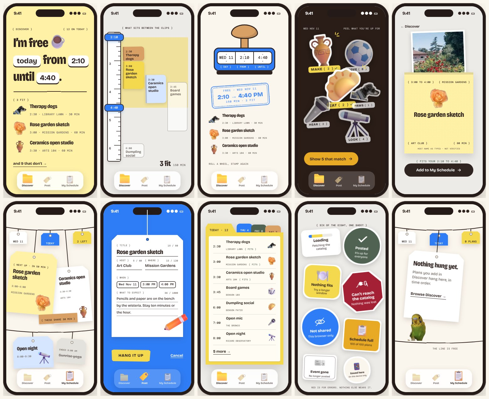
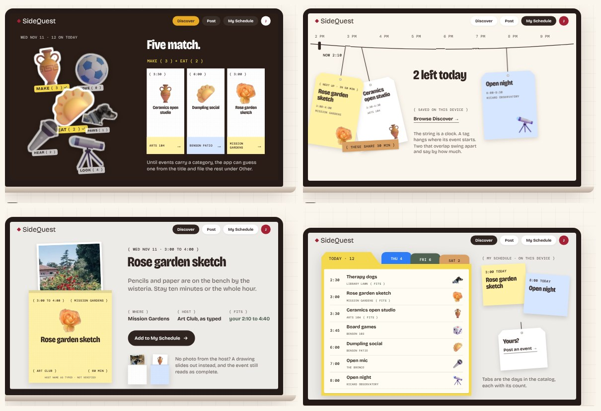

# Round 14: things you can hold

Nine screens (OB1 to OB9 on the review page, H1 to H9 in these files). Each is built as an object: a sentence with blanks, a ruler with two clips, a date stamp, a sticker pile, a paper sleeve, tags on a string, a tag you fill in, a folder with day tabs, and one sticker per app state.

What is new in this round:

- **Three kinds of picture together.** Flat colour fields, hand-drawn marks (rope, stamp, pen rings, rules) and real objects.
- **A new typeface.** Bricolage Grotesque replaces the serif headlines. DM Mono carries the small bracket labels.
- **Built for the data we have.** Eight of the nine run on what the app already stores. Only the sticker filters (OB3) need a category, and a keyword guess can stand in until then.
- **Every option still has a bad day.** Empty, wrong input, missing event, catalog out of reach.

## Where the pictures and type come from

| Asset | Source | Licence |
| --- | --- | --- |
| 3D objects (folder, tag, amphora, dumpling, telescope and others) | [microsoft/fluentui-emoji](https://github.com/microsoft/fluentui-emoji), 3D set | MIT |
| Dog, rose, budgie, fountain cut-outs | Our own review-page photos, background removed with rembg | Ours |
| Bricolage Grotesque | [Fontsource package](https://www.npmjs.com/package/@fontsource-variable/bricolage-grotesque) | SIL Open Font License 1.1 |
| Hand-drawn marks | Drawn in SVG in `o10-a.part` | Ours |

Open photo sites were not reachable from the build machine, so there are no stock photo cut-outs yet. Any transparent PNG dropped into `q10-css.txt` as a `.x-name` class can replace an object.

Files: `o10-a.part`, `o10-b.part`, `o10-board.part`, `q10-css.txt` (font and picture classes), `build-o10.py`. They build on the Round 12 helpers in `../round12/o8-a.part`.
