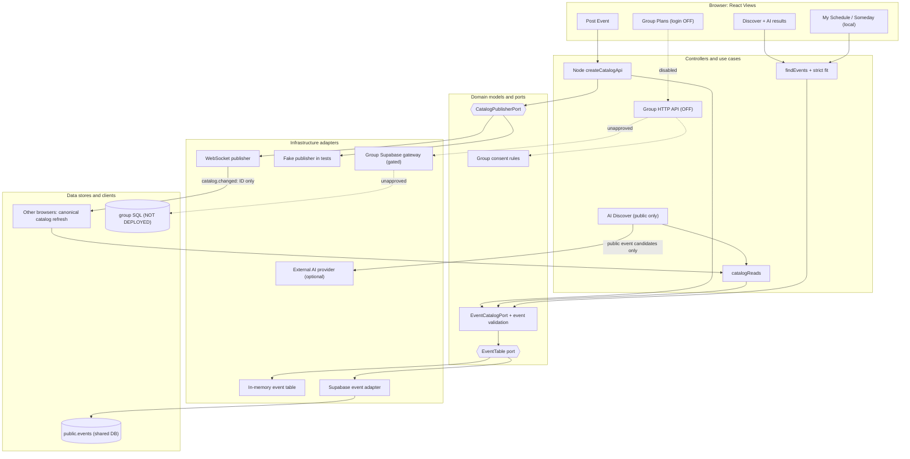

# SideQuest final architecture: as-built ports-and-adapters diagram

**Alternative architecture diagram for the final CRC requirement.** This documents the *actual draft integration* at PR #74 plus the notification-port refactor. It must be rechecked against the final commit before submission. It does not imply group SQL has been deployed.

MVC still organizes React Views, Controllers and Models. Stable ports separate the domain from event storage and realtime communication.

## Why this is a substantive improvement on MVC alone

An HTTP posting operation validates and saves through EventCatalogPort without importing Supabase-specific storage code into the controller. An in-memory adapter and a Supabase adapter implement the same storage contract. The added **CatalogPublisherPort** decouples notification delivery: WebSocket, test spy, or a no-op implementation can replace one another without changing persistence or event validation. A delivery failure does not retroactively invalidate a successful insert.

MVC separates presentation, control and data, but does not itself specify replaceable external providers, server authority or realtime transport. Ports-and-adapters makes those boundaries explicit while keeping one deployable Node/React service.

## Exact modules to show the professor

| Layer | Implemented source | Release status |
| --- | --- | --- |
| React presentation | app/src/view/DiscoverView.tsx; PostEventFields.tsx | In draft release |
| Domain and scheduling rules | app/src/model/eventCatalog.ts; fitAssessment.ts | In draft release |
| Storage port | EventCatalogPort and EventTable in eventCatalog.ts | Implemented |
| Storage adapters | app/src/model/inMemoryEventTable.ts; supabaseEventTable.ts | Implemented |
| HTTP adapter | app/server/api.ts | Implemented |
| Notification outbound port | app/src/model/catalogChanged.ts | Added by this PR |
| WebSocket publisher | app/server/catalogRealtime.ts | Integrated but not live deployed |
| AI external boundary | app/server/aiDiscover.ts | Implemented with mocked provider verification |
| Optional group boundary | app/server/groupApi.ts and supabaseGroupAccess.ts | Auth disabled and SQL not deployed |
| Personal schedule | app/src/model/schedule.ts; someday.ts | Browser-local |

**Do not represent future PlanOptions, nullable event end times, production walking paths, or group table migrations as shipped.**

## Demonstrable acceptance

1. Post through an in-memory catalog and assert the created event is retrievable.
2. Supply a fake CatalogPublisherPort and assert exactly one public ID notification *after* a successful write; none after an invalid draft.
3. Supply a publisher that fails; verify a saved event and successful HTTP response still exist.
4. In the combined WebSocket test, show two browsers on the same event catalog and an automatic authoritative refresh.
5. On an approved staging Supabase environment, repeat the provider-substitution test and record the tested commit.

The M2 reflection already has an explicitly dated November 20 architecture supplement. The professor decides whether a later supplement meets the rubric's M2 timing condition. Do not claim a retroactive submission.
