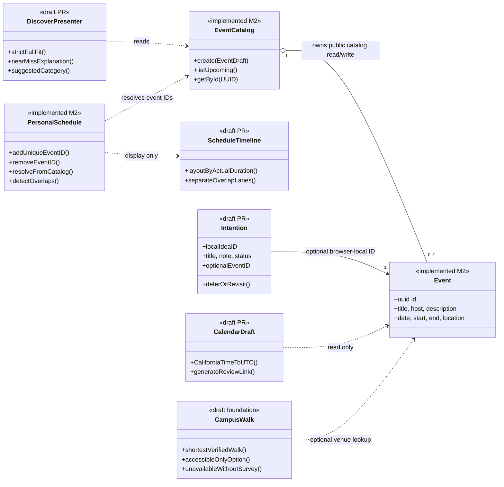
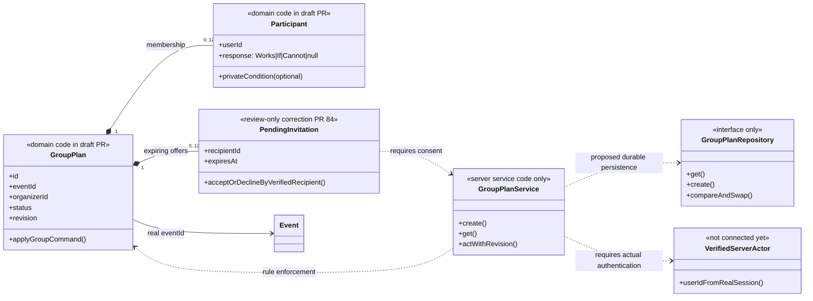

# Final-project CRC and architecture preview

[Open the two-page editable CRC drawing](FINAL_PROJECT_CRC.drawio) in [diagrams.net](https://app.diagrams.net/) (File → Open From → Device). The drawing keeps the implemented/draft distinction on every responsibility card.

## Working code contracts merged through #82 (November 23), group correction #84 proposed

`EventCatalog`, `PersonalSchedule` and the new modules are conceptual CRC roles implemented by TypeScript functions, interfaces and presenters, rather than one actual class per box. Plans, Someday, group participation and external calendar events have different meanings. Saving an item in Schedule does not RSVP. A Google Calendar link is a draft requiring user review.

## Proposed collaboration boundary, currently without real authentication

**Critical security limitation:** The gated HTTP and Auth code and review-only SQL exist; real provider sessions, deployed storage and actual cross-account authorization remain unverified. PR #84 separates pending invitations from accepted membership; the combined capacity is 12. Accepting is distinct from answering Works. A rule-engine unit test cannot establish that public collaboration is safe. [Detailed security acceptance gates](../GROUP_PLAN_SECURITY_CONTRACT.md).

**Code evidence:** `app/src/model/eventCatalog.ts`, `app/src/model/schedule.ts`, `app/src/model/someday.ts`, `app/src/model/groupPlans.ts`, `app/src/controller/presentDiscover.ts`, `app/src/controller/presentSchedule.ts`, `app/src/controller/calendarExport.ts`, `app/src/model/campusRoutes.ts`, `app/server/groupPlansService.ts`. Core final modules are merged via #82; the new consent correction remains an open review proposal.
