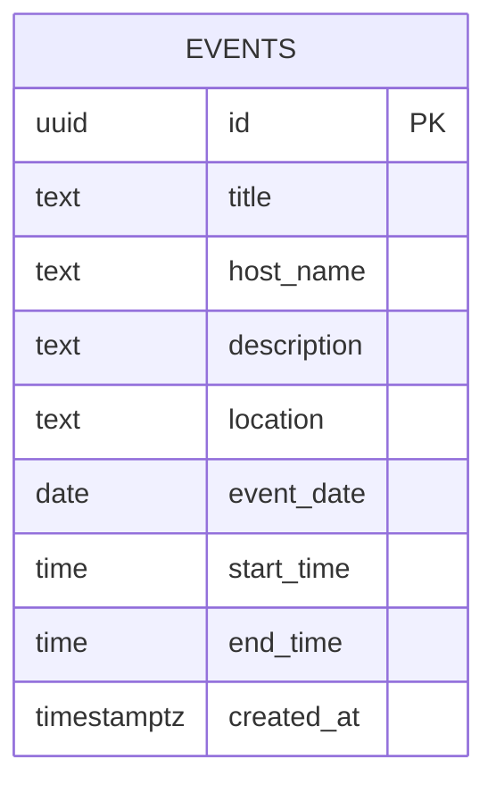
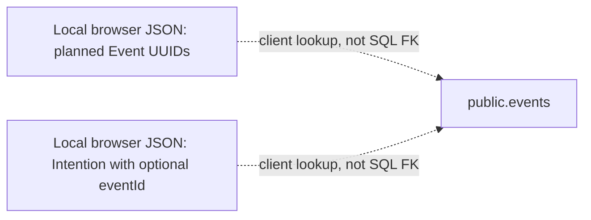
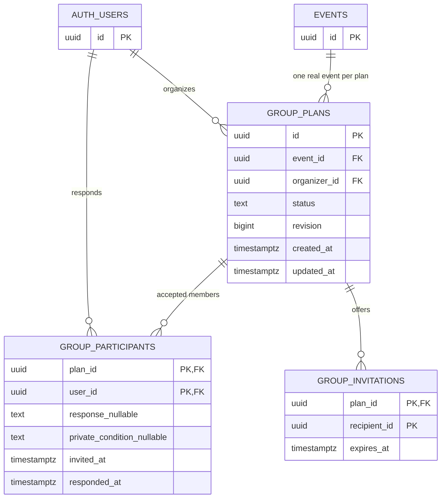

# Final-project ER diagram: current SQL versus proposed group data

[Open the two-page editable ER drawing](FINAL_PROJECT_ER.drawio) in [diagrams.net](https://app.diagrams.net/) (File → Open From → Device). The editable drawing shows Chen-style entity and attribute forms for the current implementation and explicitly marked proposed group relationships on the second page.

## Page 1: current shared SQL storage contract

The only shared table in the M2 migration is `public.events`. It is described by [the committed migration](../../supabase/migrations/20261103000000_create_events.sql). Posting stores organizer-reported `host_name`, not a verified user foreign key. The migration file's presence does not establish which schema has actually been applied to the team's production database.

Schedule UUIDs are persisted under `sidequest.planned-event-ids.v1`; Someday ideas use `sidequest.someday-intentions.v1`. Neither is a SQL entity, registered event attendance, or automatically synchronized across devices. Free-time fields are temporary search state, not `AVAILABILITY_WINDOW` SQL rows.

## Page 2: proposed future SQL design, not yet deployed

**All group SQL is proposed, not migrated.** `GROUP_INVITATIONS.recipient_id` is deliberately not an Auth foreign key: invitation creation must not check account existence. Only the verified recipient may accept; pending invitees cannot see the roster. Invitations expire after seven days. Accepted participant and organizer account FKs cascade; removing an accepted member advances revision and invalidates confirmation. `AUTH_USERS` represents a possible provider-managed identity layer, not an existing application users table. Responses begin as NULL and become Works, If or Cannot only after a specific authenticated participant submits them. Optional condition text is allowed only for If and must be restricted to its author; a group invitation cannot grant authority to impersonate a named participant.

Before adoption, agree on identities, SQL field names, unique constraints, authorization policies, revocation, concurrency guarantees, lifecycle rules, and real two-browser negative tests. [Group security contract](../GROUP_PLAN_SECURITY_CONTRACT.md).

## Diagram consistency checks

- No invented `USER`, `AVAILABILITY_WINDOW`, or attendance table in the current SQL page.
- No false SQL relationship from browser-local Schedule or Someday records to `public.events`.
- The proposed `GROUP_PLANS.event_id` references a real event; a personal intention is separately identified.
- A `GROUP_PARTICIPANTS` record is uniquely associated with one plan and one authenticated member.
- A one-to-many relationship in the target schema is not evidence that its SQL migration or live RLS is complete.
