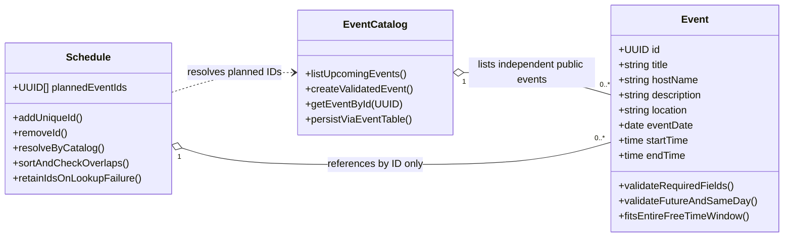

# M2 CRC diagram: GitHub preview

This page renders directly on GitHub, without the diagrams.net GitHub connector. It is a readable preview of the **implemented M2 MVP**, not a replacement for the original two-page course-format drawing.

**Meaning of relationships:** Hollow diamonds denote aggregation/reference without lifetime ownership. Deleting a local plan does not delete a public event. The dashed arrow denotes catalog lookup mediated by the shared Schedule controller. These are conceptual CRC responsibilities, implemented in TypeScript functions/types rather than three literal instantiated classes.

**Important storage distinction:** Public events use the shared catalog when configured; planned IDs are saved in browser `localStorage` under `sidequest.planned-event-ids.v1`. No SQL attendance table exists. The schedule's provisional planned-ID limit is 100.

**Original two-page course-format diagram:** [Download or view the editable M2_CRC.drawio source](M2_CRC.drawio). To edit, download it from GitHub and open [diagrams.net](https://app.diagrams.net/) using **File → Open From → Device**. The original includes the relationship rationale page and the course-style layout. [Diagram/code evidence guide](../M2_IMPLEMENTATION_DIAGRAMS.md).
