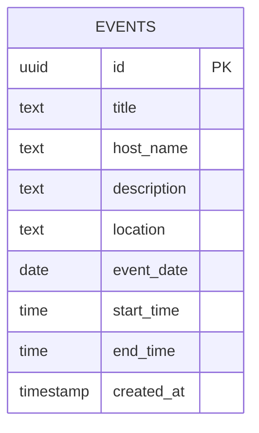

# M2 ER diagram: GitHub preview

This page renders directly on GitHub without third-party authentication. It records the implemented M2 storage model. The editable `.drawio` file retains the course's Chen-style notation.

## Shared SQL entity

`EVENTS` denotes **`public.events`**, the current application's only shared SQL table. There is no users table, enrollment table, or SQL attendance foreign key. Event hosts are self-reported display names.

## Browser-local reference (outside SQL)

The local list references event IDs but is neither a SQL entity nor a synchronized account-level schedule. A free-time search window is temporary UI input and is not a stored database entity.

**Original Chen-style drawing:** [Download or view the editable M2_STORAGE_ER.drawio source](M2_STORAGE_ER.drawio). To edit it, download from GitHub and use [diagrams.net](https://app.diagrams.net/) **File → Open From → Device**. See [diagram/code evidence guide](../M2_IMPLEMENTATION_DIAGRAMS.md) and [SQL migration](../../supabase/migrations/20261103000000_create_events.sql).
